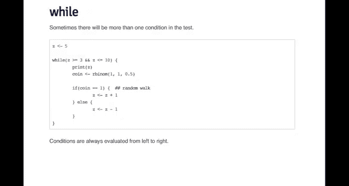

# 050：控制结构之while循环 🔄


在本节课中，我们将要学习R语言中另一种重要的循环结构——`while`循环。我们将了解它的基本语法、工作原理、使用时的注意事项，并通过示例来掌握如何在实际编程中应用它。

---

## 概述

`while`循环是R语言中除`for`循环外的另一个主要循环结构。它的核心思想是：只要给定的逻辑表达式为真（`TRUE`），就会重复执行循环体内的代码。这使得它在循环次数不预先确定，而是取决于某个动态条件时非常有用。

---

## `while`循环的基本语法

`while`循环的基本语法结构如下：
```r
while (逻辑表达式) {
  # 循环体：当逻辑表达式为TRUE时执行的代码
}
```

循环会先检查**逻辑表达式**的值。如果为`TRUE`，则执行一次循环体内的代码。执行完毕后，会再次检查逻辑表达式的值，如此反复，直到该表达式的值变为`FALSE`，循环才会停止，程序继续执行后续的代码。

上一节我们介绍了`while`循环的基本概念，本节中我们来看看一个具体的简单示例。

---

## 一个简单的`while`循环示例

以下是一个典型的`while`循环，它从0开始计数，直到数字达到10为止。

```r
count <- 0
while (count < 10) {
  print(count)
  count <- count + 1
}
```

在这个例子中：
1.  我们首先初始化一个变量`count`，并将其值设为`0`。
2.  循环条件是 `count < 10`。只要`count`的值小于10，循环就会继续。
3.  在循环体内，我们打印当前的`count`值，然后将`count`的值增加1。
4.  当`count`增加到10时，条件 `count < 10` 变为`FALSE`，循环停止。

`while`循环的一个优点是让代码意图更清晰。在这个例子中，我们可以很直观地理解“当计数小于10时持续执行”的逻辑。

---

## 使用`while`循环的注意事项

虽然`while`循环很有用，但使用时必须格外小心，以避免创建**无限循环**。

无限循环是指循环停止的条件永远无法被满足，导致循环会永远执行下去，程序无法正常结束。在R中，这通常意味着你需要手动中断程序的运行。

以下是一个可能导致无限循环的错误示例：
```r
x <- 5
while (x > 0) {
  print(x)
  # 忘记增加或减少x的值，x永远大于0，循环永不停止
}
```

因此，在编写`while`循环时，你必须确保：
*   循环体内的操作最终能影响循环条件的判断。
*   条件最终有机会变为`FALSE`。

在更复杂的代码中，有时很难一眼判断`while`循环是否会正常终止。因此，在循环次数有明确上限的情况下，使用`for`循环往往是更安全的选择。但这并不意味着你应该完全避免使用`while`循环，只是在用它时需要更加谨慎。

了解了基本用法和风险后，我们来看看如何在`while`循环中设置更复杂的条件。

---

## 在`while`循环中使用复合条件

与`if`语句类似，你可以在`while`循环的条件中使用逻辑运算符（如`&`（与）、`|`（或））来组合多个逻辑表达式。

以下是使用复合条件的一个示例，它模拟了一个在特定范围内进行的“随机游走”：

```r
z <- 5
while (z >= 3 & z <= 10) {
  print(z)
  coin <- rbinom(1, 1, 0.5) # 模拟抛一次公平硬币，结果为0或1
  if (coin == 1) {
    z <- z + 1  # 如果硬币是1，z加1
  } else {
    z <- z - 1  # 如果硬币是0，z减1
  }
}
```

在这个例子中：
*   初始值 `z` 为5。
*   循环条件是 `z >= 3 & z <= 10`，即`z`的值在3到10之间（包含3和10）时，循环继续。
*   在循环体内，程序模拟抛一次硬币。根据随机结果，`z`的值会增加或减少1。
*   循环会一直进行，直到`z`的值变得小于3或大于10，此时条件不再满足，循环停止。

这个例子比第一个例子更复杂，因为循环的终止依赖于随机数的生成，我们无法提前预知循环具体会执行多少次。这也再次提醒我们，在设计此类循环时要确保它不会运行得过久。

关于复合条件，有一个技术细节需要注意：R语言在评估像 `z >= 3 & z <= 10` 这样的复合逻辑表达式时，总是**从左到右**进行。它会先计算最左边部分（`z >= 3`）的真假。只有当这部分为`TRUE`时，才会继续计算右边的部分（`z <= 10`）。如果两者都为`TRUE`，整个条件才为`TRUE`，程序才会进入循环体执行。

---

## 总结

本节课中我们一起学习了`while`循环的核心知识：
1.  **基本语法**：`while`循环基于一个逻辑表达式，只要该表达式为`TRUE`，就重复执行循环体。
2.  **核心用途**：适用于循环次数由动态条件决定，而非固定次数的场景。
3.  **重要风险**：必须仔细设计循环条件，确保循环有机会终止，否则会导致**无限循环**。
4.  **复合条件**：可以使用逻辑运算符组合多个条件，增加循环控制的灵活性。
5.  **评估顺序**：复合条件中的表达式按从左到右的顺序进行求值。



记住，`while`循环是一个强大的工具，但“能力越大，责任越大”。在享受其灵活性的同时，务必保证循环逻辑的严谨性，让你的程序既强大又可靠。