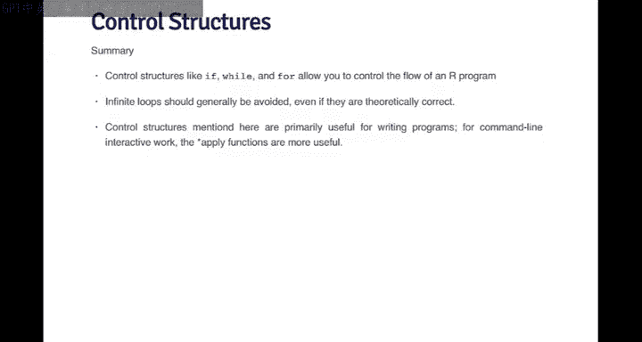

# 051：R语言控制结构 - repeat、next、break 🎯


在本节课中，我们将学习R语言中三个特殊的控制结构：`repeat`、`next`和`break`。这些结构用于控制循环的执行流程，对于编写灵活的程序逻辑至关重要。

---

## 概述

`repeat`结构用于启动一个无限循环，`next`用于跳过循环的当前迭代，而`break`用于完全退出循环。理解它们的用法和潜在风险，是编写高效、健壮R代码的重要一步。

---

## repeat循环：无限循环的起点 🔁

`repeat`是一个用于启动无限循环的构造。这不是R中常用的控制结构，但偶尔有其用途。退出`repeat`循环的唯一方法是调用`break`。显然，你必须在某个时刻调用`break`，除非你希望程序永远运行下去。

以下是一个简单的例子。这里，我将`x0`初始化为1，并将容差设置为`10^-8`。然后，我将重复执行以下结构。

```r
x0 <- 1
tol <- 1e-8

repeat {
  # 假设有一个函数计算x的新估计值
  x1 <- computeEstimate() # 此处为示例函数
  if (abs(x1 - x0) < tol) {
    break
  } else {
    x0 <- x1
  }
}
```

在这个例子中，如果新值`x1`与旧值`x0`之差的绝对值小于某个容差（这里是`10^-8`），那么我将停止循环并继续执行后续代码。如果差值大于容差，则将`x0`设置为新值，然后再次运行循环。我会计算一个新的估计值，并检查它们的差值是否很小。

这是一种常见的公式化方法。例如，在许多优化算法中，如果你试图找到某个方程组的解，或者试图最大化一个函数，你通常会反复迭代。当你计算出的估计值越来越接近时，你就会停止，因为这通常表明你正在收敛到目标函数的最小值或最大值。

理论上，这是一个完全合理的构造。你希望不断循环执行算法，直到两个值接近为止。

---

## repeat循环的潜在问题 ⚠️

然而，这里存在一个问题。首先，它需要一个保证收敛的算法，但并非每个算法都具有这种特性。其次，它在某种程度上也依赖于容差。一般来说，如果容差更小，循环将运行更长时间。

由于很难预测这个循环会运行多久，它可能有点危险，因为它是不可预测的。理论上，它可能永远运行下去，你无法保证程序会在某个时刻停止。

因此，尽管这种构造在理论上是正确的做法，但通常不是一个好主意。更好的做法可能是使用`for`循环，它对允许运行的迭代次数有硬性限制。这样，如果你的算法出现问题，它最终会达到硬性限制并停止，你会知道它停止的原因是因为没有收敛。

如果使用`repeat`方法，当你的算法不收敛时，你将没有任何警告，它只会运行很长时间。

---

## next与break：控制循环流程 ⏭️⏹️

我想讨论的最后一个控制结构元素是`next`，另外还有`return`。`next`基本上用于任何类型的循环构造中，当你想要跳过某次迭代时使用。

以下是一个基本的`for`循环，它将运行100次迭代。但我的目的是跳过前20次迭代，然后只对第21到100次迭代执行某些代码。

```r
for (i in 1:100) {
  if (i <= 20) {
    next  # 跳过本次迭代
  }
  # 执行第21到100次迭代的代码
  # ...
}
```

这里有一个非常简单的`if`条件：如果`i`小于等于20，我就跳过。我使用`next`表达式，它将跳过`for`循环中的所有其他内容，并再次迭代。一旦`i`超过20，表达式`i <= 20`将为假，因此不会执行`next`，程序将进入`for`循环的代码主体。

所以，`next`是跳过循环中某次迭代的一种方式。当然，`break`是彻底退出循环的一种方式。

`return`函数是另一个可以用来退出循环的函数，但它主要用于退出整个函数，并返回你传递给它的值。我们将在讨论函数时更多地讨论`return`，但它也是可以中断程序流程的东西。

---

## 总结与核心要点 📝

以上就是目前关于控制结构的内容。基本的总结是，像`if`、`while`和`for`这样的控制结构允许你控制R程序中的流程。

一般来说，虽然存在允许你执行无限循环的构造，但你通常需要警惕这类情况，并尽可能避免它们。即使它们在理论上是正确的，因为它们可能导致程序中出现一些不可预测的行为。

我还没有提到的另一个关键点是，这里提到的控制结构主要对编写程序有用。但对于命令行和交互式工作，我们可以使用其他类型的循环函数，它们通常名称中包含`apply`。在探索数据等命令行交互式工作中，这些函数可能更有用，尽管它们在编写程序时也非常有用。我将在另一组视频中讨论`apply`函数。

---

**本节课中，我们一起学习了：**
1.  `repeat`循环的用途与风险。
2.  使用`next`跳过循环的特定迭代。
3.  使用`break`完全退出循环。
4.  理解了在编写循环时，设定明确终止条件的重要性。



掌握这些控制结构，能帮助你更好地控制程序逻辑，编写出更清晰、更高效的R代码。