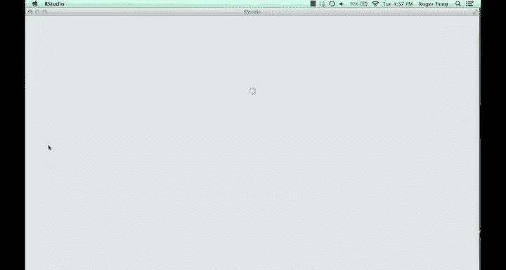
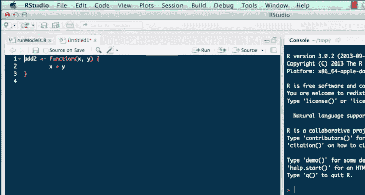
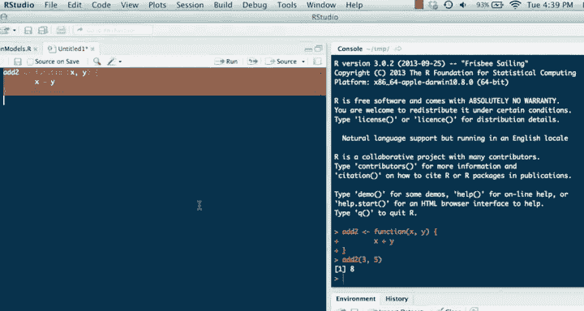
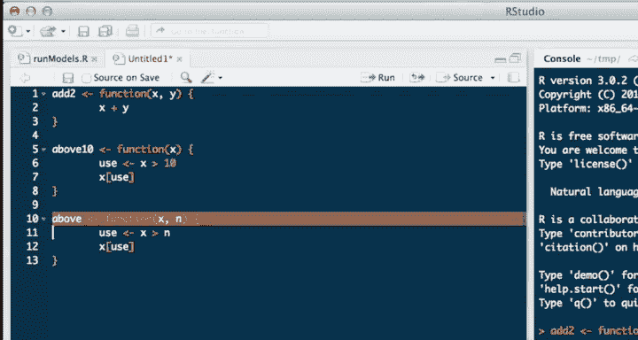
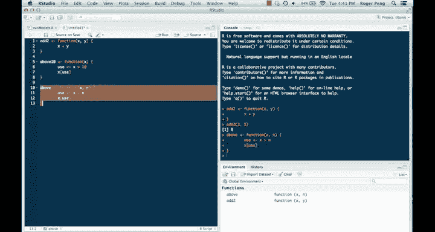
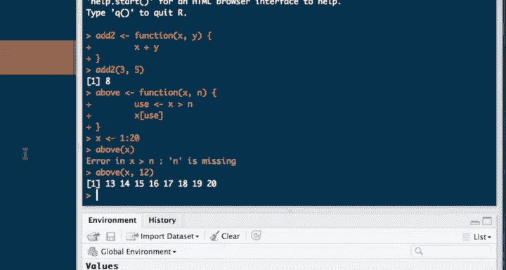
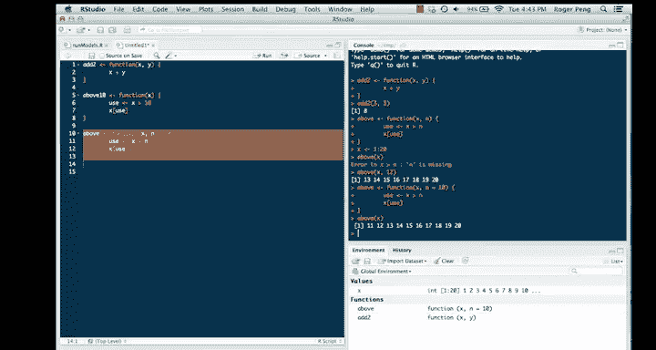
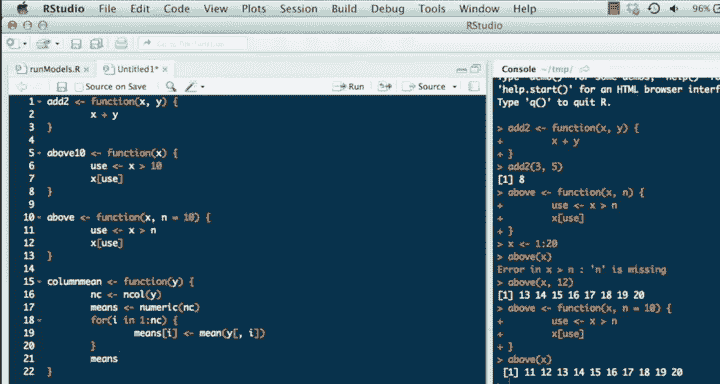
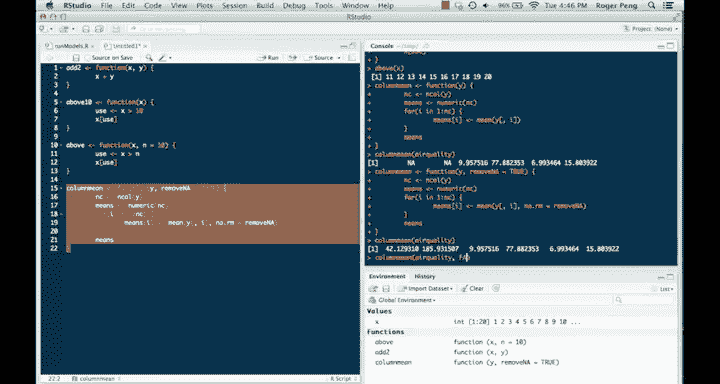

# 052：编写你的第一个R函数 🧑‍💻


在本节课中，我们将学习如何在R语言中编写函数。函数在R编程中扮演着至关重要的角色，尤其是在进行大量数据分析或统计分析时。本教程旨在帮助初学者，特别是那些对编程语言不太熟悉的同学，迈出编写R函数的第一步。

## 概述

我们将从最简单的函数开始，逐步介绍函数的基本语法、参数设置、返回值以及如何设置默认参数。通过几个具体的例子，你将学会如何创建自己的R函数。

---

## 在文本文件中编写函数



首先，我们通常将函数编写在独立的文本文件中，而不是在R的命令行中直接编写。这样做更便于管理和维护代码。未来，你还可以将函数组织成更结构化的R包。

以下是创建函数的基本步骤。

### 打开RStudio并创建脚本

首先，打开RStudio并创建一个新的R脚本文件，用于编写我们的代码。

---

## 第一个函数：两数相加 ➕

我们将从一个非常简单的函数开始：将两个数字相加。这个函数没有复杂的实际用途，但它能清晰地展示R函数的基本语法、如何指定参数以及如何返回值。



以下是创建该函数的步骤：



1.  使用 `function` 指令定义函数。
2.  为函数指定两个参数，例如 `x` 和 `y`。
3.  在函数体内，使用 `+` 运算符将两个参数相加。
4.  在R中，函数会自动返回最后一个表达式的值，因此这里无需显式使用 `return` 语句。

以下是该函数的代码：

```r
add2 <- function(x, y) {
  x + y
}
```

定义函数后，你可以在控制台中调用它。例如，输入 `add2(3, 5)`，函数将返回结果 `8`。

现在，你已经成功编写了你的第一个R函数。

---

## 第二个函数：提取向量中大于指定值的元素 🔼

接下来，我们来看一个稍微复杂一点的函数。这个函数接收一个数值向量和一个阈值，返回向量中所有大于该阈值的元素。

以下是创建该函数的步骤：

1.  定义函数 `above`，它接受两个参数：向量 `x` 和阈值 `n`。
2.  在函数体内，创建一个逻辑向量，判断 `x` 中哪些元素大于 `n`。
3.  使用这个逻辑向量对 `x` 进行子集筛选，返回符合条件的元素。





以下是该函数的代码：

```r
above <- function(x, n) {
  use <- x > n
  x[use]
}
```



调用这个函数时，你需要提供向量和阈值。例如：
```r
x <- 1:20
above(x, 12)
```
这将返回向量 `x` 中所有大于12的数字。

### 设置默认参数

如果阈值 `10` 是一个非常常用的值，我们可以为参数 `n` 设置一个默认值。这样，当用户调用函数时不指定 `n`，函数会自动使用默认值 `10`，而不会报错。

修改后的函数代码如下：



```r
above <- function(x, n = 10) {
  use <- x > n
  x[use]
}
```

现在，调用 `above(x)` 将默认返回所有大于10的元素，使函数使用起来更加方便。

---

## 第三个函数：计算数据框或矩阵的列均值 📊

现在，我们来编写一个更实用的函数：计算一个数据框或矩阵中每一列的均值。这个函数会涉及循环操作。

以下是创建该函数的步骤：

1.  定义函数 `columnmean`，它接受一个数据框或矩阵 `y` 作为参数。
2.  使用 `ncol` 函数获取 `y` 的列数。
3.  初始化一个长度等于列数的数值向量 `means`，用于存储每列的均值。
4.  使用 `for` 循环遍历每一列，计算其均值并存入 `means` 向量。
5.  函数最后返回 `means` 向量。

以下是该函数的初始代码：

```r
columnmean <- function(y) {
  nc <- ncol(y)
  means <- numeric(nc)
  for(i in 1:nc) {
    means[i] <- mean(y[, i])
  }
  means
}
```

### 处理缺失值（NA）

在计算均值时，数据中可能存在缺失值（NA）。R的 `mean` 函数有一个 `na.rm` 参数，用于指定是否在计算前移除缺失值。我们可以为我们的函数也添加这个功能。



1.  在函数参数中添加 `removeNA`，并设置默认值为 `TRUE`。
2.  在循环内部调用 `mean` 函数时，将 `removeNA` 参数的值传递给它。

修改后的函数代码如下：

```r
columnmean <- function(y, removeNA = TRUE) {
  nc <- ncol(y)
  means <- numeric(nc)
  for(i in 1:nc) {
    means[i] <- mean(y[, i], na.rm = removeNA)
  }
  means
}
```

现在，调用 `columnmean(airquality)` 会默认移除NA后计算列均值。你也可以通过 `columnmean(airquality, removeNA = FALSE)` 来保留NA的行为。

---



## 保存你的工作 💾

编写函数后，最重要的一步是保存你的R脚本文件。在RStudio中，通过“File”菜单选择“Save As...”，将文件保存为 `.R` 扩展名（例如 `my_functions.R`）。这样可以防止因意外关闭程序而丢失所有工作成果。

---

## 总结

在本节课中，我们一起学习了R函数的基础知识。我们从最简单的两数相加函数开始，逐步深入到能够处理向量筛选和计算数据框列均值的函数。我们了解了如何定义函数、设置参数和默认值，以及如何利用R自动返回最后一个表达式结果的特性。掌握这些基础是进行更复杂R编程和数据分析的关键第一步。现在，你可以尝试修改这些函数或创建自己的新函数了。