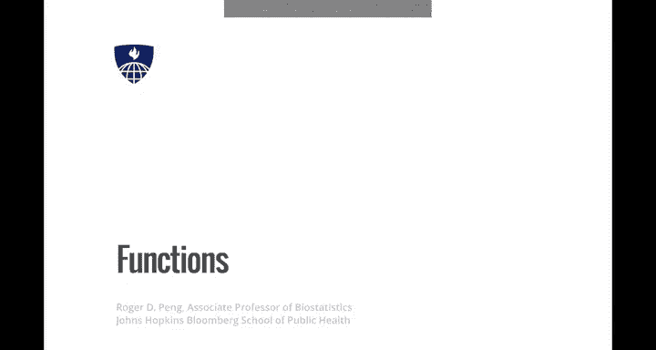
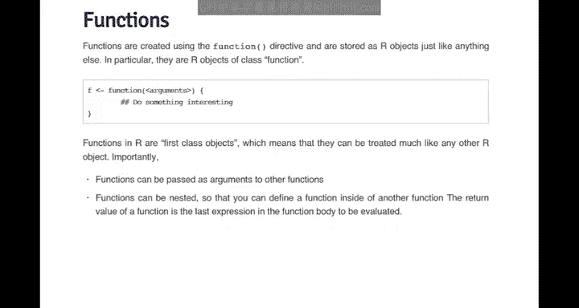
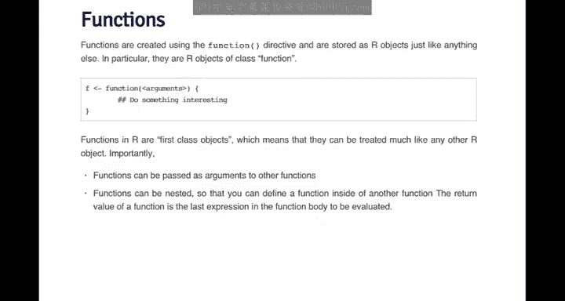
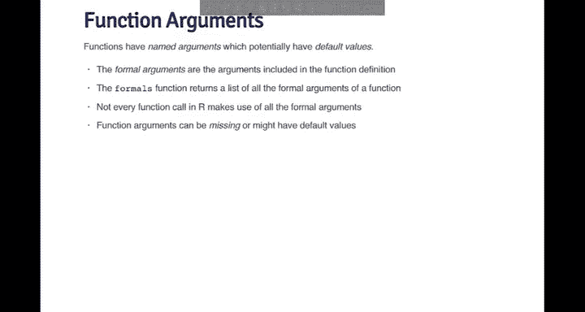
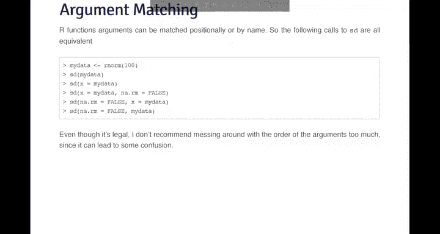
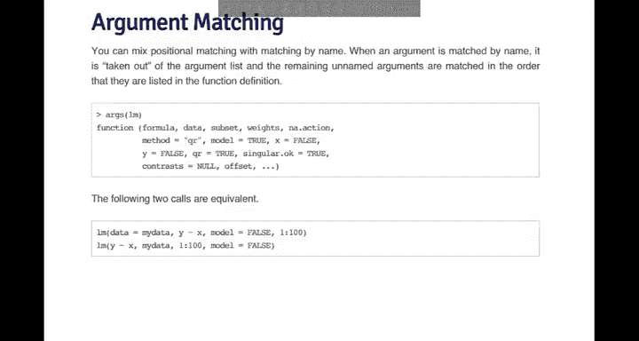
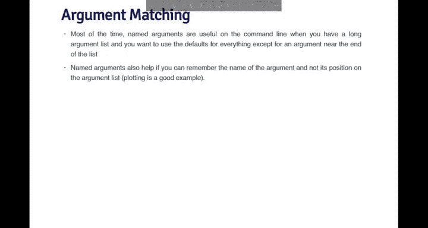
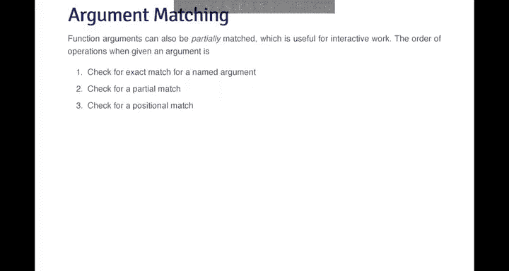
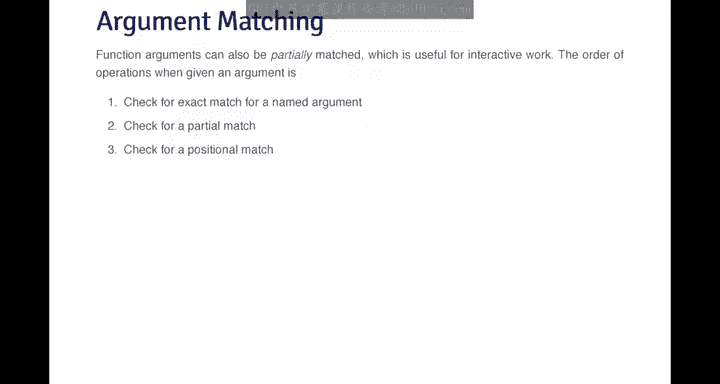

# 053：R 语言函数（第一部分）🚀


在本节课中，我们将要学习 R 语言中函数的基础知识。函数是 R 语言中最强大的特性之一，它标志着用户从单纯使用 R 转变为能够编程使用 R。基本思想是，你可以通过命令行探索数据、运行代码，但最终你可能会遇到需要执行更复杂操作的情况，这些操作无法用一两行代码表达。如果你需要反复执行这些操作，通常就需要将这种功能编码成一个函数。


本节课将分三部分介绍函数。首先，我们将介绍如何编写函数以及 R 中函数的基本写法。接着，我们会探讨词法作用域和 R 语言的作用域规则。最后，我们将以一个简单的例子结束。

## 1. 函数基础



在 R 语言中，函数使用 `function` 指令创建，并且像其他任何对象一样，函数也是以 R 对象的形式存储的。例如，你可以有整数向量、包含不同元素的列表、数据框，当然也可以有函数。具体来说，函数是一种类为 `function` 的 R 对象。

基本的函数构造如下：你将 `function` 指令赋值给某个对象（这里我称之为 `f`），该指令接收一些参数，然后在大括号 `{}` 内编写实现函数功能的代码。




```r
f <- function(argument1, argument2) {
  # 执行某些操作的代码
}
```

R 语言的一个优点是，函数被视为一等对象。这意味着你可以像对待其他 R 对象一样对待函数。重要的是，你可以将函数作为参数传递给其他函数，这在统计学中非常有用。此外，函数可以嵌套，即你可以在一个函数内部定义另一个函数。当我们讨论词法作用域时，会看到这带来的影响。

函数的返回值就是函数体中最后一个被求值的 R 表达式。虽然有一个名为 `return` 的函数可以用来返回值，但 R 中没有特殊的返回表达式。



## 2. 函数参数

函数拥有所谓的命名参数，这些参数可以具有默认值。当你设计可能被他人使用的函数时，这些特性非常有用。例如，一个函数可能有很多不同的参数，允许你调整很多细节，但大多数时候你不需要改变所有参数，可能只关心其中一两个。因此，为某些参数设置默认值就很有用。

首先，形式参数是包含在函数定义中的参数。回顾上一节的代码，形式参数就是定义在 `function()` 括号内的那些。`formals` 函数可以接受一个函数作为输入，并返回该函数所有形式参数的列表。


并非 R 中的每个函数都会用到所有形式参数。例如，如果一个函数有 10 个不同的参数，你可能不需要为所有 10 个参数都指定值。因此，函数参数可以是缺失的，或者当用户未指定时使用默认值。

R 的函数参数可以通过位置或名称进行匹配。这在编写和调用函数时都非常关键。



例如，查看计算一组数字标准差的函数 `sd`。`sd` 的输入参数 `x` 是一个数据向量，第二个参数 `na.rm` 控制是否移除数据中的缺失值，其默认值为 `FALSE`。因此，默认情况下，如果你要计算标准差的数据集中有缺失值，这些缺失值不会被包含在计算中。

以下是参数匹配的几种方式：

```r
# 模拟数据
mydata <- rnorm(100)

# 1. 位置匹配（未命名参数）
sd(mydata)

# 2. 命名参数
sd(x = mydata)
sd(x = mydata, na.rm = FALSE)

# 3. 命名参数，顺序可调
sd(na.rm = FALSE, x = mydata)

# 4. 混合匹配（命名一个，另一个按位置）
sd(na.rm = FALSE, mydata)
```

所有这些表达式都返回相同的值。当混合使用时，已命名的参数会被设定，你可以认为它从参数列表中“移除”了，然后剩余未命名的参数会按它们出现的顺序依次匹配给函数剩余的形式参数。

虽然这些表达式在功能上等价，但并非所有写法都同样推荐。例如，即使命名参数后顺序可以调整，也不建议随意颠倒参数顺序，因为这可能导致混淆。



## 3. 参数匹配的实用场景

大多数时候，命名参数在命令行中非常有用，尤其是当函数有很长的参数列表，而你只想使用默认值，仅修改列表中间或末尾的某个参数时。你通常记不清它是第几个参数，这时通过名称调用就非常方便，你无需记住参数在列表中的顺序。

这在绘图函数中尤其方便，因为许多绘图函数都有很长的参数列表，且都有默认值。你可能只想调整其中一个特定参数，这时不需要记住该参数在列表中的位置就很有用。

函数参数还可以进行部分匹配，这主要用于交互式工作，而非编程。当你调用函数时，如果参数名很长，你可以只输入名称的一部分，只要这部分能唯一匹配到一个参数，R 系统就会将该值赋给正确的参数。

参数匹配的操作顺序是：首先进行精确匹配，检查是否有参数名完全匹配；如果没有，则寻找部分匹配；如果部分匹配也不成功，则进行位置匹配。

## 4. 示例：线性模型函数 `lm`

让我们以线性模型函数 `lm` 为例，看看长参数列表的匹配是如何工作的。`lm` 函数用于将线性模型拟合到数据。

以下是 `lm` 函数参数列表的一部分：第一个是公式 `formula`，第二个是数据 `data`，然后是子集 `subset`、权重 `weights` 等。前五个参数没有默认值，用户必须指定它们。而 `method`、`model`、`x` 等参数则有默认值，如果用户不指定，就会使用这些默认值。



以下两种函数调用是等价的，展示了混合匹配：

```r
# 方式1：通过名称指定 data，其余按位置
lm(data = mydata, y ~ x, model = FALSE, 1:100)

# 方式2：更常见的调用方式，前三个按位置，后面的按名称指定
lm(y ~ x, data = mydata, subset = 1:100, model = FALSE)
```



第一种方式之所以可行，是因为 `data = mydata` 通过名称匹配，相当于从待匹配列表中“拿走”了。剩下的未命名参数 `y ~ x` 会匹配给第一个尚未匹配的参数（即 `formula`）。`model = FALSE` 也通过名称匹配并被“拿走”。最后，`1:100` 被赋给下一个尚未匹配的参数，即 `subset`。

虽然第一种方式在语法上可行，但因其容易混淆，并不推荐。更常见和清晰的是第二种调用方式。

## 总结





本节课中，我们一起学习了 R 语言函数的基础知识。我们了解到函数是使用 `function` 指令创建的一等对象，可以像其他对象一样存储和传递。我们重点探讨了函数参数的两种匹配方式：位置匹配和名称匹配，以及如何为参数设置默认值。我们还通过 `sd` 和 `lm` 函数的例子，看到了在实际中如何灵活运用这些规则来编写和调用函数，特别是在处理长参数列表时，使用命名参数可以大大提高代码的可读性和便利性。理解这些基础是后续学习更高级函数概念和词法作用域的关键。