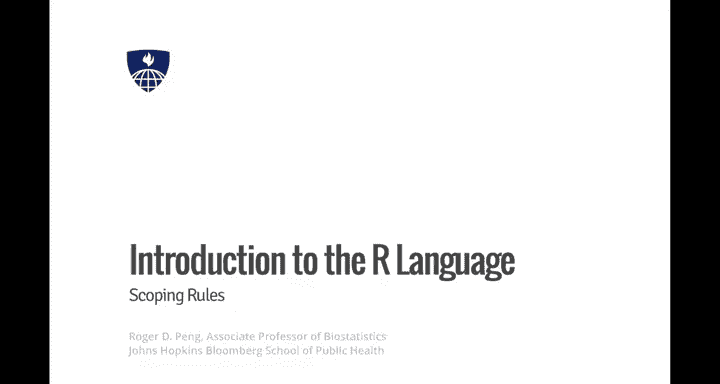
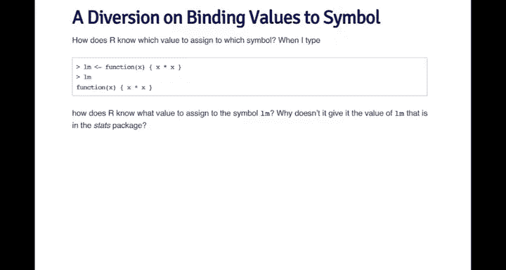
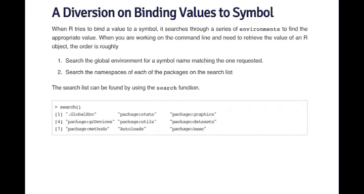
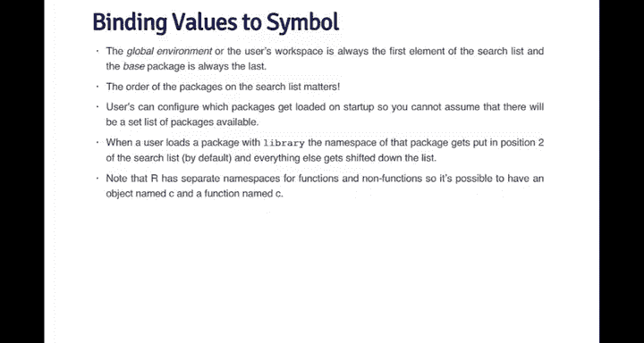
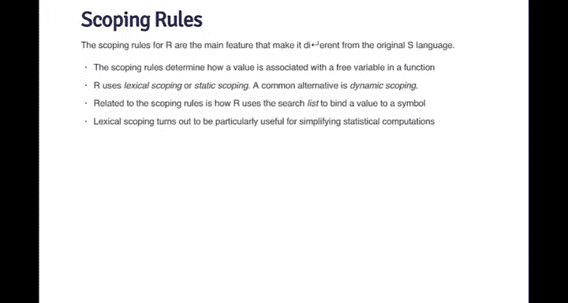
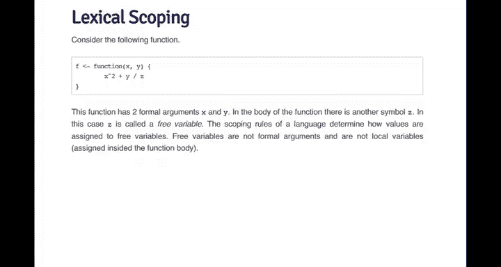
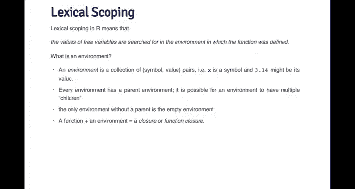
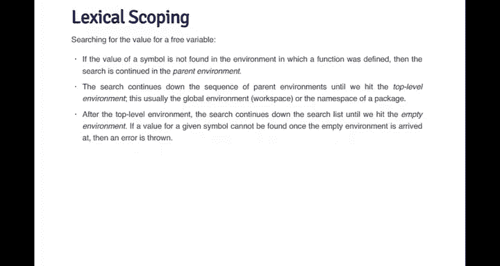

# 055：R语言作用域规则与符号绑定 🔍



在本节课中，我们将要学习R语言中一个核心概念：作用域规则。具体来说，我们将探讨当R执行一个函数时，它如何为函数体中出现的符号（例如变量名）绑定具体的值。理解这个过程对于编写和调试R代码至关重要。

---

## 符号绑定与搜索过程 🔎



在R中，当一个函数运行时，它需要为函数体中出现的每个符号找到一个具体的值。这个过程称为“符号绑定”。

例如，假设我们定义了一个名为 `lm` 的函数，它计算输入值的平方：

```r
lm <- function(x) {
  x * x
}
```

然而，R的基础包 `stats` 中已经存在一个同名的 `lm` 函数，用于拟合线性模型。那么，当我们在代码中调用 `lm` 时，R如何决定使用哪个函数呢？

R通过搜索一系列“环境”来为符号绑定值。环境可以看作是一个包含符号及其对应值的列表。

---

## 搜索列表与环境顺序 📋

当你在命令行工作并需要检索一个R对象的值时，R会遵循一个特定的搜索顺序。

以下是搜索过程的核心步骤：

1.  **首先搜索全局环境**：全局环境就是你的工作空间，包含了你定义或加载到R中的所有对象。如果在这里找到了匹配请求的符号，R就会使用该符号关联的值。

2.  **然后搜索已加载包的命名空间**：如果在全局环境中没有找到匹配的符号，R会接着搜索“搜索列表”上每个包的命名空间。搜索列表包含了当前已加载到R中的所有包。



搜索列表是有顺序的。其顺序通常是：
*   第一个元素总是**全局环境**。
*   后续元素是已加载的包，例如 `stats`、`graphics` 等。
*   最后一个元素总是**基础包**。

因此，对于 `lm` 这个符号，如果它在全局环境中被重新定义，R会优先使用全局环境中的版本。否则，它会沿着搜索列表向下查找，最终在 `stats` 包中找到用于拟合线性模型的 `lm` 函数。

---

## 包的加载与搜索列表变化 🔄

上一节我们介绍了搜索列表的默认顺序，本节中我们来看看用户操作如何改变这个列表。

全局环境始终是搜索列表的第一个元素，而基础包始终是最后一个元素。由于搜索过程是按列表顺序进行的，因此包在列表中的顺序非常重要。

用户可以通过配置决定启动时加载哪些包，并且可以随时使用 `library()` 函数加载新包。这意味着你无法假设搜索列表中的包集合或顺序在任何会话中都是固定不变的。

当用户使用 `library()` 函数加载一个包时，该包的命名空间（即包含其所有符号和值的环境）会被放置在搜索列表的**第二个位置**，紧跟在全局环境之后。原先在这个位置及之后的包都会向后顺移一位。



此外，R为函数和非函数对象设置了独立的命名空间。这意味着你可以拥有一个名为 `c` 的向量，它不会与同名的、用于连接对象的 `c()` 函数发生冲突。

---

## 词法作用域规则 📖

上述搜索机制引出了R的“作用域规则”，这是R与原始S语言的主要区别之一。作用域规则决定了如何为函数中的“自由变量”绑定值。

在函数中，变量主要分为两类：
*   **形式参数**：在函数定义头部声明的变量。
*   **自由变量**：在函数体中使用，但未在函数定义头部声明的变量。

考虑以下函数：
```r
f <- function(x, y) {
  x^2 + y / z
}
```
在这个函数中，`x` 和 `y` 是形式参数，而 `z` 就是一个自由变量。那么，R应该为 `z` 赋予什么值呢？

R采用**词法作用域**（也称为静态作用域）规则。其核心原则可以总结为：

> **自由变量的值，在定义该函数的环境中搜索。**

---





## 环境与函数闭包 🧩

为了理解词法作用域，我们需要先理解“环境”这个概念。

环境是**符号-值对**的集合。例如，符号 `x` 可能对应值 `3.14`，符号 `y` 可能对应一个数据框。R中的所有对象都可以看作是符号和值的配对。

每个环境都有一个**父环境**（除了唯一的“空环境”没有父环境）。这种结构形成了环境的层次体系。例如：
*   **全局环境**是你的工作空间，它是一个环境。
*   每个**包的命名空间**也是一个环境。

当一个函数与它被定义时所在的环境关联起来时，就形成了一个**函数闭包**。闭包是R中实现许多高级功能的关键。

---

## 自由变量的搜索路径 🛤️

现在，让我们将以上概念串联起来，看看当函数中遇到一个自由变量时，R的具体搜索路径是什么。

搜索遵循以下步骤：



1.  **首先，在定义该函数的环境中查找**。例如，如果一个函数在全局环境中定义，那么首先就在全局环境中搜索自由变量。

2.  **如果未找到，则向父环境回溯**。如果在当前环境中找不到，则去其父环境中查找。

3.  **沿环境链向上，直至顶层环境**。搜索会沿着父环境链不断向上，直到达“顶层环境”。对于在全局环境定义的函数，顶层环境就是全局环境本身；对于在包中定义的函数，顶层环境通常是该包的命名空间。

4.  **若仍未找到，则沿搜索列表向下查找**。一旦到达顶层环境还未找到，搜索就会“跳出”当前的环境链，转而沿着我们之前讨论的**搜索列表**继续向下查找（从顶层环境在搜索列表中的位置开始）。

5.  **最终抵达空环境**。搜索会一直进行，直到查找到搜索列表的末尾（基础包之后），即**空环境**。

6.  **抛出错误**。如果在经历了所有环境和搜索列表后，直到空环境仍未找到该符号，R就会抛出一个错误，提示找不到该对象。

---

## 总结 📝

本节课中我们一起学习了R语言的作用域规则与符号绑定机制。我们了解到：

1.  R通过**搜索列表**来为符号绑定值，搜索顺序从全局环境开始，到已加载的包，最后是基础包。
2.  用户加载包会改变搜索列表的顺序，新包会插入到全局环境之后。
3.  R采用**词法作用域**规则，其核心是：自由变量在其**函数被定义的环境中**进行查找。
4.  搜索自由变量时，R会先在定义环境及其父环境链中查找，然后根据需要跳转到搜索列表中继续查找。
5.  理解**环境**（符号-值对的集合）和**函数闭包**（函数与其定义环境的关联）是掌握作用域的关键。



掌握这些规则有助于你理解R代码的行为，预测变量如何被解析，并能在编写函数（尤其是使用闭包的高级函数编程）时避免常见的错误。