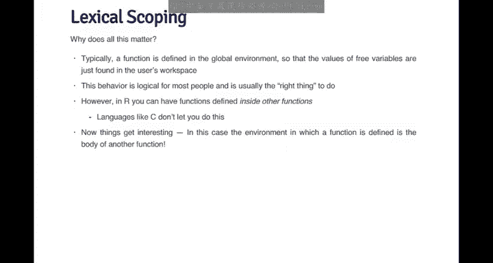
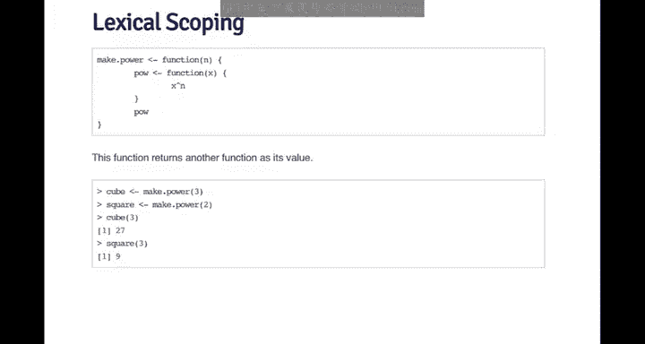
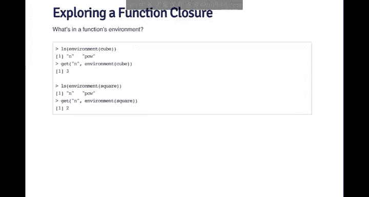
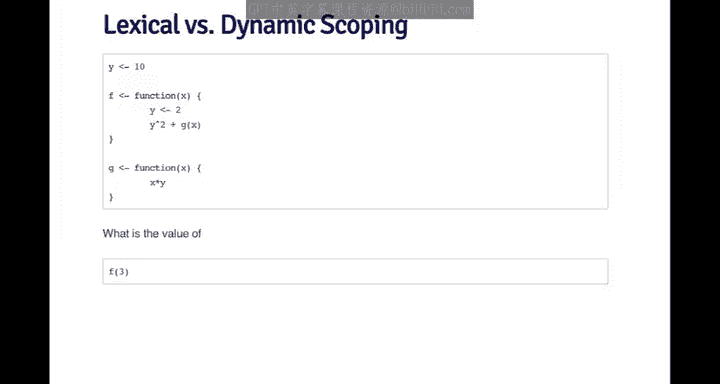
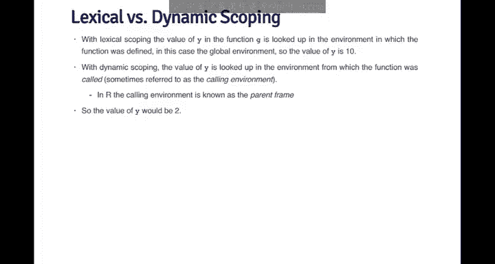
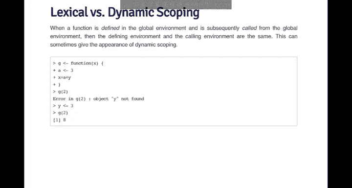
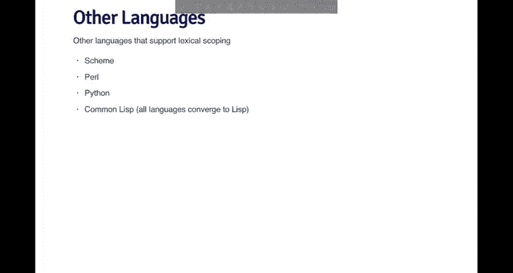
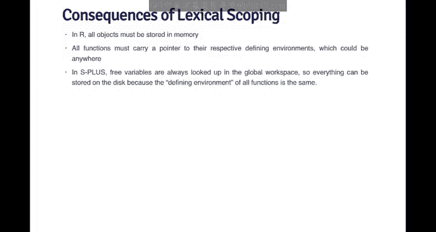

# 056：R语言作用域规则详解 🧭

在本节课中，我们将要学习R语言中一个核心且强大的概念——作用域规则。理解作用域规则对于编写高效、可预测的函数至关重要，尤其是在处理函数嵌套和闭包时。

---

## 概述

R语言采用**词法作用域**规则。这意味着函数在定义时，其自由变量的值由定义该函数的环境决定，而非调用它的环境。这与动态作用域形成对比。本节将深入探讨词法作用域的原理、应用及其影响。

---

## 全局环境与函数定义

通常情况下，函数在全局环境中定义。此时，函数内部的自由变量会在用户的全局工作空间中寻找其值。这是大多数用户预期的行为：如果在函数内部找不到某个变量的值，就向上一级（全局环境）查找。

这种机制允许你定义一些**全局变量**，这些变量可以被工作空间中定义的多个不同函数共用。



---

## 函数嵌套与闭包

然而，R语言的关键特性在于，你可以在一个函数内部定义另一个函数。例如，一个函数可以返回另一个函数作为其结果。

在大多数情况下，函数返回列表、向量、矩阵或数据框等。但当函数返回另一个函数时，情况就变得有趣了。此时，被返回的函数是在另一个函数内部定义的，因此它的定义环境不再是全局环境，而是那个外层函数的内部环境。这正是作用域规则开始产生重要影响的时候。

为了说明这一点，我们来看一个构造器函数的例子。

以下是构造器函数 `make.power` 的代码示例：

```r
make.power <- function(n) {
  power <- function(x) {
    x ^ n
  }
  return(power)
}
```

`make.power` 函数接收一个参数 `n`。在其内部，它定义了另一个函数 `power`，该函数接收参数 `x` 并计算 `x^n`。最后，`make.power` 将 `power` 函数作为结果返回。

在 `power` 函数内部，`x` 是形式参数，没有问题。但 `n` 是一个自由变量，因为它不是在 `power` 内部定义的。然而，`n` 定义在 `make.power` 函数内部。由于 `power` 是在 `make.power` 的环境中定义的，`power` 函数会在这个环境中找到 `n` 的值。

现在，我们可以这样使用它：

```r
cube <- make.power(3) # 创建一个计算立方的函数
square <- make.power(2) # 创建一个计算平方的函数

cube(3) # 返回 27 (3^3)
square(3) # 返回 9 (3^2)
```



通过这种方式，一个函数（`make.power`）能够构造出许多具有不同功能（计算不同次幂）的函数。

---

## 探索函数环境

你如何知道一个函数的环境里有什么呢？可以通过 `ls` 函数来查看函数定义环境中的对象。

以下是查看函数环境的代码示例：



```r
# 查看 cube 函数的环境
ls(environment(cube))
# 输出: [1] "n"

# 获取环境中的 n 的值
get("n", environment(cube))
# 输出: [1] 3

# 查看 square 函数的环境
get("n", environment(square))
# 输出: [1] 2
```

对于 `cube` 函数，其环境中有一个对象 `n`，值为 3。这就是 `cube` 函数知道要将参数计算为三次方的“记忆”来源。同样，`square` 函数的环境中也存储了 `n=2`。这个存储了自由变量值的环境被称为函数的**闭包**。

---

## 词法作用域 vs. 动态作用域



为了更清晰地理解R的词法作用域，我们将其与动态作用域进行简要比较。

考虑以下代码：

```r
y <- 10

f <- function(x) {
  y <- 2
  y^2 + g(x)
}

g <- function(x) {
  x * y
}
```



在函数 `f` 中，`y` 和 `g` 都是自由变量。在函数 `g` 中，`y` 也是自由变量。那么，调用 `f(3)` 会返回什么结果呢？

*   **在词法作用域（R的规则）下**：函数 `g` 中 `y` 的值，会在定义 `g` 的环境中查找，即全局环境。因此，`g` 中的 `y` 值为 10。计算过程为：`f(3)` -> `2^2 + g(3)` -> `4 + (3 * 10)` -> `34`。
*   **在动态作用域下**：函数 `g` 中 `y` 的值，会在调用 `g` 的环境中查找（在R中称为父框架）。此时，调用环境是 `f` 的内部，其中 `y` 被赋值为 2。因此，`g` 中的 `y` 值为 2。计算过程为：`f(3)` -> `2^2 + g(3)` -> `4 + (3 * 2)` -> `10`。

可以看到，使用不同的作用域规则，同一个函数调用会产生不同的结果。

---

## 全局环境下的特殊情况

有一种情况会让词法作用域和动态作用域看起来效果相同：当一个函数在全局环境中定义，并且随后也从全局环境调用时，其定义环境和调用环境是完全相同的。

这有时会给人一种存在动态作用域的错觉，即使实际上并没有。请看下面的例子：


```r
g <- function(x) {
  a <- 3
  x + a + y
}

g(2) # 报错：找不到对象 'y'



y <- 3
g(2) # 返回 8
```

第一次调用 `g(2)` 时，函数 `g` 在全局环境中寻找自由变量 `y`，但 `y` 尚未定义，因此报错。当我们定义了 `y <- 3` 后再次调用，它就能成功找到 `y` 并计算结果。

虽然看起来 `y` 的值是在调用时被查找到的，但实际上它仍然是在定义环境（全局环境）中被找到的，只是因为定义环境和调用环境恰好重合了。



---

## 词法作用域的应用与影响

词法作用域并非R语言独有的特性。许多其他编程语言也支持它，例如Scheme、Perl、Python和Common Lisp等。有一个著名的计算机科学观点认为，所有语言最终都会向Lisp的特性靠拢，因此词法作用域是一种非常常见且重要的语言特性。

在R语言中，词法作用域带来了两个主要影响：

1.  **所有对象必须存储在内存中**：由于作用域规则的复杂性，以及各种环境相互链接的方式，很难在物理内存之外实现这种模型。因此，在R最初设计时，所有数据都存储在内存中。这在处理现代超大型数据集时带来了挑战。
2.  **每个函数都必须携带指向其定义环境的指针**：这个定义环境可能在任何地方（由于函数嵌套），因此需要额外的指针来关联内存中的环境位置，这使得R的对象模型比一些其他语言（如早期的S-PLUS）更为复杂，但也因此更加强大和灵活。

在S-PLUS（S语言的早期实现）中，自由变量总是在全局工作空间中查找，因此所有函数的定义环境都是相同的，理论上数据可以存储在磁盘上。而R的词法作用域模型为实现更高级的编程范式（如函数工厂、闭包）提供了基础。

---

## 总结


本节课我们一起深入学习了R语言的词法作用域规则。我们了解到：

*   R采用**词法作用域**，函数依据其**定义时**的环境来解析自由变量。
*   通过**函数嵌套**和**闭包**，我们可以创建能“记住”特定状态的函数（如 `make.power` 的例子）。
*   词法作用域与动态作用域的关键区别在于变量查找的**环境**不同（定义环境 vs. 调用环境）。
*   虽然词法作用域要求更多的内存管理和更复杂的内部模型，但它为R提供了强大的函数式编程能力。



理解这些规则是编写高级、模块化且可维护的R代码的关键一步。