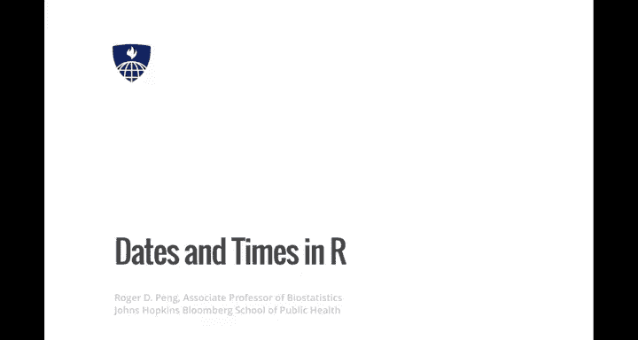
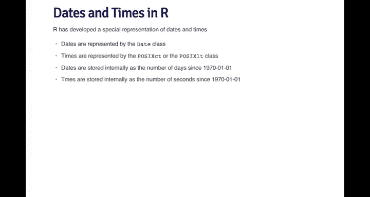
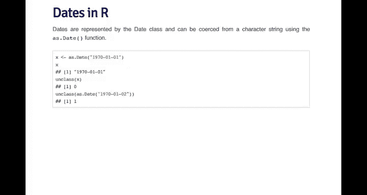
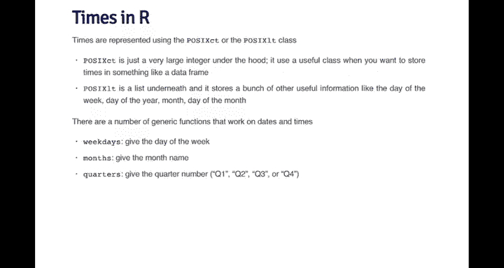
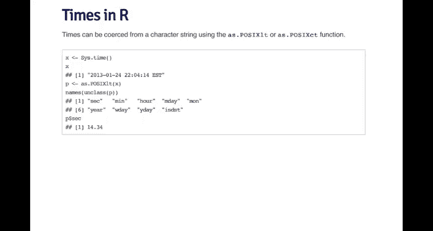
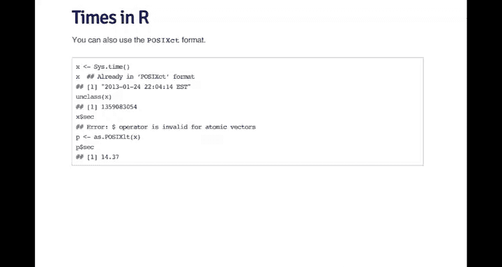
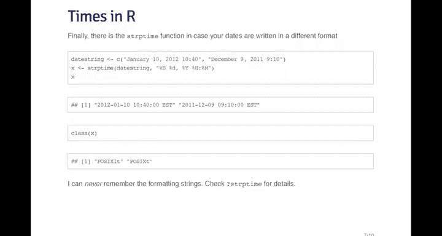
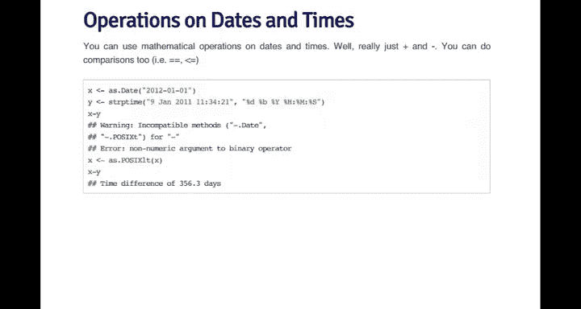
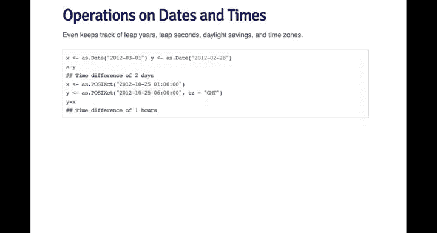
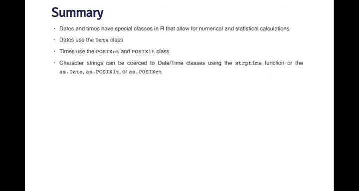

# 059：R语言中的日期与时间处理 📅⏰



在本节课中，我们将学习R语言中日期与时间的基本概念、表示方法以及如何进行简单的计算和转换。日期和时间是数据分析中常见的数据类型，R提供了专门的类来处理它们，使得相关操作更加便捷和准确。

---

## R中日期与时间的表示方式

上一节我们介绍了R中的基本数据类型，本节中我们来看看日期和时间是如何在R中表示的。R使用特殊的类来表示日期和时间，这不同于我们之前讨论过的列表、字符向量和数值向量等类型。

*   日期由 **`Date`** 类表示。
*   时间由两个独立的类表示：**`POSIXct`** 和 **`POSIXlt`**。

日期本质上不附带时间信息，它表示某年某月中的某一天，可以理解为“年-月-日”的格式。例如，日期 `1970-01-01` 表示1970年1月1日。

在内部，日期存储为自 `1970-01-01` 起的天数。这个细节通常不重要，但有助于理解R如何进行日期计算。时间在内部存储为自 `1970-01-01` 起的秒数，这同样是一个底层细节，但有时了解它会很有用。



---

## 创建与转换日期对象

以下是创建和转换日期对象的常用方法。

最常见的方式是使用 `as.Date()` 函数将字符字符串转换为日期。例如，字符串 `"1970-01-01"` 可以被转换。

```r
x <- as.Date("1970-01-01")
print(x)
# 输出：[1] "1970-01-01"
```



打印出来的对象看起来像字符串，但它实际上是一个 `Date` 类对象，因为有特殊的打印方法。如果使用 `unclass()` 函数查看其内部表示，会得到数字 `0`，因为这是自基准日期（1970-01-01）起0天的日期。

```r
unclass(x)
# 输出：[1] 0
```

如果输入 `1970-01-02`，其内部表示将是数字 `1`。早于1970年的日期则用负数表示。用户通常无需担心底层表示，只需知道日期是 `Date` 类的对象即可。

---

## 时间类：POSIXct 与 POSIXlt

时间可以用两种类型表示。`POSIX` 是一套关于计算机如何表示数据的标准家族，`POSIXct` 和 `POSIXlt` 是其中用于表示时间的类。

*   **`POSIXct`** 类将时间存储为非常大的整数。这种类型便于在数据框等结构中存储时间，因为它本质上是一个大整数向量。
*   **`POSIXlt`** 类将时间底层存储为一个列表。它存储了关于给定时间的许多有用信息，例如星期几、一年中的第几天、月份等。




有一些通用函数可以操作日期和时间对象，例如：
*   `weekdays()`：返回给定日期是星期几。
*   `months()`：返回给定日期的月份。
*   `quarters()`：返回季度（如Q1代表1-3月）。

这些函数可以用于 `POSIXct`、`POSIXlt` 或 `Date` 类的对象。

---

## 时间对象的操作与提取

可以使用 `as.POSIXlt()` 或 `as.POSIXct()` 函数在 `POSIXlt` 和 `POSIXct` 类型之间进行转换。

`Sys.time()` 函数可以获取系统当前时间，它返回一个 `POSIXct` 对象。



```r
t <- Sys.time()
print(t)
# 输出格式类似：[1] "2023-01-23 10:15:11 EST"
```

可以将其转换为 `POSIXlt` 对象，因为 `POSIXlt` 底层是列表，所以可以提取列表中的元素。

```r
p <- as.POSIXlt(t)
names(unclass(p))
# 输出包含：sec, min, hour, mday, mon, year, wday, yday, isdst
```



例如，提取秒数：
```r
p$sec
# 输出：[1] 11.86
```

对于 `POSIXct` 对象，不能直接使用 `$` 操作符提取列表元素。必须先将其转换为 `POSIXlt` 对象。

```r
t_ct <- as.POSIXct(t)
# t_ct$sec  # 这会报错
as.POSIXlt(t_ct)$sec # 正确方式
```

---

## 使用 strptime 解析字符串

`strptime()` 函数可以将特定格式的字符字符串转换为日期或时间对象（通常是时间对象）。它使用**格式字符串**来指定输入字符串的样式。

例如，有以下字符串：
```r
x <- c("January 10, 2012 10:40", "December 9, 2012 9:10")
```

使用 `strptime()` 进行转换：
```r
y <- strptime(x, "%B %d, %Y %H:%M")
print(y)
```

格式字符串中的符号含义如下（更多信息请查阅 `?strptime` 帮助页）：
*   `%B`：非缩写月份名称。
*   `%d`：月份中的天数。
*   `%Y`：四位数的年份。
*   `%H`：小时（24小时制）。
*   `%M`：分钟。



转换后，`y` 是一个 `POSIXlt` 类对象。

---

## 日期与时间的运算

一旦数据是日期或时间格式，就可以对它们进行操作，这非常方便。例如，可以加减日期、比较日期。



需要注意的是，不能随意混合不同的类进行运算。例如，一个 `Date` 对象和一个 `POSIXlt` 对象相减会报错。

```r
x <- as.Date("2012-01-01")
y <- as.POSIXlt("2012-01-02 10:00:00")
# x - y  # 错误
as.POSIXlt(x) - y # 正确，先转换类型
```

日期和时间操作符的优点在于，它们能自动处理一些复杂情况，例如闰年、闰秒、夏令时和时区。

*   **闰年示例**：2012年是闰年，有2月29日。因此 `2012-03-01` 与 `2012-02-28` 相差2天，而非平年的1天。
*   **时区示例**：比较两个不同时区的时间，系统会自动计算时区差，得出正确的时间间隔。

使用日期时间类可以自动处理这些不规则情况。



---

## 总结与拓展

本节课中我们一起学习了R语言中日期与时间处理的核心知识。

总结如下：
1.  R有特殊的类来表示日期和时间，以便进行数值和统计计算。
2.  日期使用 **`Date`** 类。
3.  时间使用 **`POSIXct`** 或 **`POSIXlt`** 类。
4.  可以使用 `strptime()`、`as.Date()`、`as.POSIXlt()` 和 `as.POSIXct()` 函数将字符串强制转换为日期或时间类。
5.  日期时间对象支持算术和比较运算，并能自动处理闰年、时区等复杂情况。



此外，许多绘图函数能够识别日期时间对象。当绘制此类对象时，R会自动以特殊方式格式化坐标轴（尤其是X轴），使其具有时间刻度特性。建议尝试使用日期时间类进行绘图，观察图形的变化。