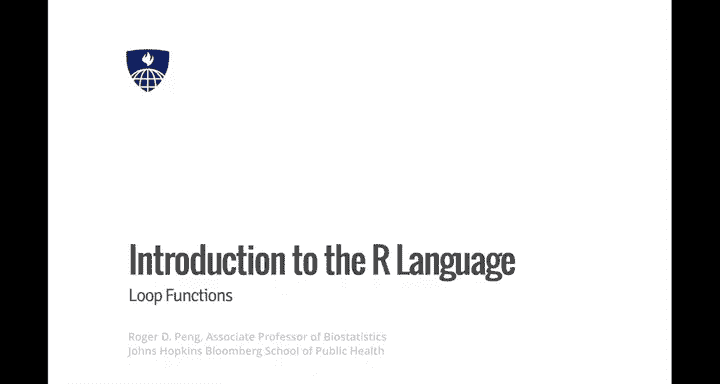
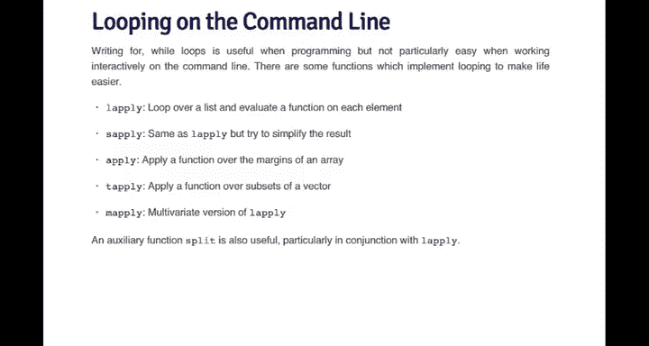
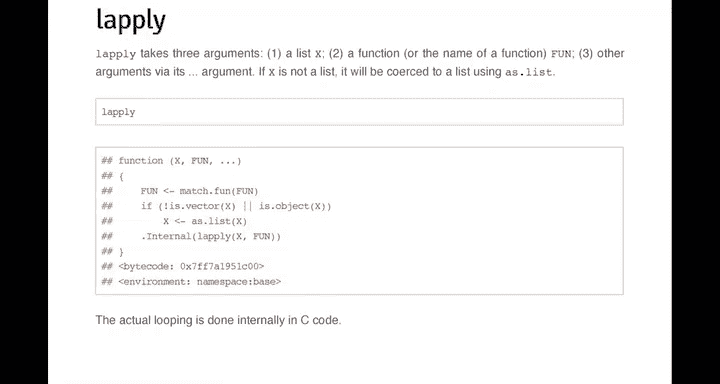
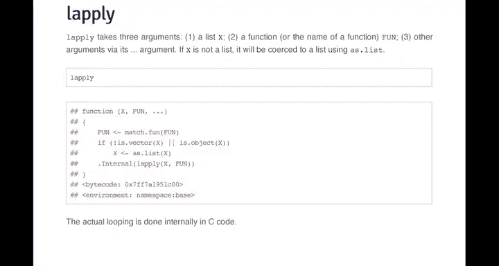
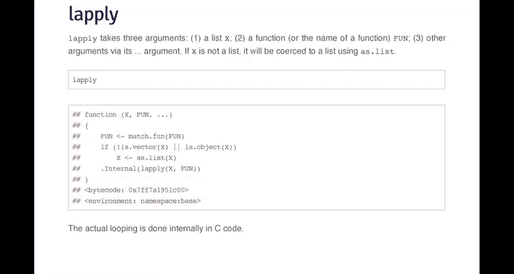
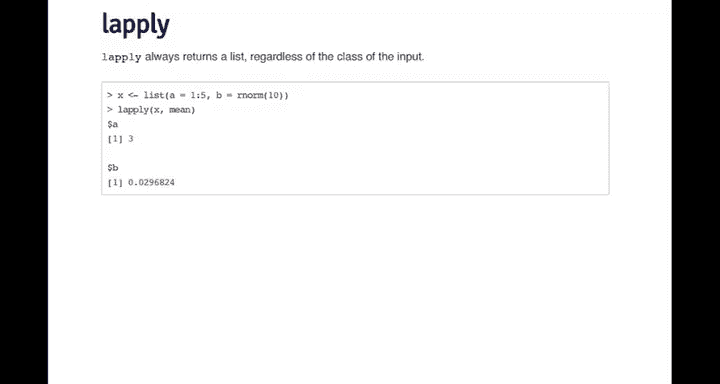
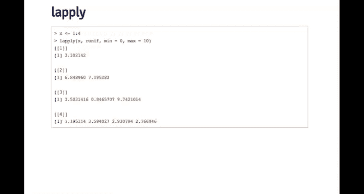
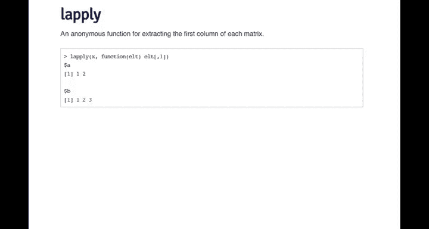
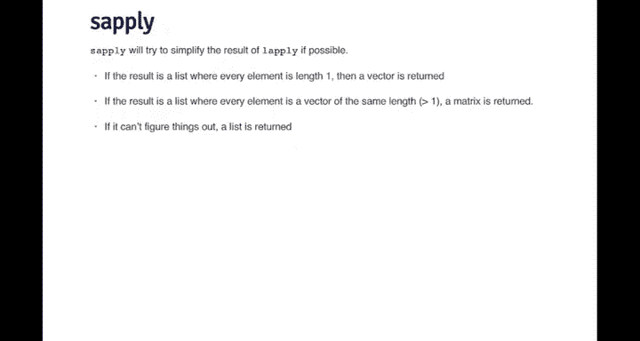
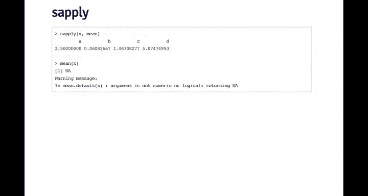

# 060：循环函数 lapply 🌀

在本节课中，我们将学习 R 语言中一些最强大的函数——循环函数。它们能让我们在交互式环境中，以极少的代码量高效地对一组对象执行循环操作。



上一节我们介绍了循环的基本概念，本节中我们来看看 R 中一组名为 `apply` 的函数族，它们能以更紧凑的方式实现循环功能。

## 核心循环函数介绍

R 中有几个关键的循环函数，它们的名字中通常都包含 `apply`。

以下是主要的几个函数及其简要说明：
*   **`lapply`**：核心函数。对一个列表的每个元素应用指定函数，并返回一个列表。
*   **`sapply`**：`lapply` 的简化版本。尝试简化 `lapply` 的输出结果（例如，将单值列表简化为向量）。
*   **`apply`**：对数组（如矩阵）的特定维度（行或列）应用函数。
*   **`tapply`**：对向量的子集应用函数。
*   **`mapply`**：`lapply` 的多变量版本。



此外，还有一个非常有用的辅助函数：
*   **`split`**：将对象分割成子集。它本身不应用函数，但常与 `lapply` 或 `sapply` 结合使用。

接下来，我们将深入探讨 `lapply` 函数的工作原理。

## 深入理解 `lapply` 函数







`lapply` 函数是循环函数族中的主力。它的核心思想是：你有一个对象列表，希望遍历这个列表，并对列表中的每个元素应用一个函数。

`lapply` 函数接受三个基本参数：
1.  **`x`**：一个列表。
2.  **`FUN`**：要应用的函数（或函数名）。
3.  **`...`**：传递给函数 `FUN` 的其他参数。

如果 `x` 不是列表，`lapply` 会尝试将其强制转换为列表。如果无法转换，则会报错。

`lapply` 的工作流程可以用以下伪代码描述：
```r
lapply(x, FUN, ...) 的简化过程：
1.  如果 x 不是列表，则尝试 as.list(x)。
2.  对列表 x 中的每个元素 i，计算 FUN(x[[i]], ...)。
3.  将所有结果收集到一个新列表中并返回。
```

关键点在于：**`lapply` 总是返回一个列表**。输入的对象会被强制转换为列表，而输出则一定是一个列表。



## `lapply` 基础用法示例

让我们通过几个例子来理解 `lapply` 的用法。

**示例 1：计算列表中元素的均值**

首先，我们创建一个包含两个元素的列表：
```r
x <- list(a = 1:5, b = rnorm(10))
```
现在，我们使用 `lapply` 计算列表中每个元素的均值：
```r
lapply(x, mean)
```
执行后，我们将得到一个包含两个元素的新列表，其名称与原列表相同（`a` 和 `b`），但每个元素的值是原向量计算出的均值。

**示例 2：生成不同长度的随机数**

在这个例子中，我们创建一个序列 `1:4`，并对每个元素应用 `runif` 函数（生成均匀分布随机数）：
```r
x <- 1:4
lapply(x, runif)
```
`runif(n)` 生成 `n` 个随机数。因此，这个调用会返回一个列表，其中第一个元素是长度为1的随机向量，第二个是长度为2的向量，依此类推。



**示例 3：向函数传递额外参数**

假设我们想生成介于 0 和 10 之间的均匀随机数，而不是默认的 0 到 1。我们可以通过 `...` 参数将 `min` 和 `max` 参数传递给 `runif` 函数：
```r
lapply(x, runif, min = 0, max = 10)
```
这样，生成的随机数就都在 0 到 10 的范围内了。

## 匿名函数在 `lapply` 中的应用

`lapply` 及相关函数大量使用**匿名函数**。匿名函数是没有名称的函数，可以直接在调用时定义。

假设我们有一个包含两个矩阵的列表：
```r
x <- list(a = matrix(1:4, 2, 2), b = matrix(1:6, 3, 2))
```
我们想提取每个矩阵的第一列。虽然没有现成的函数直接做这件事，但我们可以用匿名函数轻松实现：
```r
lapply(x, function(elt) elt[, 1])
```
这里，`function(elt) elt[, 1]` 就是一个匿名函数，它接受一个参数 `elt`（即列表中的每个矩阵），并返回该矩阵的第一列。这个函数仅在 `lapply` 调用期间存在。

## `sapply`：简化 `lapply` 的结果



`lapply` 总是返回列表，但有时我们希望得到更简单的数据结构，比如向量或矩阵。`sapply` 函数就是为此设计的，它会尝试简化 `lapply` 的输出。

回顾之前计算均值的例子，`lapply` 返回了一个每个元素都是单个数字的列表。使用 `sapply` 可以将其简化为一个向量：
```r
x <- list(a = 1:5, b = rnorm(10), c = rnorm(20, 1), d = rnorm(100, 5))
sapply(x, mean)
```
如果结果列表中每个元素的长度相同（例如都是长度为5的向量），`sapply` 可能会将其简化为一个矩阵。如果无法简化，`sapply` 将退回到返回一个列表。

**请注意**：直接对列表调用 `mean` 函数（如 `mean(x)`）是无效的，会返回 `NA` 并产生警告，因为 `mean` 函数并非设计用于处理列表。



## 总结

本节课中我们一起学习了 R 语言中强大的循环函数，重点是 `lapply` 和 `sapply`。
*   **`lapply`** 是基础，它对列表的每个元素应用函数，并总是返回一个列表。
*   **`sapply`** 是 `lapply` 的友好版本，它会尝试将输出简化为向量或矩阵，使结果更易于处理。
*   我们可以通过 `...` 参数向被应用的函数传递额外的参数。
*   **匿名函数**允许我们在调用 `lapply` 时快速定义简单的操作，而无需预先定义命名函数。



掌握这些循环函数能极大地提高编码效率，让你用更简洁的代码完成复杂的数据操作任务。