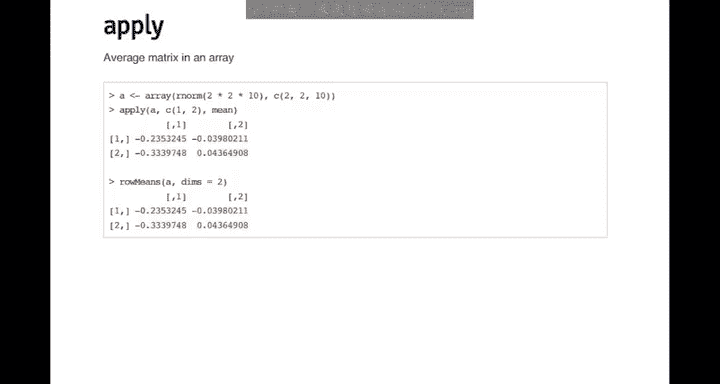

# 061：循环函数 apply 🌀


在本节课中，我们将要学习R语言中的 `apply` 函数。这是一个用于在数组的维度上评估函数的循环函数。我们将了解它的工作原理、常见用法，以及它与 `for` 循环和其他专用函数的区别。

---

## 概述

`apply` 函数是另一个循环函数，用于在数组的维度上评估一个函数。通常，这个函数会是一个匿名函数，就像我们在 `lapply` 中展示的那样，或者也可以是一个已存在的函数，例如 `mean`。它通常用于对矩阵的行或列应用函数。当然，矩阵作为二维数组，是我们最常使用的数组类型。在R中，你可能也会遇到三维数组等，因此你可以将 `apply` 用于更通用的数组，例如计算一组矩阵的平均值。

需要注意的一点是，你可能会偶尔听到一种说法，即使用 `apply` 在某种程度上比使用 `for` 循环更好或更快。一般来说，这种说法并不正确。这在很久以前旧版本的S语言或R中可能是真的，但现在完全不是这样了。你希望使用 `apply` 这类函数的主要原因是它涉及更少的代码输入，而更少的输入总是更好，因为优秀的程序员总是很“懒”。因此，`apply` 在命令行交互中特别有用，因为在进行探索性数据分析时，我们希望尽可能减少输入，以免手指疲劳。

---

## `apply` 函数的工作原理

`apply` 函数的基本语法如下：

```r
apply(X, MARGIN, FUN, ...)
```

*   **`X`**：一个数组。数组是附加了维度的向量。例如，矩阵就是一个二维数组。
*   **`MARGIN`**：一个整数向量，指示应保留哪些维度。
*   **`FUN`**：你想要应用到每个维度上的函数。
*   **`...`**：你想要传递给函数 `FUN` 的其他参数。

---

## 对矩阵的行和列应用函数

上一节我们介绍了 `apply` 的基本参数，本节中我们来看看如何用它处理矩阵。

假设我们创建了一个有20行和10列的矩阵，其元素是生成的随机正态变量。

```r
x <- matrix(rnorm(200), 20, 10)
```

### 计算每列的平均值

如果我们想计算这个矩阵每一列的平均值，可以这样做：

```r
apply(x, 2, mean)
```

这里，`MARGIN = 2` 表示我们希望保留第二个维度（列），而压缩第一个维度（行）。其思想是：对每一列，计算所有行的平均值，从而“消除”行这个维度。返回的结果是一个长度为10的向量，包含了每一列的平均值。

### 计算每行的总和

类似地，我们可以计算矩阵每一行的总和：

```r
apply(x, 1, sum)
```

这里，`MARGIN = 1` 表示我们希望保留第一个维度（行），而压缩第二个维度（列）。返回的结果是一个长度为20的向量，包含了每一行的总和。

---

## 专用函数 vs. `apply`

对于计算行/列总和或平均值这类简单操作，R提供了高度优化的专用函数，执行速度比 `apply` 快得多。

以下是这些专用函数：
*   `rowSums(x)`：计算每行的总和。
*   `rowMeans(x)`：计算每行的平均值。
*   `colSums(x)`：计算每列的总和。
*   `colMeans(x)`：计算每列的平均值。

因此，如果你只想计算矩阵行或列的总和或平均值，请使用这些专用函数。

---

## 应用更复杂的函数

`apply` 的强大之处在于可以应用任何函数。例如，假设我们有一个20行10列的随机正态变量矩阵，我们想计算每一行的第25和第75百分位数。

```r
x <- matrix(rnorm(200), 20, 10)
apply(x, 1, quantile, probs = c(0.25, 0.75))
```

这里，`MARGIN = 1` 表示按行操作。我们传递了 `quantile` 函数，并通过 `...` 参数（即 `apply` 的第四个及之后的参数）将 `probs = c(0.25, 0.75)` 传递给了 `quantile` 函数。

这个调用会遍历矩阵的每一行，并为每一行计算第25和第75百分位数。对于每一行，会返回两个数字。`apply` 函数会创建一个矩阵来存放结果，这个结果矩阵的行数等于返回值的数量（2），列数等于原始矩阵的行数（20）。因此，我们会得到一个2行20列的矩阵，其中每一列对应原始矩阵一行的两个百分位数。

---

## 处理多维数组

前面我们主要处理的是二维矩阵，现在假设我们有一个多维数组。例如，创建一个包含随机正态变量的数组，其维度为2行、2列、10层（第三个维度为10）。你可以将其想象为一叠（10个）2x2的矩阵。

```r
a <- array(rnorm(2 * 2 * 10), c(2, 2, 10))
```

如果我们想对这10个2x2矩阵求平均值，结果将是另一个2x2矩阵（即均值矩阵）。我们可以这样使用 `apply`：

```r
apply(a, c(1, 2), mean)
```

这里，`MARGIN = c(1, 2)` 表示我们希望保留第一个和第二个维度（即行和列），而压缩第三个维度。传递给 `FUN` 的函数是 `mean`。这个操作会对第三维（那10个矩阵）进行平均，最终给出均值矩阵。

另一种实现相同效果的方法是使用 `rowMeans` 函数，即使对象是数组：

```r
rowMeans(a, dims = 2)
```

这里的 `dims = 2` 参数指定了要保留的维度数。

---

## 总结

本节课中我们一起学习了 `apply` 函数。我们了解到：
1.  `apply` 用于在数组的指定维度上应用函数。
2.  其核心参数包括数组 `X`、指定维度的 `MARGIN`、要应用的函数 `FUN` 以及传递给函数的其他参数 `...`。
3.  对于简单的行/列求和与求平均，应优先使用 `rowSums`、`colMeans` 等优化函数。
4.  `apply` 的真正优势在于其灵活性，可以方便地对行或列应用任何自定义或复杂的函数。
5.  它同样适用于处理二维以上的多维数组。



通过掌握 `apply`，你可以在R中更高效、更简洁地处理需要对数据子集进行重复操作的任务。