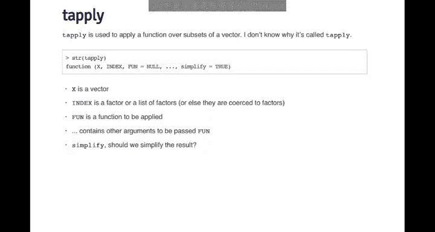
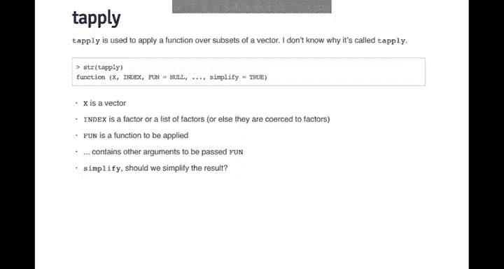
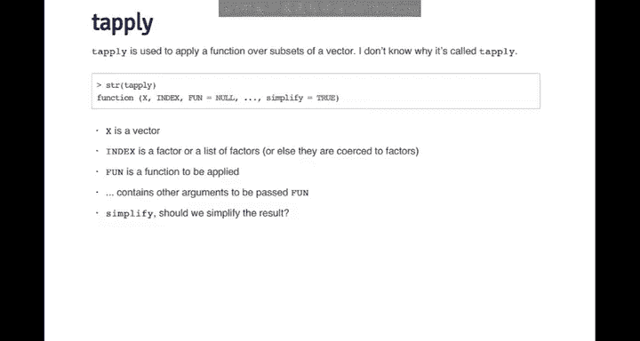
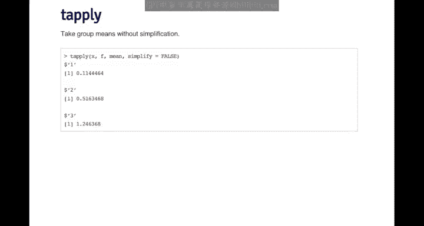
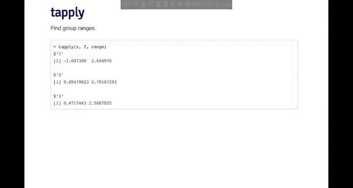
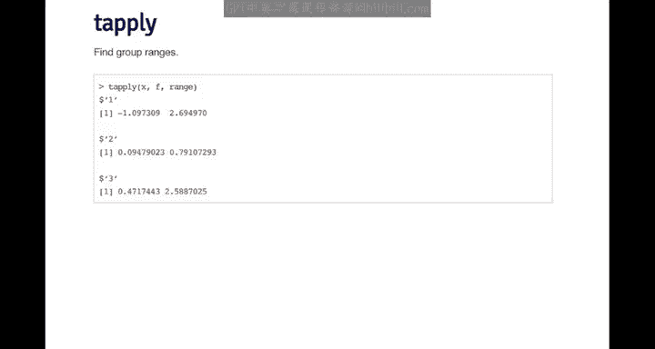
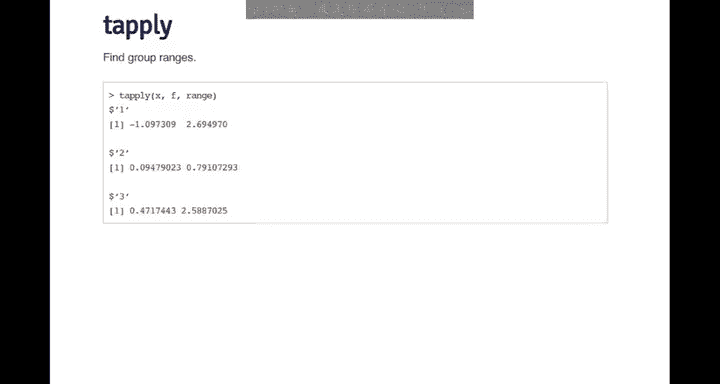

# 063：循环函数 tapply 🧮




在本节课中，我们将要学习R语言中一个非常实用的函数——`tapply`。这个函数用于对向量的子集应用某个函数，是分组汇总数据的强大工具。

## 概述



`tapply`函数的核心思想是：你有一个向量（通常是数值型向量），并且你想对这个向量中属于不同组的元素分别计算某个汇总统计量。为此，你需要另一个长度相同的向量或因子来标识原始向量中每个元素属于哪个组。

## `tapply` 函数的基本原理

上一节我们介绍了`tapply`的基本概念，本节中我们来看看它的具体语法和参数。

`tapply`函数的基本调用格式如下：
```r
tapply(X, INDEX, FUN, ..., simplify = TRUE)
```
*   **`X`**：一个向量（通常是数值型），我们希望对它的子集进行计算。
*   **`INDEX`**：一个因子或列表，长度与`X`相同，用于定义`X`中元素的分组。
*   **`FUN`**：要应用于每个分组的函数（例如`mean`, `sd`）。
*   **`...`**：传递给`FUN`函数的其他参数。
*   **`simplify`**：逻辑值，指示是否简化结果。如果为`TRUE`（默认值），`tapply`会尝试将结果简化为数组；如果为`FALSE`，则总是返回一个列表。

## 一个简单的示例

为了更好地理解，让我们通过一个具体例子来演示`tapply`的用法。



首先，我们创建一个包含三个分组的数值向量：
```r
# 生成数据：10个标准正态、10个均匀分布、10个均值为1的正态
x <- c(rnorm(10), runif(10), rnorm(10, 1))
```
接下来，我们创建一个因子变量来标识每个元素所属的组：
```r
# 创建一个因子，三个水平各重复10次
f <- gl(3, 10)
print(f)
```
现在，我们可以使用`tapply`来计算每个分组的平均值：
```r
# 对每个分组计算均值
tapply(x, f, mean)
```
执行上述代码，你将得到三个数字，分别对应三个分组的平均值。

## 控制输出格式：`simplify` 参数

`tapply`函数的`simplify`参数控制着返回结果的格式。

如果你将`simplify`设置为`FALSE`，函数将始终返回一个列表：
```r
# 返回列表格式的结果
tapply(x, f, mean, simplify = FALSE)
```
此时，输出是一个包含三个元素的列表，每个元素对应一个分组的平均值。

## 应用更复杂的汇总函数

`tapply`不仅可以计算简单的均值，还可以应用任何返回单个值或向量的函数。




以下是应用`range`函数（返回最小值和最大值）的示例：
```r
# 对每个分组计算取值范围（最小值和最大值）
tapply(x, f, range)
```
在这个例子中，`tapply`会对`x`向量的每个分组应用`range`函数。由于`range`函数为每个分组返回一个包含两个值（最小值和最大值）的向量，因此最终输出会是一个列表，列表中的每个元素都是一个长度为2的向量。

## 总结







本节课中我们一起学习了`tapply`函数。我们了解到，`tapply`是用于对向量进行分组计算的核心函数。它的工作流程是：根据一个索引因子将数据向量分成若干子集，然后对每个子集独立地应用指定的函数。通过调整`simplify`参数，我们可以控制结果是简化的数组还是保留结构的列表。这个函数在数据分析和探索性数据分析中非常有用，可以快速计算不同组别的统计量。