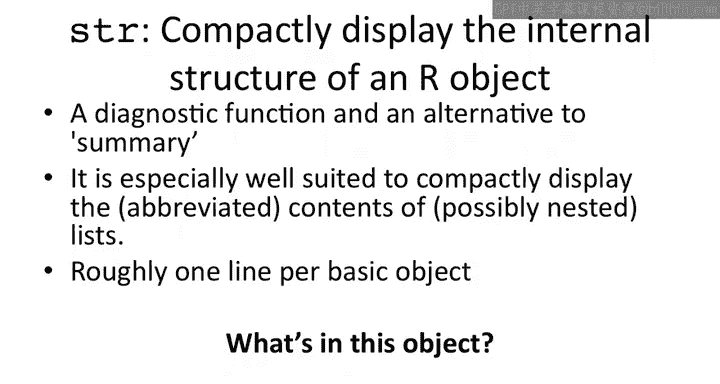
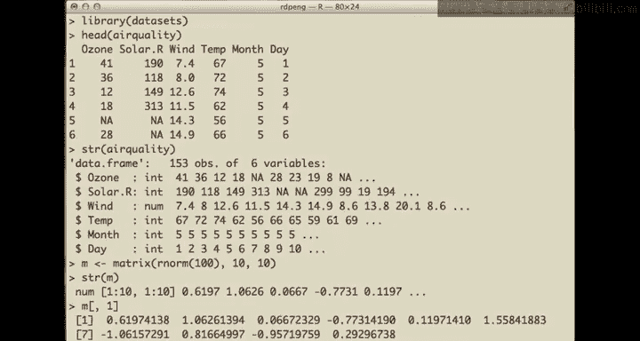

# 068：R语言中的`str()`函数 📊


在本节课中，我们将要学习R语言中一个极其重要的函数——`str()`函数。这个函数功能强大、用途广泛，能帮助我们快速查看任何R对象的内部结构。无论你是初学者还是有经验的用户，掌握`str()`函数都将极大地提升你探索和理解数据的能力。

## 什么是`str()`函数？

`str()`函数的核心目标是**紧凑地显示R对象的内部结构**。你可以将`str`理解为“structure”（结构）的缩写。它是一个非常简单的诊断函数，用途广泛，可以作为`summary()`函数的替代方案来使用。

当你想要查看一个对象是什么以及它包含什么内容时，通常会使用`summary()`，它非常有用。但`str()`是另一个特别适合**紧凑显示大型列表**（尤其是可能包含嵌套列表的列表）的函数。它的设计目标是**为每个基本对象生成大约一行的输出**。例如，如果你给它一个简单的向量，它会返回一行输出打印到控制台。

因此，`str()`函数的基本目标是回答一个问题：**这个对象里有什么？**

## `str()`函数的基本用法演示

上一节我们介绍了`str()`函数的基本概念，本节中我们来看看它的具体用法。我们将通过启动R并演示几个例子来展示`str()`函数如何工作。

`str()`本身是一个函数，它接受一个对象作为参数，并且可以接受**任何R对象**。这意味着你甚至可以将`str()`应用于其他函数。



例如，我想知道`lm()`函数（线性模型函数）的参数是什么。

```r
str(lm)
```

执行上述代码，它会给出`lm`函数的参数列表，这是一个非常简洁的摘要，显示了第一个参数是`formula`，第二个是`data`等。

同样，我可以查看`ls()`函数：

```r
str(ls)
```

这会显示`ls`函数的参数。

## 查看数据对象

现在，让我们看看如何用`str()`查看数据对象。假设我生成一些正态分布的随机变量。

```r
x <- rnorm(100, mean = 2, sd = 4)
```

你可以对`x`使用`summary()`函数，它会给出五数概括（最小值、第一四分位数、中位数、第三四分位数、最大值）和均值。

```r
summary(x)
```

这能让你大致了解数据的范围和分布情况。

你也可以对`x`调用`str()`函数，它会给出更多信息。

```r
str(x)
```

它会返回一行输出，告诉你`x`是一个数值向量，包含100个元素，并且会显示这个向量的前几个数字，让你对数据的样子有个概念。

## 应用于其他数据类型

`str()`函数可以应用于其他类型的向量。例如，我可以创建一个因子变量。

```r
f <- gl(40, 10) # 生成一个有40个水平、每个水平重复10次的因子
str(f)
```

它会再次给出一行输出，告诉你这是一个因子，有40个水平，前四个水平被命名为1、2、3、4，然后显示这个因子的前几个元素都标记为水平“1”。

你也可以对因子调用`summary()`，输出会略有不同。`summary()`会给出每个不同水平中的元素数量，这个输出不如`str()`给出的那么紧凑。

## 查看数据框

`str()`函数也可以用于其他数据类型，比如数据框。让我们加载一个内置的数据集。

```r
data(airquality) # 加载空气质量数据集
```

要查看`airquality`数据，我可以使用`head()`函数查看前六行，或者调用`str()`来获得不同的输出。

```r
str(airquality)
```

它会告诉你这是一个数据框，有153个观测值（即153行）和6个变量。然后，它为每个变量提供一小段输出。例如，第一个变量叫`Ozone`，是整数类型，前几个观测值中就有一些`NA`（缺失值）。第二个变量叫`Solar.R`，也是整数类型，并显示前几个值。

这里的`str()`输出对于快速检查R中的数据以及不同R对象的结构非常有用。

## 查看矩阵和列表

我们可以更进一步。例如，我们可以创建一个小矩阵。



```r
m <- matrix(rnorm(100), 10, 10) # 创建一个10行10列的矩阵，填充随机正态分布数
str(m)
```

它会给出更多信息。现在它知道这是一个矩阵，会说它是一个二维数组，有10行和10列，并显示前几个元素（你看到的是第一列）。

最后，我将使用`split()`函数创建一个小列表，看看`str()`如何查看列表并给出紧凑的摘要。

```r
s <- split(airquality, airquality$Month) # 按月份拆分空气质量数据框
str(s)
```

现在你会看到一个输出。这是一个包含五个不同数据框的列表，每个数据框对应一个特定月份的数据（数据只收集了五个月，所以只有五个元素）。例如，对于5月（Month 5），有31个观测值和6个变量，并显示数据的大致样子。对于6月，有30个观测值和同样的6个变量，以此类推。

对于这种拆分后的列表，`str()`提供了一个非常简洁的摘要，虽然不是最紧凑的，但已经尽可能紧凑了。它能让你快速浏览数据，检查是否存在问题（比如缺失值），并对下一步该做什么有个概念。

## 总结

本节课中我们一起学习了R语言中可能是最有用的函数——`str()`函数。我们了解到：

1.  `str()`函数用于**紧凑地显示任何R对象的内部结构**。
2.  它可以应用于**函数、向量、因子、数据框、矩阵和列表**等各种对象。
3.  与`summary()`相比，`str()`的输出通常更紧凑，尤其适合查看**大型或嵌套的列表结构**。
4.  它的输出能快速回答“**这个对象里有什么？**”这个问题，帮助你理解数据的类型、维度和内容预览。

我鼓励你在任何时候，当你有一个R对象但不知道里面有什么时，就使用`str()`函数。它是一个强大的工具，能让你更高效地进行数据探索和分析。