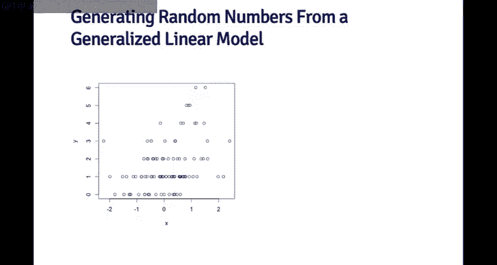

# 070：模拟线性模型 📊


在本节课中，我们将学习如何使用 R 语言模拟生成来自线性模型和广义线性模型的数据。我们将从简单的线性模型开始，逐步过渡到包含二元预测变量和泊松分布响应的更复杂模型。

## 概述

上一节我们讨论了如何从简单的概率分布中模拟随机数。本节中，我们来看看如何从指定的统计模型中模拟数据，例如线性模型。我们将学习如何设置参数、生成预测变量和误差项，并最终合成响应变量。

## 模拟简单线性模型

首先，我们考虑一个简单的线性模型。该模型包含一个连续型预测变量 **X** 和一个正态分布的随机误差项 **ε**。模型的公式如下：

**y = β₀ + β₁ * x + ε**

其中，我们假设截距 **β₀ = 0.5**，斜率 **β₁ = 2**，误差项 **ε** 服从均值为 0、标准差为 2 的正态分布。

以下是模拟该模型数据的步骤：

1.  设置随机种子以确保结果可重现。
2.  生成预测变量 **x**，假设其服从标准正态分布。
3.  生成误差项 **ε**，服从 N(0, 2²) 分布。
4.  根据线性模型公式计算响应变量 **y**。

```r
set.seed(20)
x <- rnorm(100)
epsilon <- rnorm(100, 0, 2)
y <- 0.5 + 2 * x + epsilon
summary(y)
plot(x, y)
```

生成的 **y** 均值约为 0.68，范围大约在 -6 到 6 之间。绘制 **x** 与 **y** 的散点图，可以清晰地看到它们遵循我们设定的线性关系。

## 模拟预测变量为二元数据的线性模型

现在，我们对上一个例子稍作变化。如果预测变量 **x** 不是连续型，而是一个二元随机变量（例如代表性别或实验组/对照组），该如何模拟？

这非常简单。我们可以使用二项分布（`rbinom` 函数）来生成二元数据。假设 **x** 来自一次伯努利试验，取值为 1 的概率 p = 0.5。

以下是具体步骤：

1.  设置随机种子。
2.  使用 `rbinom` 生成 100 个二元预测变量 **x**。
3.  生成正态误差项 **ε**。
4.  根据相同的线性模型公式计算连续型响应变量 **y**。

```r
set.seed(20)
x <- rbinom(100, 1, 0.5)
epsilon <- rnorm(100, 0, 2)
y <- 0.5 + 2 * x + epsilon
summary(y)
plot(x, y)
```

此时 **y** 的均值约为 1.4，范围大约在 -3 到 7 之间。由于 **x** 是二元的，散点图会呈现为两组垂直分布的点，但仍能清晰地看出从 **x=0** 到 **x=1**，**y** 的均值存在线性上升的趋势。

## 模拟泊松广义线性模型

最后，我们模拟一个更复杂的模型——广义线性模型，例如响应变量为计数数据的泊松回归模型。此时误差分布不再是正态分布，而是泊松分布。

我们假设响应变量 **y** 服从泊松分布，其均值 **μ** 的对数与预测变量 **x** 呈线性关系。模型公式如下：

**log(μ) = β₀ + β₁ * x**
**y ~ Poisson(μ)**

其中，假设 **β₀ = 0.5**，**β₁ = 0.3**。

模拟此模型需要以下步骤：

1.  设置随机种子。
2.  生成连续型预测变量 **x**（例如标准正态分布）。
3.  计算线性预测值 **log(μ)**。
4.  通过指数运算得到泊松分布的均值 **μ**。
5.  使用 `rpois` 函数，以 **μ** 为参数生成泊松分布的响应变量 **y**。

```r
set.seed(20)
x <- rnorm(100)
log.mu <- 0.5 + 0.3 * x
mu <- exp(log.mu)
y <- rpois(100, mu)
summary(y)
plot(x, y)
```

生成的 **y** 均值约为 1.5，范围在 0 到 6 之间。散点图显示数据为典型的计数数据，并且随着 **x** 的增加，**y** 的计数也呈现上升的线性趋势。

## 总结



本节课中，我们一起学习了在 R 语言中模拟不同统计模型数据的方法。我们从基础的简单线性模型入手，探讨了预测变量为二元数据的情形，最后扩展到响应变量为计数数据的泊松广义线性模型。核心在于理解模型的数据生成过程：设定参数、生成预测变量、根据模型结构（包括链接函数）计算线性部分，最后加上或转换出特定分布的随机误差，从而得到最终的响应变量。掌握这些模拟技术对于理解模型本质和进行统计实验至关重要。