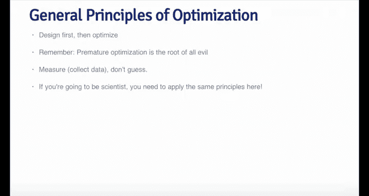
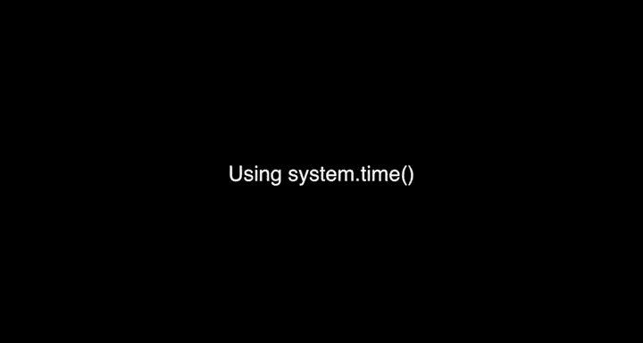
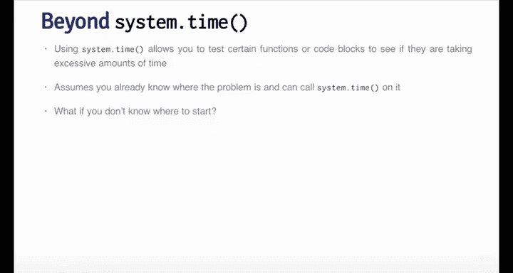

# 072：R 性能分析器（第一部分）🔍


在本节课中，我们将要学习 R 语言中一个非常实用的工具——性能分析器。当您开发大型程序或进行大规模数据分析时，如果代码运行时间过长，分析器可以帮助您精确找出耗时原因，并提供优化策略。我们还将介绍其他辅助工具，如 `system.time()` 函数，它们共同构成了优化代码的强大工具箱。

## 为什么需要性能分析器？🤔

上一节我们提到了性能分析器的用途，本节中我们来看看具体在什么情况下需要使用它。

当您编写的代码片段在单独运行时表现良好，但一旦被嵌入到一个更大的程序中，并被重复执行成千上万次时，其速度问题就会变得非常明显。此时，性能分析器就能派上用场，帮助您定位并优化那些在迭代中拖慢整体速度的代码部分。

## 代码优化的基本原则 ⚖️

在深入使用工具之前，了解代码优化的基本原则至关重要。一个普遍的准则是：**不要过早优化**。

您的首要任务应该是编写出可运行、可读性强且易于他人理解的代码。因为通常很难凭直觉判断程序究竟在哪里耗费了最多时间。如果不进行正式的性能分析，盲目优化可能会在代码正常工作之前就引入错误。正如那句名言所说：“过早优化是万恶之源。”





一旦您确定需要优化代码，就应该像科学家一样，先收集数据。性能分析正是收集这些数据的方法。

## 基础计时工具：`system.time()` ⏱️

在介绍性能分析器之前，我们先来看一个更简单的工具：`system.time()` 函数。它虽然不是分析器，但能帮助您对代码段进行基础计时。

`system.time()` 函数接受一个任意的 R 表达式，执行它，并返回执行所花费的时间。这个表达式可以很简单，也可以很复杂。

以下是 `system.time()` 的基本用法：
```r
system.time({
  # 您的 R 代码放在这里
  for(i in 1:1000) {
    x <- rnorm(100)
  }
})
```

### 理解两种时间概念

使用 `system.time()` 时，需要理解两个重要的时间概念：

1.  **用户时间**：CPU 用于执行该表达式所花费的时间。
2.  **流逝时间**：您实际感受到的、从开始到结束所经过的“挂钟时间”。

通常，这两个时间值比较接近。但在某些情况下，它们会有显著差异：

*   **流逝时间 > 用户时间**：当程序花费大量时间等待外部资源时（例如从网络读取数据），CPU 实际处理代码的时间很短，但您需要等待更久。
    ```r
    # 示例：读取网页，大部分时间在等待网络
    system.time(readLines("http://www.jhsph.edu"))
    ```
*   **流逝时间 < 用户时间**：当程序能够利用计算机的多个核心时。例如，R 中某些线性代数库（如 `BLAS`）是多线程的，可以并行计算。虽然 CPU 总工作时间（用户时间）更长，但由于任务被分摊到多个核心同时进行，您感受到的等待时间（流逝时间）反而更短。
    ```r
    # 示例：利用多核进行矩阵计算
    hilbert <- function(n) {
      i <- 1:n
      1 / outer(i - 1, i, "+")
    }
    system.time(svd(hilbert(500)))
    ```

### `system.time()` 的局限性

`system.time()` 非常实用，但它有一个前提：**您需要知道该对哪部分代码进行计时**。它假设您已经大致定位了可能的性能瓶颈。

这对于小型或结构简单的程序可能足够。但如果面对一个庞大、复杂的程序，您完全不知道问题出在哪里，又该从何下手计时呢？这时，我们就需要更强大的工具——性能分析器。

---



本节课中我们一起学习了性能分析的必要性、代码优化的基本原则，以及如何使用 `system.time()` 函数对代码段进行基础计时。我们了解到，`system.time()` 虽然有用，但在定位未知的性能瓶颈时存在局限。在下一节课中，我们将深入探讨 R 的性能分析器，学习如何系统地剖析整个程序的运行时间分布。