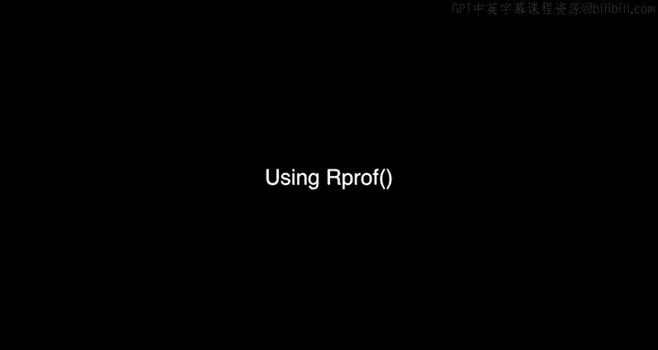
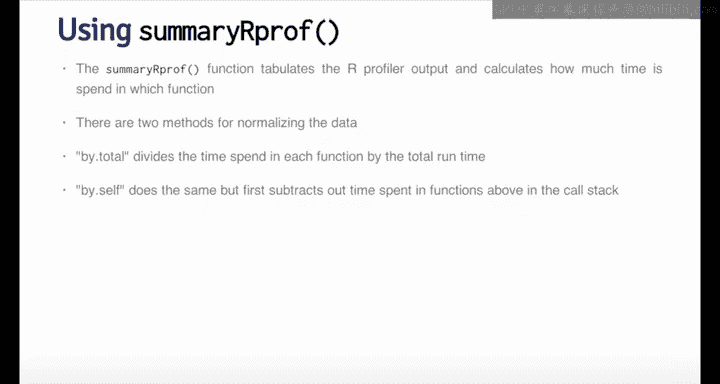
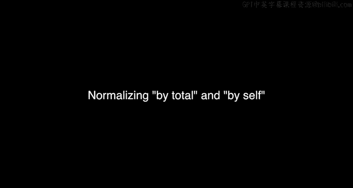
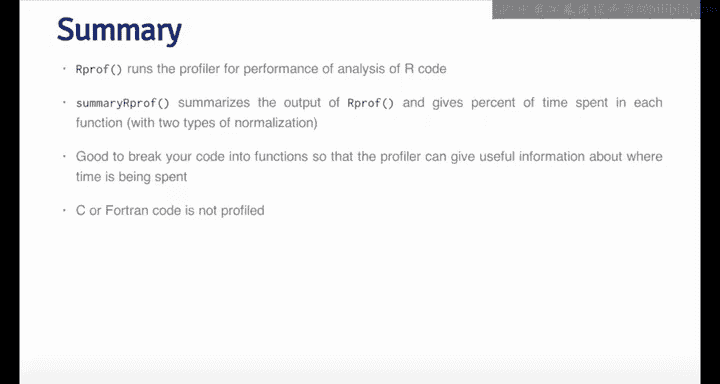

# 073：R 性能分析器（第二部分）🔍



在本节课中，我们将深入学习 R 语言中的性能分析工具 `Rprof`。我们将了解它的工作原理、如何解读其输出，以及如何利用 `summaryRprof` 函数来识别代码中的性能瓶颈。

---

## Rprof 函数简介

上一节我们介绍了性能分析的基本概念，本节中我们来看看 R 语言内置的性能分析器 `Rprof`。

`Rprof` 是 R 语言中的一个函数，用于启动性能分析器。需要注意的是，R 必须是在编译时启用了性能分析器支持的情况下构建的。不过，在绝大多数情况下（约 99.9%），R 都默认包含此支持。只有在一些非常特殊的情况下，R 才会在没有性能分析器支持的情况下编译。因此，你的 R 版本很可能可以使用性能分析器。

另一个有用的函数是 `summaryRprof`。它接收性能分析器的原始输出，并将其汇总成一种可读性更强的格式，因为原始的 `Rprof` 输出通常不易直接使用。

---

## 重要注意事项

在使用性能分析工具时，有一个重要的原则需要牢记。

你不应该同时使用 `system.time` 函数和 `Rprof` 函数。这两个工具并非设计为协同工作。因此，你应该只选择其中一种使用，而不是同时使用两者。

---

## Rprof 的工作原理

`Rprof` 函数的基本工作原理是，在固定的采样时间间隔内，跟踪函数调用栈的状态。

具体来说，当你的函数正在运行时，分析器会定期查询函数调用栈。它会记录下哪些函数调用了哪些其他函数，并在每个采样点打印出整个调用栈。它所做的就是在非常短的时间间隔（大约每 0.02 秒）打印一次函数调用栈。

首先你会注意到，如果你的函数运行时间少于 0.02 秒，那么性能分析器将毫无用处，因为它永远无法对函数调用栈进行采样。一般来说，如果你的程序运行得非常快，性能分析器就不太有用。当然，如果你的程序运行得很快，你可能一开始就不会想到要使用性能分析器，所以这通常不是问题。但你确实需要在代码运行时间较长（至少达到秒级）的情况下使用性能分析器。

---

## 原始输出示例

以下是性能分析器原始输出的一个简单示例。一般来说，你永远不会直接使用这个输出，但了解一下它的内容可能很有趣。

```
"lm" "eval" "eval" "model.frame" "model.frame.default" "eval" "list"
"lm" "lm.fit"
```





你可以看到，输出的每一行都是一个函数调用栈。最右边可以看作是栈顶，最左边是栈底。例如，从右往左看，`lm` 被调用，`lm` 调用了 `eval`，`eval` 又调用了 `eval`，接着调用了 `model.frame`，`model.frame` 调用了 `model.frame.default`，后者又调用了 `eval`，然后是 `list`。所有这些函数相互调用，因此你可以看到函数调用栈的深度相当可观。

随着评估的深入，函数调用栈会发生变化。在最底部，你可以看到 `lm` 调用了 `lm.fit`。如果你不熟悉 `lm` 函数，`lm.fit` 实际上是执行所有真正计算工作的核心函数。因此，你会预计程序会在 `lm.fit` 函数中花费相当多的时间。

---

## 使用 summaryRprof 汇总数据

由于那种原始输出不易阅读，我们使用 `summaryRprof` 函数来整理 `Rprof` 的输出，并计算在每个函数中花费了多少时间。

其原理是，一旦你看到函数调用栈，你就知道调用栈的每一行都间隔了 0.02 秒，因为这是采样的频率。基于此，你可以计算在每个函数中花费了多少秒，因为如果一个函数出现在调用栈中，那么你一定在其中花费了一些时间。

`summaryRprof` 提供了两种数据标准化方法：
*   **`by.total`**：将每个函数花费的时间除以总运行时间。
*   **`by.self`**：做同样的事情，但首先减去在调用栈中更底层函数所花费的时间。

理解 `by.total` 和 `by.self` 这两个独立的概念非常重要。

`by.total` 的基本思想是，通过函数花费的总时间进行标准化，可以告诉你该函数在打印输出中出现了多少次。例如，你 100% 的时间都花在顶层函数上。假设你调用了 `lm`，那么你 100% 的时间都花在这个函数上，因为它是顶层函数。

但现实情况是，顶层函数通常并不执行真正重要的操作，它们所做的只是调用执行实际工作的辅助函数。因此，如果你的函数花费大量时间做某事，那很可能是在那些被顶层函数调用的辅助函数中。所以，了解在顶层函数中花费了多少时间通常并不有趣，因为真正的工作并不在那里发生。你真正想知道的是，在减去它调用的所有底层函数的时间后，顶层函数本身花费了多少时间。如果结果发现，即使在减去所有底层函数的时间后，顶层函数仍然花费了大量时间，那才是有趣的事情。但大多数时候你会发现，当你减去所有被调用的底层函数的时间后，顶层函数本身花费的时间非常少，因为所有的工作和计算都是在底层函数中完成的。所以，这才是你想要集中精力优化的地方。

因此，我认为 `by.self` 格式是最有趣的格式，因为它告诉你在给定函数中花费了多少时间，但减去了它调用的所有底层函数所花费的时间。这能更准确地描绘出哪些函数真正占用了最多时间，以及哪些函数可能是你后续想要优化的目标。

---

## 输出格式示例

以下是 `by.total` 格式的一些输出示例。

```
$by.total
                     total.time total.pct self.time self.pct
"lm"                        7.41     100.0      0.00      0.0
"lm.fit"                   3.52      47.5      3.52     47.5
"model.frame"              1.55      20.9      0.00      0.0
"model.frame.default"      1.55      20.9      0.14      1.9
...
```

你可以清楚地看到，最顶部显示 100% 的时间都花在了 `lm` 函数上。这次运行的总时间是 7.41 秒，当然所有时间都花在了 `lm` 上，因为 `lm` 是顶层函数。第二名是 `lm.fit` 函数，我提到过 `lm.fit` 是进行大量计算的地方，它花费了 3.52 秒，大约占总时间的一半。你还可以看到这里有许多其他函数，如 `model.frame`、`model.frame.default`、`eval` 等。这些函数并不真正涉及计算，但在这些函数中也花费了相当多的时间，这有点意思。

我认为更有用的输出是 `by.self` 输出，它减去了所有底层函数的调用，计算了真正花费在给定函数上的时间。

```
$by.self
                     self.time self.pct total.time total.pct
"lm.fit"                   3.52     47.5       3.52      47.5
"as.list.data.frame"       0.82     11.1       0.82      11.1
"model.matrix.default"     0.64      8.6       0.64       8.6
...
```

在这里，你可以看到 `lm.fit` 是明显的赢家，因为那才是所有计算真正发生的地方。具体来说，`lm.fit` 调用了一个 Fortran 例程来求逆矩阵，这通常是在大多数大规模回归问题中所有计算发生的地方。

下一个花费大量时间的函数（约 11%）是 `as.list` 函数或其 `as.list.data.frame` 方法。目前尚不清楚为什么在这个函数中花费了这么多时间，但这可能是你想要调查的事情，因为它可能不是核心计算中非常重要的部分。你可以顺着列表往下看，了解在各个函数中花费了多少时间。你会发现很多这些函数并不直接与计算或核心计算相关，而更多地与数据格式化等有关。

`summaryRprof` 输出的最后一部分是采样间隔，你可以看到打印函数调用栈的采样时间间隔（这里是 0.02 秒），以及采样时间，也就是表达式运行的总时间。我认为这相当于 `system.time` 函数中的“elapsed”时间。

---

## 使用分析器的策略与局限

以上是对 R 中 `Rprof` 性能分析器的快速介绍。它是一个对 R 代码进行性能分析非常有用的工具，能提供一些有用的反馈。我经常发现它能突出显示一些你可能没有怀疑过的、消耗大量时间或成为瓶颈的函数，因为这些函数可能并非你正在进行的真正计算的核心。因此，分析器在突出显示这类情况以及发现一些意想不到的事情方面非常有用。

`summaryRprof` 函数汇总了 `Rprof` 的输出，并给出了在每个函数中花费的时间百分比。我认为 `by.self` 这种标准化类型对于突出代码中的瓶颈最为有用。

使用性能分析器的一个启示是，将你的代码分解成函数是有用的。与其拥有一个庞大的函数，不如将代码分解成逻辑上不同的部分，形成不同的函数。这样，分析器就可以利用这些信息告诉你时间花在了哪里。请记住，分析器会打印函数调用栈。如果你将代码分解成多个小函数，你赋予的函数名称将在调用栈中作为小标识符，告诉你代码在哪里花费了最多时间。这是在分析 R 代码时另一个有用的小策略。

最后值得注意的是，如果你的 R 代码（或任何其他 R 代码）调用了 C 或 Fortran 代码，这些 C 和 Fortran 代码就像一个黑盒，不会被分析。你不会看到关于这些代码的任何信息，你只知道在那里花费了一些时间，但不会知道任何细节。

---

## 总结

本节课中我们一起学习了 R 性能分析器 `Rprof` 的核心用法。我们了解到：
1.  `Rprof` 通过定期采样函数调用栈来工作。
2.  `summaryRprof` 函数能将原始数据转换为可读的汇总信息。
3.  `by.self` 时间能更准确地反映函数自身的开销，是定位瓶颈的关键。
4.  将代码模块化为多个函数有助于分析器提供更清晰的洞察。
5.  分析器无法分析 C 或 Fortran 等外部代码。



总的来说，我认为性能分析器非常有用。我鼓励你使用它，而不是仅仅猜测在哪里优化代码。分析器可以用来收集关于时间花费在哪里的数据，从而进行有针对性的优化。