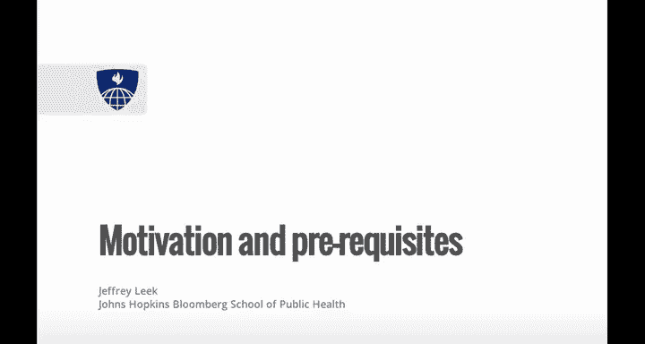
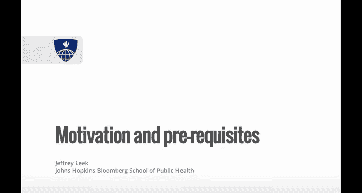
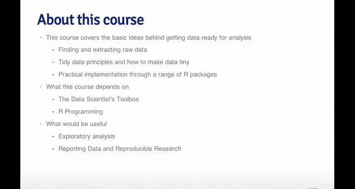
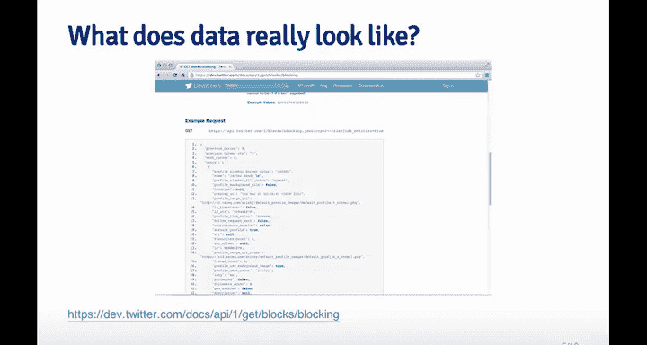
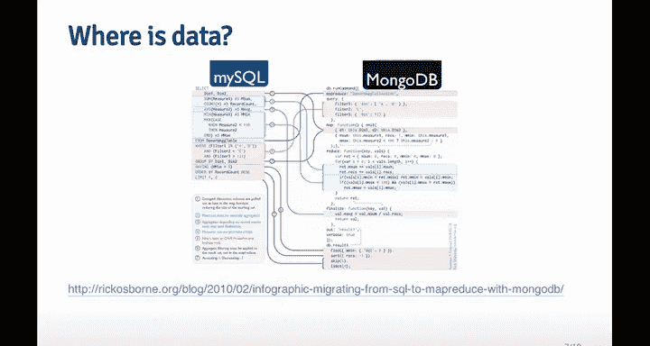
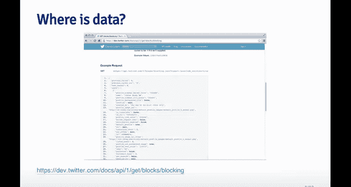
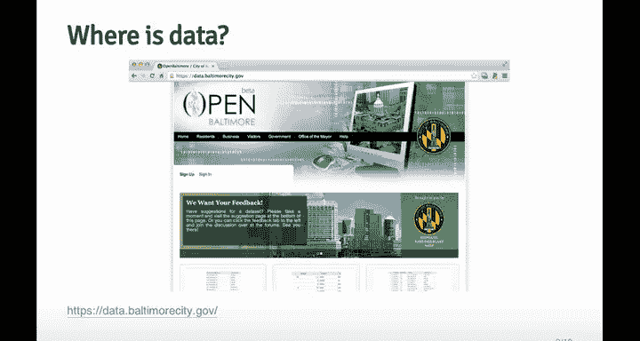
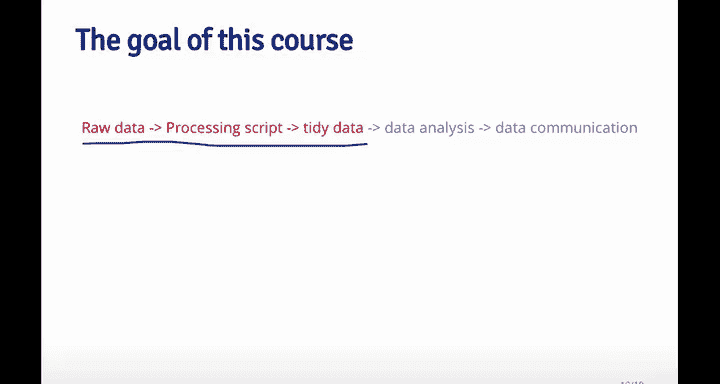

# 074：获取数据的动机 🎯

在本节课中，我们将要学习《获取数据》这门课程的核心动机与前提条件。这门课程是数据科学系列中较为独特的一门，旨在帮助你理解为何以及如何为数据分析准备数据。

## 课程概述

这门课程涵盖了为数据分析准备数据的基本思想。在机器学习或统计学课程中，这一步常常被跳过，它们通常假设数据已经以整洁的格式准备就绪。本课程则深入探讨了从各种原始形式（如数据库、原始图像文件等）中寻找数据，并将其提取出来的具体细节。同时，课程也关注整洁数据原则，将那些格式可能不佳的复杂原始数据，整理成易于在数据分析中使用的整洁格式。

课程还通过一系列R包来介绍实际应用，我们将讨论许多不同的R包。

## 前提条件

本课程假设你已经学习了《数据科学家工具箱》并安装了所有相关工具，同时也学习了《R语言编程》或类似课程，以确保你具备足够的R编程基础，不会感到困难。

如果你还学习过一些探索性数据分析，以及《报告与可重复性研究》课程，将会更有帮助。探索性数据分析之所以相关，是因为在数据清理过程中你可能需要绘制一些图表。而报告与可重复性研究课程则涵盖了创建能复现分析的脚本，这是数据清理的一个重要组成部分。不过，这些并非学习本课程的硬性要求。

## 理想数据与现实数据

上一节我们介绍了课程的目标，本节中我们来看看数据在理想和现实中的不同形态。

理想中的数据看起来像这样：一个Excel文件，其中每一行代表一个观测值，每一列代表一个变量。它被整齐地组织成类似矩阵的形式，这使得将其导入R或其他编程语言并开始进行复杂的统计分析变得非常容易。

然而，正如我们在《数据科学家工具箱》中看到的，真实数据看起来大不相同。例如，这是一个FastQ文件。你可能需要从文件的一行或每一行中提取序列信息。为了获取这些信息，你必须解析这个原始文本文件，并提取出你真正关心的部分。因此，获取数据的一个步骤就是深入这些原始文件，理解其结构，并能够提取相关部分。

另一种情况是，你得到的数据可能结构相当整齐，例如来自Twitter API的数据。这些数据以JSON格式格式化，虽然整齐有序且易于分发，但在许多编程语言中很难直接用于下游分析。因此，你可能希望以易于分析和处理的方式重新组织这些数据，这也是获取和清理数据的另一个组成部分。

最后，你可能会遇到像“口服一片”和“与葡萄柚汁同服半片”这样的自由文本指令。你可能需要从这些自由文本中提取一小部分信息，例如指示服用的药片数量，并根据你收集的每条记录进行分类。

## 数据的来源

上一节我们讨论了数据的形态，本节中我们来看看数据可能存储的位置。

数据可能存在于你需要提取它的任何地方，即使数据位于你可能想要分析的结构化环境中。以下是几个例子，它们都是数据库。MySQL和MongoDB是两个非常流行的免费数据库，数据可能存储在其中。例如，如果你在一家公司工作，你可能需要进入该数据库，收集其原始形式的数据，然后进行处理，以便对数据的某个子集进行分析，或者创建一个算法，将预测分析应用于从这些数据库收集的数据。

数据可能存在于各种地方，不一定非得是你电脑上的文件。例如，这是一个GET请求（我们将在本课程中讨论），它是尝试从网站获取信息的请求。在这个例子中，它正在从Twitter API获取关于特定推文或用户的信息。

数据也可能来自其他网站。这是本课程中会相对频繁看到的一个网站，即巴尔的摩的开放数据网站。它包含了许多有趣且有用的数据集供你分析，而且都是免费的，这很棒。但你必须能够从网络上获取它们，无论是通过API还是可下载文件，并清理它们，以便进行下游分析。

## 数据处理的全流程

如果你思考从数据库中的原始数据，一直到最终可以传达给同事、合作者或业务伙伴的数据的整个流程，实际上包含许多步骤。在大多数统计学或机器学习课程中，它们专注于数据分析这一步，这是数据处理流程的重要组成部分，但它们往往跳过了从原始数据到整洁数据的早期阶段。然而，在数据并非预先为你整理好的任何环境中（例如初创公司、大多数大型企业或几乎所有的学术环境），这一阶段都是更重要的组成部分之一。你需要知道如何实际获取原始数据本身，以便自己进行清理，理解其中的原理，而这正是本课程的全部内容。

## 总结

本节课中，我们一起学习了《获取数据》课程的动机。我们了解到，真实世界的数据很少以理想的整洁格式呈现，它们可能存在于数据库、API、网页或原始文件中，并且格式各异。本课程的目标就是教你如何从这些多样的来源中提取数据，并运用整洁数据原则将其整理成适合分析的格式。掌握这些技能对于在任何需要处理原始数据的环境中开展工作至关重要。