# 083：从MySQL数据库读取数据 📊

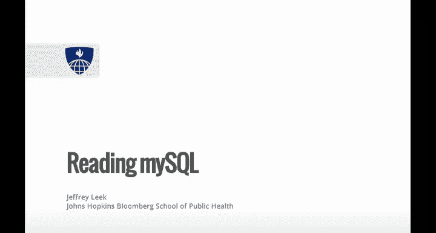

在本节课中，我们将学习如何使用R语言从MySQL数据库中读取数据。MySQL是一种广泛使用的开源数据库，尤其在网络应用中非常流行。我们将了解数据库的基本结构，学习如何连接到数据库，并执行查询来获取所需的数据。

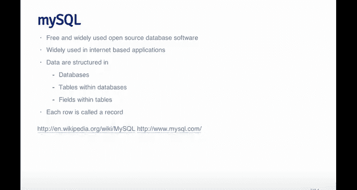

---

## 数据库结构简介

上一节我们介绍了课程目标，本节中我们来看看MySQL数据库的基本结构。数据在数据库中以结构化的方式存储。每个数据库包含一系列**表**，每个表类似于一个数据框。表中的每一列称为一个**字段**，每一行称为一条**记录**。

以下是一个示例数据库结构图，展示了“员工”数据库中多个相互关联的表：


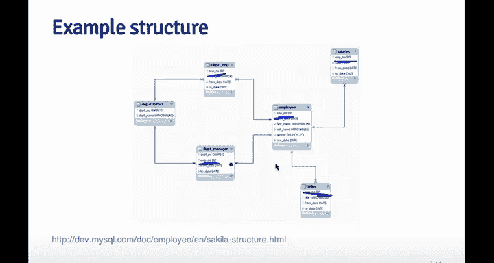

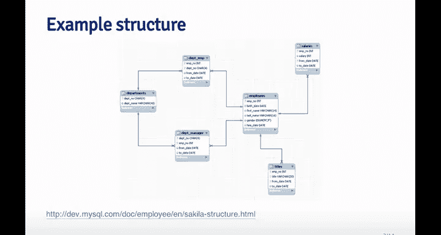

每个方框代表一个表（可视为一个数据框），方框内列出的变量是该表的列名。这些表通过共同的ID字段（如`emp_no`）相互链接，从而可以查询到每位员工所属的部门、薪资、职称以及部门经理等信息。

---

## 安装MySQL与RMySQL包

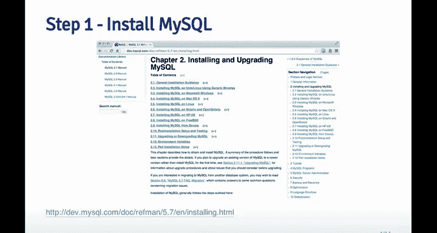

在开始使用R操作MySQL之前，需要先安装MySQL数据库和R中的`RMySQL`包。

以下是安装步骤：

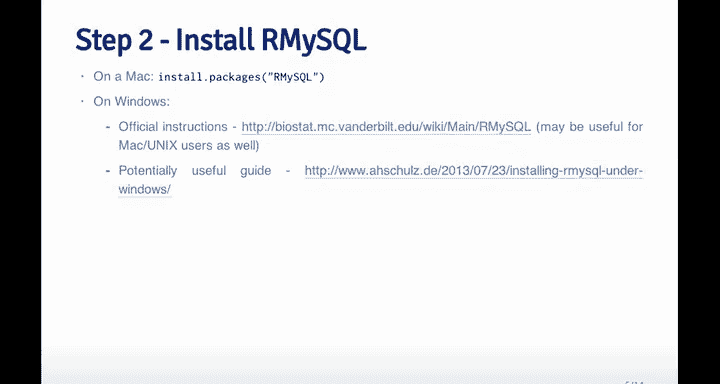

1.  **安装MySQL数据库**：具体步骤因操作系统而异。你可以访问[MySQL官方网站](https://dev.mysql.com/downloads/)下载适合你系统的版本并按照说明安装。本课程将使用一个公开的Web服务器示例，但建议你在自己的系统上安装MySQL进行练习。
2.  **安装RMySQL包**：在R中安装`RMySQL`包。
    *   在Mac系统上，可以直接使用 `install.packages("RMySQL")`。
    *   在Windows系统上，安装可能稍复杂，需要正确设置数据库驱动。你可以参考[官方说明](https://cran.r-project.org/web/packages/RMySQL/index.html)或这份[更直观的指南](https://www.r-bloggers.com/2011/05/installing-rmysql-on-windows/)。如果遇到问题，请在课程论坛提问。

---

## 连接到MySQL数据库

我们将以加州大学圣克鲁兹分校维护的公共人类基因组数据库为例，演示如何连接。

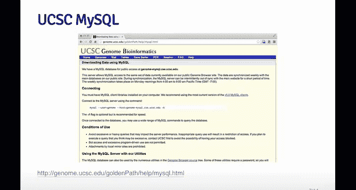

首先，加载`RMySQL`包，然后使用`dbConnect`函数建立连接。该函数需要指定数据库类型、用户名、主机地址等信息。

```r
library(RMySQL)
# 建立到公共基因组数据库服务器的连接
ucscDb <- dbConnect(MySQL(), user="genome", host="genome-mysql.cse.ucsc.edu")
```

连接成功后，会返回一个连接句柄（如`ucscDb`），后续操作都将基于这个句柄。

**重要提示**：完成数据操作后，务必使用`dbDisconnect`函数关闭连接，这是一个良好的习惯。


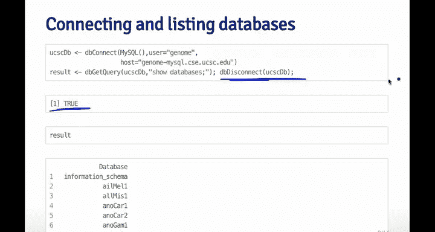

```r
# 操作完成后，断开连接
dbDisconnect(ucscDb)
```

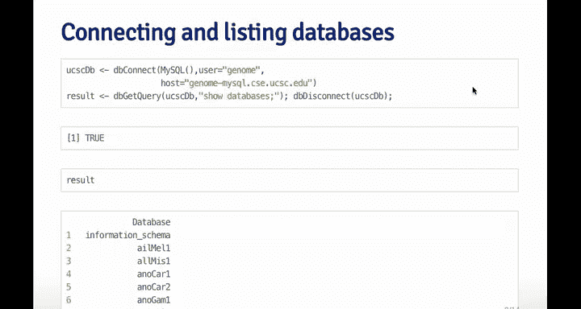

---

## 探索数据库与表

建立连接后，我们可以探索服务器上有哪些数据库，以及特定数据库中有哪些表。

以下是相关操作：

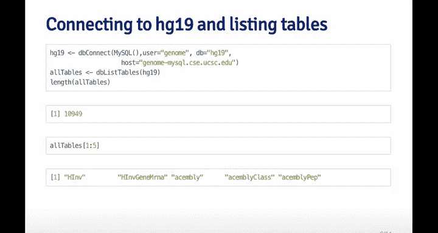

1.  **列出所有数据库**：使用`dbGetQuery`函数向数据库发送SQL查询命令。
    ```r
    result <- dbGetQuery(ucscDb, "show databases;")
    dbDisconnect(ucscDb)
    ```
    执行后，`result`变量中会存储该MySQL服务器上所有可用的数据库列表。

2.  **连接到特定数据库并列出其表**：我们选择`hg19`（人类基因组第19版）数据库进行连接。
    ```r
    hg19 <- dbConnect(MySQL(), user="genome", host="genome-mysql.cse.ucsc.edu", db="hg19")
    allTables <- dbListTables(hg19)
    length(allTables) # 查看该数据库中有多少张表
    head(allTables, 5) # 查看前5张表的名称
    ```
    `hg19`数据库包含超过10,000张表，每张表对应一种特定类型的基因组数据。

---

## 查看表结构与获取数据

确定感兴趣的表后，可以查看其结构（字段名）并获取数据。

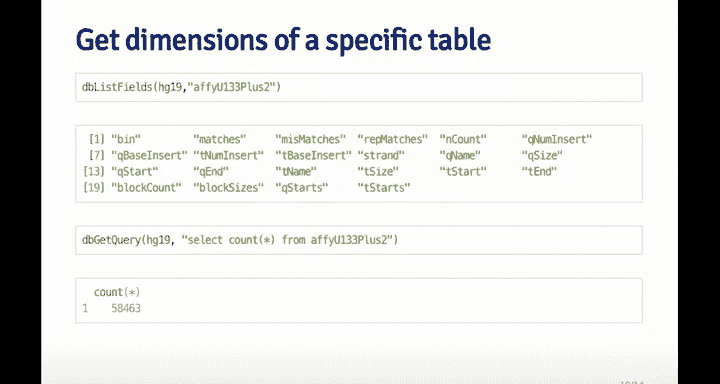

以下是具体方法：

1.  **列出表的字段（列名）**：使用`dbListFields`函数。
    ```r
    dbListFields(hg19, "affyU133Plus2")
    ```
    这将返回`affyU133Plus2`表的所有列名。

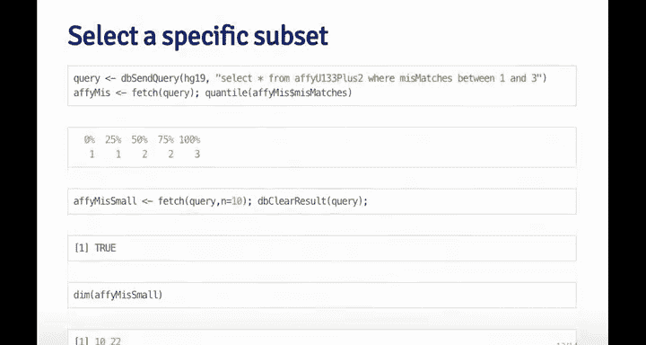

2.  **获取表的行数**：使用`dbGetQuery`发送SQL的`COUNT`命令。
    ```r
    dbGetQuery(hg19, "SELECT COUNT(*) FROM affyU133Plus2")
    ```

3.  **读取整个表到R中**：使用`dbReadTable`函数，这会将整张表作为一个数据框读入。
    ```r
    affyData <- dbReadTable(hg19, "affyU133Plus2")
    head(affyData)
    ```
    **注意**：如果表非常大，直接读取可能会超出内存。此时应使用查询来获取数据子集。

---

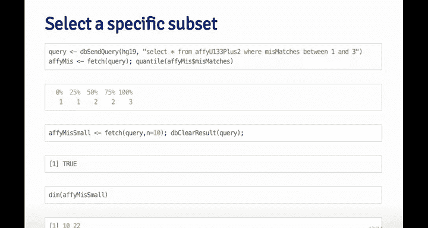

## 使用查询获取数据子集

对于大型表，更安全高效的方法是使用SQL查询语句只提取需要的部分数据。

以下是操作流程：

1.  **发送查询并获取结果**：使用`dbSendQuery`发送一个带条件的`SELECT`语句，然后用`fetch`获取结果。
    ```r
    query <- dbSendQuery(hg19, "SELECT * FROM affyU133Plus2 WHERE mismatches BETWEEN 1 AND 3")
    affyMis <- fetch(query)
    quantile(affyMis$mismatches)
    ```

2.  **限制获取的行数**：在`fetch`中使用`n`参数，可以只提取前几行数据，用于快速检查。
    ```r
    affySmall <- fetch(query, n=10)
    dim(affySmall)
    ```

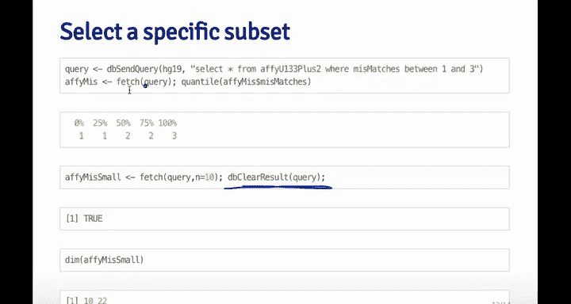


3.  **清理查询结果**：使用`dbSendQuery`后，必须在获取数据后清理远程服务器上的查询。
    ```r
    dbClearResult(query)
    ```
    这非常重要，可以释放服务器资源。

---


## 重要注意事项与资源

在结束前，我们强调几个关键点和学习资源。

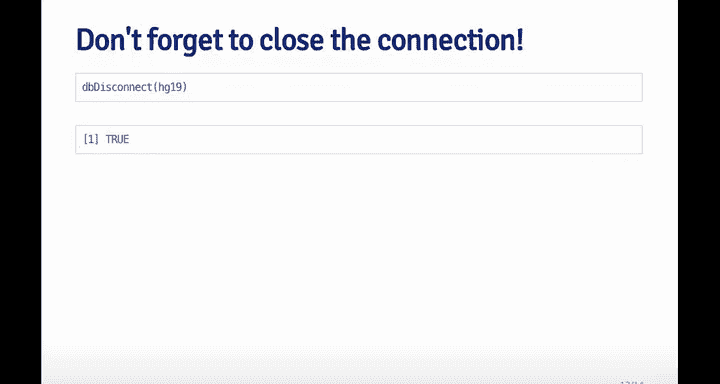

*   **始终关闭连接**：完成所有数据操作后，务必使用`dbDisconnect()`关闭数据库连接。忘记关闭连接是常见错误。
*   **谨慎操作**：本课程示例连接的是公共只读服务器。**请仅使用`SELECT`语句查询数据，不要尝试`DELETE`、`INSERT`或`UPDATE`等修改操作**，以免影响他人使用。同时，由于课程人数众多，请避免集中访问该公共服务器，最好在自己的本地MySQL上练习。
*   **深入学习**：
    *   `RMySQL`包的[官方文档](https://cran.r-project.org/web/packages/RMySQL/RMySQL.pdf)提供了详尽的函数说明。
    *   想深入学习SQL查询，可以参考[MySQL命令列表](https://www.w3schools.com/sql/)或相关博客教程。

---

## 总结

本节课中我们一起学习了如何使用R语言与MySQL数据库进行交互。我们掌握了如何安装必要的工具包、建立和关闭数据库连接、探索数据库结构、查看表信息，以及最重要的——使用`dbGetQuery`、`dbReadTable`和`dbSendQuery`/`fetch`组合来安全高效地从数据库中读取数据或数据子集。记住谨慎操作和及时关闭连接的原则，你就能很好地利用R来处理存储在MySQL中的大量结构化数据了。

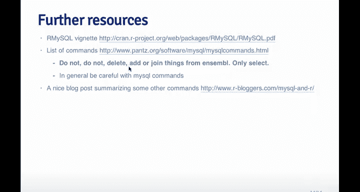

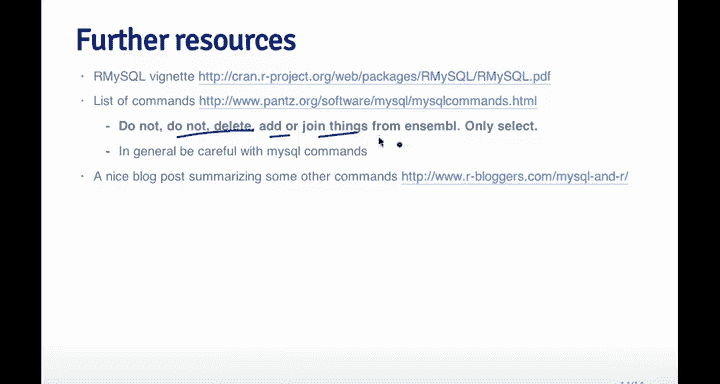

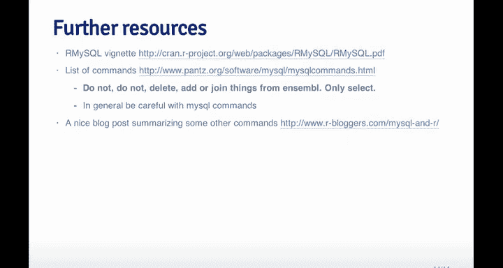

