# 084：从HDF5文件读取数据 📁


在本节课中，我们将学习如何从HDF5文件中读取数据。HDF5是一种用于存储大型和结构化数据集的格式，广泛应用于科学计算和数据分析领域。我们将介绍HDF5的基本结构，学习如何在R中安装和使用`RHDF5`包来创建、写入和读取HDF5文件。

---

## HDF5格式简介

上一节我们介绍了本课程的主题。本节中，我们来看看HDF5格式的基本概念。

HDF5用于存储大型数据集，也用于存储结构化数据集。它支持存储多种数据类型。HDF代表分层数据格式，这是因为数据存储在组中，这些组包含零个或多个数据集及其元数据。

每个组都有一个组头，包含组名和该组对应的属性列表。它们还有一个组符号表，其中列出了组中的对象。

数据集则是多维元素数组及其元数据。它们可以有一个包含名称、数据类型、数据空间和存储布局的头部，然后还有一个数据数组，你可以将其视为HDF5元素的数据框。

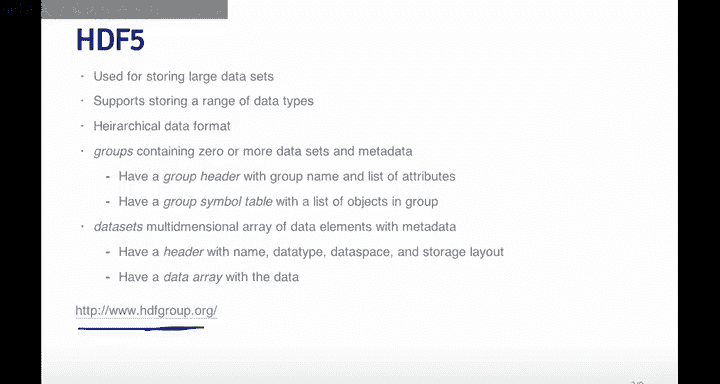

如果你想了解更多关于HDF5存储结构的信息，可以访问HDF5 Group的官方网站。

---

## 安装RHDF5包

了解了HDF5的基本概念后，接下来我们需要在R中安装处理HDF5文件的工具包。

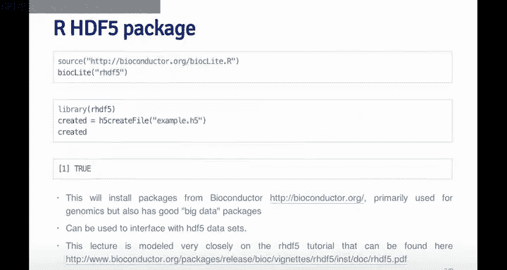

`RHDF5`包需要通过Bioconductor安装。安装此包的方法是先获取指定的URL，这将加载`biocLite`函数。首次使用`biocLite`安装包时，它还需要从Bioconductor安装`Biobase`包，因此可能需要一些时间。

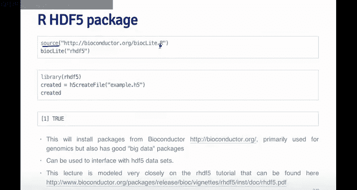

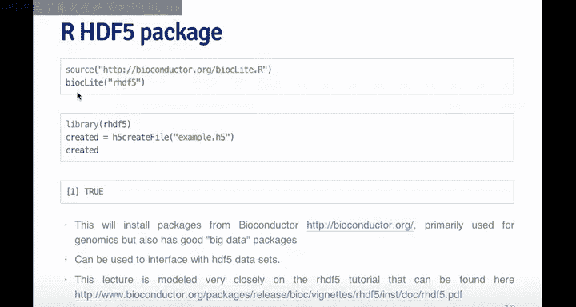

以下是安装步骤的代码：

```r
source("http://bioconductor.org/biocLite.R")
biocLite("rhdf5")
```

安装完成后，我们可以像往常一样使用`library`命令加载这个包。

```r
library(rhdf5)
```

---

## 创建HDF5文件与组

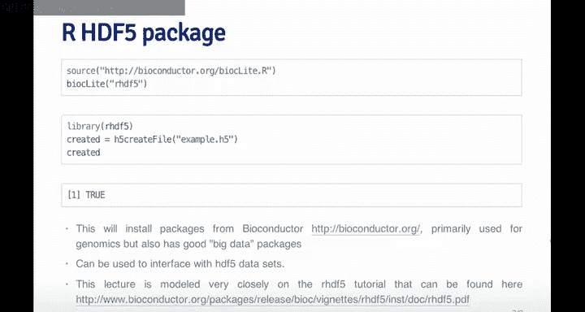

安装好工具包后，我们就可以开始实际操作了。在本节中，我们将创建HDF5文件并在其中组织数据。

本讲座的内容与RHDF5教程非常接近，该教程链接已在本幻灯片底部提供。我们将使用`H5createFile`命令创建一个HDF5文件集，文件名为`example.h5`。

```r
created <- H5Fcreate("example.h5")
```

创建文件后，我们可以在文件中创建组。我们使用`H5createGroup`命令。这将在此文件中创建名为`foo`的组。然后我们可以创建另一个名为`baa`的组，以及一个作为`foo`子组的名为`foobaa`的组。

```r
h5createGroup("example.h5", "foo")
h5createGroup("example.h5", "baa")
h5createGroup("example.h5", "foo/foobaa")
```

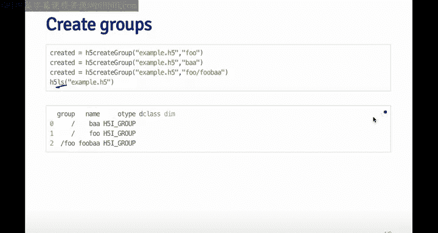

然后，你可以查看我们创建的组和文件名。使用`h5ls`命令，它类似于`ls`命令，但只列出特定HDF5文件的组件。

```r
h5ls("example.h5")
```

---

## 向组写入数据

创建了文件结构后，下一步是向其中写入数据。以下是写入数据的具体方法。

我们可以写入特定的组。例如，我们可以创建一个矩阵`A`，然后使用`h5write`命令将该矩阵写入特定组。这里，`example.h5`是我们要操作的文件，`foo/A`是文件内的目标组。

```r
A <- matrix(1:10, nr=5, nc=2)
h5write(A, "example.h5", "foo/A")
```

我们不仅可以写入矩阵，还可以写入多维数组。例如，这里有一个多维数组。我们还可以为它添加属性，例如提供像这样的元数据：`attr`属性，用于描述单位信息。

```r
B <- array(seq(0.1, 2.0, by=0.1), dim=c(5,2,2))
attr(B, "scale") <- "liter"
h5write(B, "example.h5", "foo/foobaa/B")
```

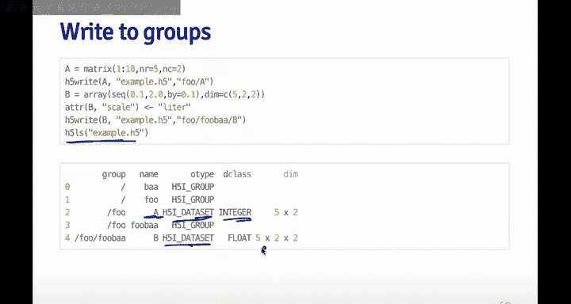

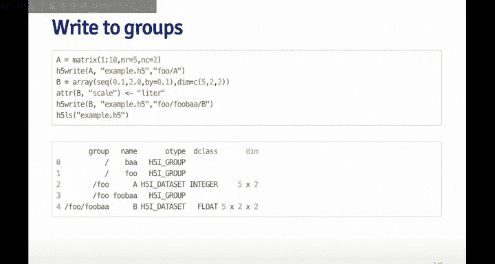

再次列出文件内容，我们现在可以看到所有已创建的组，并且在那些组中，我们实际上有一些数据集。你可以看到`A`现在是一个HDF5数据集，由整数组成；下面还有另一个数据`B`，由浮点数组成，并给出了这些数据集的维度，它们可以是多维的。

```r
h5ls("example.h5")
```

---

## 写入数据框与读取数据

除了数组，我们还可以直接写入其他数据结构，例如数据框。

我们也可以直接写入数据。实际上，我们可以将数据写入顶级组。方法是这样的：假设我们使用`data.frame`命令创建了一个这样的数据框。现在我们有了这个数据框，我们可以使用`h5write`命令将该数据框直接写入顶级组。我们不是传递要发送到的组，而是直接传递变量名。

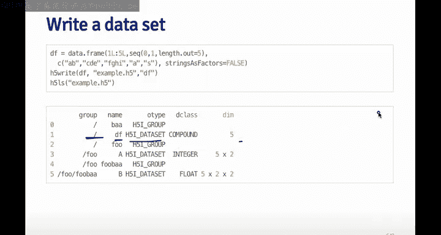

```r
df <- data.frame(1L:5L, seq(0,1,length.out=5), c("ab","cde","fghi","a","s"), stringsAsFactors=FALSE)
h5write(df, "example.h5", "df")
```

如果我们列出当前的情况，现在可以看到在顶级组（即根组）中，有`df`，它是一个数据集，并给出了数据的维度等信息。

```r
h5ls("example.h5")
```

然后，你可以使用`h5read`命令直接读取数据。你将使用`h5read`，并告诉它你要查看哪个文件。例如，你可以告诉它读取一个非常特定的数据集，如`foo/A`。你可以通过指定路径来读取子数据集。你也可以通过仅指定数据集名称来读取顶级组中的数据集。

```r
readA <- h5read("example.h5", "foo/A")
readSubB <- h5read("example.h5", "foo/foobaa/B")
readDf <- h5read("example.h5", "df")
```

你得到的是你写入的数据。这就是你读取数据的方式，例如，如果你有一个HDF5文件中的数据，并且你想把它提取出来。

---

## 分块读取与写入

HDF5文件格式的另一个优点是你可以轻松地分块读取和写入数据。

我们在这里要做的实际上是再次写入。我们将使用`h5write`，并将数据写入我们文件中已有的数据集`A`。我们要做的是写入元素12、13和14，我们可以告诉它我们想把这些值写入该数据的特定部分。我们可以给它索引。这里的索引文件为每个维度提供索引。对于第一个维度，我们将说写入此数据集第一列的前三行，并设置这些值。

```r
h5write(c(12,13,14), "example.h5", "foo/A", index=list(1:3,1))
```

如果我们在此写入操作后读取数据，你可以看到在第一列的前三行中，得到了12、13和14，就像我们写入的那样。

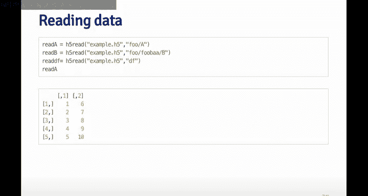

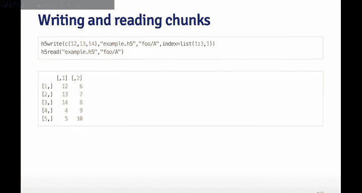

```r
h5read("example.h5", "foo/A")
```


你可以使用类似的索引命令来仅读取数据的子组件。你可以传入一个索引，它是一个列表，显示了要读取的不同维度。例如，如果你只想读取第一列的前三行，你可以将相同的索引命令传递给`h5read`。

```r
h5read("example.h5", "foo/A", index=list(1:3,1))
```

---

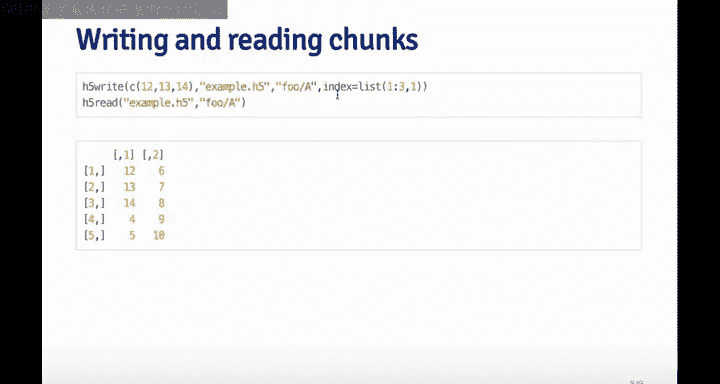


## 注意事项与进一步资源

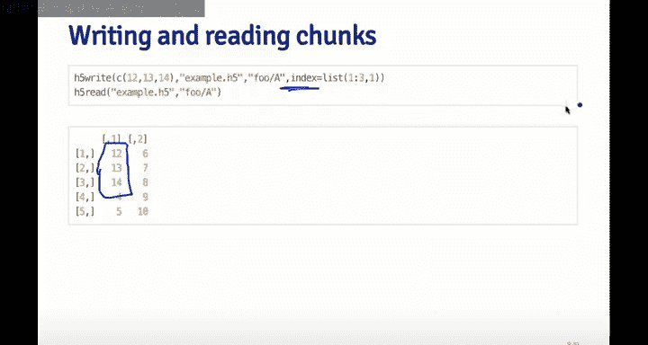

在结束之前，有一些重要的注意事项和推荐资源需要了解。

需要记住的一点是，HDF5可用于优化R中磁盘的读取和写入。这里的教程提供了关于如何使用HDF5的更多信息，本讲座借用了该教程中的大量信息。如果你对HDF5感兴趣，HDF5 Group通常有很多关于使用HDF5的良好信息。

---


## 总结 🎯

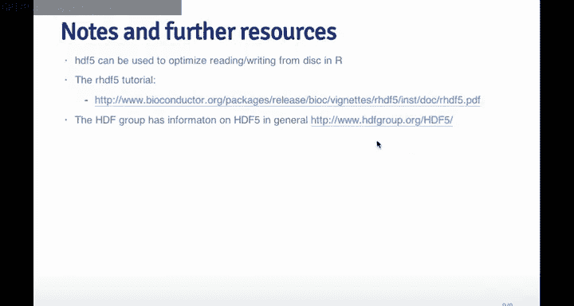


本节课中，我们一起学习了如何从HDF5文件中读取数据。我们从HDF5格式的基本概念讲起，介绍了其分层存储结构。然后，我们详细讲解了如何在R中通过Bioconductor安装`RHDF5`包。通过实际操作，我们创建了HDF5文件，在其中建立了组结构，并向组中写入了矩阵、多维数组和数据框等多种类型的数据。最后，我们学习了如何读取整个数据集或通过索引进行分块读取，并了解了HDF5在优化磁盘I/O方面的优势。掌握HDF5文件的读写能力，对于处理大型科学数据集至关重要。