# 085：从网络读取数据 📡

在本节课中，我们将学习如何从网络上读取数据。网络数据来源广泛，获取方式多样。本节课将主要聚焦于从网站中抓取数据（即网络爬虫），并简要介绍API的使用以及身份验证。后续会有专门课程深入讲解API获取数据的部分。

---

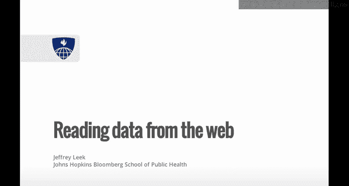

## 什么是网络爬虫？ 🕸️

网络爬虫是指通过编程方式，从网站的HTML代码或URL中提取数据。这是一种获取数据的有效方法。

例如，有人曾通过爬虫收集了Netflix为所有电影分配的分类标签，并进行了有趣的分析，这个故事因此广为流传。这展示了通过编程从网站提取数据，可以收集到有趣的数据集。

可以说，几乎所有网站都包含你可能希望以编程方式读取的信息。然而，在某些情况下，这种行为可能违反网站的服务条款。有些网站明确声明不希望被爬取。如果你尝试从这些网站抓取数据，需自行承担风险。

如果你在短时间内尝试读取过多页面，一个非常常见的后果是你的IP地址可能会被封锁。如果你从网站读取了大量专有信息，可能会遇到更大的麻烦。因此，在决定从网站抓取数据时，需要谨慎。但总体而言，这是一种快速收集大量数据的好方法。

---

## 一个爬虫示例：Google Scholar页面 📄

我将通过一个示例来展示如何以编程方式提取数据。这个例子来自我的Google Scholar页面。

该页面展示了我发表的论文及其被引用次数，这是学术界关心的一类数据。

我们将首先使用`readLines`命令从互联网获取数据。这是一种方法。

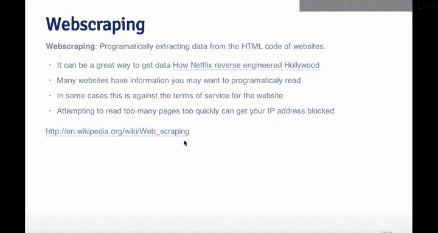

以下是具体步骤：

1.  使用`url`函数打开到特定URL的连接。
2.  使用`readLines`函数从该连接中读取数据。
3.  使用完毕后，务必像操作数据库一样关闭连接。

```r
# 打开一个URL连接
con <- url("http://scholar.google.com/citations?user=HI-I6C0AAAAJ")
# 读取网页的HTML代码
htmlCode <- readLines(con)
# 关闭连接
close(con)
```

查看我们收集到的HTML代码，它会像这样显示：一个很长的大字符串。你可以指定`readLines`读取的行数，但输出仍然会以这种未格式化的方式呈现，阅读起来有些困难。

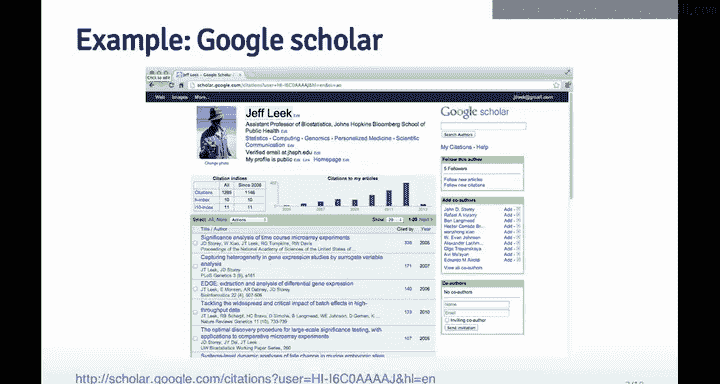

---

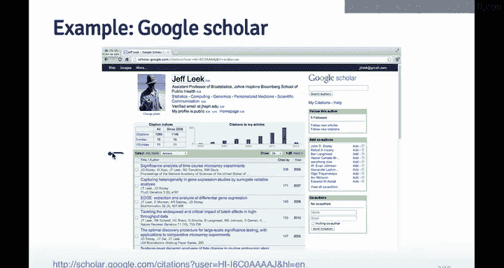


## 使用XML包解析HTML 🧩

处理上述问题的一种方法是使用XML包，就像我们之前见过的那样。

我们可以使用相同的URL，通过XML包解析HTML，并使用`htmlTreeParse`函数获取完整的结构。

```r
library(XML)
url <- "http://scholar.google.com/citations?user=HI-I6C0AAAAJ"
html <- htmlTreeParse(url, useInternalNodes = TRUE)
```

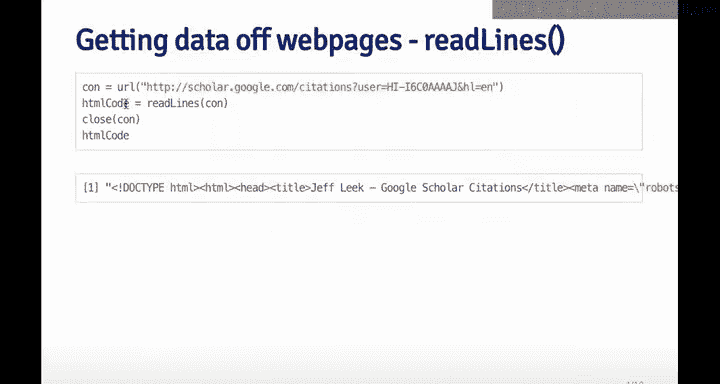

然后，如果我想要获取页面的标题，可以查找`<title>`标签内的节点。或者，我可以通过查看表格的特定元素来获取论文的被引用次数。

```r
# 获取页面标题
xpathSApply(html, "//title", xmlValue)
# 获取被引用次数（示例，路径需根据实际HTML调整）
# xpathSApply(html, "//table[@id='gsc_rsb_st']//td", xmlValue)
```

---

## 使用httr包获取数据 🔗

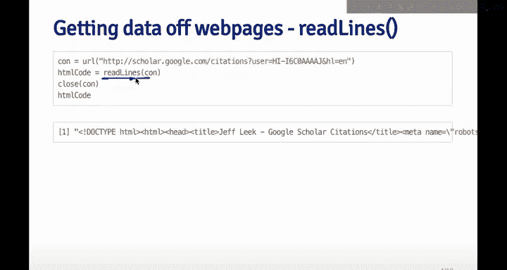

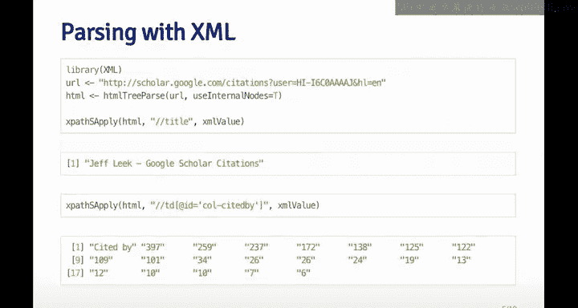

另一种获取数据的方法是使用`GET`命令，它来自`httr`包。

对于开放且易于访问的网站，使用我们之前讨论过的连接方式可能是最简单的方法。但我们稍后会讨论为什么`httr`包在其他场景下非常有用。

```r
library(httr)
url <- "http://scholar.google.com/citations?user=HI-I6C0AAAAJ"
html2 <- GET(url)
```

现在，我需要从那个HTML页面中提取内容。我使用`content`函数将其作为文本（一个大文本字符串）提取出来。

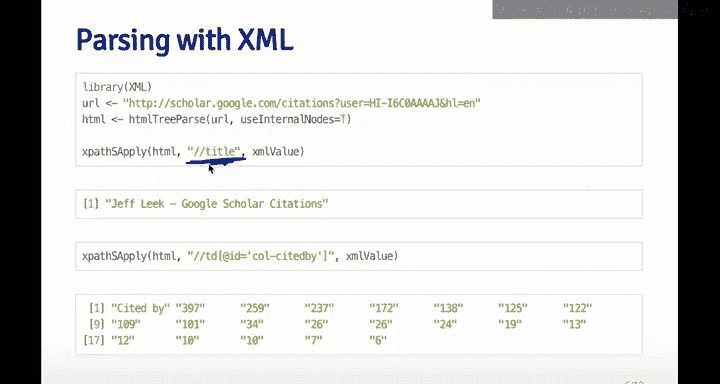

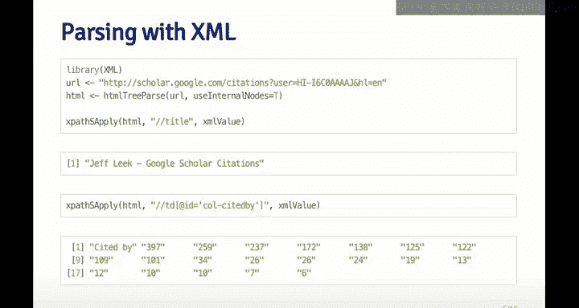

```r
content2 <- content(html2, as = "text")
```

然后，我可以使用`htmlParse`命令来解析该文本并获取解析后的HTML。

```r
parsedHtml <- htmlParse(content2, asText = TRUE)
```

这样得到的`parsedHtml`对象，与直接使用XML包提取数据得到的结果完全相同。然后，我就可以像之前一样使用`xpathSApply`来提取页面标题等信息。

---

## 处理需要身份验证的网站 🔐

在某些情况下，你可能需要处理更复杂的事情。例如，如果你用浏览器导航到某个网页，可能会发现它需要输入用户名和密码。

如果我仅使用`httr`包中的`GET`命令尝试获取该页面，会得到一个状态码为401的响应。这是因为我没有通过身份验证，无法登录。

`httr`包允许你为网站进行身份验证。你可以通过分配一个“句柄”来实现。

```r
# 使用用户名和密码进行身份验证
pg2 <- GET("http://httpbin.org/basic-auth/user/passwd",
           authenticate("user", "passwd"))
```

在这个例子中，这是一个测试网站，用户名是“user”，密码是“password”。你可以用此类网站测试访问权限。

现在，响应的状态码是200，这意味着我们成功获得了文件的访问权限，身份验证通过。

我们可以查看`pg2`对象的名称，它会给出所有不同的组件，包括我们为此文件获得的“cookies”以及我们用来访问它的“句柄”等。

然后，我们就可以在通过R登录后，使用`content`函数提取该网站的内容。

```r
names(pg2)
content(pg2)
```

---

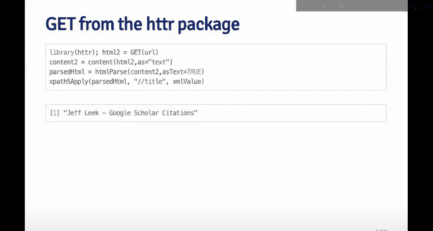

## 使用句柄管理会话 🎪

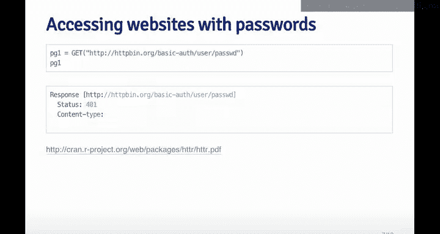

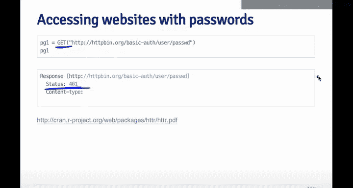

确保使用句柄，因为如果你使用句柄，你可以在多次访问网站时保存身份验证状态。

如果你将Google设置为一个句柄（代表特定网站），那么你可以告诉`GET`去获取那个句柄，并可以指定获取特定路径，或者发送不同的路径。

例如，如果你对这个句柄进行了一次身份验证，那么cookies将与该句柄保持关联，你将保持已认证状态。在访问该网站时，你无需反复进行身份验证。

```r
# 创建一个句柄并认证
google <- handle("http://google.com")
pg1 <- GET(handle = google, path = "/")
pg2 <- GET(handle = google, path = "search")
```

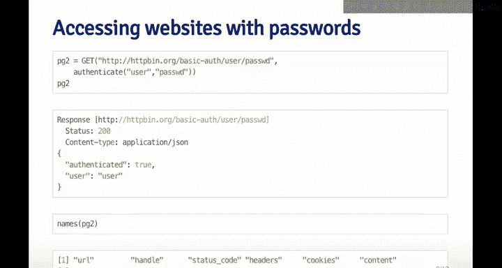

---

## 更多学习资源 📚

R-bloggers网站有很多关于如何从网络抓取数据的好例子。如果你去R-bloggers上搜索“web scraping”，你将能找到所有这些教程。

`httr`包的帮助文件也包含许多有用的示例，主要是玩具示例。如果你将这些与R-bloggers上更实用的示例结合起来，可以学到很多东西。

此外，请关注后续关于API的课程，以了解如何以编程方式与网站的API进行交互。

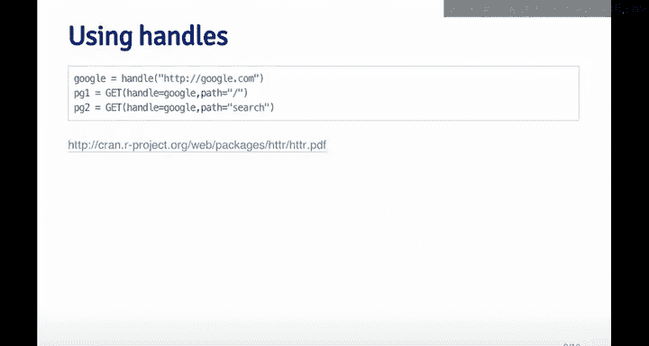

---

## 总结 📝

本节课中，我们一起学习了从网络读取数据的几种核心方法：

1.  我们了解了**网络爬虫**的概念及其潜在风险。
2.  我们学习了使用基础R的`readLines()`函数和`url()`连接来读取原始网页数据。
3.  我们掌握了使用**XML包**解析HTML结构，并利用XPath提取特定信息（如标题）。
4.  我们介绍了功能更强大的**httr包**，它提供了`GET()`函数来发起网络请求。
5.  我们探索了如何使用`httr`包的`authenticate()`函数访问需要**身份验证**的网站。
6.  我们理解了使用**句柄**来管理网络会话和保持认证状态的重要性。

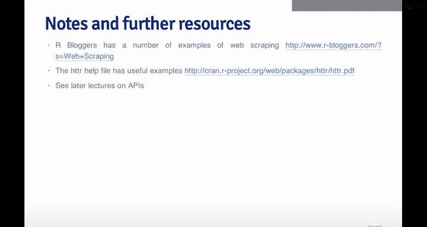

这些技能是获取网络公开数据或受保护数据的基础，为后续的数据分析工作提供了重要的数据来源。