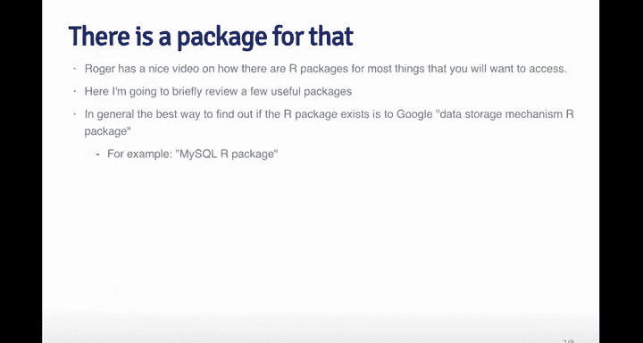
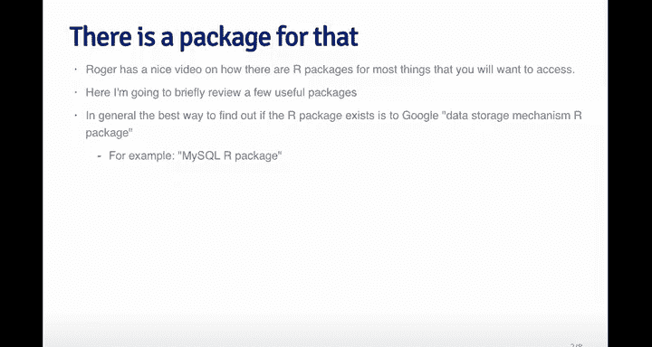
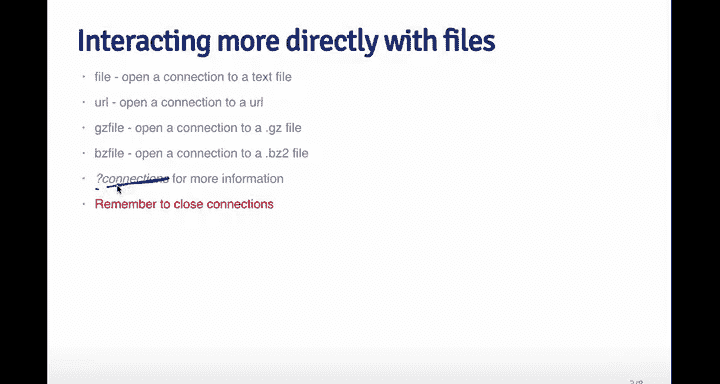
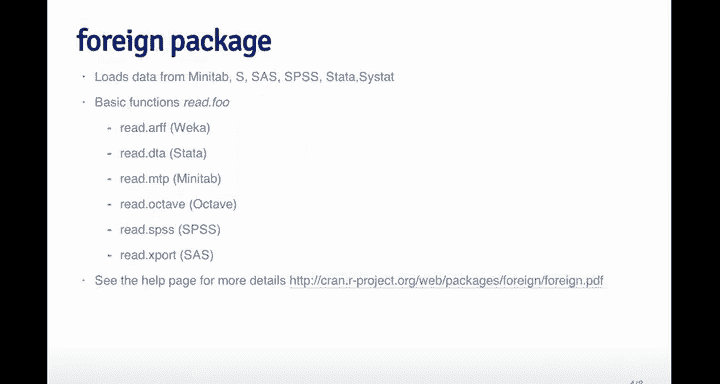
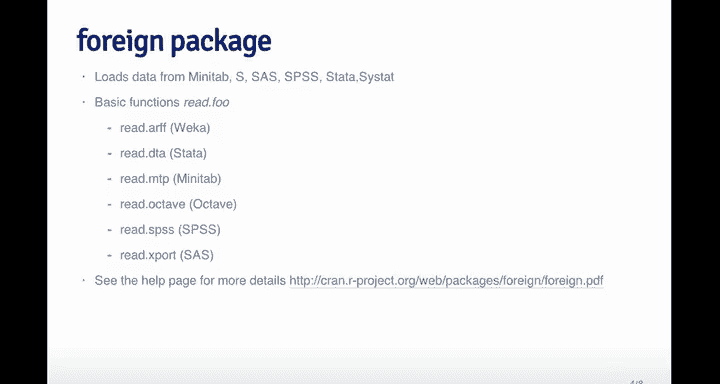
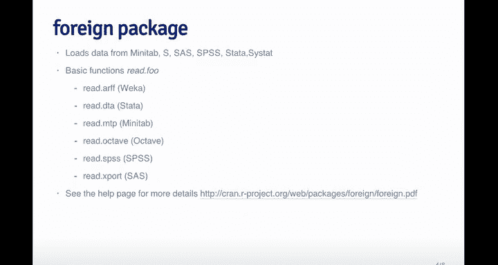
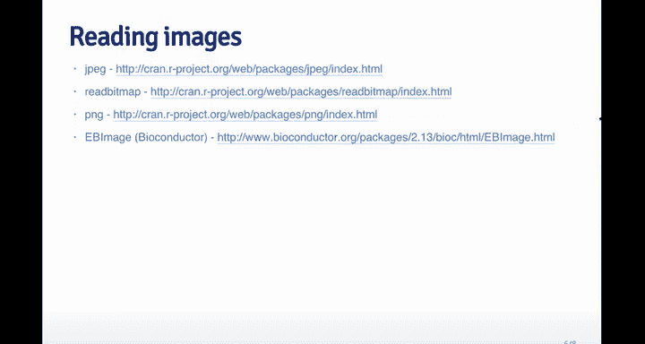
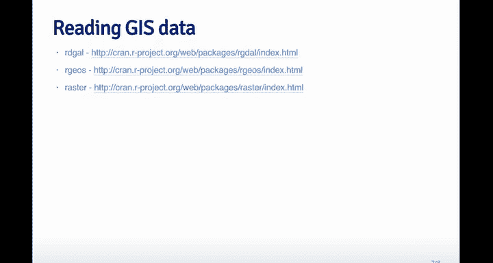
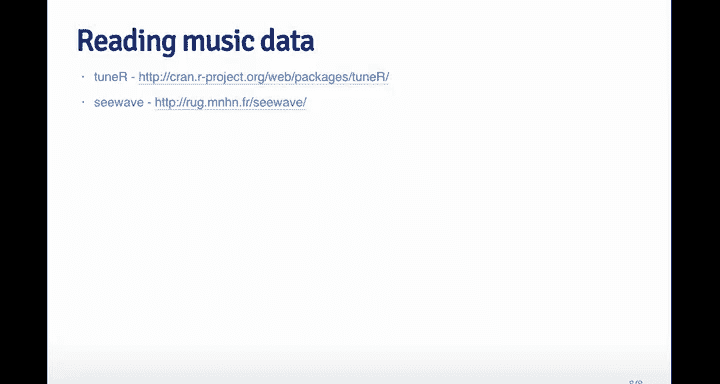

# 087：从其他来源读取数据 📂

在本节课中，我们将学习如何从多种非传统或特定格式的数据源中读取数据。我们已经介绍了从XML、JSON、HDF5或MySQL等来源读取数据，但R生态系统的强大之处在于其丰富的扩展包，几乎可以连接任何数据源。

## 概述

R社区开发了大量专用包，用于连接各种数据存储机制和文件格式。无论数据来自其他统计软件、特定数据库、图像文件还是音乐文件，通常都能找到对应的R包来读取和处理它们。本节将简要介绍一些有用的包和查找方法。

## 查找R包的方法

上一节我们介绍了从常见文件类型和数据库读取数据，本节中我们来看看如何为特定数据源寻找合适的R包。

我发现，查找某个R包是否存在的最佳方式是使用谷歌搜索，关键词格式为：**数据存储机制 + R包**。例如，搜索“MySQL R package”通常会直接显示最相关的包。对于相对常见的数据类型，几乎总能找到对应的R包来访问数据。

## 访问本地与远程文件连接

除了使用`url()`函数，R还提供了其他函数来建立与文件的连接。

以下是用于建立文件连接的核心函数：
*   `file()`: 用于访问本地计算机上已有文件的连接。
*   `gzfile()`: 用于访问经过gzip压缩的文件的连接。
*   `bzfile()`: 用于访问经过bzip2压缩的文件的连接。

如果你想了解更多关于建立本地或远程文件连接的信息，可以在R控制台中输入`?connections`查看帮助文档。

## 读取其他统计软件的数据

如果你需要与使用其他编程语言或统计软件（如SAS、SPSS、Stata）的同事协作，`foreign`包会非常有用。

`foreign`包的基本函数命名遵循`read.`加文件扩展名的模式。以下是几个例子：
*   `read.dta()`: 用于读取Stata（扩展名为.dta）的数据文件。
*   `read.octave()`: 用于读取Octave的数据文件。
*   `read.spss()`: 用于读取SPSS的数据文件。
*   该包也能读取SAS的`.export`文件等。

关于此包的更多详细信息，可以查阅其帮助文件（`?foreign`），内容通常一目了然。借助它，我成功读取了来自其他编程语言的大部分数据文件。

## 连接其他数据库

除了MySQL，R还能连接许多其他类型的数据库。

以下是几个重要的数据库连接包：
*   **RPostgreSQL**: 提供从R连接到PostgreSQL数据库（一种与DBI兼容的数据库）的接口。第一个链接是相关教程，第二个是帮助文件。
*   **RODBC**: 提供连接到多种数据库的接口，包括PostgreSQL、MySQL、Microsoft Access和SQLite。这里也有一个很好的教程和帮助文件。
*   **RMongo** 和 **RMongoDB**: 这两个包可用于连接MongoDB数据库并从中提取数据。

使用这些包时，你需要像使用`RMySQL`包一样，向数据库发送查询。关键是你必须使用数据库自身的语法来编写查询语句。因此，你需要对目标数据库的语法有基本了解才能提取数据。

## 读取非传统格式数据

R不仅能读取文本和表格数据，还能直接处理如图像、音乐等特殊格式。

你可以读取以下类型的非传统数据：
*   **图像文件**: 使用`jpeg`、`readbitmap`、`png`等包可以直接将JPEG、PNG等图像文件读入R并进行操作。Bioconductor项目中的`EBImage`包也非常适合用于分析和处理图像数据。
*   **GIS数据**: 地理信息系统数据。有多种R包可以读取和处理由专有或开源软件导出的各种GIS数据。
*   **音乐文件**: 你可以使用`tuneR`或`seewave`包直接读取MP3等音乐文件数据并进行音频分析。R中有许多优秀的音乐处理软件包，可用于对这些数据进行分析并得出有趣的新发现。

## 总结

本节课中，我们一起学习了如何为各种数据源寻找和使用特定的R包。我们介绍了连接本地与远程文件的方法、读取其他统计软件数据的`foreign`包、连接PostgreSQL和MongoDB等数据库的包，以及处理图像、地理信息和音乐文件等非传统格式数据的工具。正如Roger在视频中所说，“万物皆可R包”。无论你的数据来自何处，通常只需搜索“数据源类型 + R package”，就能找到相应的工具来访问它。