# 088：数据子集化与排序 📊

在本节课中，我们将学习如何在R中操作数据，特别是如何对数据进行子集化（提取特定部分）和排序。这些技能对于整理数据、准备分析至关重要。我们将从基础概念开始，逐步介绍多种方法。

## 概述

将数据加载到R后，通常需要对其进行操作，以整理成整洁的数据格式：变量在列中，观测值在行中，并且只包含你想要分析的观测值。本节课程将回顾子集化的相关知识，并介绍排序的方法。

## 数据子集化

数据子集化是指从数据框（data frame）中提取特定的行、列或元素。以下是几种常用的方法。

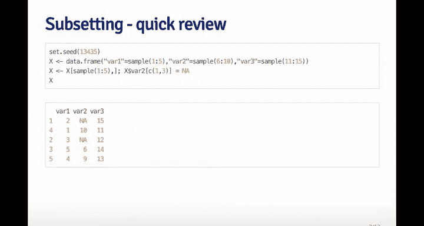

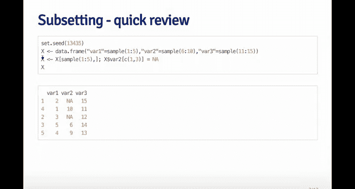

### 按列提取

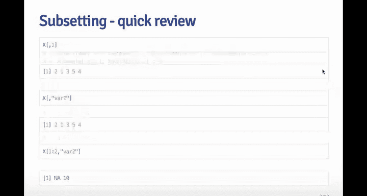

首先，我们可以通过指定列索引或列名来提取单个列。

*   **按索引提取**：使用 `x[, 1]` 可以提取数据框 `x` 的第一列。
*   **按列名提取**：使用 `x[, "var2"]` 可以提取名为 `"var2"` 的列。

### 同时按行和列提取

我们可以同时指定行和列的条件来提取数据的子集。

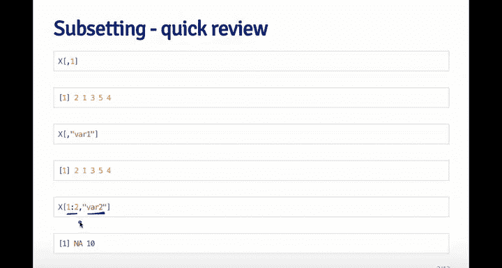

例如，命令 `x[1:2, "var2"]` 会输出数据框 `x` 的前两行，并且只提取 `"var2"` 这一列。

### 使用逻辑条件提取

通过逻辑语句可以提取满足特定条件的行。

*   **使用“与”条件**：例如，要找出 `variable1` 小于等于3 **并且** `variable3` 大于11的所有行，可以使用 `x[x$var1 <= 3 & x$var3 > 11, ]`。
*   **使用“或”条件**：例如，要找出 `variable1` 小于等于3 **或者** `variable3` 大于15的所有行，可以使用 `x[x$var1 <= 3 | x$var3 > 15, ]`。

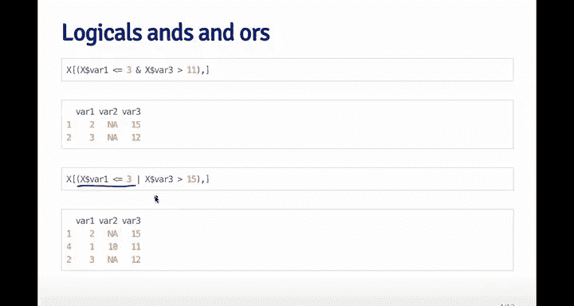

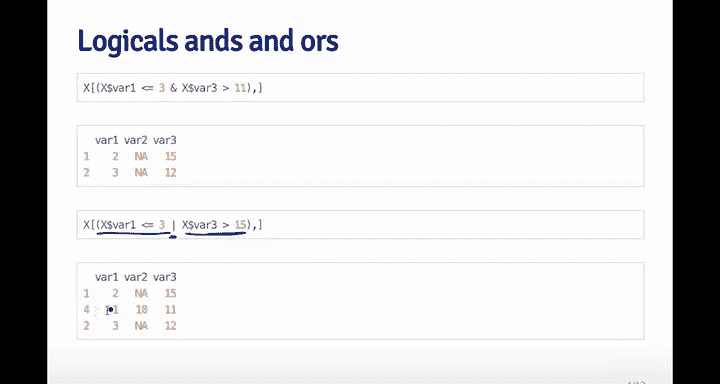

### 处理缺失值（NA）

当数据包含缺失值（NA）时，直接使用逻辑条件子集化可能无法得到预期结果。`which()` 函数可以帮助解决这个问题。

`which()` 函数会返回满足条件的索引位置，并自动忽略NA值。例如，`which(x$var2 > 8)` 会返回 `var2` 大于8的行的索引，然后可以用这些索引来提取数据：`x[which(x$var2 > 8), ]`。

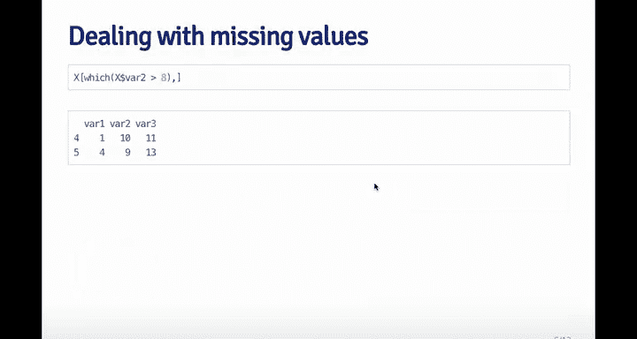

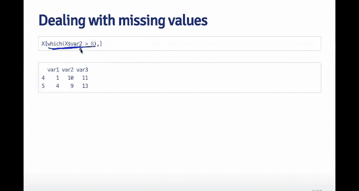

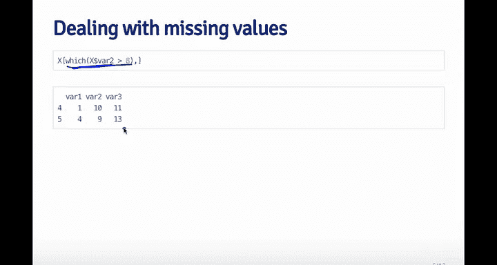

## 数据排序

排序是另一种常见的数据操作，可以按一个或多个变量的值对数据进行排列。

### 对单个向量排序

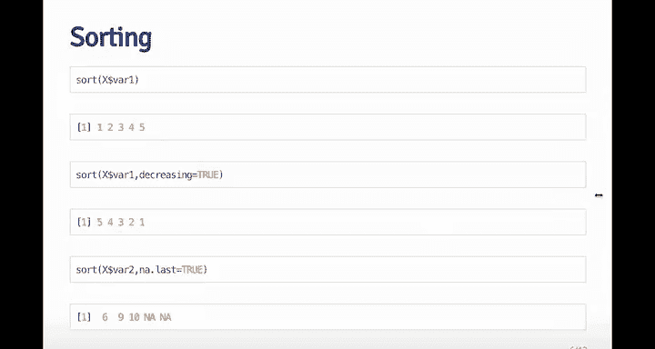

使用 `sort()` 函数可以对一个向量进行排序。

*   **默认升序**：`sort(x$var1)` 会将 `var1` 的值按升序排列。
*   **降序排列**：通过设置参数 `decreasing = TRUE` 可以实现降序排列：`sort(x$var1, decreasing = TRUE)`。
*   **处理NA值**：通过设置参数 `na.last = TRUE`，可以将所有NA值放在排序结果的末尾。

### 按列对数据框排序

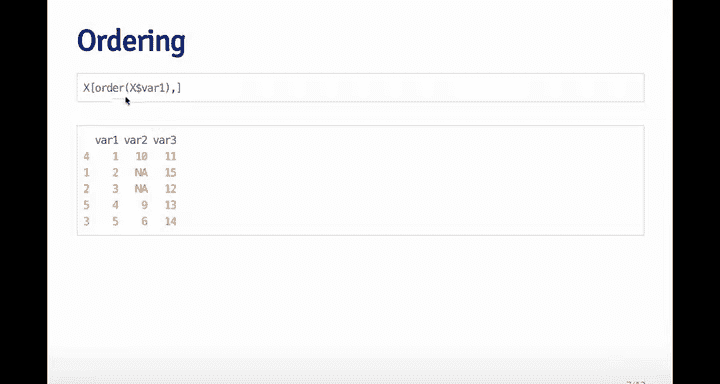

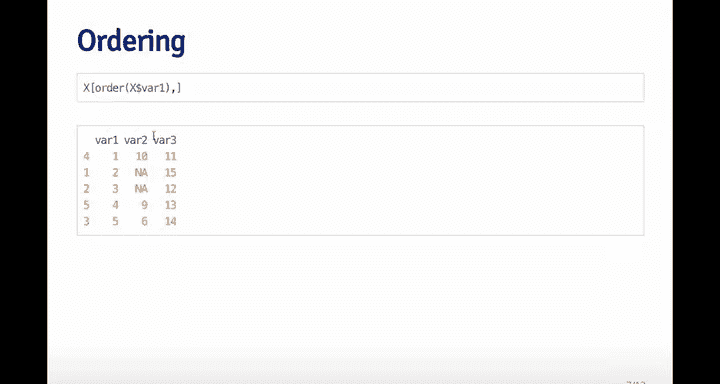

要基于某一列的值对整个数据框的行进行重新排序，可以使用 `order()` 函数。

`order()` 函数返回的是排序后的索引顺序。例如，`order(x$var1)` 会返回一个索引向量，指示如何排列行才能使 `var1` 按升序排列。然后，将这个结果用于行的选择：`x[order(x$var1), ]`。

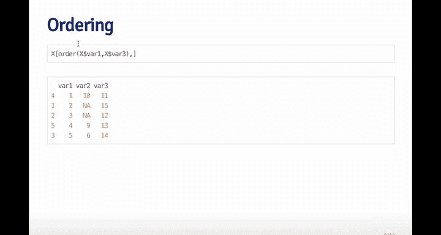

### 按多列排序

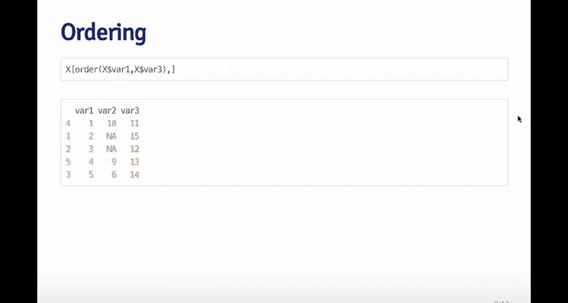

可以传递多个变量给 `order()` 函数，实现多级排序。

例如，`x[order(x$var1, x$var3), ]` 会首先按 `var1` 升序排列，对于 `var1` 值相同的行，再按 `var3` 升序排列。

### 使用 `dplyr` 包排序

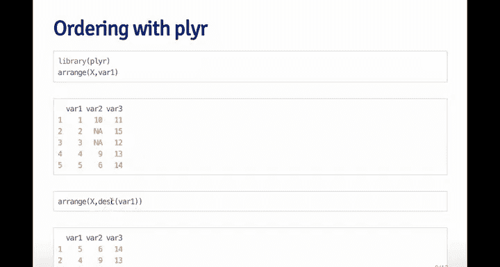

`dplyr` 包（由 Hadley Wickham 编写）提供了更直观的排序函数 `arrange()`。

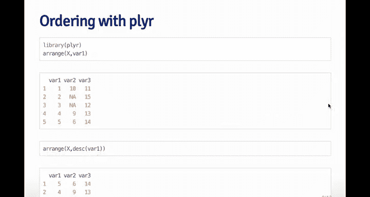

首先需要加载库：`library(dplyr)`。
*   **升序排列**：`arrange(x, var1)` 会按 `var1` 升序排列数据框。
*   **降序排列**：使用 `desc()` 函数包裹变量名可以实现降序排列：`arrange(x, desc(var1))`。

## 添加行与列

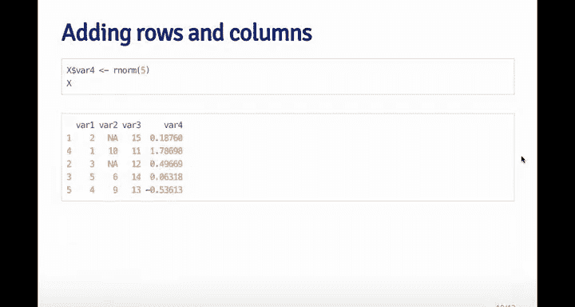

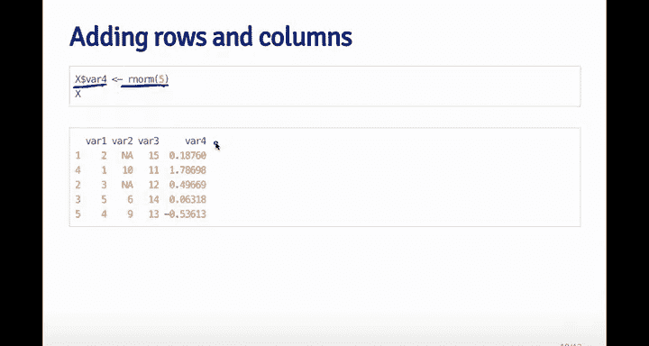

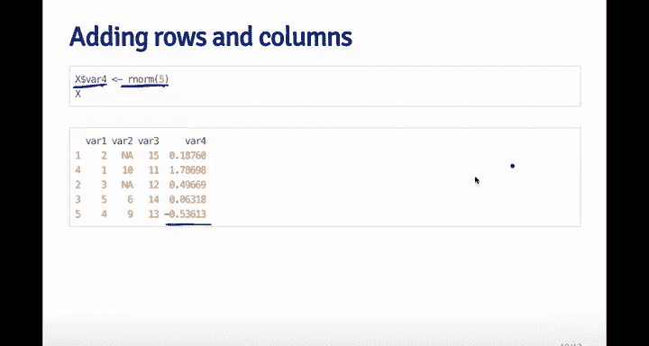

向现有数据框中添加新的行或列是一个直接的过程。

### 添加新列

有两种主要方法：
*   **直接赋值**：`x$var4 <- rnorm(5)` 会创建一个名为 `var4` 的新列，并为其分配一个长度为5（与数据框行数相同）的随机正态分布向量。
*   **使用 `cbind()`**：`cbind(x, rnorm(5))` 会将新的向量作为一列绑定到数据框 `x` 的右侧。如果交换顺序 `cbind(rnorm(5), x)`，则新列会绑定到左侧。

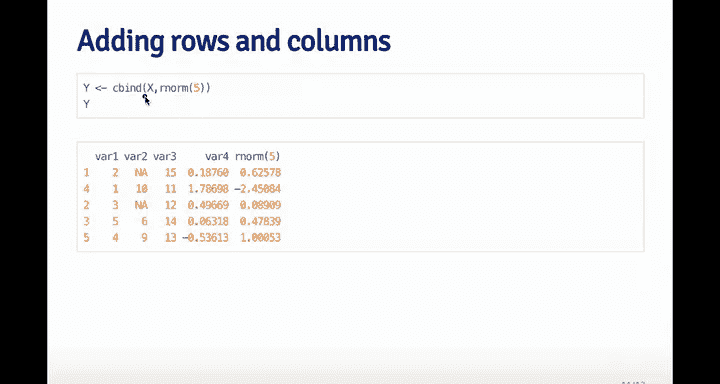

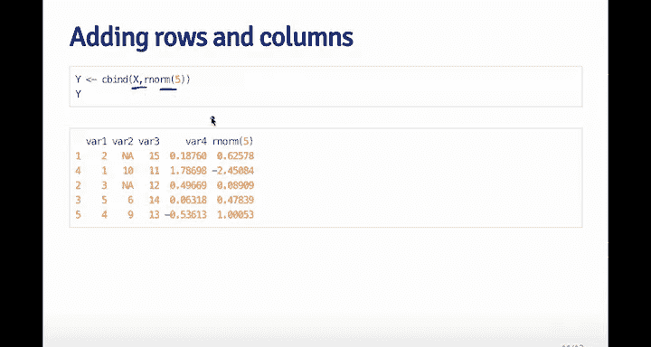

### 添加新行

使用 `rbind()` 函数可以添加新行。
*   `rbind(x, rnorm(3))` 会将新的向量作为一行绑定到数据框 `x` 的底部。
*   `rbind(rnorm(3), x)` 则会将新行绑定到顶部。

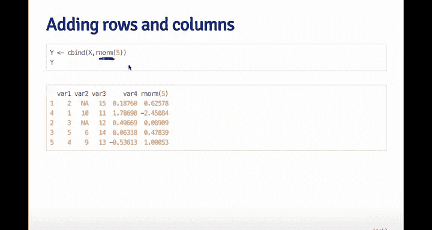

## 总结

本节课我们一起学习了R中数据操作的核心技能：**子集化**与**排序**。
我们掌握了如何通过索引、名称和逻辑条件提取数据的特定部分，特别是学会了使用 `which()` 函数处理包含缺失值的情况。
在排序方面，我们学习了使用 `sort()`、`order()` 函数以及 `dplyr` 包中的 `arrange()` 函数对数据进行单列或多列排序。
最后，我们还了解了如何使用 `cbind()` 和 `rbind()` 向数据框添加新的列和行。
掌握这些技巧能帮助你有效地整理和准备数据，为后续的分析工作打下坚实基础。

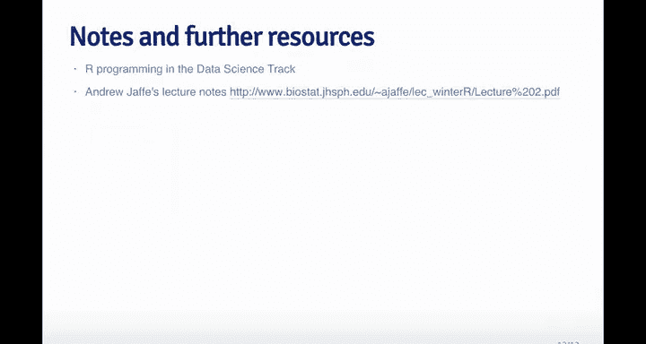

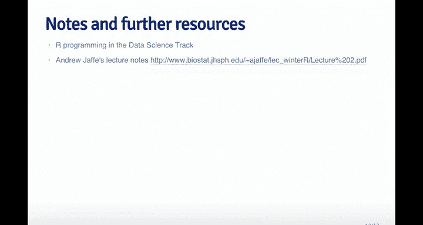

> 关于子集化、重排序和排序的更多详细说明，可以参考R编程课程中的资料。本节部分信息来源于约翰霍普金斯大学彭博公共卫生学院生物统计学系助理教授 Roger Peng 的课程讲义，你可以查阅他的讲义以获取更多信息。