# 089：数据汇总

在本节课中，我们将学习如何对加载到R中的数据进行检查和汇总。这是数据清洗的关键步骤，目的是在开始下游分析之前，识别数据中的异常、缺失值或其他问题。

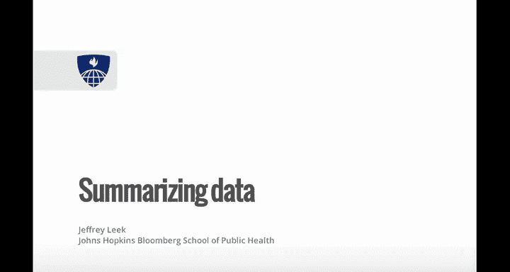


## 加载示例数据

首先，我们需要一个数据集来练习。我们将使用一个关于巴尔的摩市餐厅信息的公开数据集。你可以通过指定URL来下载这个CSV格式的数据文件。

```r
# 创建数据目录（如果不存在）
if(!file.exists("data")) {
  dir.create("data")
}
# 数据文件的URL
fileUrl <- "https://data.baltimorecity.gov/api/views/k5ry-ef3g/rows.csv?accessType=DOWNLOAD"
# 下载文件
download.file(fileUrl, destfile = "./data/restaurants.csv", method = "curl")
# 将数据读入R
restData <- read.csv("./data/restaurants.csv")
```

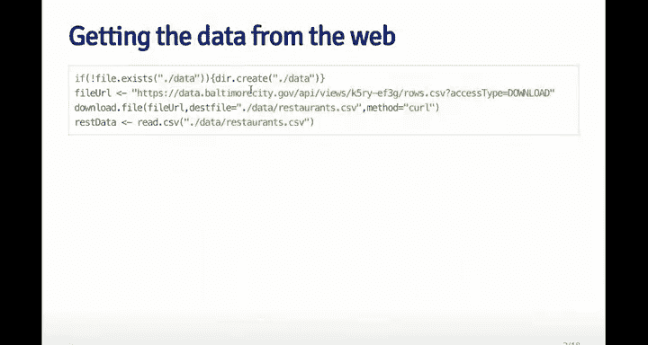

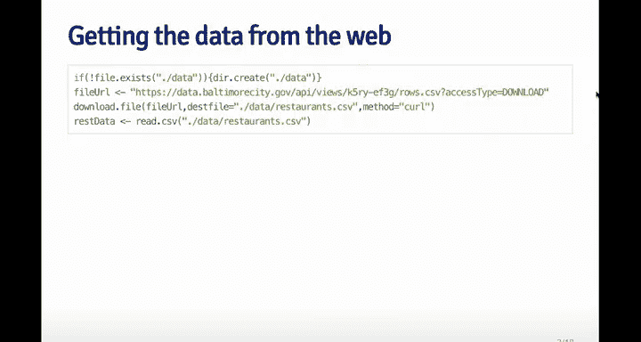

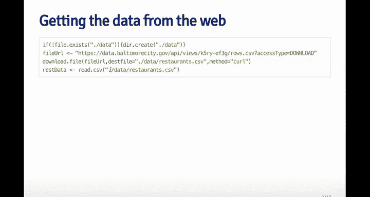

## 初步查看数据

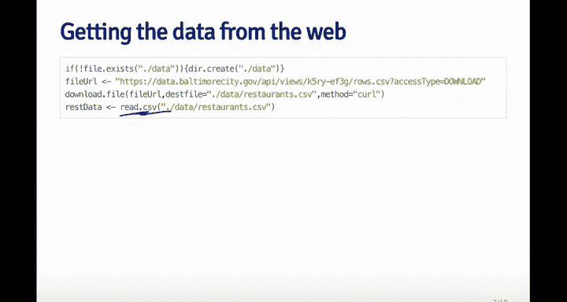

数据加载后，第一步是查看其内容。直接输入数据框名称可以显示全部数据，但如果数据量很大，显示会不清晰。

### 查看数据头部和尾部

`head()`和`tail()`函数可以分别查看数据框的开头和结尾部分。

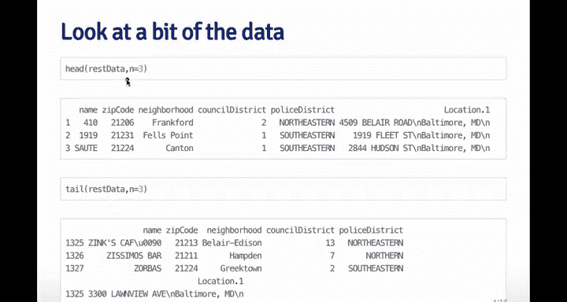

```r
# 查看前3行
head(restData, n=3)

# 查看后3行
tail(restData, n=3)
```

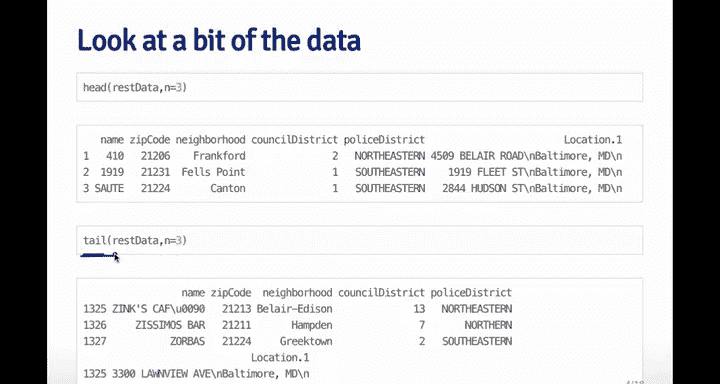


默认情况下，`head()`和`tail()`会显示6行数据。

### 获取数据摘要

`summary()`函数可以为数据集中的每个变量提供统计摘要。

```r
summary(restData)
```

对于文本型或因子型变量，它会显示每个类别的计数。对于数值型变量，它会显示最小值、第一四分位数、中位数、均值、第三四分位数和最大值。这个函数能快速揭示问题，例如，我们发现数据中有一个邮政编码被错误地记录为负值。

### 查看数据结构


`str()`函数可以显示数据框的结构信息。

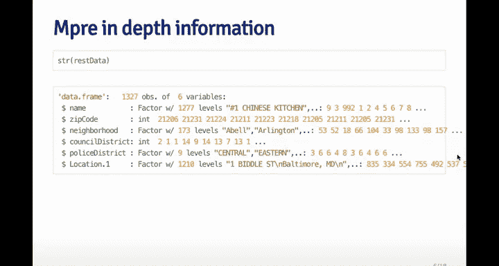

```r
str(restData)
```


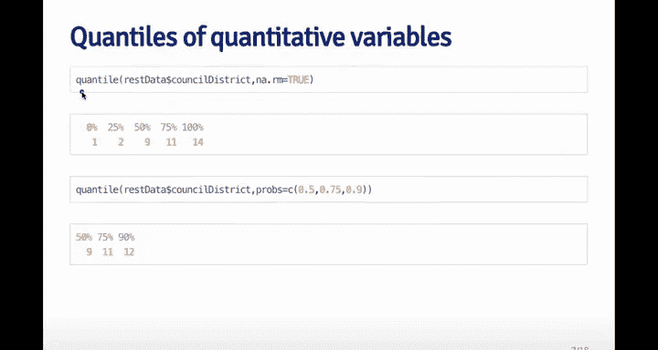

它会告诉你对象的类别（如数据框）、维度，以及每一列的数据类型（如因子、整数等）。这有助于你判断是否需要转换变量类型。

## 深入分析变量

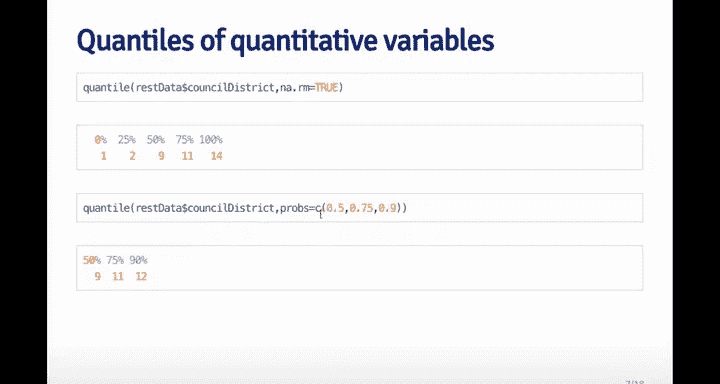

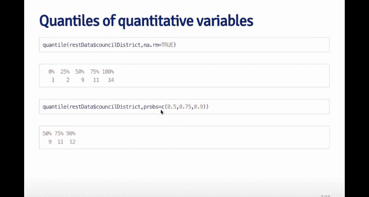

上一节我们介绍了查看数据整体情况的方法，本节中我们来看看如何对特定变量进行更深入的分析。

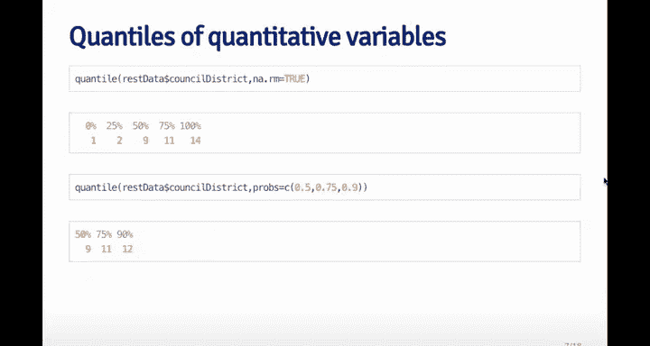

### 分析数值变量

`quantile()`函数用于查看数值变量的分布情况。


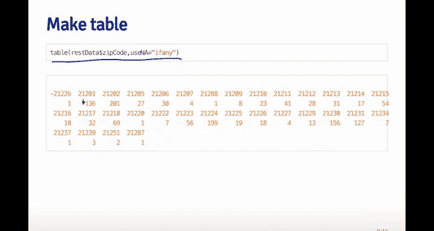

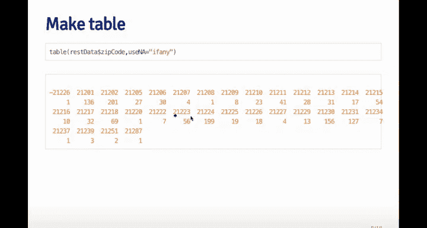


```r
# 查看“councilDistrict”变量的分位数
quantile(restData$councilDistrict)
```

你可以指定不同的概率来查看对应的百分位数。

```r
# 查看0%、50%（中位数）和99%分位数
quantile(restData$councilDistrict, probs = c(0, 0.5, 0.99))
```

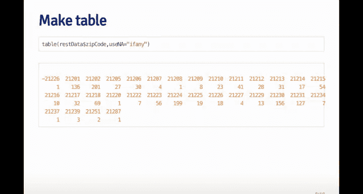

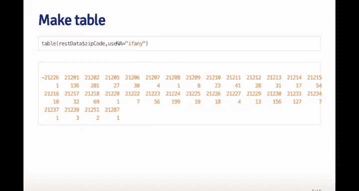

### 创建频数表

`table()`函数可以为分类变量创建频数表。

```r
# 创建邮政编码的频数表
table(restData$zipCode)
```

这能让你快速了解每个类别的数量分布。默认情况下，`table()`函数会忽略缺失值（NA）。为了确保能发现缺失值，需要使用`useNA`参数。

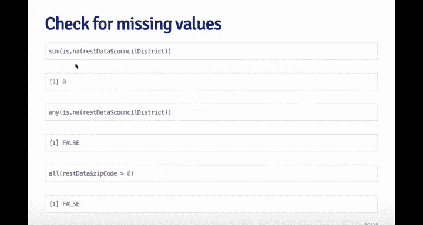

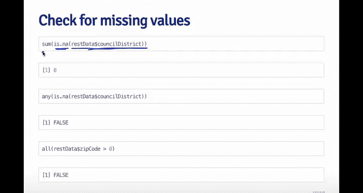

```r
# 创建包含缺失值计数的频数表
table(restData$zipCode, useNA = "ifany")
```

### 创建二维交叉表


你还可以创建二维交叉表，以探索两个分类变量之间的关系。

```r
# 按“councilDistrict”和“zipCode”创建交叉表
table(restData$councilDistrict, restData$zipCode)
```


## 检查缺失值与数据完整性

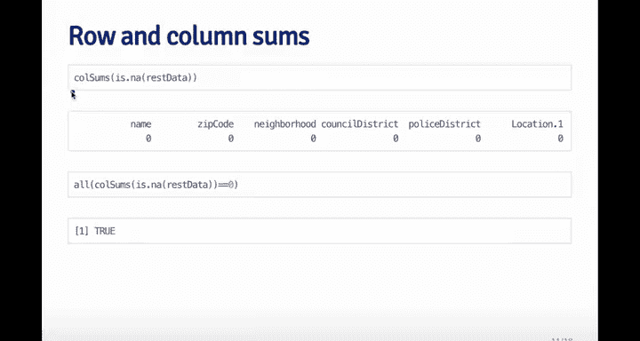

在了解了如何查看数据分布后，我们需要系统地检查数据的完整性和正确性。

### 检查缺失值

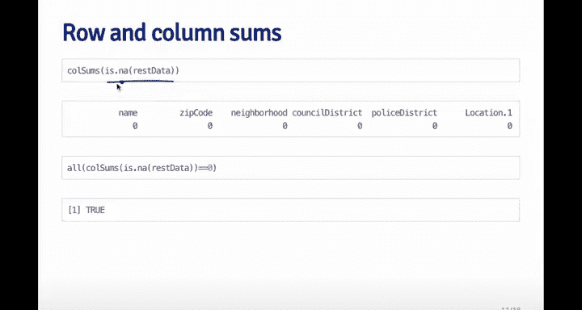

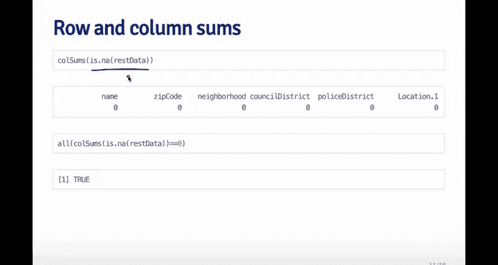

`is.na()`函数可以检测缺失值。结合`sum()`或`any()`函数使用非常方便。


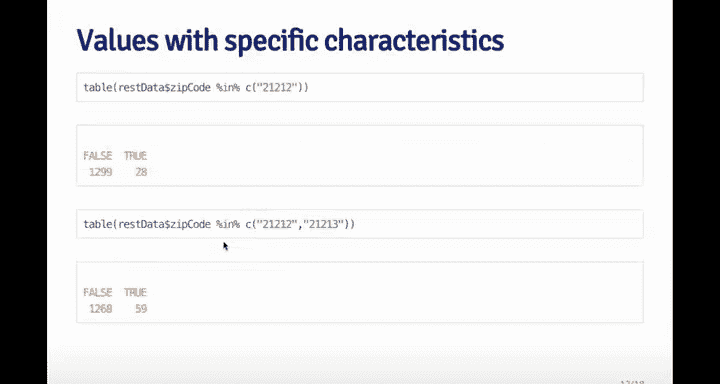

```r
# 检查“councilDistrict”列是否有缺失值，并计算缺失数量
sum(is.na(restData$councilDistrict))

# 检查“councilDistrict”列是否存在任何缺失值
any(is.na(restData$councilDistrict))
```

`any()`函数检查向量中是否存在`TRUE`值（即是否存在NA）。`all()`函数则检查是否所有值都满足某个条件。

```r
# 检查是否所有邮政编码都大于0（我们发现有一个负值）
all(restData$zipCode > 0)
```

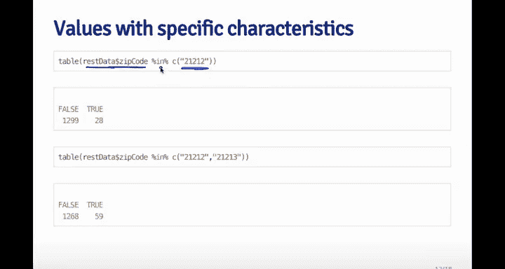

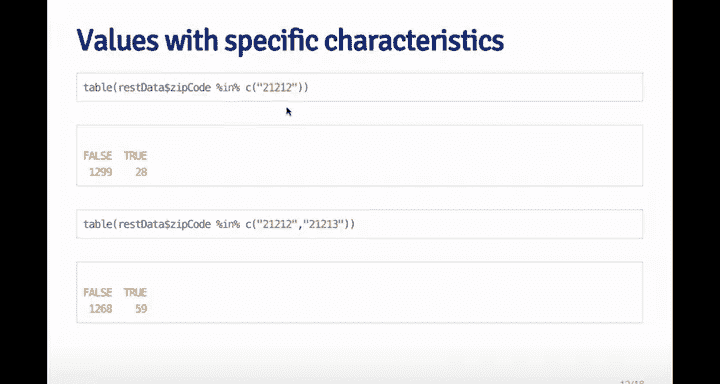

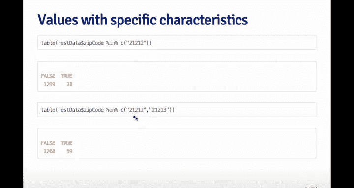

### 跨列检查缺失值

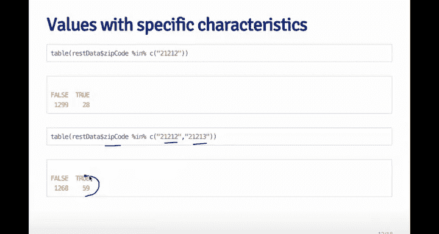

`colSums()`和`rowSums()`函数可以对矩阵或数据框的行或列进行求和。结合`is.na()`使用，可以快速检查整个数据集的缺失情况。

```r
# 检查数据框每一列的缺失值数量
colSums(is.na(restData))

# 确认所有列的缺失值数量都为0
all(colSums(is.na(restData))==0)
```

## 数据子集与高级汇总

### 基于条件筛选数据

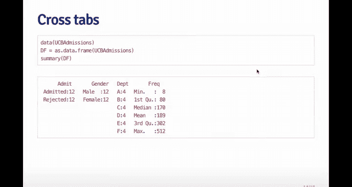

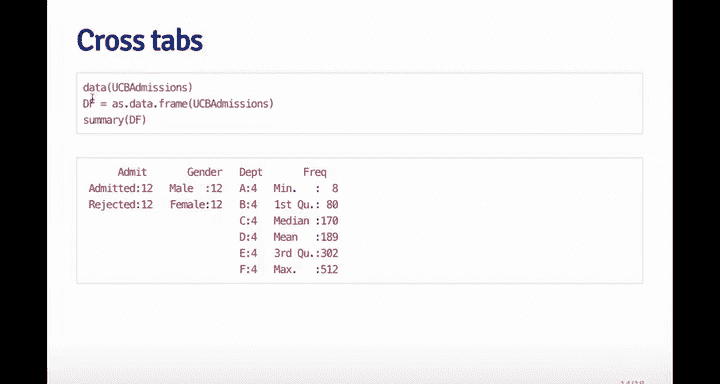

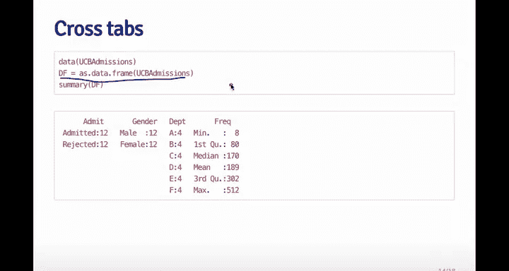

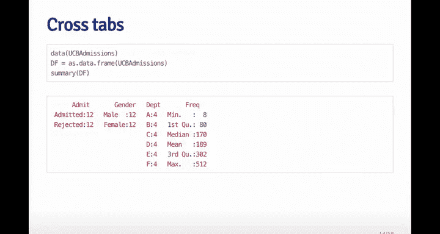

你可以使用逻辑条件来创建数据的子集。`%in%`操作符在匹配多个值时特别有用。

```r
# 找出邮政编码为21212或21213的餐厅
zipCodes <- c("21212", "21213")
restData_subset <- restData[restData$zipCode %in% zipCodes, ]
```

### 创建交叉汇总表

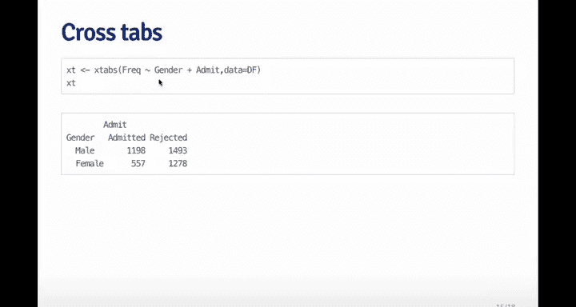

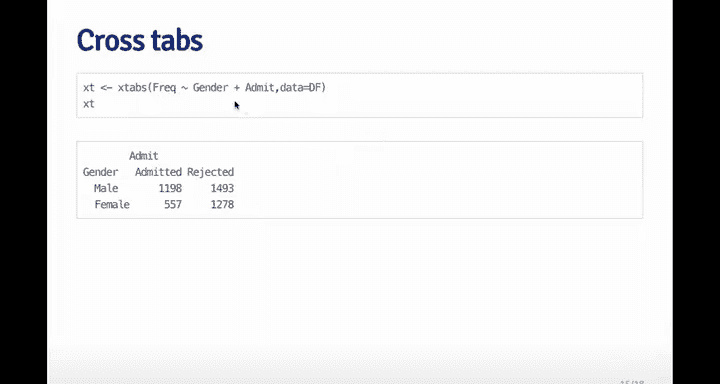

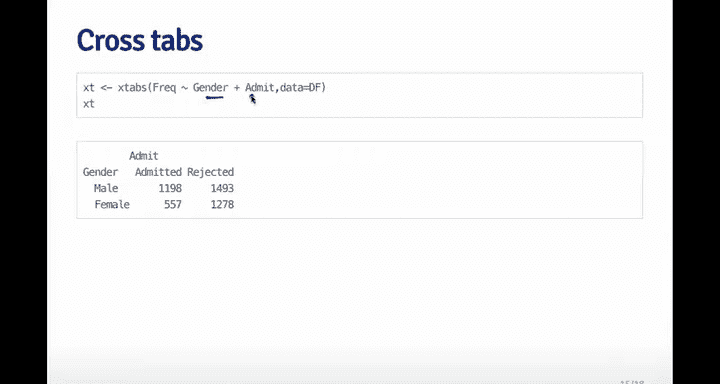

对于更复杂的数据，可以使用`xtabs()`函数创建加权交叉表。我们以R内置的`UCBAdmissions`数据集为例。

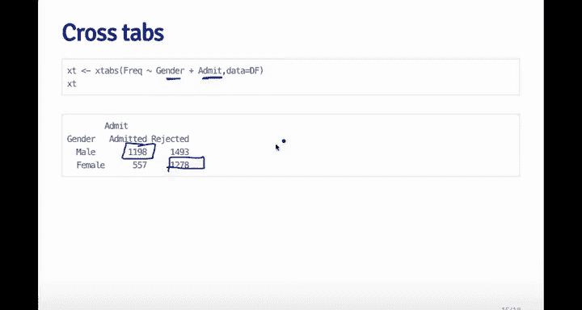

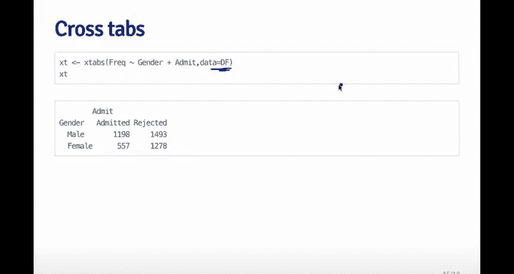

```r
# 加载伯克利大学录取数据
data("UCBAdmissions")
df <- as.data.frame(UCBAdmissions)

# 创建按性别和录取状态交叉汇总的频率表
xtabs(Freq ~ Gender + Admit, data = df)
```

`xtabs()`公式的左边（`Freq`）是表中要显示的值，右边（`Gender + Admit`）是用于分类的变量。

### 处理高维表格

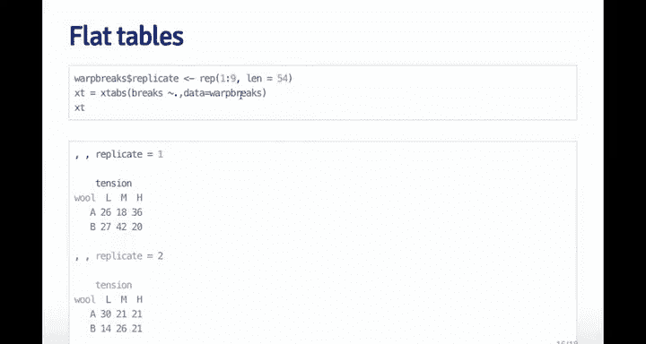

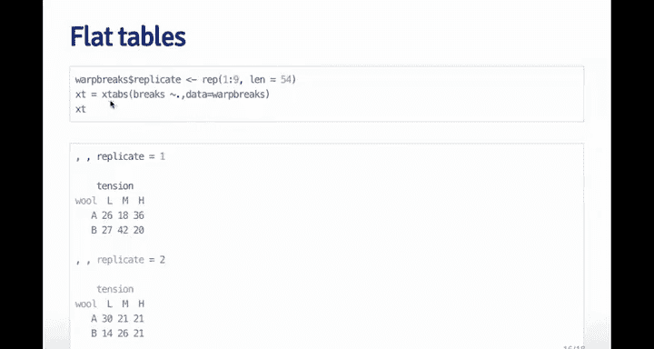

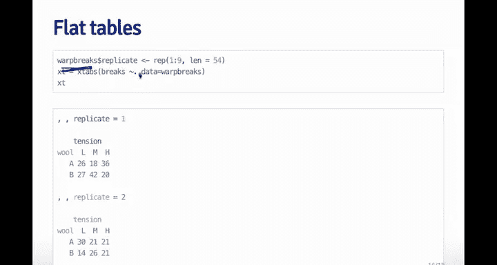

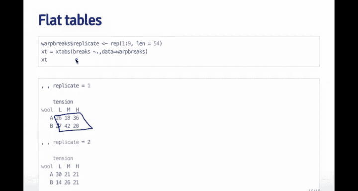

当涉及多个分类变量时，交叉表会变得复杂。`ftable()`函数可以将高维表格“扁平化”，使其更易于阅读。

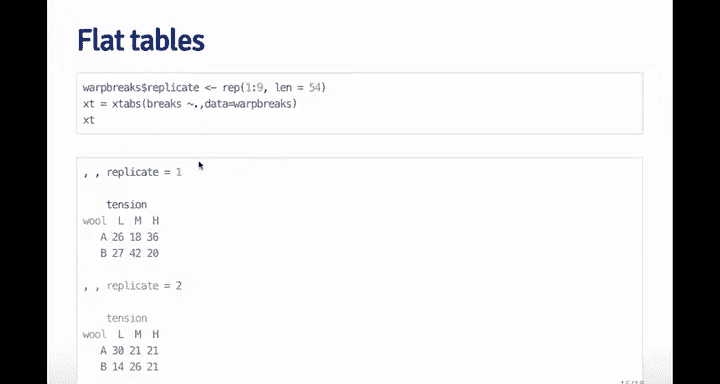

```r
# 使用Warpbreaks数据集创建三维交叉表
data("warpbreaks")
# 添加一个虚拟的复制变量作为示例
warpbreaks$replicate <- rep(1:9, len = 54)
# 创建交叉表
xt <- xtabs(breaks ~ ., data = warpbreaks)
# 扁平化显示
ftable(xt)
```


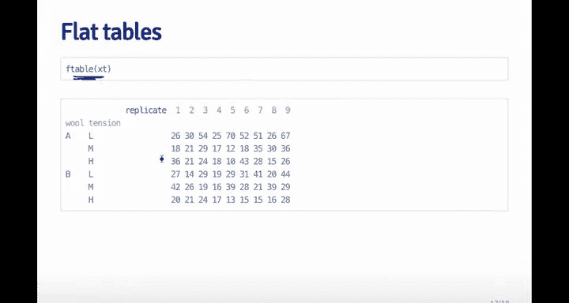

## 检查数据大小

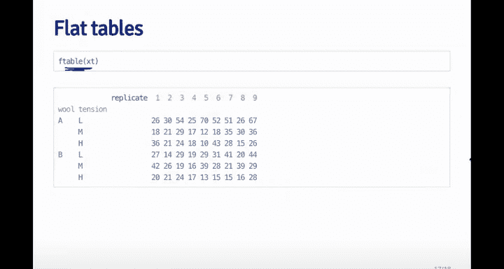

最后，在处理大型数据集时，了解其内存占用情况很有帮助。`object.size()`函数可以查看对象的大小。

```r
# 创建一个示例数据
D <- data.frame(x=rnorm(100), y=rnorm(100))
# 查看对象大小（字节）
object.size(D)
# 以更易读的单位（如MB）打印大小
print(object.size(D), units="Mb")
```

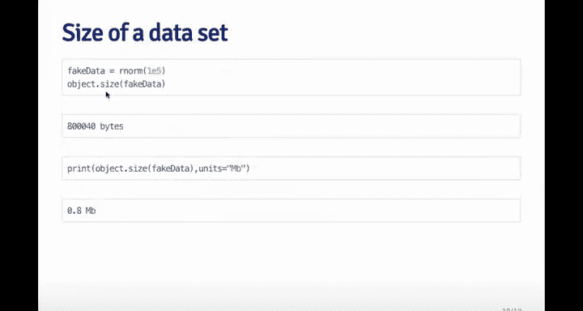

## 总结

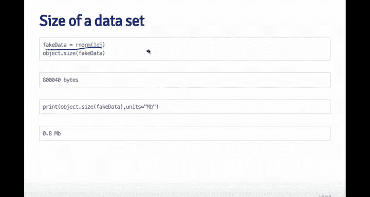

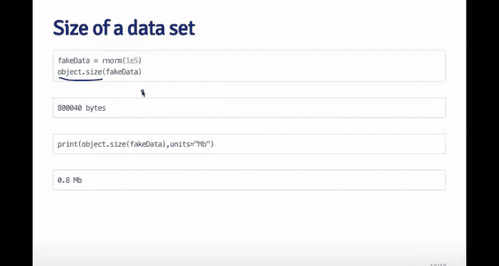

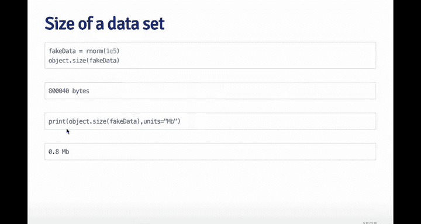

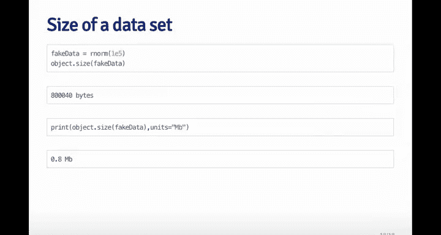

本节课中我们一起学习了在R中初步探索和汇总数据的一系列核心技能。我们首先学习了如何使用`head()`、`tail()`、`summary()`和`str()`来快速了解数据的全貌和结构。接着，我们掌握了使用`quantile()`和`table()`分析变量分布，以及使用`is.na()`、`any()`、`all()`和`colSums()`来系统检查数据完整性和缺失值的方法。最后，我们探讨了如何使用逻辑条件和`%in%`操作符创建数据子集，以及利用`xtabs()`和`ftable()`进行高级交叉汇总，并使用`object.size()`评估数据大小。这些工具是进行有效数据清洗和准备工作的基础。