# 090：创建新变量 🧮


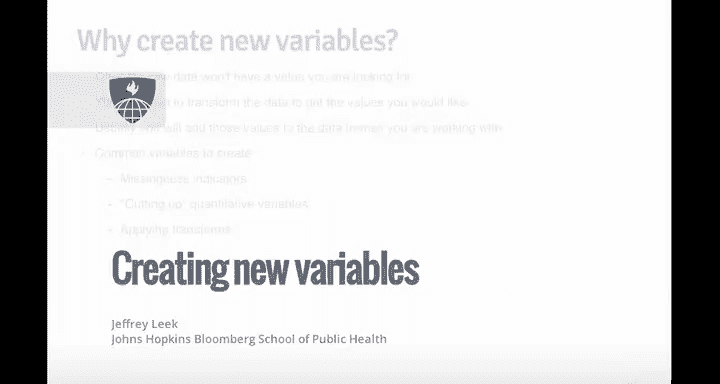

在本节课中，我们将学习如何在R语言中创建新的变量。加载数据集后，有时会发现原始数据中并不包含我们需要的某些变量。因此，我们需要对数据进行一些转换，以得到所需的值。通常，我们会将这些新值添加回数据框中，这在预测等任务中尤为重要，因为我们需要创建可能用作预测因子的新变量。

上一节我们介绍了数据加载的基本概念，本节中我们来看看如何通过创建新变量来丰富和转换数据。

## 创建序列

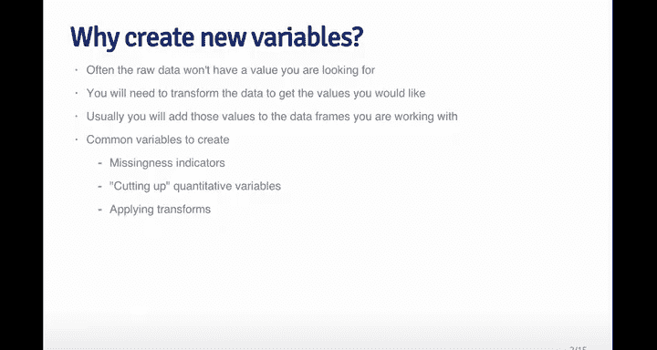

在深入分析数据之前，首先介绍如何创建序列。序列常用于索引对数据执行的不同操作，因此了解如何创建它们很有用。在R中，创建序列的命令是 `seq`。

通常，你需要告诉 `seq` 最小值和最大值。有两种常用方法来指定生成多少个值：一种是使用 `by` 参数，另一种是指定向量的长度。

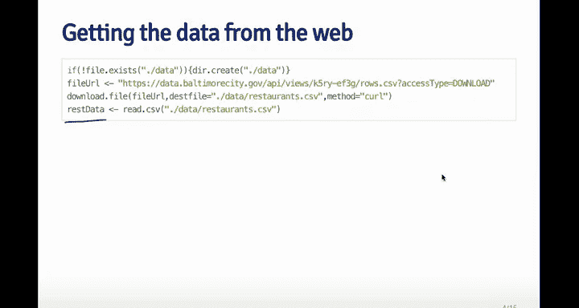

以下是创建序列的几种方法：

*   **使用 `by` 参数**：`seq(1, 10, by=2)` 会创建一个从1开始，每次增加2的序列。
*   **指定长度**：`seq(1, 10, length=3)` 会创建一个从1开始，到10结束，且恰好包含3个值的序列。
*   **使用 `seq_along`**：如果你有一个向量 `x`，并想创建一个与之等长的索引向量用于循环或访问数据子集，可以使用 `seq_along(x)`。

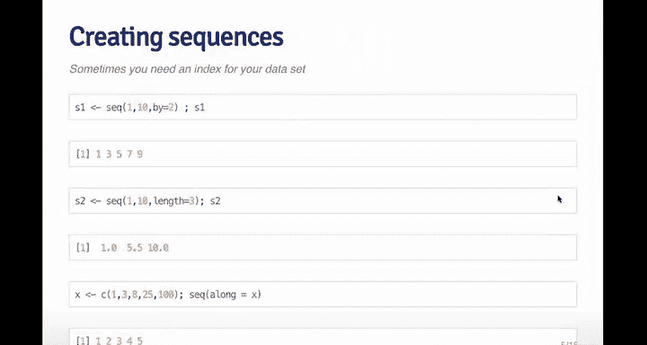

## 创建子集指示变量

你可能需要创建一个变量，用于指示另一个变量属于哪个子集。例如，在餐厅数据集中，我们有餐厅所在的社区信息。假设我想找出我附近两个社区（Roland Park 和 Homeland）的所有餐厅。

可以使用 `%in%` 命令来查找仅属于这两个社区的餐厅。如果餐厅在指定社区中，则返回 `TRUE`，否则返回 `FALSE`。然后，我将这个名为 `nearme` 的新变量附加到餐厅数据框中。这样，我就可以方便地根据 `nearme` 变量来筛选出附近的餐厅，这是一种比反复使用 `%in%` 命令更简洁的数据子集筛选方法。

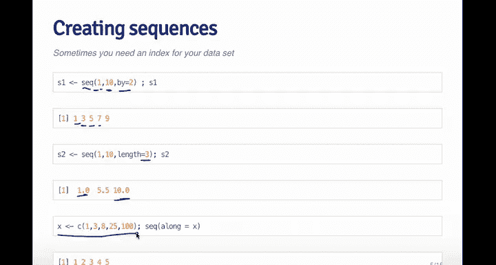


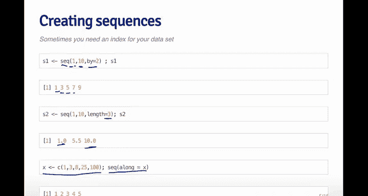

```r
# 假设 restData 是数据框，neighborhood 是社区列
restData$nearme <- restData$neighborhood %in% c("Roland Park", "Homeland")
```

## 创建二元变量

另一个常见操作是创建二元变量。例如，我们可能想找出邮政编码错误的案例。

这里，我向数据框分配一个名为 `zipWrong` 的变量，并使用 `ifelse` 命令。`ifelse` 命令首先接收一个条件（例如，邮政编码是否小于0）。如果条件为真（邮政编码小于0），则返回 `TRUE`；如果条件为假（邮政编码为正数），则返回 `FALSE`。

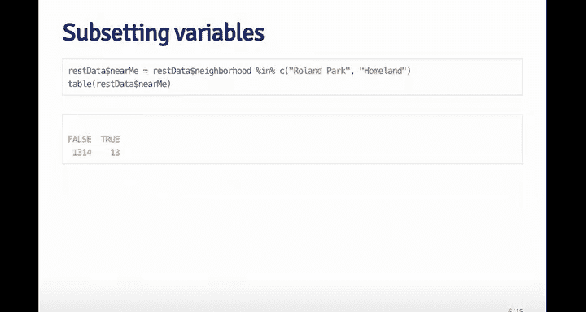


这样，我就可以创建一个表格来显示邮政编码是否错误。所有邮政编码小于0的案例都会标记为 `TRUE`，这便于我将这些值从数据集中过滤掉。

```r
restData$zipWrong <- ifelse(restData$zipCode < 0, TRUE, FALSE)
table(restData$zipWrong, restData$zipCode < 0)
```

## 将定量变量转换为分类变量

你可能希望将定量变量转换为分类变量。例如，我们可能想将邮政编码分成连续的几组。

这里，我创建一个名为 `zipGroups` 的变量，使用 `cut` 命令。我将 `cut` 命令应用于定量变量“邮政编码”，并告诉它按照我提供的一组值（在本例中是邮政编码的分位数）进行分割。

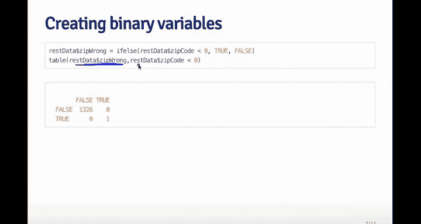

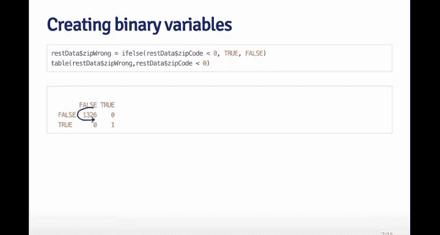

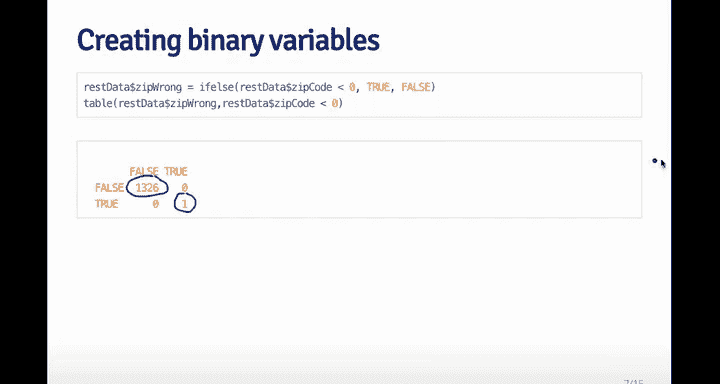

`cut` 命令将返回一个因子变量。`zipGroups` 就是一个因子变量，它将邮政编码变量分割成：第0分位数到第25百分位数、第25到第50百分位数、第50到第75百分位数、第75到第100百分位数。

然后，我可以制作一个表格，显示哪些邮政编码落入这些不同的分组中。例如，低值落入第一组，中等值落入下一组，依此类推。

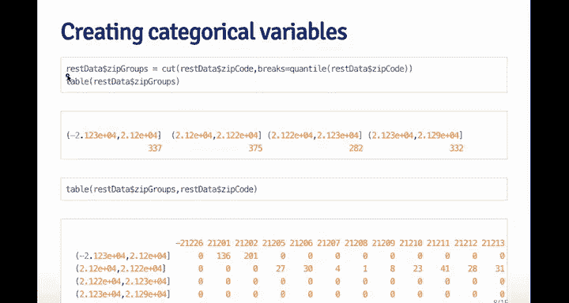

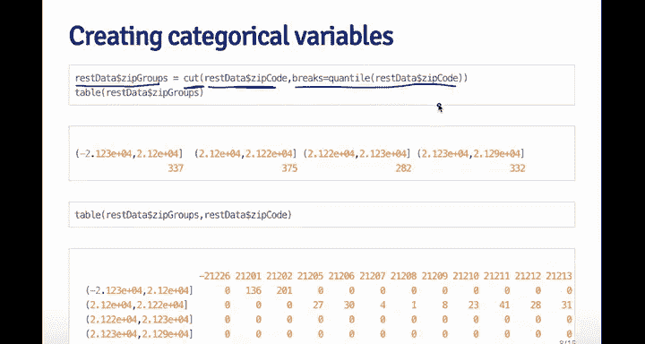

```r
restData$zipGroups <- cut(restData$zipCode, breaks=quantile(restData$zipCode))
table(restData$zipGroups)
```

## 使用 `cut2` 函数简化分组

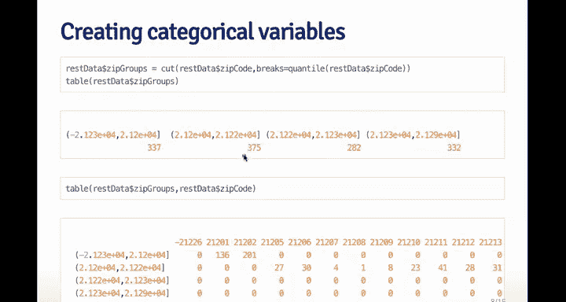

在之前的 `cut` 函数版本中，我必须用 `quantile` 函数指定所有分割点。如果你使用 `Hmisc` 包中的 `cut2` 函数，可以更简单地实现。

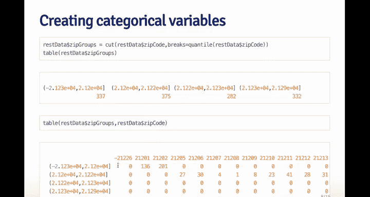

使用 `cut2` 函数，你可以直接指定想将邮政编码分成多少组（例如4组），并指定按分位数分割。`cut2` 函数会自动找出分位数并按此将数据分成4组。如果你不想预先设置分割点，这是一种很好的方法。

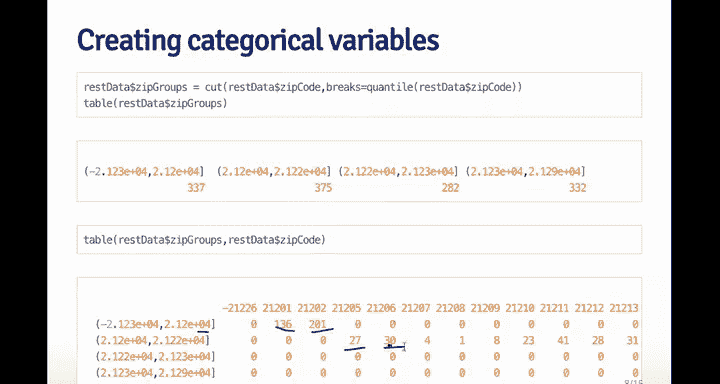


```r
# 需要先安装并加载 Hmisc 包
# install.packages("Hmisc")
library(Hmisc)
restData$zipGroups <- cut2(restData$zipCode, g=4)
table(restData$zipGroups)
```

## 创建因子变量

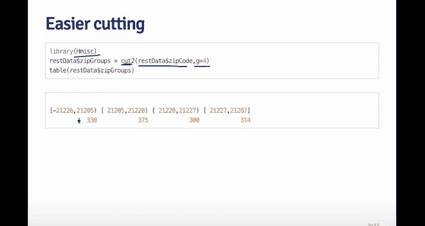

你可能需要创建因子变量。例如，加载到R中的邮政编码变量是整数变量，但你可能想将其转换为因子变量。换句话说，邮政编码增加1并不一定意味着变量发生了定量变化，因此你可能想将其视为分类变量。

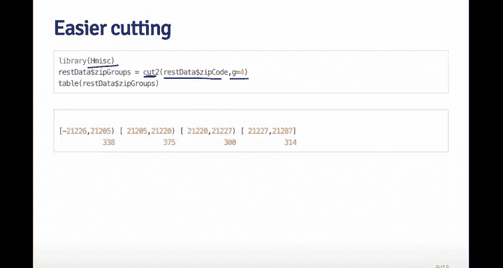

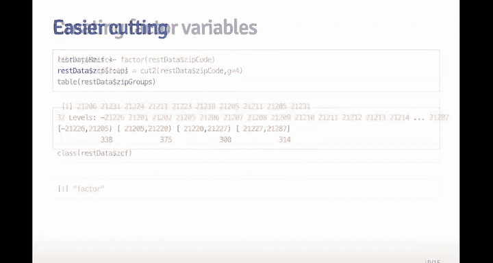

使用 `factor` 命令可以实现这一点。它接收一个整数变量作为输入，并将其转换为一个名为 `zcf` 的因子变量。查看 `zcf` 的前10个值，它们看起来和以前一样，但 `factor` 会告诉你有多少个不同的邮政编码水平（例如32个）。查看这个变量的类别，它现在是因子变量。

```r
restData$zcf <- factor(restData$zipCode)
class(restData$zcf)
```

## 因子变量的其他操作

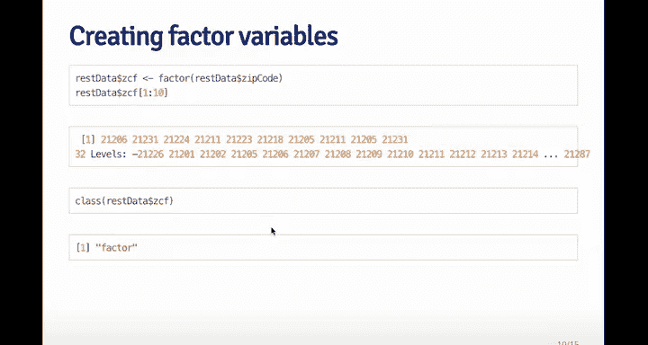

以下是关于因子变量的其他一些有用操作。首先，我创建一个虚拟向量来演示。

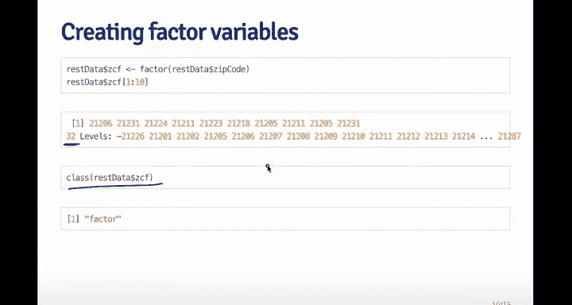

我创建一个包含“yes”和“no”的向量，随机生成一个大小为10的向量，并将其转换为因子变量。默认情况下，它会按字母顺序将最低值（“no”）作为因子变量的第一个水平。

但是，假设我希望将“yes”值作为最低水平（参考类）。那么，我可以在创建因子时指定水平的顺序。例如，我可以重新设定该变量的水平，使参考类等于“yes”值。

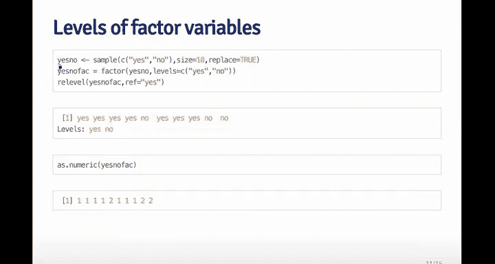

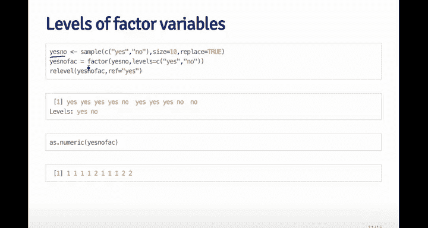

另外，如果你希望在特定模型中使用因子变量，可以使用 `as.numeric` 命令将其转换回数值变量。这样做时，它会从最低值开始，将其标记为1，下一个最低值标记为2，依此类推。

```r
yesno <- sample(c("yes", "no"), size=10, replace=TRUE)
yesnofac <- factor(yesno, levels=c("yes", "no"))
relevel(yesnofac, ref="yes")
as.numeric(yesnofac)
```

## 使用 `mutate` 函数添加新变量

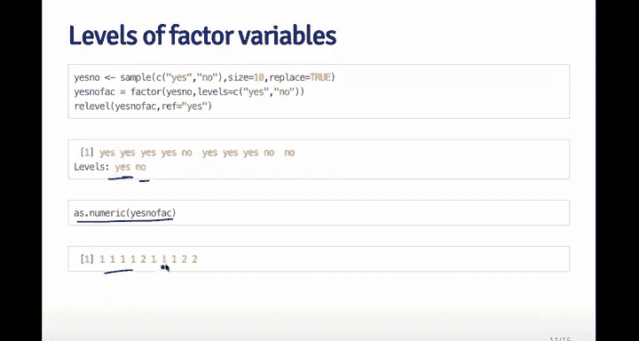

你可以使用 `mutate` 函数创建一个新版本的变量，并同时将其添加到数据框中。这是 `plyr` 包（或 `dplyr` 包）的一部分。

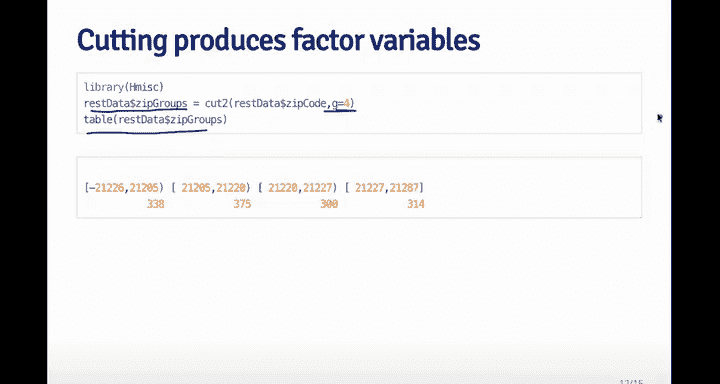

这里，我将创建一个新的数据框。我将对旧数据框应用 `mutate` 函数，并添加一个新变量 `zipGroups`，它等于原始 `restData` 数据框中某个变量的函数。现在，新数据框 `restData2` 将是旧的 `restData` 数据框加上新添加的变量。这样，我就可以在新数据框中查看 `zipGroups` 的表格。

```r
# 需要先安装并加载 dplyr 包
# install.packages("dplyr")
library(dplyr)
restData2 <- mutate(restData, zipGroups=cut2(zipCode, g=4))
table(restData2$zipGroups)
```

## 对定量数据进行常见变换

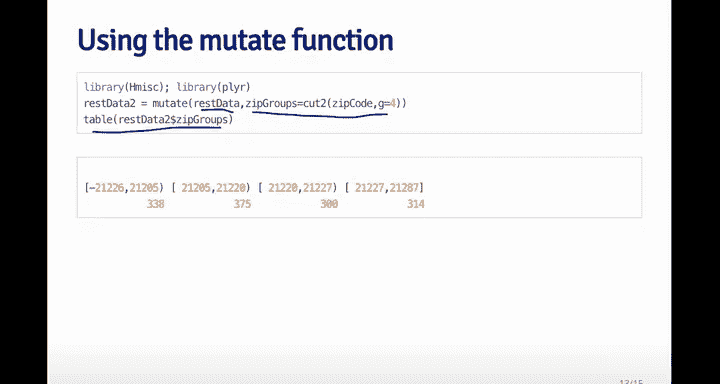

在探索性分析中，你可能需要对定量数据应用一些不同的变换。以下是最常见的变换列表：

*   **绝对值与平方根**：`abs()`， `sqrt()`
*   **取整函数**：
    *   `ceiling()`：向上取整
    *   `floor()`：向下取整
    *   `round(x, digits=n)`：四舍五入到指定位数
    *   `signif(x, digits=n)`：四舍五入到指定有效数字位数
*   **三角函数**：`cos()`， `sin()` 等
*   **对数与指数**：
    *   `log()`， `log2()`， `log10()`：常用于处理偏态数据或存在许多离群值的数据。
    *   `exp()`：指数函数

关于数据变换的更多信息，可以参考课程中提供的链接，以及 Jackie 的讲义和 R 的 `Math` 方法页面。

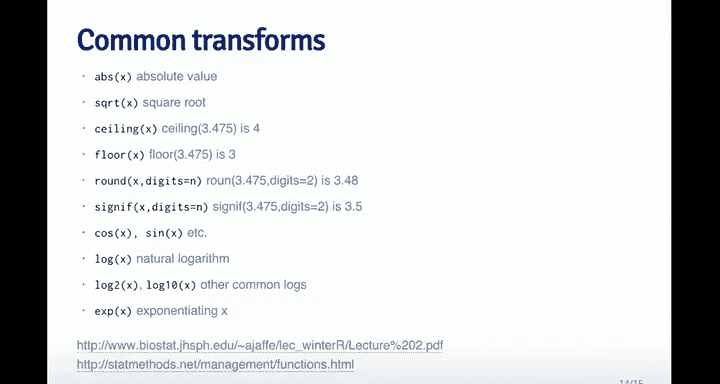

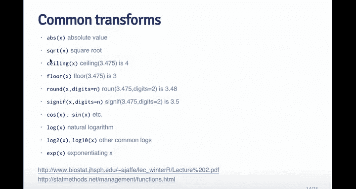

## 总结

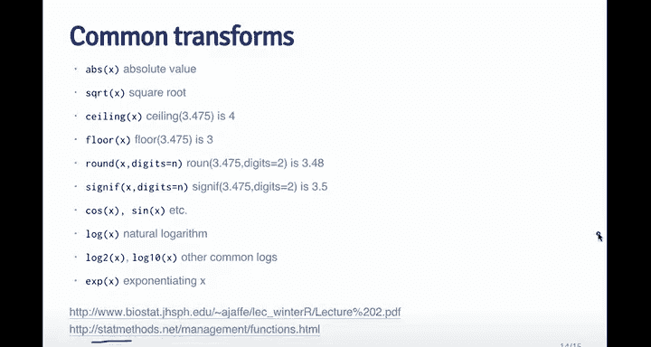


本节课中，我们一起学习了在R中创建新变量的多种方法。我们从创建用于索引的序列开始，然后学习了如何创建子集指示变量和二元变量来标记或筛选数据。接着，我们探讨了将定量变量转换为分类变量的技术，包括使用 `cut` 和 `cut2` 函数进行分组，以及使用 `factor` 函数创建因子变量。我们还介绍了 `mutate` 函数，它可以高效地在数据框中添加新变量。最后，我们回顾了对定量数据进行探索性分析时常用的一些数学变换。掌握这些技能，能够帮助你更灵活地处理和准备数据，以满足后续分析和建模的需求。