# 091：重塑数据 🧩


在本节课中，我们将学习如何重塑R语言中的数据。数据在加载到R中时，其格式往往并非“整洁”的，可能以某种奇怪的方式排列。因此，我们首先需要将数据重塑成我们想要的格式。

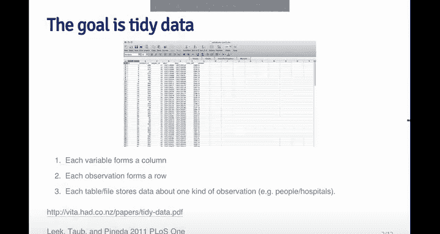

## 什么是整洁数据？📐

上一节我们提到了数据重塑的目标是获得整洁数据。整洁数据有几项核心原则：
*   每个变量构成一列。
*   每个观测构成一行。
*   每个表格或文件只存储一种观测类型的数据。

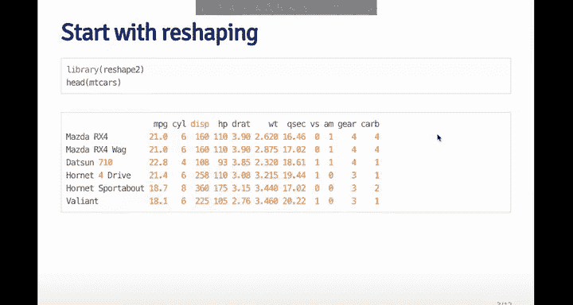

在本节的数据重塑中，我们将重点关注前两个原则。

## 数据重塑基础：熔化与重铸 🔥

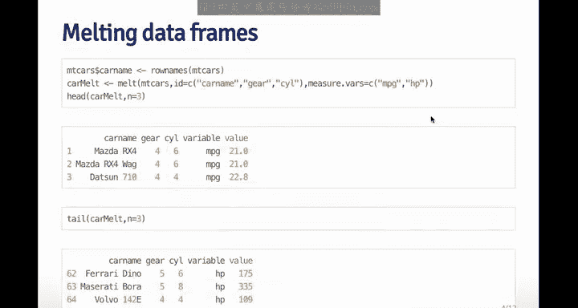

我们将从查看R中的内置数据集 `mtcars` 开始。这个数据集包含多辆汽车（行）及其多个观测变量（列），如每加仑英里数（mpg）、气缸数（cyl）和马力（hp）等。接下来，我们将对这个数据集进行重塑。

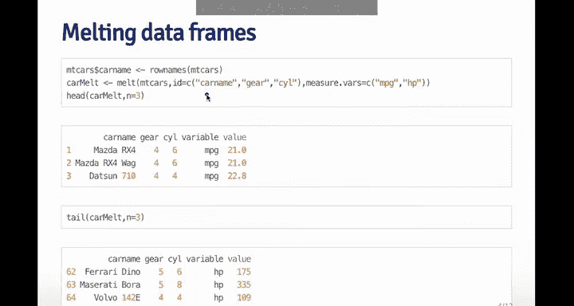

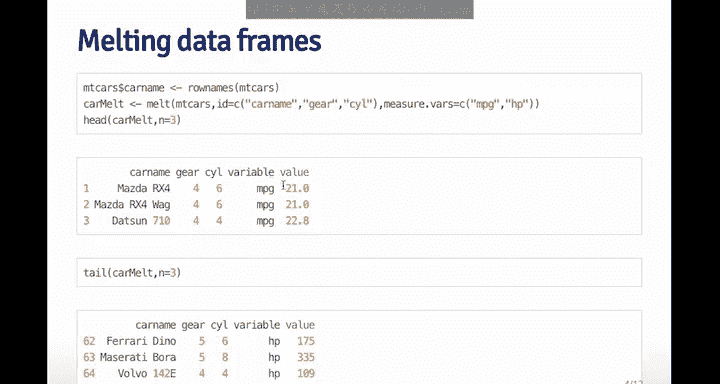

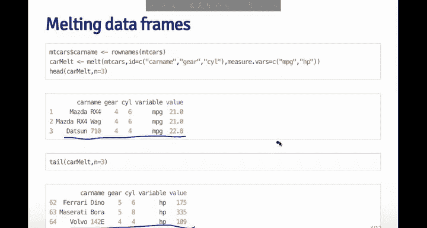

### 熔化数据

首先，我们可以“熔化”数据。熔化数据时，我们将数据框传递给 `melt` 函数，并指定哪些是标识变量，哪些是度量变量。

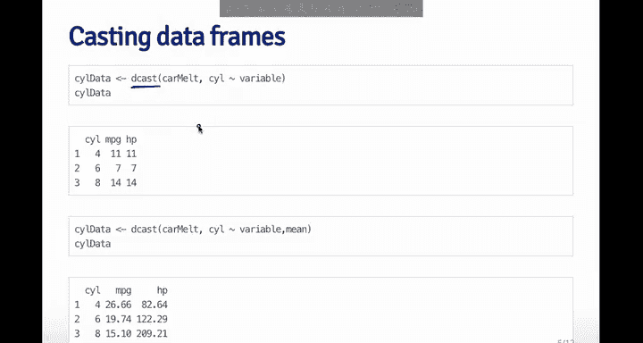

以下是使用 `melt` 函数的示例：
```r
# 假设我们使用reshape2包
library(reshape2)
carMelt <- melt(mtcars, id.vars=c("car_name", "gear", "cyl"), measure.vars=c("mpg", "hp"))
```

这段代码会创建一个高而瘦的数据框。标识变量（如car_name, gear, cyl）会保留，而度量变量（如mpg, hp）会被“熔化”到一个名为“variable”的列中，其对应的值则在“value”列中。这样，每个mpg值和每个hp值都会独占一行。

### 重铸数据

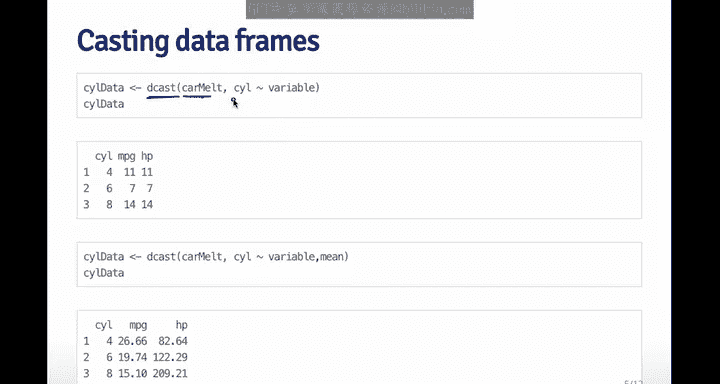

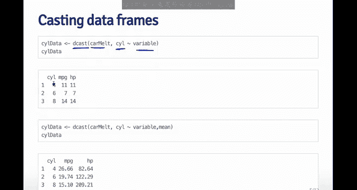


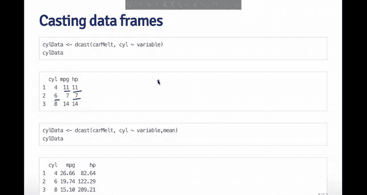

熔化数据后，我们可以用多种方式“重铸”它，将其重新格式化成不同的形状。这需要使用 `dcast` 函数。

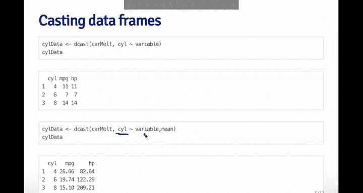

`dcast` 函数将熔化后的数据集重铸为特定形状的数据框。例如，如果我们想按不同变量查看气缸数的汇总：
```r
dcast(carMelt, cyl ~ variable)
```

这段代码会将不同的气缸数放在左侧的行中，将变量（mpg和hp）放在右侧的列中。默认情况下，它会使用 `length` 函数汇总数据，显示每个气缸数下mpg和hp的观测数量。

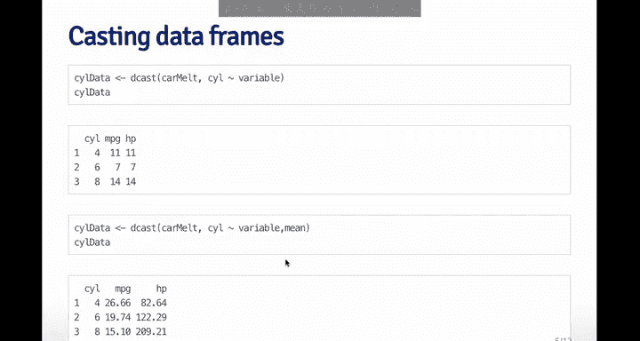


我们也可以传递不同的汇总函数，例如计算每个组的平均值：
```r
dcast(carMelt, cyl ~ variable, mean)
```

现在，对于四缸汽车，我们可以得到平均每加仑英里数是26.66，平均马力是82.64。这本质上是将数据以不同方式重新汇总和组织。

## 分组汇总：拆分-应用-合并 🔄


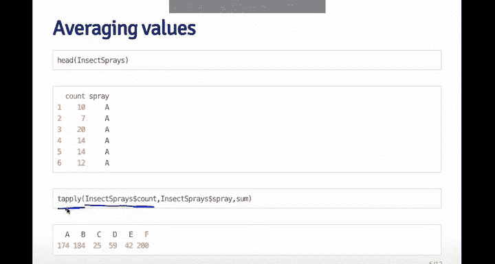

另一个常见需求是计算特定因子内的汇总值（如平均值、总和）。我们将使用 `InsectSprays` 数据集进行演示，该数据集包含不同杀虫喷雾（A-F）下的昆虫计数。

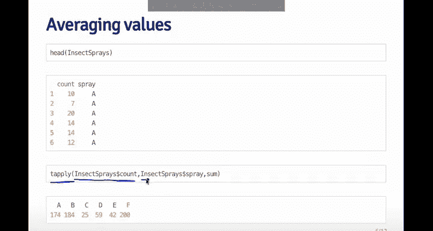

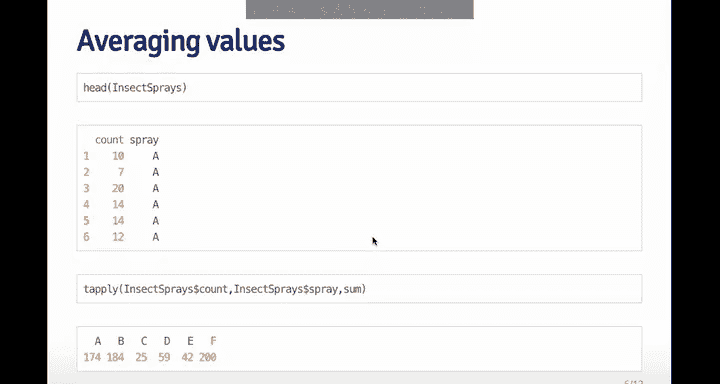

### 使用 `tapply` 快速汇总

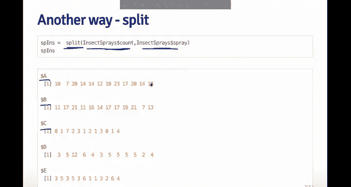

一种快速计算各喷雾组昆虫计数总和的方法是使用 `tapply` 函数：
```r
tapply(InsectSprays$count, InsectSprays$spray, sum)
```

`tapply` 函数沿着索引（spray）应用一个函数（sum）到数据（count）上，从而得到A、B、C等各组的昆虫总数。

### 完整的拆分-应用-合并流程

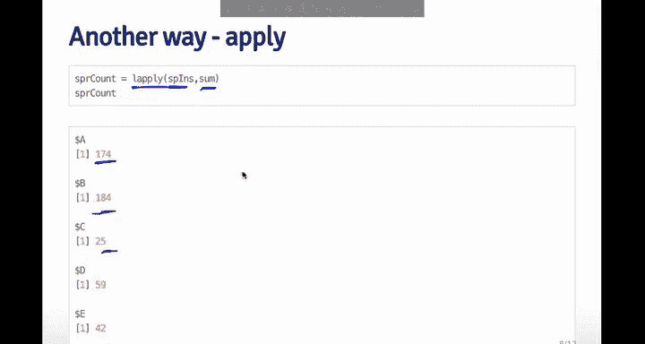

另一种更明确的方法是“拆分-应用-合并”模式：
1.  **拆分**：使用 `split` 函数按喷雾类型拆分数据。
    ```r
    spl <- split(InsectSprays$count, InsectSprays$spray)
    ```
2.  **应用**：使用 `lapply` 对拆分后的列表应用 `sum` 函数。
    ```r
    sprSum <- lapply(spl, sum)
    ```
3.  **合并**：使用 `unlist` 将列表结果合并回向量。
    ```r
    unlist(sprSum)
    ```

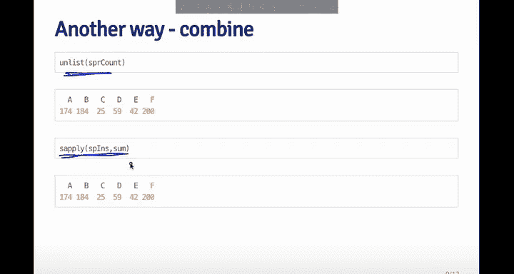

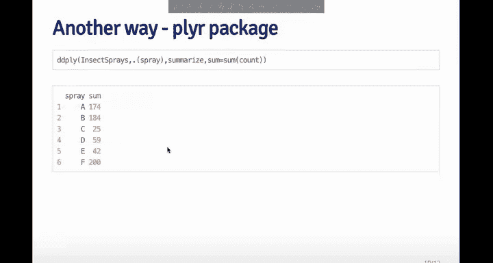

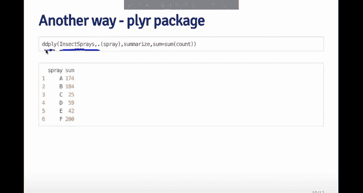

`sapply` 函数可以合并“应用”和“合并”这两个步骤：
```r
sapply(spl, sum)
```

## 使用 `plyr` 包简化操作 📦

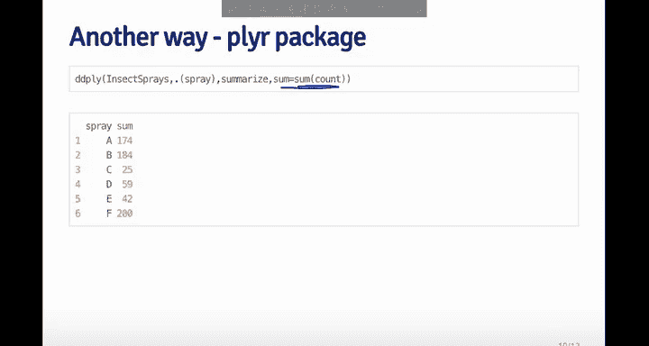

`plyr` 包为这类操作提供了一个简洁的接口。我们可以使用 `ddply` 函数一步完成分组汇总：
```r
# 假设我们已安装并加载plyr包
library(plyr)
ddply(InsectSprays, .(spray), summarize, sum=sum(count))
```

这段代码对 `InsectSprays` 数据框，按 `spray` 变量分组，汇总 `count` 列的和。

`ddply` 的另一个强大功能是，它可以计算与原始数据集长度相同的新变量。例如，为每个观测值计算其所属喷雾组的总计数：
```r
spraySums <- ddply(InsectSprays, .(spray), mutate, sum=sum(count))
```


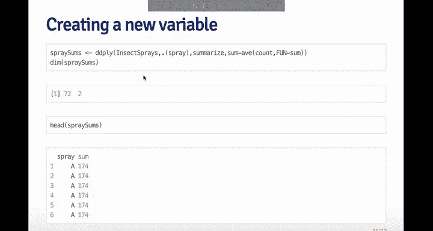

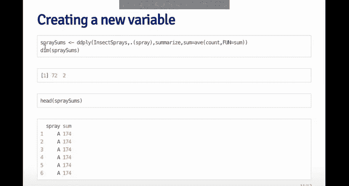


现在，`spraySums` 数据框中新增的 `sum` 列，对于每个属于A组的观测，其值都是A组的总计数。这个新变量可以添加到原数据中，用于后续分析。

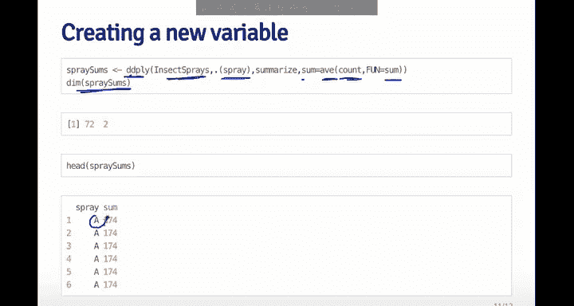

## 更多资源与函数 📚


关于重塑数据的更多信息，可以参考 `plyr` 包的教程。此外，还有一些其他有用的函数：
*   `acast`：与 `dcast` 类似，但将熔化后的数据转换为数组（可能多维）。
*   `arrange`：用于对数据集重新排序，无需使用之前课程中提到的 `order` 命令。
*   可以结合使用 `ddply` 和 `mutate` 来添加基于原变量汇总的新变量。

## 总结

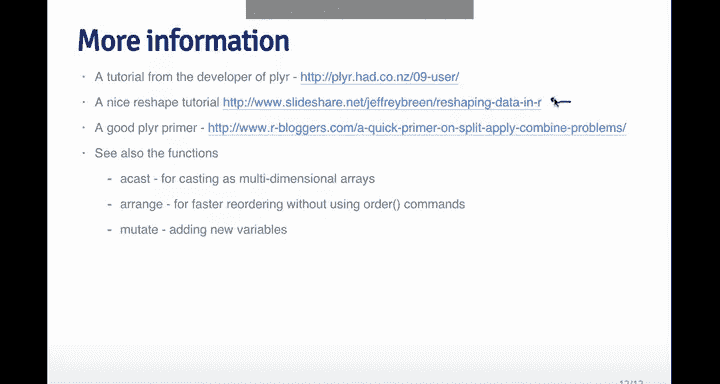

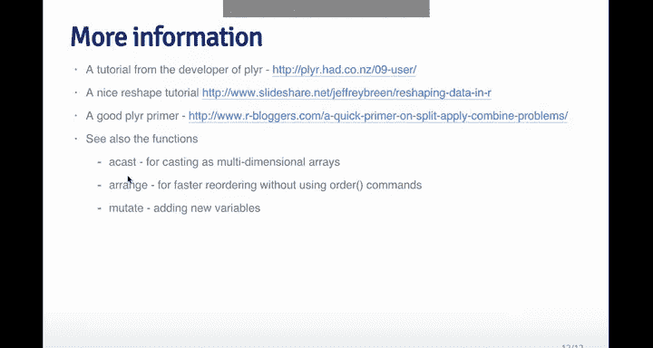

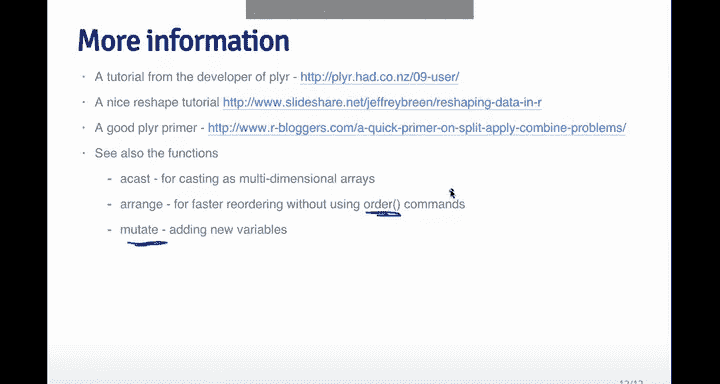

本节课中，我们一起学习了在R中重塑数据的关键技术。我们首先理解了整洁数据的原则，然后掌握了通过“熔化”与“重铸”来改变数据形状的方法。接着，我们探索了按组汇总数据的多种策略，包括快速的 `tapply`、清晰的“拆分-应用-合并”流程以及高效的 `plyr` 包操作。这些技能将帮助你有效地将原始数据整理成适合分析的格式。