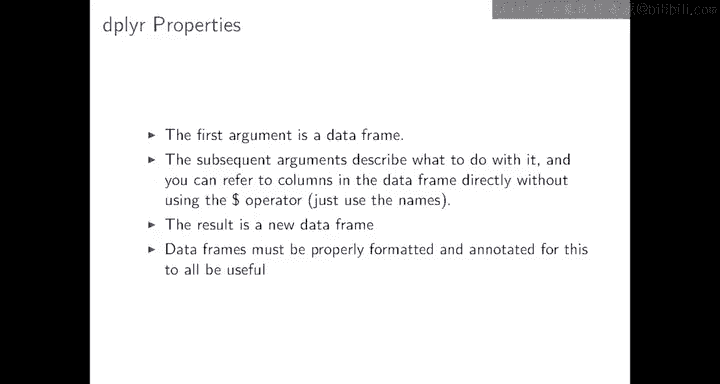

# 092：使用 dplyr 管理数据框入门 🚀


在本节课中，我们将学习 R 语言中一个专门用于处理数据框的强大工具包——`dplyr`。我们将介绍该包的基本概念和核心“动词”，包括 `arrange`、`filter`、`select`、`mutate` 和 `rename`。通过学习这些函数，你将能够以更高效、更直观的方式操作和管理数据。

## 概述：dplyr 与数据框

`dplyr` 包的核心是处理数据框。数据框是 R 语言和统计学中关键的数据结构。该包遵循“整洁数据”的基本假设：在一个数据框中，每一行代表一个观测，每一列代表一个变量、度量或特征。

`dplyr` 包由 RStudio 的 Hadley Wickham 开发，可以看作是 `plyr` 包的优化和精简版本。它在概念上并未提供全新的功能，但极大地简化了 R 中许多现有功能的操作，并且运行速度更快，这得益于其许多关键操作是用底层的 C++ 代码实现的。

## 核心“动词”简介

`dplyr` 提供了一系列核心函数，我们称之为数据操作的“动词”。以下是本课程将介绍的主要动词：

*   **`select`**：返回数据框列的子集。
*   **`filter`**：提取数据框行的子集。
*   **`arrange`**：对数据框的行进行重新排序。
*   **`rename`**：重命名变量（列）。
*   **`mutate`**：转换或向数据框添加新变量。
*   **`summarize`**：生成数据框的汇总统计量。

所有 `dplyr` 函数都具有相似的格式：第一个参数总是一个数据框，随后的参数则描述要对该数据框执行什么操作。每个函数都会返回一个新的数据框。因此，确保你的数据框格式正确、标注清晰（例如，因子水平已标注、变量名完整）对于有效使用这些函数至关重要。

## 函数详解与使用

上一节我们介绍了 `dplyr` 的核心“动词”，本节中我们来看看它们的具体用法。每个函数都设计得简单直观。

### 1. select：选择列

`select` 函数用于根据列名选择数据框中的特定列。

**语法**：
```r
select(data_frame, column1, column2, ...)
```

**示例**：假设有一个名为 `my_data` 的数据框，包含 `id`、`name`、`age`、`salary` 列。
```r
# 只选择 name 和 age 列
new_data <- select(my_data, name, age)
```

### 2. filter：筛选行

`filter` 函数用于根据逻辑条件筛选出满足特定条件的行。

**语法**：
```r
filter(data_frame, logical_condition)
```

**示例**：筛选出 `age` 大于 30 的行。
```r
# 筛选年龄大于30的员工
older_employees <- filter(my_data, age > 30)
```

### 3. arrange：排列行

`arrange` 函数用于根据一列或多列的值对数据框的行进行升序或降序排序。

**语法**：
```r
arrange(data_frame, column_to_sort_by)
# 降序排列
arrange(data_frame, desc(column_to_sort_by))
```

**示例**：按 `salary` 降序排列数据。
```r
# 按薪资从高到低排列
sorted_data <- arrange(my_data, desc(salary))
```

### 4. rename：重命名列

`rename` 函数用于更改数据框中一个或多个列的名称。

**语法**：
```r
rename(data_frame, new_name = old_name)
```

**示例**：将列名 `id` 改为 `employee_id`。
```r
# 重命名id列
renamed_data <- rename(my_data, employee_id = id)
```

### 5. mutate：创建新列

`mutate` 函数用于添加新的列，或基于现有列转换生成新的列。

**语法**：
```r
mutate(data_frame, new_column = expression_based_on_old_columns)
```

**示例**：创建一个新列 `annual_salary`，其值为 `monthly_salary` 列乘以 12。
```r
# 计算年薪
my_data <- mutate(my_data, annual_salary = monthly_salary * 12)
```

## 总结



本节课中，我们一起学习了 R 语言 `dplyr` 包的基础知识。我们了解到 `dplyr` 是专门为高效、直观地操作数据框而设计的工具包。我们重点介绍了五个核心“动词”：`select`（选择列）、`filter`（筛选行）、`arrange`（排序行）、`rename`（重命名列）和 `mutate`（创建新列）。这些函数具有一致的语法结构，第一个参数是数据框，并总是返回一个新的数据框。掌握这些基础函数，将为你在 R 中进行数据清洗、转换和探索性分析打下坚实的基础。