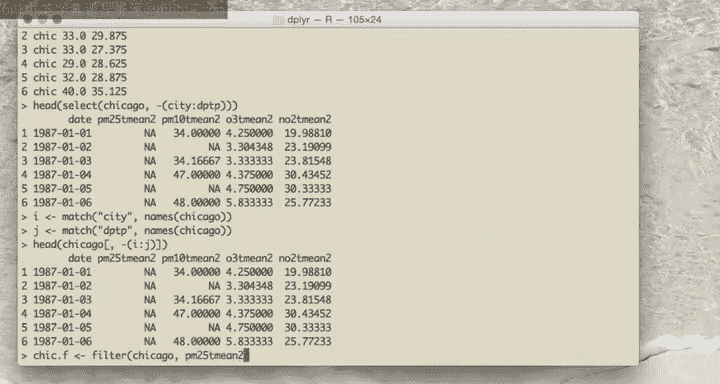
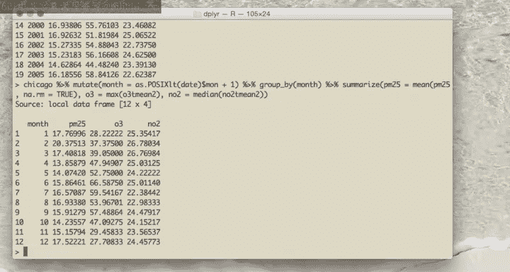
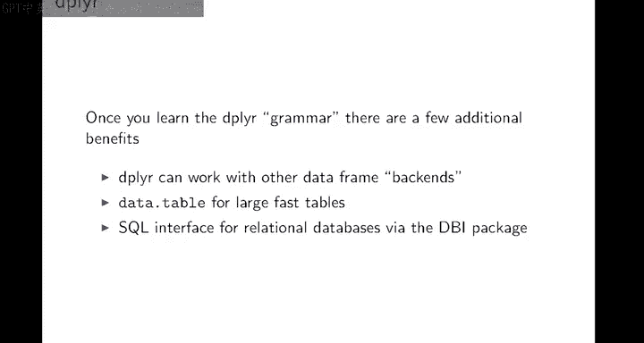

# 093：使用dplyr管理数据框的基本工具 📊


在本节课中，我们将学习如何使用R语言中的`dplyr`包来高效地管理和操作数据框。`dplyr`提供了一系列直观且强大的函数，可以简化数据筛选、排序、重命名、创建新变量以及分组汇总等常见任务。

## 概述

首先，你需要加载`dplyr`包。加载时可能会看到一些警告信息，这是因为有其他函数与`dplyr`中的函数同名，但这暂时无需担心。

```r
library(dplyr)
```

我们将使用一个关于芝加哥市1987年至2005年空气污染和天气变量的示例数据集。该数据集包含6940行和8列。

```r
# 假设数据已加载为`chicago`数据框
dim(chicago) # 查看数据维度
head(chicago) # 查看前几行数据
```

## 选择列：`select`函数

`select`函数允许你根据列名选择数据框中的特定列，而无需使用列索引。

以下是使用`select`函数的一些方法：

*   **按名称范围选择**：你可以使用`:`符号选择从某个列到另一个列之间的所有列。
    ```r
    select(chicago, city:dptp)
    ```
    这段代码会选择从`city`列到`dptp`（露点）列之间的所有列。

*   **排除特定列**：使用`-`符号可以排除指定的列。
    ```r
    select(chicago, -(city:dptp))
    ```
    这段代码会选择除`city`到`dptp`列之外的所有列。



使用`select`函数直接引用列名，比在基础R中查找列索引再进行子集操作更加简洁和易读。


## 筛选行：`filter`函数

上一节我们介绍了如何选择列，本节中我们来看看如何根据条件筛选行。`filter`函数用于基于逻辑条件对数据框的行进行子集筛选。

*   **单条件筛选**：例如，筛选出PM2.5大于30的所有行。
    ```r
    filter(chicago, pm25tmean2 > 30)
    ```

*   **多条件组合筛选**：你可以使用逻辑运算符组合多个条件。
    ```r
    filter(chicago, pm25tmean2 > 30 & tmpd > 80)
    ```
    这段代码会筛选出同时满足PM2.5大于30**且**温度高于80度的行。

与`select`类似，`filter`函数也允许你直接使用变量名，使得代码意图非常清晰。

## 排列行：`arrange`函数

`arrange`函数用于根据一列或多列的值对数据框的行进行重新排序。

*   **升序排列**：默认按升序排列。
    ```r
    arrange(chicago, date)
    ```
    这会将数据按`date`变量从早到晚排列。

*   **降序排列**：使用`desc()`函数进行降序排列。
    ```r
    arrange(chicago, desc(date))
    ```
    这会将数据按`date`变量从晚到早排列。

## 重命名变量：`rename`函数

`rename`函数可以轻松地修改变量（列）的名称，格式为`新名称 = 旧名称`。

```r
chicago <- rename(chicago,
                  dewpoint = dptp,
                  pm25 = pm25tmean2)
```
这段代码将`dptp`列重命名为`dewpoint`，将`pm25tmean2`列重命名为`pm25`。

## 创建新变量：`mutate`函数

`mutate`函数用于在数据框中创建新的变量，或转换现有的变量。

```r
chicago <- mutate(chicago,
                  pm25detrend = pm25 - mean(pm25, na.rm = TRUE))
```
这段代码创建了一个名为`pm25detrend`的新列，其值是PM2.5原始值减去该列的均值（即中心化处理）。

## 分组与汇总：`group_by`和`summarize`函数

`group_by`和`summarize`函数通常结合使用，用于对数据进行分组并计算各组的汇总统计量。

首先，我们创建一个分类变量，例如根据温度是否超过80华氏度将日期分为“热”和“冷”。
```r
chicago <- mutate(chicago,
                  tempcat = factor(tmpd > 80,
                                   labels = c("cold", "hot"),
                                   levels = c(FALSE, TRUE)))
```

接着，使用`group_by`函数按这个分类变量对数据进行分组。
```r
hotcold <- group_by(chicago, tempcat)
```

最后，使用`summarize`函数计算每个温度类别下各污染物的统计量。
```r
summarize(hotcold,
          pm25 = mean(pm25, na.rm = TRUE),
          o3 = max(o3tmean2, na.rm = TRUE),
          no2 = median(no2tmean2, na.rm = TRUE))
```

你还可以按其他变量分组，例如按年份汇总。
```r
chicago <- mutate(chicago, year = as.POSIXlt(date)$year + 1900)
yearly <- group_by(chicago, year)
summarize(yearly,
          pm25 = mean(pm25, na.rm = TRUE),
          o3 = max(o3tmean2, na.rm = TRUE),
          no2 = median(no2tmean2, na.rm = TRUE))
```

## 管道操作符：`%>%`

管道操作符`%>%`允许你将多个数据操作步骤连接成一个清晰的序列。它的作用是将左侧的结果传递给右侧的函数作为第一个参数。

以下是一个使用管道操作符的完整示例，它完成了创建月份变量、按月份分组、然后汇总的连续操作：
```r
chicago %>%
  mutate(month = as.POSIXlt(date)$mon + 1) %>%
  group_by(month) %>%
  summarize(pm25 = mean(pm25, na.rm = TRUE),
            o3 = max(o3tmean2, na.rm = TRUE),
            no2 = median(no2tmean2, na.rm = TRUE))
```
使用管道操作符可以避免创建大量中间变量，使代码更易读、更流畅。

## `dplyr`的其他优势

`dplyr`的设计使其能够与不同的数据后端协同工作。除了标准的R数据框，你还可以：
*   使用`data.table`包处理超大型数据集。
*   通过`DBI`包连接SQL关系型数据库，并使用相同的`dplyr`语法进行查询和操作。



这意味着，一旦你熟练掌握了`dplyr`，就可以将技能几乎无缝地应用到其他数据库环境中。

## 总结



本节课中我们一起学习了`dplyr`包的核心功能。我们掌握了如何使用`select`选择列、`filter`筛选行、`arrange`排序、`rename`重命名、`mutate`创建新变量，以及如何通过`group_by`和`summarize`进行分组汇总。最后，我们还了解了强大的管道操作符`%>%`如何将多个操作优雅地串联起来。这些工具共同构成了在R中进行高效数据操作的基础。