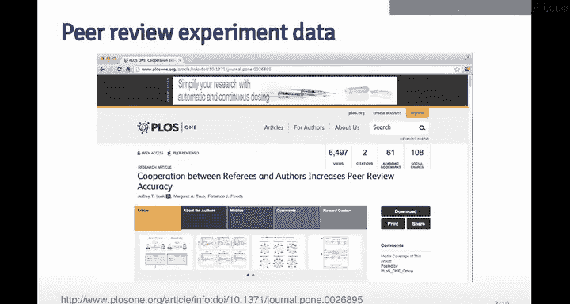
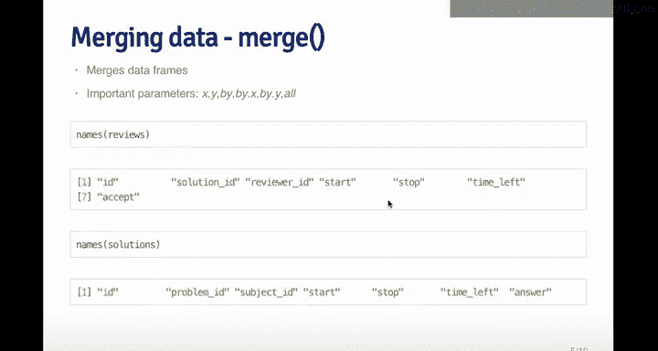
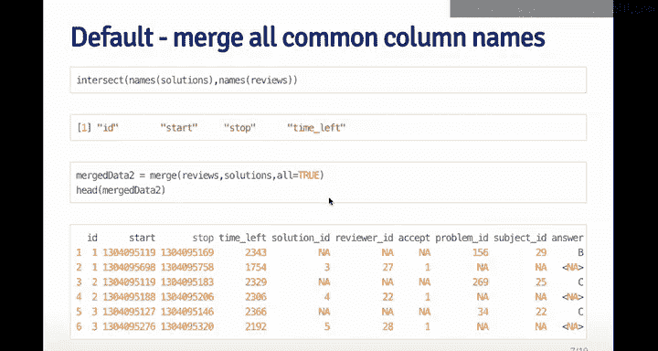
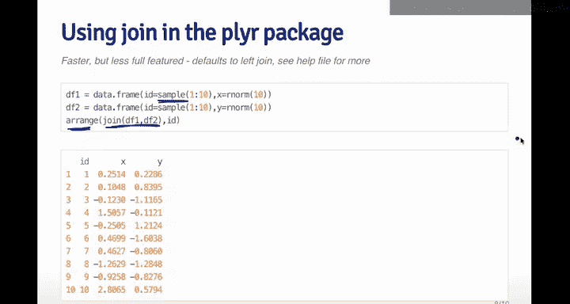
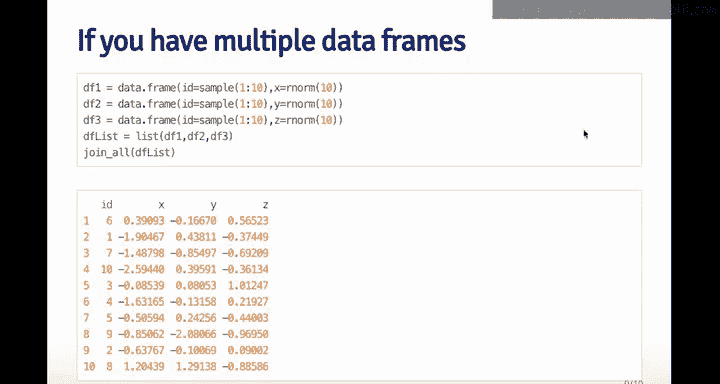
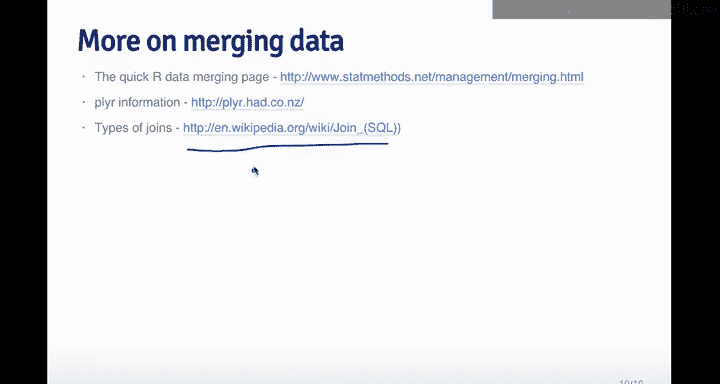

# 094：20_合并数据 🧩

在本节课中，我们将学习如何在R语言中合并多个数据集。这是数据分析中一项非常常见的任务，尤其是在处理来自不同来源但彼此关联的数据时。

## 概述

有时，你会将多个数据集加载到R中，并希望将它们合并在一起。通常，你需要基于一个共同的ID来匹配这些数据集。这类似于在MySQL这样的数据库中链接多个表的概念。

## 数据背景介绍

我们将要使用的数据来自一项同行评审实验。这项实验旨在模拟科学研究中同行评审系统的工作方式。我们收集了两类数据：一类是参与者提交的SAT类问题的答案，另一类是评审者对答案进行评审的记录。

我们可以从作者的Dropbox账户下载这些数据。数据集包含两个文件，分别对应两个数据框：一个记录了研究中所有被解答的问题，另一个记录了所有对这些问题的评审记录。

## 使用 `merge` 命令合并数据

首先，我们读取这两个数据集。`reviews` 数据框包含一个名为 `solution_id` 的变量，它与 `solutions` 数据集中的 `id` 变量相对应。`solutions` 数据中还有 `problem_id` 和 `subject_id`，它们将与其他数据集匹配，但本示例中不涉及。

`merge` 命令是R基础包中用于合并数据框的函数。它的关键参数是 `x` 和 `y`，分别代表两个要合并的数据框。你可以使用 `by`、`by.x` 或 `by.y` 参数来指定基于哪些列进行合并。默认情况下，它会尝试合并所有具有相同名称的列。

例如，在我们的数据中，如果使用默认设置，`merge` 会尝试合并 `id`、`start`、`stop`、`time_left` 等列，因为这些变量名在两个数据框中都存在。然而，这些变量在两个数据集中的含义可能并不相同，这会导致错误的合并。

因此，我们需要明确告诉 `merge` 函数应该基于哪些变量进行合并。以下是具体的操作步骤：

1.  指定 `x` 为 `reviews` 数据框，`y` 为 `solutions` 数据框。
2.  使用 `by.x = "solution_id"` 和 `by.y = "id"` 来指明匹配的列。
3.  设置 `all = TRUE`，这意味着如果一个值只出现在一个数据框中，合并后的数据框仍会包含该行，并在缺失值的位置用 `NA` 填充。

执行合并后，我们可以看到新的数据框以 `solution_id` 排序，并包含了来自两个原始数据集的所有信息，从而可以作为一个整体进行分析。

## 使用 `plyr` 包中的 `join` 函数

除了基础的 `merge` 命令，你还可以使用 `plyr` 包中的 `join` 函数来合并数据集。`join` 的速度通常比 `merge` 更快，但功能相对较少。它只能基于两个数据集中具有相同名称的列进行合并。

例如，如果我们有两个虚构的数据框，它们有一个共同的标识符 `ID`，但行的顺序不同。我们可以使用 `join` 将它们合并，然后使用 `arrange` 命令按 `ID` 排序。

以下是使用 `join` 的一个优势场景：

当你有多个数据框需要合并，并且它们拥有一个共同的ID时，使用 `plyr` 包会非常方便。你可以将所有数据框放入一个列表中，然后使用 `join_all` 命令一次性合并所有数据集。这种方法比多次调用 `merge` 命令更简洁高效。

## 合并类型与注意事项

在开始密集地进行数据合并之前，有必要了解不同类型的连接操作，例如左连接、右连接等。学习这些概念的最佳途径之一是阅读关于数据库连接（如SQL连接）的资料。R的帮助页面（`?merge`）和 `plyr` 包的文档也提供了关于合并数据的详细信息。

## 总结

本节课中，我们一起学习了在R中合并数据集的两种主要方法：
1.  使用基础的 `merge()` 函数，它可以进行灵活的、基于指定列的合并。
2.  使用 `plyr` 包中的 `join()` 和 `join_all()` 函数，它们在处理多个具有共同列名的数据框时更加快捷。

理解并正确应用数据合并技术，对于整合多源数据、进行深入分析至关重要。