# 095：编辑文本变量 📝

在本节课中，我们将学习如何在R语言中编辑和清理文本变量。数据清洗的一个常见步骤是处理格式混乱的文本变量，例如变量名或数据值中可能包含多余的空格、句点或下划线。我们将学习如何通过编程方式操作这些文本，以获得整洁、规范的变量名和数据集内容。

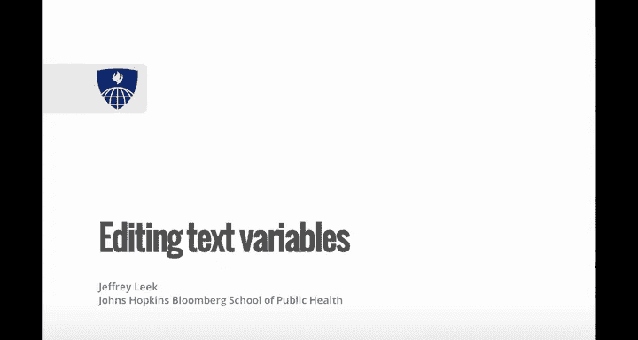

---

## 将变量名转换为小写

上一节我们介绍了数据清洗的重要性，本节中我们来看看如何规范化变量名的大小写。

查看巴尔的摩固定摄像头数据集的列名时，你可能会发现某些变量名包含大写字母，例如 `crosstreet` 中的 `S`。虽然看似小事，但在输入时容易因大小写不一致而导致错误。一个简单的解决方案是将所有字母转换为小写。

在R中，可以使用 `tolower()` 函数来实现这一点。该函数接收一个字符向量，并返回一个所有字母均为小写的版本。

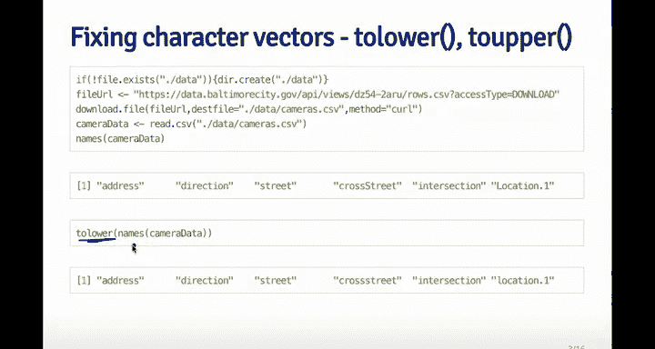

**代码示例：**
```r
names(cameraData) <- tolower(names(cameraData))
```

如果需要将字母全部转换为大写，也可以使用对应的 `toupper()` 函数。

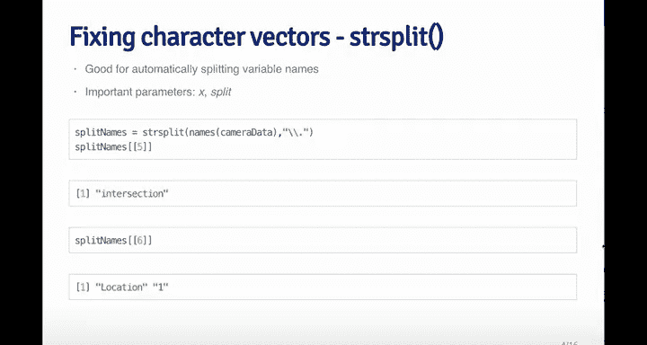

---

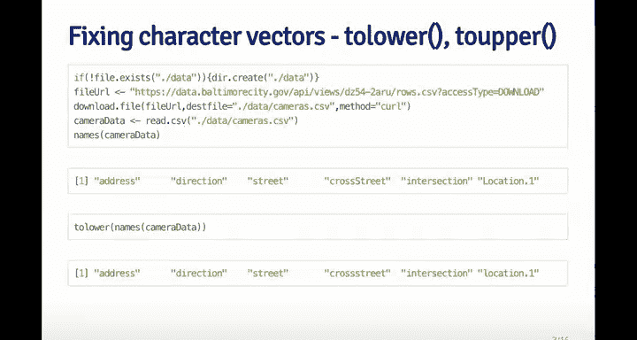

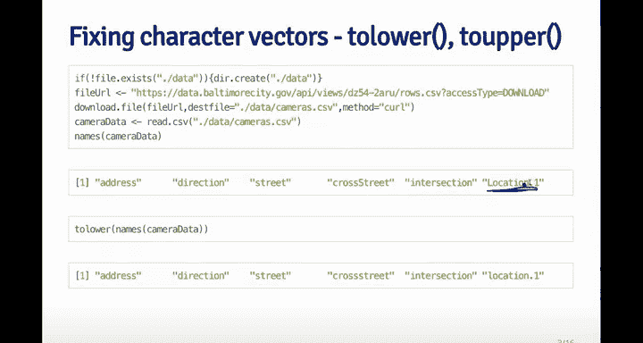

## 拆分包含分隔符的变量名

有时，变量名可能包含句点等分隔符，例如 `location.1`。这通常发生在从外部文件加载数据时。为了获得更清晰的变量名，我们需要拆分这些名称。

R中的 `strsplit()` 函数可以用于拆分字符串。我们需要指定要拆分的字符串和分隔符。由于句点在正则表达式中是特殊字符，我们需要使用转义字符 `\\`。

**代码示例：**
```r
splitNames <- strsplit(names(cameraData), "\\.")
```

执行后，`splitNames` 是一个列表。例如，原始变量名 `location.1` 会被拆分为 `"location"` 和 `"1"` 两个部分。

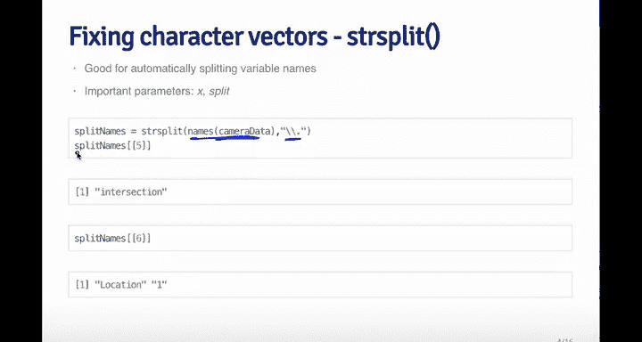

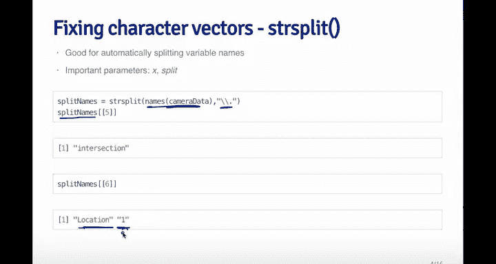

---

## 理解列表与提取元素

在进一步处理拆分后的名称之前，我们需要快速回顾一下R中列表的用法，因为后续函数依赖于对列表的操作。

列表可以包含多种类型的元素。我们可以通过索引或名称来访问列表中的元素。

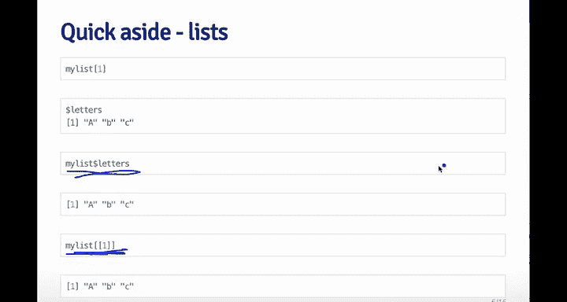

**代码示例：**
```r
myList <- list(letters = c("A", "b", "c"), numbers = 1:3, matrix(1:4, 2, 2))
myList[[1]]        # 提取第一个元素（字母向量）
myList$letters     # 通过名称提取元素
myList[[1]][1]     # 提取第一个元素中的第一个值
```

---

## 移除变量名中的句点

回到拆分变量名的问题，我们的目标通常是只保留句点之前的部分。例如，对于 `location.1`，我们只想要 `"location"`。

我们可以编写一个简单的函数来提取列表每个元素的第一个部分，然后使用 `sapply()` 函数将其应用到整个列表上。

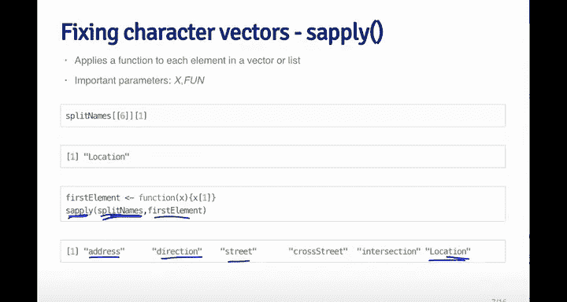

**代码示例：**
```r
firstElement <- function(x){x[1]}
names(cameraData) <- sapply(splitNames, firstElement)
```

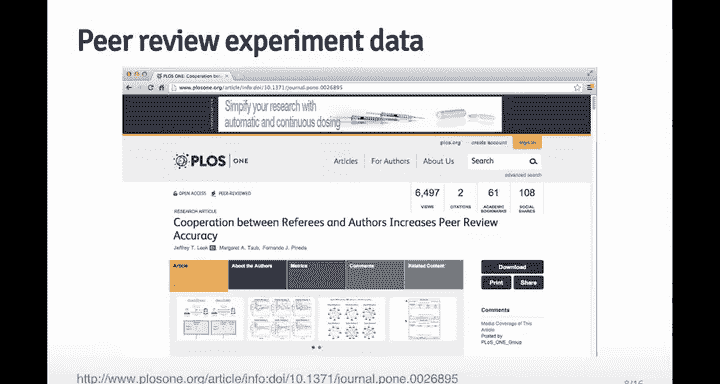

这样，变量名 `location.1` 就变成了 `location`，句点被成功移除。

---

## 替换变量名中的字符

接下来，我们使用同伴互评实验数据来展示其他文本操作技巧。

该数据集中，变量名如 `solution_id` 和 `reviewer_id` 包含下划线。为了获得更整洁的变量名，我们希望移除这些下划线。

`sub()` 函数可以用于替换字符串中**第一个**匹配到的模式。`gsub()` 函数则用于替换字符串中**所有**匹配到的模式。

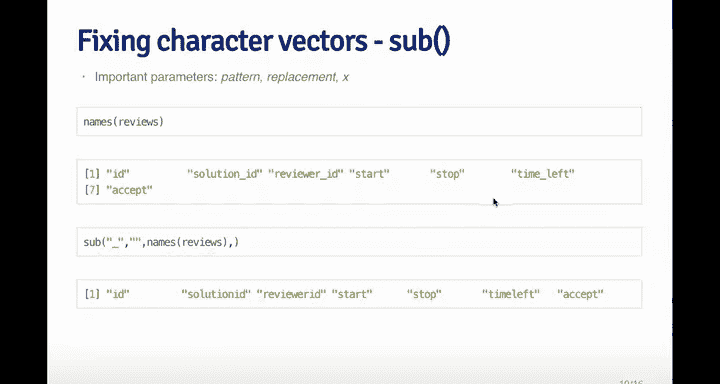

以下是具体操作步骤：

1.  **使用 `sub()` 替换第一个下划线：**
    ```r
    sub("_", "", names(reviews))
    ```
    对于 `test_name`，这只会移除第一个下划线。

2.  **使用 `gsub()` 替换所有下划线：**
    ```r
    gsub("_", "", names(reviews))
    ```
    这会移除变量名中所有的下划线，得到如 `solutionid` 这样的名称。

这些函数同样适用于清理数据集内部的实际文本值。

---

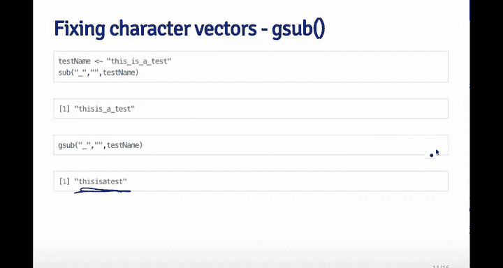

## 在数据中搜索特定值

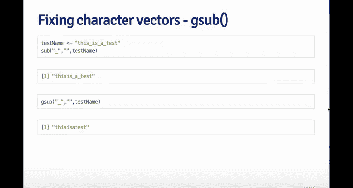

有时，我们需要在变量中搜索包含特定文本的行。例如，在摄像头数据中，找出所有交叉路口包含 `"Alameda"` 的记录。

`grep()` 和 `grepl()` 函数可以用于此目的。

*   **`grep()`**：返回匹配项在向量中的**索引位置**。
    ```r
    grep("Alameda", cameraData$intersection)
    # 可能返回：4, 5, 36
    ```

*   **`grepl()`**：返回一个逻辑向量（TRUE/FALSE），指示每个元素是否匹配。
    ```r
    grepl("Alameda", cameraData$intersection)
    # 返回：FALSE, FALSE, FALSE, TRUE, TRUE, ... , TRUE
    ```

我们可以利用 `grepl()` 的结果来对数据进行子集筛选。

**代码示例：**
```r
# 筛选出交叉路口包含"Alameda"的数据
cameraData_Alameda <- cameraData[grepl("Alameda", cameraData$intersection), ]
```

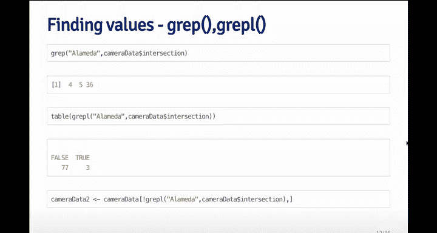

此外，将 `grep()` 的参数 `value` 设置为 `TRUE`，可以直接返回匹配的文本值，而不是索引。

**代码示例：**
```r
grep("Alameda", cameraData$intersection, value=TRUE)
```

如果要检查某个值是否**不**出现在向量中，可以检查 `grep()` 返回结果的长度是否为0。

**代码示例：**
```r
length(grep("JeffStreet", cameraData$intersection)) == 0
```

---

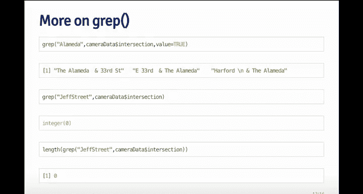

## 其他有用的字符串函数

除了搜索和替换，还有一些基础函数和 `stringr` 包中的函数对处理文本很有帮助。

以下是几个常用函数：

*   **`nchar()`**：计算字符串中的字符数。
    ```r
    nchar("Jeffrey Leek") # 返回 12
    ```

*   **`substr()`**：提取字符串的子串。
    ```r
    substr("Jeffrey Leek", 1, 7) # 返回 "Jeffrey"
    ```

*   **`paste()`** / **`paste0()`**：连接多个字符串。
    ```r
    paste("Hello", "World") # 返回 "Hello World"（默认用空格分隔）
    paste0("Hello", "World") # 返回 "HelloWorld"（无分隔符）
    ```

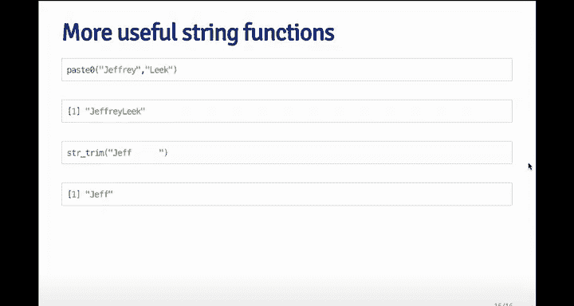

*   **`str_trim()`** (来自 `stringr` 包)：去除字符串开头和结尾的空格。
    ```r
    library(stringr)
    str_trim("  Hello World  ") # 返回 "Hello World"
    ```

---

## 关于文本数据的要点总结

本节课中我们一起学习了多种编辑文本变量的技术。最后，总结一下处理数据集文本时的一些重要原则：

*   **统一小写**：尽可能使用全小写变量名和值，避免因大小写不一致导致的隐蔽错误。
*   **描述性命名**：变量名应具有描述性（例如用 `diagnosis` 而非 `dx`）。
*   **避免特殊字符**：变量名不应包含下划线、句点或空格。我们已经学习了如何移除它们。
*   **合理使用因子**：对于具有固定类别数的字符型变量，通常应转换为因子变量，并确保其水平值是描述性的。
*   **清晰的取值标签**：例如，使用 `"male"`/`"female"` 或 `"TRUE"`/`"FALSE"`，而不是 `"M"`/`"F"` 或 `1`/`0`。这能使数据分析过程更清晰易懂。

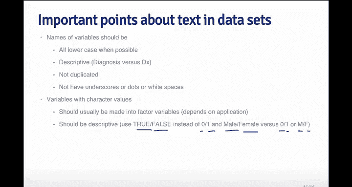

遵循这些原则，可以显著提高数据集的整洁度和后续分析的效率。