# 096：正则表达式 I 🔍

在本节课中，我们将要学习正则表达式的基础知识。正则表达式是一种强大的工具，用于在文本中搜索和匹配特定模式。我们将从基本概念开始，逐步介绍如何组合字面量和元字符来构建灵活的搜索模式。

---

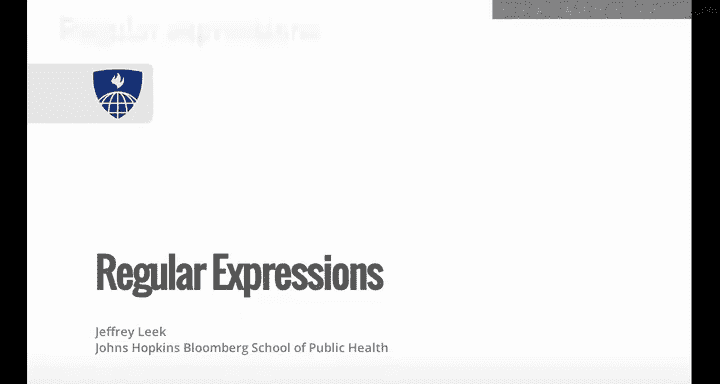

## 概述

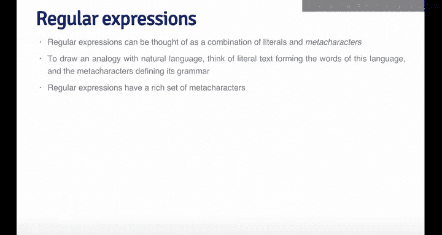

我们已经学习了如何使用文本函数 `sub`、`gsub` 和 `grep` 来操作字符串并识别可能感兴趣的文本模式。在本节中，我们将探讨正则表达式，它将搜索特定文本片段的概念扩展为搜索可能符合更广泛模式的文本片段。

---

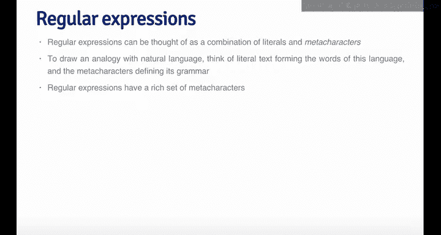

## 正则表达式的组成

正则表达式可以看作是**字面量**和**元字符**的组合。

为了与自然语言类比，可以将字面量文本视为构成语言的单词，而元字符则定义了其语法。正则表达式拥有一套丰富的元字符，使我们能够搜索字符串，识别那些仅用字面量很难找到的特定兴趣模式。

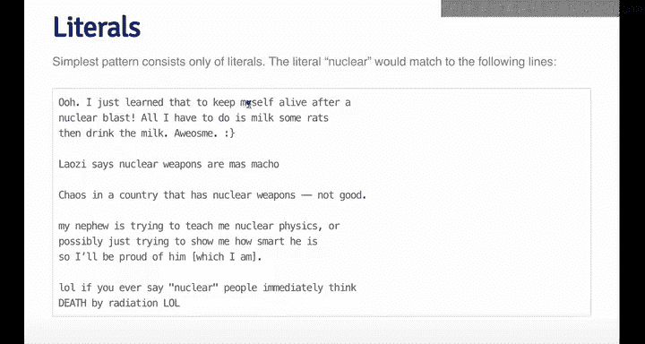

---

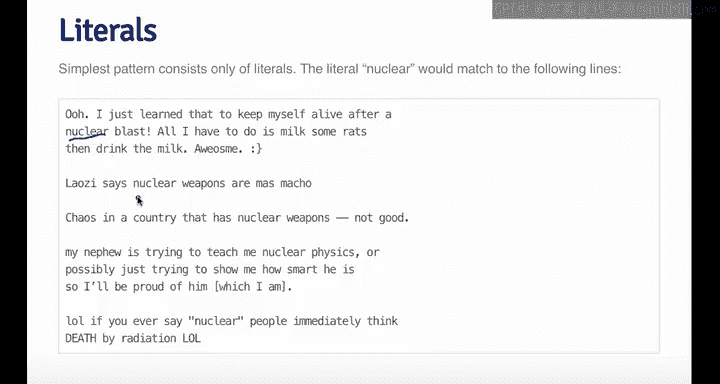

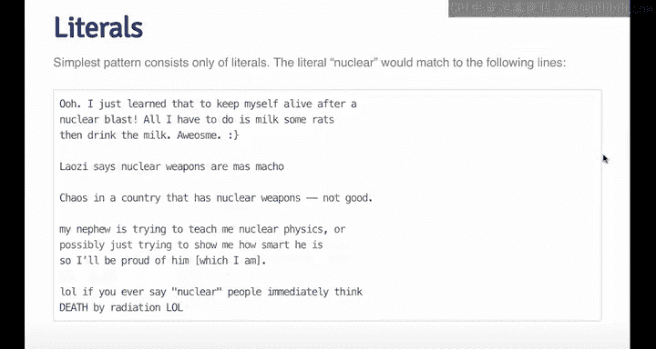

## 字面量匹配

字面量由完全匹配的单词组成。

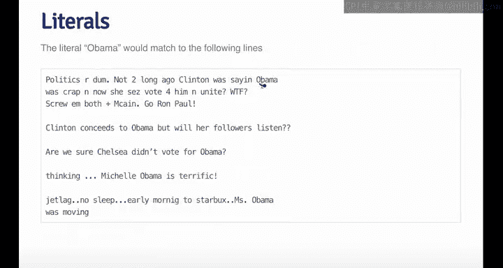

例如，字面量 `nuclear` 会匹配所有包含该单词的行，因为 `nuclear` 在这些行中精确出现。

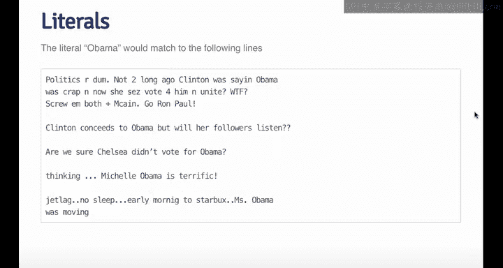

同样，字面量 `Obama` 会匹配所有包含该单词的行。你可以精确匹配你观察到的文本。

---

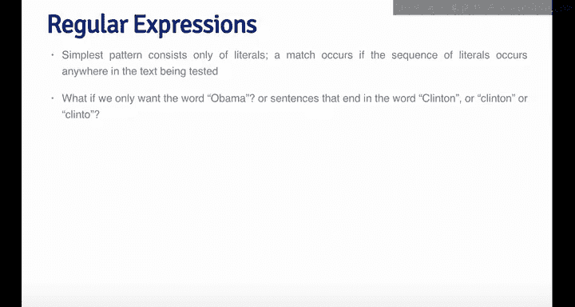

## 引入元字符

在正则表达式的最简单形式中，只包含字面量。只有当被测试的文本中任何地方出现完全相同的字面量序列时，才会发生匹配。

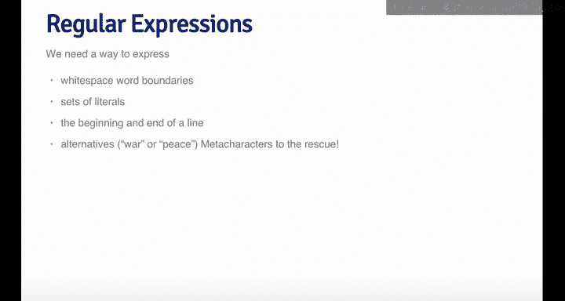

但是，如果我们只想匹配单词 `Obama`，或者以单词 `Clinton` 结尾的句子，或者像 `Clintoninto` 这样更短的短语呢？

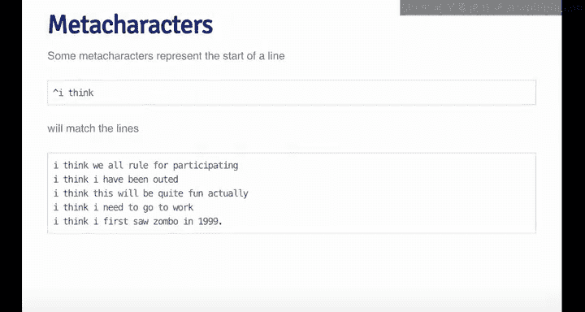

我们需要一种方法来表达空白、单词边界、字面量集合、行的开头和结尾，或者像 `war` 或 `peace` 这样的替代项。因此，我们将使用元字符来指定这些更通用的搜索项，以便能够识别它们。

---

## 常用元字符

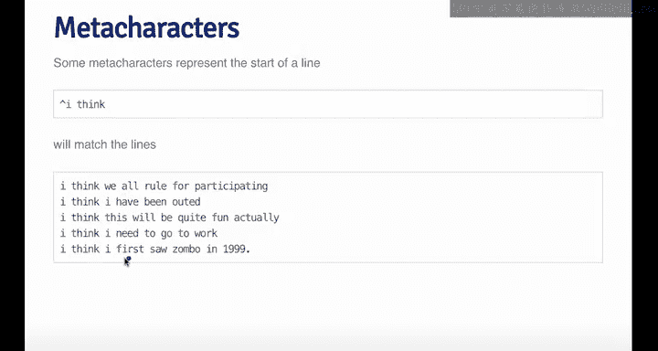

以下是正则表达式中常用的一些元字符及其功能：

### 匹配行首

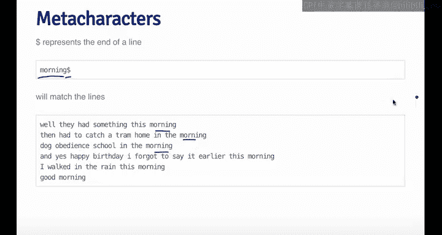

元字符 `^` 代表行的开始。

例如，正则表达式 `^I think` 会匹配所有以 “I think” 开头的行。它不会匹配 “I think” 出现在行中间的情况。

### 匹配行尾

元字符 `$` 代表行的结束。

例如，正则表达式 `morning$` 会匹配所有以 “morning” 结尾的行。如果 “morning” 只出现在文本中间，则不会匹配。

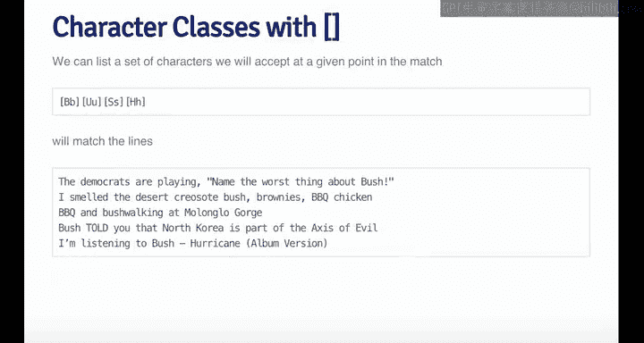

### 匹配字符集合

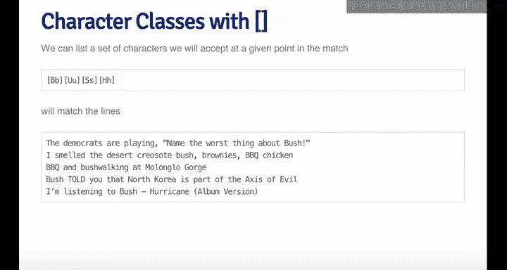

我们可以考虑在匹配中任何给定点接受的字符列表或集合。

例如，正则表达式 `[Bb][Uu][Ss][Hh]` 会匹配单词 “bush” 的所有版本，无论哪些字母被大写。它将匹配每个可能字母处的小写和大写形式。

### 组合元字符

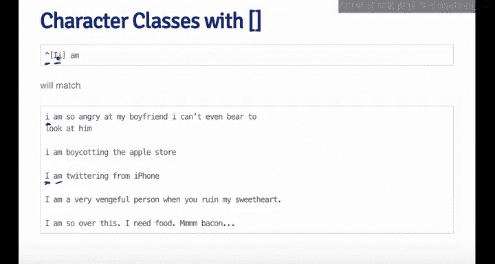

你可以开始组合这些元字符。

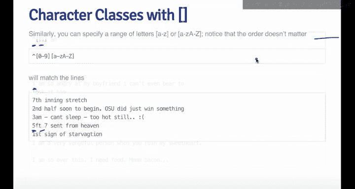

例如，`^[Ii] am` 会匹配以大写或小写 “I” 开头，后跟字面量 “am” 的行。它允许行的开头是小写或大写的 “I”，然后是字面量 “M”。

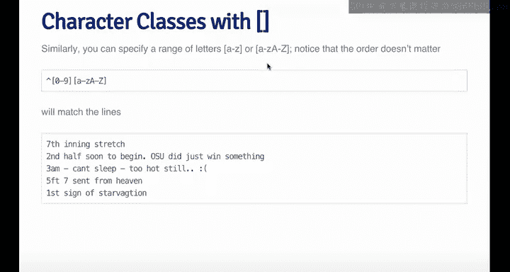

### 匹配字符范围

你还可以指定字符或字母的范围。

例如，`[a-z]` 会匹配任何小写字母 a 到 z。`[a-zA-Z]` 会查找任何字母，无论大小写。

例如，正则表达式 `^[0-9][a-zA-Z]` 会在行首查找一个 0 到 9 之间的数字，后跟任意一个字母作为该行的下一个字母。它会匹配所有以数字开头且下一个字符是字母的行。

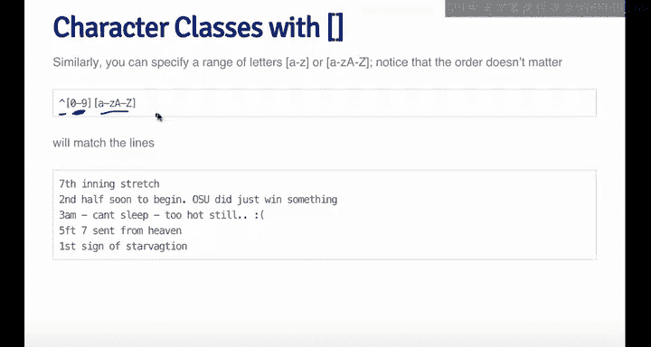

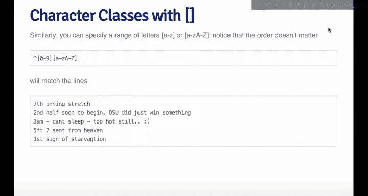

### 排除字符类

在字符类的开头使用 `^` 也是一个元字符，表示它应该匹配**不在**指定类中的任何字符。

例如，正则表达式 `[^\.?]$` 会查找任何不以句点或问号结尾的行。方括号内的 `^` 表示“不是这两个字符中的任何一个”。它会匹配所有不以句点或问号结尾的行，例如以感叹号结尾或没有标点符号的行。

---

## 总结

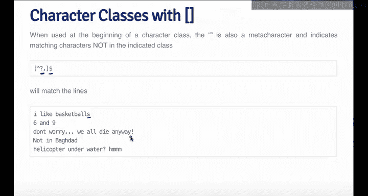

本节课中，我们一起学习了正则表达式的基础知识。我们了解了正则表达式由字面量和元字符组成，并探索了几个关键的元字符：用于匹配行首的 `^`、匹配行尾的 `$`、用于定义字符集合的方括号 `[]`，以及用于排除字符的 `[^]`。通过组合这些元素，我们可以构建强大的模式来搜索和匹配文本中的复杂结构。掌握这些基础是有效使用正则表达式的第一步。