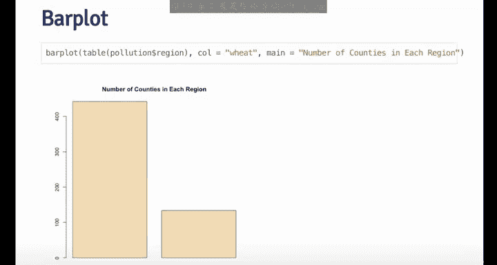

# 107：探索性图形分析（第一部分）📊


在本节课中，我们将学习如何构建探索性图形。探索性图形主要是为你自己而制作的图表，用于查看数据并探索你所关注数据集中的情况。

## 概述

探索性图形是数据分析中用于初步理解数据、发现模式、提出建模策略和调试分析的重要工具。它们通常制作迅速、数量众多，旨在帮助分析师形成对数据的个人理解。本节课我们将通过一个关于美国空气污染的真实数据集，来演示几种常见的探索性图形。

## 为什么在数据分析中使用图形？

我们使用图形进行数据分析，主要希望达成几个目标：理解数据属性、发现数据中的基本模式、为建模策略提供建议（例如选择线性或非线性模型）、调试分析过程，以及向他人传达结果。探索性图形主要服务于前四个目标，即理解数据、发现模式、建议策略和调试分析。在本讲中，我们暂不深入讨论用于展示结果的图形构建，这将在后续课程中涉及。

## 探索性图形的特点

探索性图形通常具有以下特点：它们制作非常迅速，往往是边查看数据边生成的；你会制作大量图形，以便从不同角度审视数据；你需要逐个查看许多变量。其目标是让你作为分析师，能对数据集形成个人理解，把握其外观、属性、存在的问题以及需要后续跟进的事项。

探索性数据分析的核心问题可以归结为：我的数据看起来是什么样子？这就是制作探索性图形的目标。在此阶段，你通常无需过多担心图形的外观或呈现方式，例如坐标轴和图例通常会在后期清理，颜色和大小主要用于帮助你区分信息。当然，如果是为了演讲等展示场合，你可能需要更仔细地考虑颜色和大小。

## 示例数据集：美国细颗粒物污染

为了具体讨论各种探索性图形，我们将使用一个真实数据集。该数据集涉及美国的环境空气污染，来源于美国环境保护署。EPA为国家室外空气污染设定了环境空气质量标准。我们将关注一种名为细颗粒物（PM2.5）的空气污染物。美国的标准是，在给定地点，三年平均的年均值不得超过每立方米12微克。任何超过此水平的州将被视为不符合国家标准。

数据来自美国EPA的空气质量系统。我已下载并汇总了这些数据用于本次演示。本次探索性分析的基本问题是：美国是否有县超过了细颗粒物污染的国家标准？我们拥有美国许多县的监测数据，希望查看它们是否超过了新设定的每立方米12微克的标准。

你可以使用 `read.csv` 函数读取数据。以下是数据框的前几行：第一列是PM2.5的水平（2008年至2010年三年间的年均值），`fips` 列是县的标识符，`region` 列表示该县位于东部还是西部，`longitude` 和 `latitude` 列则是该县监测器的经纬度坐标。

记住，我们的核心问题是查看是否有县超过12微克/立方米的标准。即使在探索性分析中，你仍然需要在脑海中有一个基本问题，即使它目前可能有些模糊，因为这个问题将驱动你思考数据的样子。一个问题对某类分析可能是问题，对另一类则可能不是。因此，浏览数据时心中需有一个背景问题。

## 一维数据摘要

我们可以查看数据的一维摘要。以下是几种常见方法：五数摘要、箱线图、直方图、密度图和条形图。我将在此演示其中几种。

### 五数摘要

五数摘要本身并非图形，但它总结了给定变量的某些特定方面。R中的 `summary` 函数可以生成此摘要，实际上它生成的是六数摘要，因为它包含了均值。传统的五数摘要包括最小值、第一四分位数、中位数、第三四分位数和最大值。

以下是PM2.5变量的摘要输出：
```r
summary(pm25)
```
从输出中可以看到，中位数为10微克/立方米，低于标准；最大值为18.4，超过了标准，因此在此期间肯定有一些县违反了标准。第三四分位数为11，第一四分位数为8.5，最小值为3.38。

### 箱线图

以下是PM2.5变量的箱线图，我将其指定为蓝色。你可以看到中位数约为10，正如我们在五数摘要中看到的那样。还可以看到有许多县似乎超过了每立方米12微克的标准线，同时也有许多县低于此线，即符合标准。

### 直方图与数据地毯

以下是相同数据的直方图。直方图的好处在于，它能提供更多关于变量分布形状的细节。我喜欢做的一件事是在直方图下方添加“数据地毯”。数据地毯会绘制构成直方图的所有数据点，这样你就能精确看到这些点的位置。一方面，你得到了作为摘要的直方图；另一方面，通过下方的数据地毯，你也能获得一些精细的细节，可以看到异常值在哪里，数据主体在哪里。可以看到，数据主体似乎集中在10左右，但在15以上有几个异常值。

你可以通过更改 `breaks` 参数来调整直方图中条形（即组距）的数量。在之前的幻灯片中，条形较宽，直方图更平滑。在这张幻灯片中，我通过设置 `breaks = 100` 使条形更小，你可以看到直方图变得更粗糙。设置 `breaks` 参数时需要注意，数值不宜过大，否则会产生许多小条形，导致直方图非常嘈杂；当然，数值也不宜过小，否则可能只有几个条形，无法真正看清分布形状。通常，调整 `breaks` 参数以获取最理想的直方图形状是很有用的。

### 在图形上叠加参考线

这是之前展示过的箱线图，但现在我在图上叠加了一个特征：一条在12处的水平线。数字12是国家环境空气质量标准。我将这条线叠加在12处，以便了解有多少县高于或低于这条线。你可以看到，超过75%的县低于此线，因为整个蓝色箱体都在这条线以下，而蓝色箱体的上端是第75百分位数或第三四分位数。

这在总结和突出特定特征时很有用。你也可以在直方图上这样做。这里，我在12处画了一条黑色垂直线，并在中位数处画了一条洋红色垂直线，以便总结并精确查看分布的中位数位置。在箱线图中很容易看到中位数，因为箱线图本身就包含中位数这一特征，而直方图则没有。因此，有时添加一条垂直线来突出中位数是很好的做法。你可以再次看到，中位数低于标准，但有一些县高于它。

### 条形图

条形图是分类数据的另一种图形摘要。这里我绘制了 `region` 变量，可以看到东部有多少县，西部有多少县。可以看到，大多数县位于美国东部，美国西部有100多个县。这总结了这个特定的分类变量。

## 总结



本节课我们一起学习了探索性图形分析的第一部分。我们了解了探索性图形的目的和特点，并通过美国PM2.5污染的实际案例，演示了如何利用五数摘要、箱线图、直方图（配合数据地毯和调整组距）以及条形图来初步探索和理解数据分布，并借助参考线（如国家标准线）来评估数据。这些工具能帮助你快速形成对数据集的直观认识，为后续深入分析奠定基础。