# 111：R语言基础绘图系统（第二部分）📊

在本节课中，我们将继续学习R语言的基础绘图系统。我们将重点介绍几个核心的绘图函数，并学习如何通过添加注释、线条、图例以及创建多图布局来增强和定制你的图表。


---

## 核心绘图函数介绍

上一节我们介绍了基础绘图系统的概念。本节中，我们来看看几个最常用、最核心的绘图函数。

以下是几个关键的基础绘图函数：

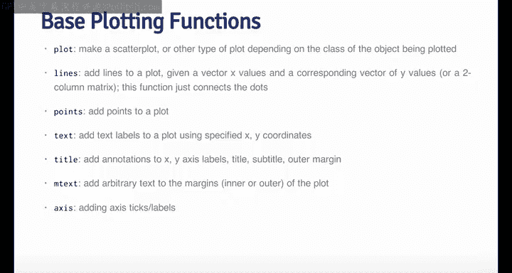

*   **`plot`**：这是最常用的函数，主要用于创建散点图。根据输入对象的类型，它也可以创建其他类型的图表。
*   **`lines`**：此函数本身不创建新图表，而是向现有图表添加线条。当你需要连接数据点（例如绘制时间序列图）时，它非常有用。
*   **`points`**：此函数向现有图表添加数据点。例如，你可以在一个图表上，用不同的颜色或形状添加代表另一个子集的数据点。
*   **`text`**：此函数用于在图表内部添加文本标签，以进行注释。
*   **`title`**：此函数通常用于在图表外部添加注释，例如X轴和Y轴标签、主标题和副标题。
*   **`mtext`**：`m`代表边距（margin）。此函数用于在图表的边距（包括内边距和外边距）中放置文本。
*   **`axis`**：此函数用于自定义坐标轴的刻度。

---

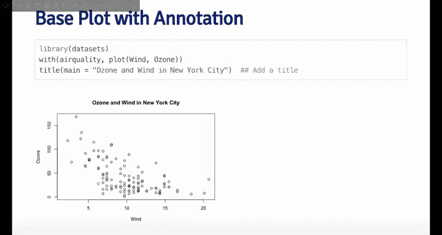

## 图表注释与增强

了解了核心函数后，我们来看看如何利用它们对图表进行注释和增强。

### 添加标题

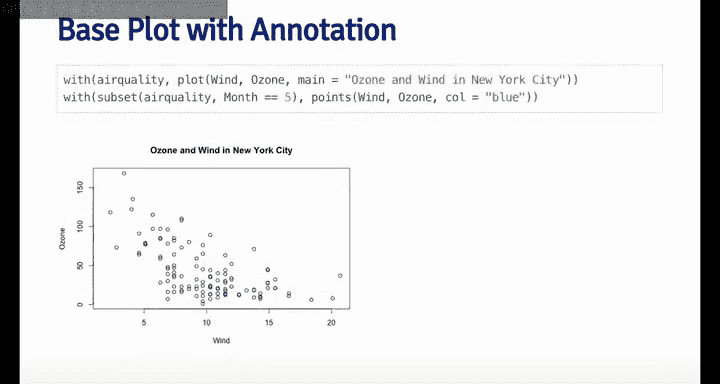


以下是一个为散点图添加标题的例子。我们绘制风速（Wind）和臭氧浓度（Ozone）的关系。


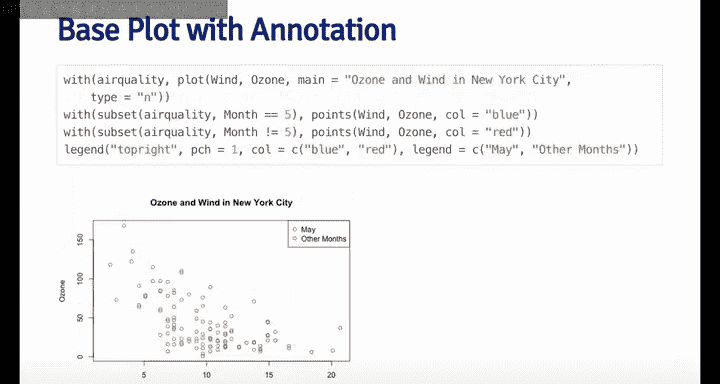


```r
plot(wind, ozone)
title(main = "Ozone and Wind in New York City")
```

你也可以在调用`plot`函数时直接指定标题：

```r
plot(wind, ozone, main = "Ozone and Wind in New York City")
```

### 叠加数据点

有时，我们希望突出显示数据中的特定子集。例如，将五月份的数据点用不同颜色标出。

```r
# 首先绘制所有数据的散点图
plot(wind, ozone)
# 然后，筛选出月份为5的数据，并用蓝色点叠加
may <- subset(airquality, Month == 5)
points(may$Wind, may$Ozone, col = "blue", pch = 20)
```


### 分步绘制与添加图例

为了避免数据点重叠，并更清晰地展示不同组别，我们可以先初始化一个空图表，再分步添加不同组的数据。

```r
# 初始化图表，type="n"表示只设置绘图区域，不绘制任何数据点
plot(wind, ozone, type = "n")
# 添加五月份的数据（蓝色）
points(wind[month == 5], ozone[month == 5], col = "blue", pch = 20)
# 添加非五月份的数据（红色）
points(wind[month != 5], ozone[month != 5], col = "red", pch = 20)
# 在右上角添加图例
legend("topright", pch = 20, col = c("blue", "red"), legend = c("May", "Other Months"))
```

### 添加回归线

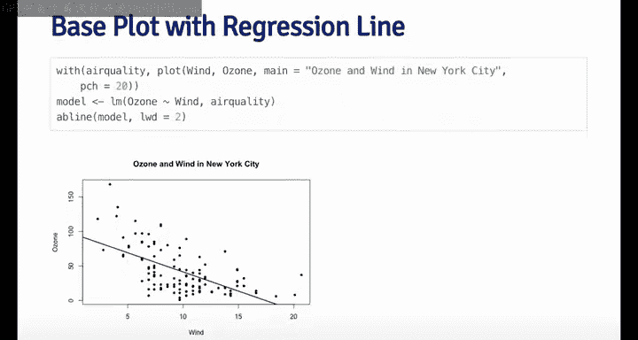


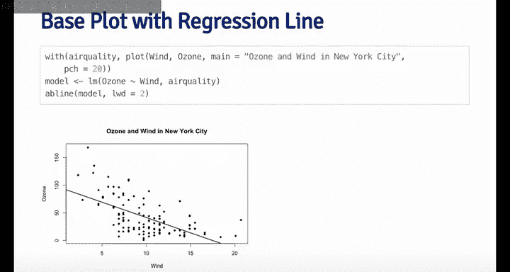

为散点图添加趋势线（如回归线）是常见的需求。

```r
# 绘制散点图，pch=20表示使用实心小圆点
plot(wind, ozone, pch = 20)
# 拟合线性模型
model <- lm(ozone ~ wind)
# 使用abline函数添加回归线，lwd=2使线条更粗
abline(model, lwd = 2)
```

**公式**：`ozone ~ wind` 表示以`wind`为自变量，`ozone`为因变量的线性模型。

---

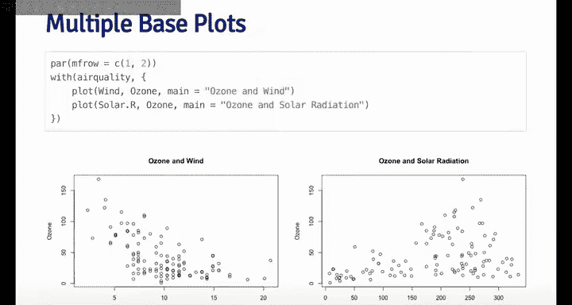

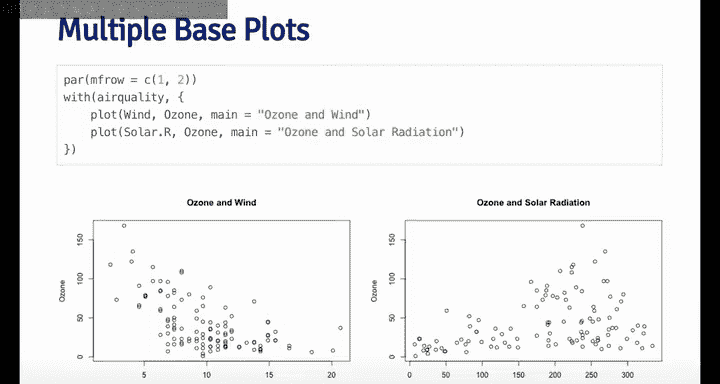

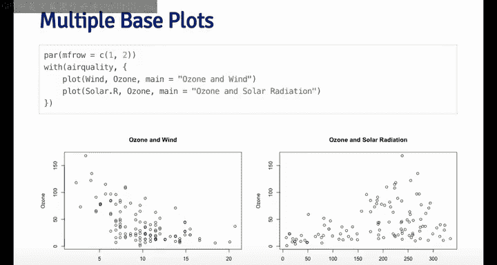

## 创建多图布局

有时我们需要将多个图表排列在一个图形设备中，以便进行比较。

### 并排排列图表

以下代码创建一行两列的布局，并排显示两个散点图。

```r
# 设置图形参数：1行，2列
par(mfrow = c(1, 2))
# 第一个图：臭氧 vs 风速
plot(wind, ozone, main = "Ozone vs Wind")
# 第二个图：臭氧 vs 太阳辐射
plot(solar.r, ozone, main = "Ozone vs Solar Radiation")
```

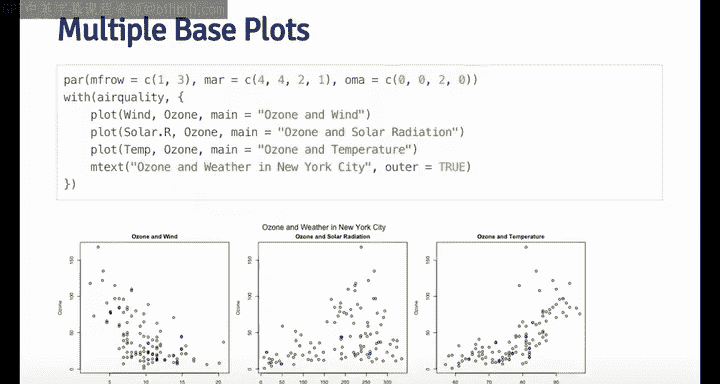

### 为多图面板添加总标题

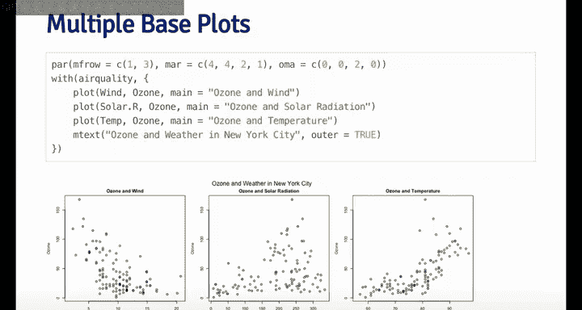

我们还可以为整个多图面板添加一个总标题，这需要利用外边距（outer margin）。

```r
# 设置图形参数：1行3列，调整边距，并设置顶部外边距以容纳总标题
par(mfrow = c(1, 3), mar = c(4, 4, 2, 1), oma = c(0, 0, 2, 0))
# 绘制三个子图
plot(wind, ozone, main = "Ozone vs Wind")
plot(solar.r, ozone, main = "Ozone vs Solar Radiation")
plot(temp, ozone, main = "Ozone vs Temperature")
# 在外边距添加总标题
mtext("Ozone and Weather in New York City", outer = TRUE, cex = 1.5)
```

---

## 总结

本节课中我们一起学习了R语言基础绘图系统的进阶功能。


我们首先介绍了几个核心的注释函数，如`lines`、`points`、`text`和`legend`，它们用于在基础图表上添加元素。接着，我们通过实例学习了如何分步构建图表、为特定数据子集着色以及添加回归线。最后，我们探讨了如何使用`par(mfrow)`创建多图布局，并利用外边距为整个图板添加总标题。

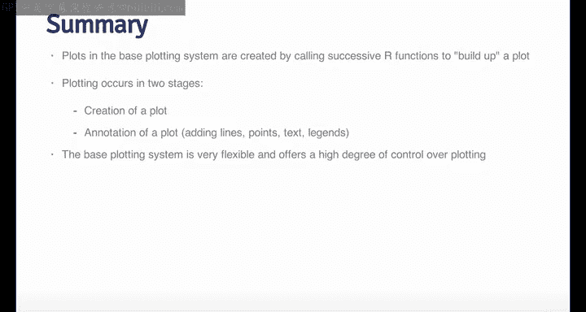

基础绘图系统的特点是**高度灵活和可控**。创建图表通常始于一个初始化函数（如`plot`、`hist`），然后通过一系列函数调用来逐步添加点和线、文本和注释。虽然这有时会导致代码行数较多，但它提供了对图表几乎所有细节的精细控制能力，对于制作出版质量的图表非常有用。在后续课程中，我们将介绍其他绘图系统。