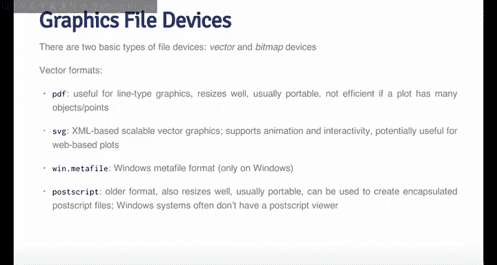
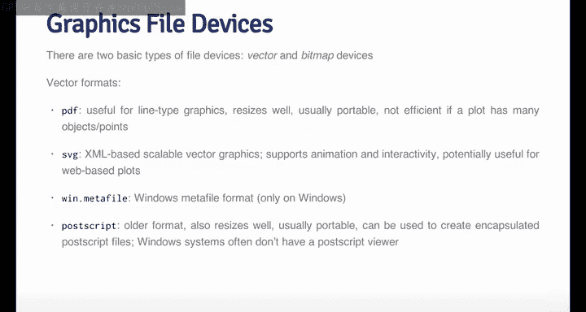
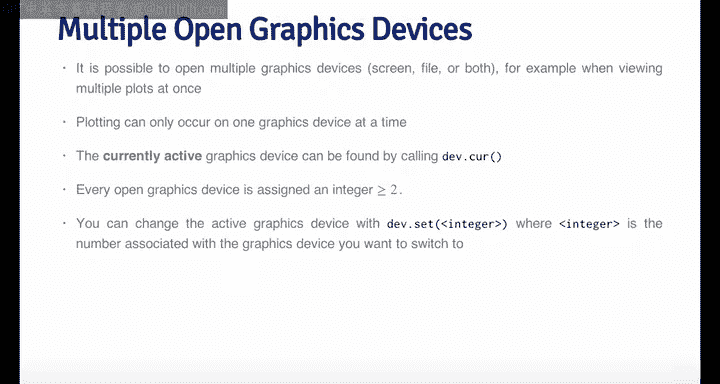
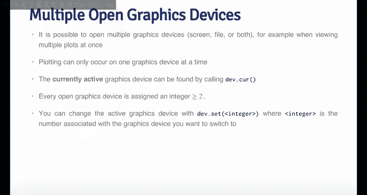
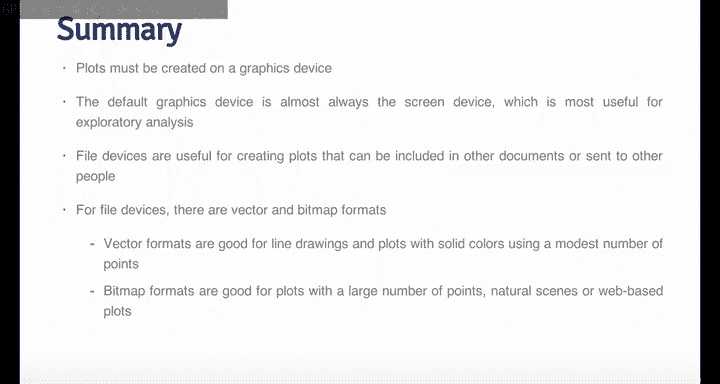

# 114：R中的图形设备（第二部分）📊



在本节课中，我们将学习R语言中图形设备的分类、特点以及如何操作多个设备。我们将重点了解矢量格式与位图格式的区别，并掌握在设备间复制图形的方法。

---

## 矢量格式与位图格式


上一节我们介绍了图形设备的基本概念。本节中，我们来看看图形文件设备的两大主要类别：矢量设备和位图设备。

矢量格式通常最适合用于线形图形，例如散点图或带有回归线的图表。这类图形不包含自然场景或照片图像。矢量格式的优势在于缩放时不会失真，图形质量不会受损。例如，PDF格式具有很好的可移植性，几乎可以在所有平台上使用，是一种通用的矢量格式。

以下是常见的矢量格式及其特点：
*   **PDF**：通用性强，可移植性好，缩放不失真。
*   **SVG（可缩放矢量图形）**：适用于网页图形，支持动画和交互性，几乎所有网络浏览器都支持。
*   **Windows Metafile**：仅适用于Windows系统的矢量格式。
*   **PostScript**：PDF格式的前身，现已不常用。



然而，如果图表包含大量数据点，矢量格式可能不太理想。因为每个点都需要在文件中用信息表示，这会导致文件体积非常庞大。

---

## 位图格式

接下来，我们探讨位图格式。位图格式将图形或图像表示为一系列像素，因此能高效地呈现包含大量数据点的图表。

以下是常见的位图格式及其特点：
*   **PNG（便携式网络图形）**：特别适用于线条图或纯色图像。它使用无损压缩算法，文件体积较小，且几乎所有网络浏览器都支持，适合网页图形。
*   **JPEG**：非常适用于自然场景（如照片），这类图像包含颜色渐变而非纯色。它使用有损压缩算法，文件体积非常小、效率高。同样适合绘制包含大量数据点的图表。任何计算机和网络浏览器都能读取JPEG文件。
*   **TIFF**：另一种较旧的位图格式，支持无损压缩，目前仍很常用。
*   **BMP**：Windows系统原生的位图格式，常用于图标等。

需要注意的是，位图格式通常缩放效果不佳。尝试放大或缩小已生成的位图图形可能会导致图像质量失真。此外，JPEG格式不适用于线条图，因为在线条处可能会出现锯齿状边缘。

---

## 操作多个图形设备

在R中，可以同时打开多个图形设备。例如，您可能希望同时查看三到四个不同的图表。实现方法是打开三到四个不同的屏幕设备。

您可以通过显式调用函数来启动图形设备。例如，在Mac系统上，可以多次调用`quartz()`函数来打开多个图形屏幕设备。但是，一次只能向一个设备绘图。当前正在接收绘图的设备称为**活动图形设备**。

您可以使用`dev.cur()`函数来查看当前哪个设备是活动设备。该函数会返回一个整数，标识当前活动的图形设备。每个图形设备都会被分配一个大于等于2的整数（没有编号为1的设备）。




您可以使用`dev.set()`函数来更改活动图形设备。该函数接受一个整数值作为参数，将活动设备切换到对应编号的设备上。这样，您就可以根据需要在不同图形设备之间切换。

---

## 在设备间复制图形



最后，我们学习如何在设备间复制图形。这通常用于以下场景：您在屏幕上创建了一个图形，非常满意，并希望将其保存到文件中。

有两种方法可以实现：
1.  如果您保存了生成该图形的代码，可以打开一个文件设备，然后将代码复制粘贴到R中执行，最后关闭文件设备。这样图形就保存在文件中了。
2.  一个更快、有时也更方便的方法是，直接将图形从屏幕设备复制到文件设备。

您可以使用`dev.copy()`函数将图形从任一设备复制到另一设备。如果特别希望生成PDF文件，可以使用`dev.copy2pdf()`函数，它能直接将屏幕设备上的图形复制到PDF文件中。

**重要提示**：复制图形并非精确操作。最终文件中的图形可能与屏幕上看到的图形不完全一致，您可能需要进行一些调整。

以下是一个示例代码，它在屏幕上创建一个图形（使用R内置的`faithful`老忠实喷泉数据集），然后将其复制到PNG文件中：

```r
# 在屏幕设备上创建图形
with(faithful, plot(eruptions, waiting))
title(main = "Old Faithful Geyser Data")

# 将图形复制到PNG文件
dev.copy(png, file = "geyserplot.png")
# 关闭PNG设备，完成文件写入
dev.off()
```

执行`dev.off()`后，计算机上就会生成一个名为“geyserplot.png”的PNG格式文件，您可以将其发送给他人或用于演示文稿中。

---

## 总结



本节课中，我们一起学习了R语言中图形设备的核心知识。基本要点如下：
*   每个图形都必须在某个图形设备上创建，通常是屏幕设备，这适用于探索性分析。
*   若想保存图形或发送给他人，则必须在文件设备中创建图形。
*   有多种文件格式可供选择，包括PDF、SVG等矢量格式，以及PNG、JPEG等位图格式。
*   可以同时打开和操作多个图形设备，并使用`dev.cur()`、`dev.set()`进行管理。
*   可以使用`dev.copy()`等函数在设备间复制图形，但需注意复制结果可能并非完全一致。