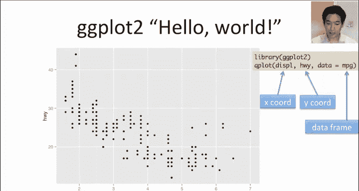
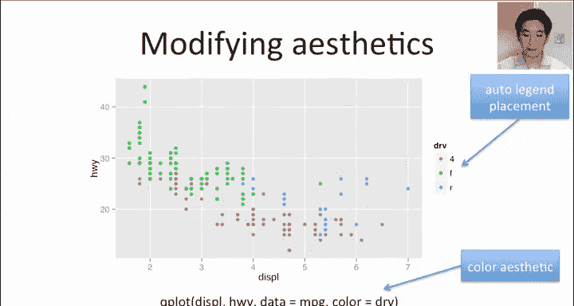
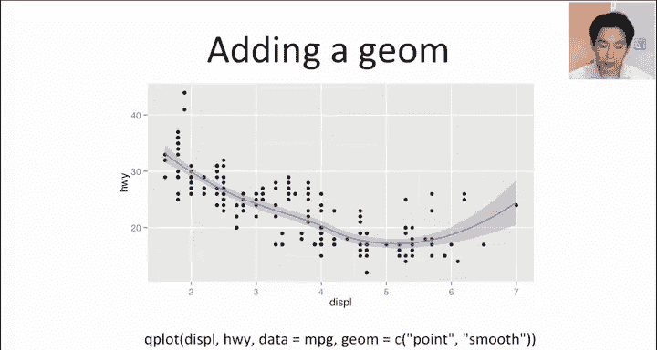
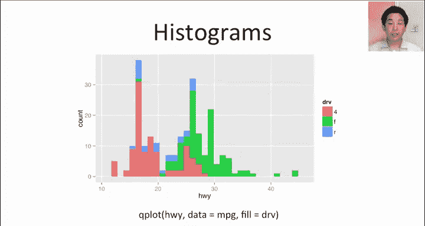
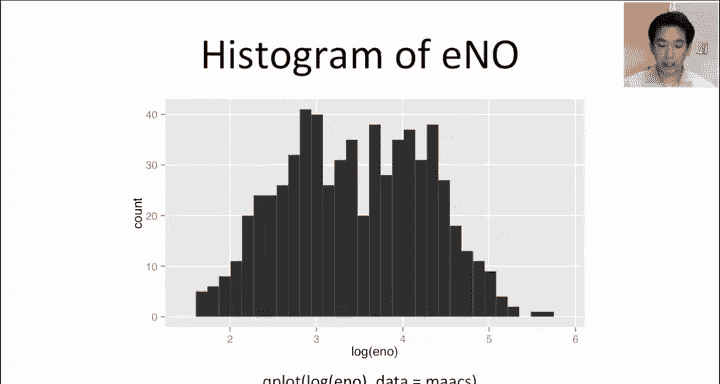
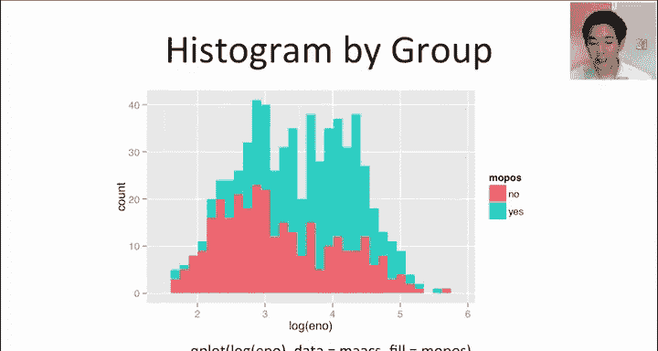
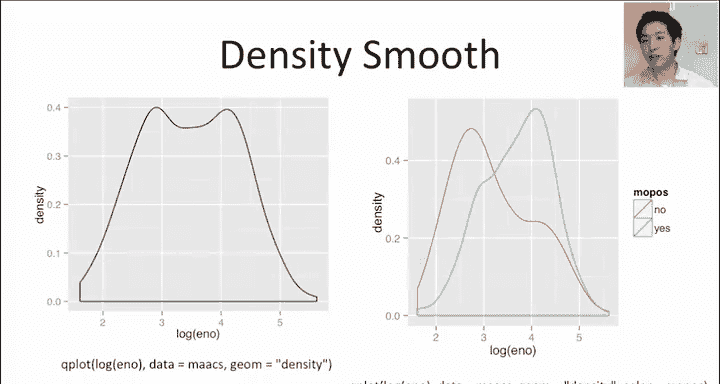
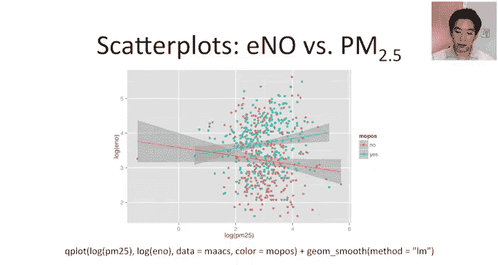
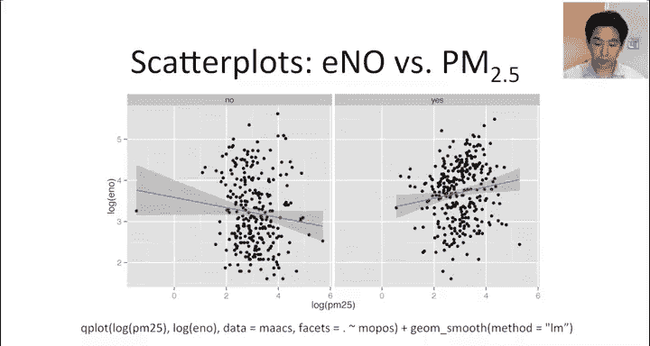

# 118： Foundations using R
## 课程编号：P118 - ggplot2 第2部分 📊

在本节课中，我们将学习如何使用 `ggplot2` 包中的 `qplot` 函数来创建和定制各种统计图形。我们将通过两个数据集示例，探索如何通过颜色、形状、分面等功能来可视化数据中的不同子组和关系。

---

### 数据集介绍

我将从一个示例数据集开始。这个数据集随 `ggplot2` 包提供，安装包后即可加载。这是 `mpg` 数据集，它记录了多种不同类型汽车的每加仑英里数。从 `str` 函数的结果可以看出，该数据集包含 **234** 个观测值（即 234 种不同的汽车）和 **11** 个测量变量。

具体来说，我将关注以下几个变量：
*   `displ`：发动机排量，是发动机大小的指标。
*   `hwy`：高速公路油耗。
*   `drv`：驱动类型，分为四轮驱动（4）、前轮驱动（f）和后轮驱动（r）。

请注意，数据集中的因子变量已被适当标记。例如，`manufacturer` 变量标记了汽车制造商（奥迪、雪佛兰等），`drv` 变量则用 “4”、“f”、“r” 来标记驱动类型。

---

### 基础绘图：散点图

一个非常简单的绘图，我称之为 `ggplot` 的 “Hello World”，是调用 `qplot` 函数。在 x 轴上我放置了表示发动机大小的 `displ` 变量，在 y 轴上放置了高速公路油耗 `hwy`。我通过 `data` 参数指定数据框为 `mpg`。

```r
qplot(x = displ, y = hwy, data = mpg)
```

这个绘图非常简单。可以看到，它生成的图形与传统的基础绘图系统有很大不同：它有灰色的背景和白色的网格线，点是实心圆点而非基础绘图系统中典型的空心圆，并且 x 轴和 y 轴都有标签。




---

### 修改图形属性：按颜色区分子组

我们可以修改一些图形属性来突出显示数据的不同子组。其中一个子组可以通过驱动类型 `drv` 来区分：有些车是前轮驱动，有些是后轮驱动，有些是四轮驱动。

我像之前一样指定了 x、y 坐标和数据框，然后添加了另一个参数 `color`。我指定颜色映射到驱动变量 `drv`。这意味着驱动变量的不同水平将被自动分配不同的颜色。

```r
qplot(x = displ, y = hwy, data = mpg, color = drv)
```

在这个新图中，前轮驱动汽车显示为绿色，后轮驱动为蓝色，四轮驱动为红色。可以看到，前轮驱动汽车的油耗往往最高，四轮驱动最低，后轮驱动居中。请注意，图例是自动放置在图形上的，因子变量的不同水平也自动进行了颜色编码，无需进行任何特殊操作。



---

### 添加统计摘要：平滑曲线


有时我们想为图形添加一个统计摘要。这里我们选择添加的摘要是一种平滑器，更技术性的名称是 **LOESS**。它可以平滑数据，以便观察数据的整体趋势。

我通过添加 `geom` 参数来实现这一点。我想在这个图上添加两种几何对象：一种是点本身（以便看到数据），另一种是平滑线。

```r
qplot(x = displ, y = hwy, data = mpg, geom = c(“point”, “smooth”))
```

这条蓝色的线就是平滑线，其 95% 的置信区间由灰色的带状区域表示。




---

### 创建直方图

通过仅指定一个变量，我们可以用 `qplot` 函数创建直方图。这里我只指定了 `hwy` 变量，它显示了数据集中所有汽车的高速公路油耗。

同样，我想区分哪些车是四轮驱动，哪些是前轮驱动等。因此，我指定了 `fill` 参数（而不是 `color`）。`fill` 参数表示直方图的不同部分将根据驱动类型填充不同的颜色。



```r
qplot(x = hwy, data = mpg, fill = drv)
```

你可以再次看到类似的图像：四轮驱动车辆的油耗往往最低，前轮驱动车辆的油耗往往最高。


---

### 使用分面

`ggplot` 的另一个特性叫做 **分面**，类似于 `lattice` 包中的面板。其思想是，你可以创建单独的图形来展示由因子变量指示的数据子集，并可以制作一个图形面板来一起查看这些不同的子集。

之前我们通过不同颜色来编码子组，但如果数据点很多，颜色可能会重叠，难以看清不同的组。一个更简单的方法是，将三个组拆分到单独的面板中，制作三个独立的图形。

在左侧的图中，我有三个不同的散点图，展示了排量与高速公路油耗的关系，并按不同的驱动类型进行了拆分。我通过 `facets` 参数来指定这一点。

`facets` 参数接受一个公式，基本格式是：`左侧变量 ~ 右侧变量`。右侧的变量决定面板的列数，左侧的变量决定面板的行数。

请注意，在红色框出的左侧图中，公式左侧是一个点（`.`），表示只有一行。右侧是 `drv` 变量，表示应该用这个变量来决定列数。因为 `drv` 变量有三个水平，所以会有三列，最终三张图排成一行。

```r
# 三列，一行
qplot(x = displ, y = hwy, data = mpg, facets = . ~ drv)
```

在蓝色框出的右侧图中，我有三个直方图。注意，在 `facets` 参数中，我把 `drv` 变量放在了波浪线（`~`）的左侧。这表示我想要三行。因为波浪线右侧没有变量，所以只有一列。这样我就得到了按三个组分别查看高速公路油耗的三个直方图。

```r
# 三行，一列
qplot(x = hwy, data = mpg, facets = drv ~ .)
```


---

### 复杂示例：哮喘研究数据

接下来，我想通过一个来自约翰霍普金斯大学的数据集，演示一个稍微复杂一些的例子。该数据来自 **MAACS** 研究，这是一项在约翰霍普金斯大学对巴尔的摩 5 至 17 岁儿童进行的研究。这些儿童都患有持续性哮喘，并在过去一年中有过急性发作。

以下是该数据的一个片段，有 750 个观测值，为了演示，我只列出 5 个变量：
*   `id`：标识符。
*   `eno`：呼出一氧化氮，这是一个测量值，大致对应于肺部炎症水平。`eno` 值大表示存在肺部炎症。
*   `pm25`：细颗粒物，这是直径小于 2.5 微米的灰尘。
*   `mopos`：小鼠过敏原皮试阳性变量。这是一个皮肤测试，告诉我们儿童是否对小鼠过敏原过敏。



---

### 绘制呼出一氧化氮的直方图

以下是呼出一氧化氮（取对数后）的基本直方图。你可以看到它有一个有趣的形状，看起来有两个甚至三个峰。

```r
qplot(x = log(eno), data = maacs)
```




---

### 按组着色的直方图

现在，我制作了另一个直方图，但根据 `mopos` 变量对不同的组进行了颜色编码。我区分了对小鼠过敏原敏感（过敏）和不敏感（不过敏）的人群。


你可以想象，对小鼠过敏原敏感的儿童可能过敏更严重，可能对多种环境触发因素更敏感。从数据中大致可以看出，蓝色条（过敏组）略高，红色条（非过敏组）略低。这表明，平均而言，对小鼠过敏原呈阳性的儿童肺部炎症水平略高。

```r
qplot(x = log(eno), data = maacs, fill = mopos)
```



---


### 使用密度平滑可视化

可视化这类一维数据的另一种方法是进行密度平滑。在左侧，我为 `log(eno)` 变量添加了 `geom_density`。你可以看到密度平滑图中至少有两个峰。

在右侧，我通过 `color = mopos` 按是否对小鼠过敏原阳性来拆分颜色。你可以看到，这两个峰大致对应于他们是否对小鼠过敏原过敏。

```r
# 左侧：整体密度
qplot(x = log(eno), data = maacs, geom = “density”)
# 右侧：按组着色的密度
qplot(x = log(eno), data = maacs, geom = “density”, color = mopos)
```




---

### 散点图与分组

现在，如果我们想看一些散点图，比如探究呼出一氧化氮是否与家中的细颗粒物水平有关，我们可以绘制 `log(pm25)` 和 `log(eno)` 的散点图。

在最左侧，我简单地绘制了 `log(eno)` 和 `log(pm25)` 的散点图。很难直接看出可能存在的关系。

在中间的图中，我制作了相同的散点图，但通过形状区分了两组（过敏与非过敏儿童）。我指定了 `shape` 参数，并将其映射到 `mopos` 变量。但由于点的重叠，很难看清两组。

在右侧的图中，我没有用形状而是用颜色来区分两组。在这个图中，稍微容易看到两个不同的组。

```r
# 左侧：简单散点图
qplot(x = log(pm25), y = log(eno), data = maacs)
# 中间：按形状分组
qplot(x = log(pm25), y = log(eno), data = maacs, shape = mopos)
# 右侧：按颜色分组
qplot(x = log(pm25), y = log(eno), data = maacs, color = mopos)
```

---

### 添加分组平滑线

我们可以做的一件事是平滑 `log(pm25)` 和 `log(eno)` 之间的关系，并查看这种关系在两个组中是否有何不同。

我将 `geom` 设置为点和一条平滑线。这次我不使用 LOESS，而是指定 `method = “lm”`，以便使用标准的线性回归模型。这样，我可以分别查看过敏与非过敏儿童中 PM2.5 与 ENO 的线性关系。

```r
qplot(x = log(pm25), y = log(eno), data = maacs, color = mopos, geom = c(“point”, “smooth”), method = “lm”)
```


大致可以看出，在非过敏儿童（红点）中，存在轻微的负相关关系，但考虑到置信区间，这种关系并不特别强。而在过敏儿童中，PM2.5 与 ENO 之间似乎存在递增的关系。



---

### 使用分面查看相同数据


查看相同数据的另一种方法是使用分面将其拆分。与其将两组重叠并用不同颜色编码，不如使用 `facets` 参数将它们拆分成两个图。

这里我指定了 `facets` 参数，并说我想要由 `mopos` 变量决定的两列（“否” 和 “是”）。然后我在每个面板内平滑关系。你可以再次看到相同的情况：在非过敏儿童中，存在微小的递减关系；在过敏儿童中，存在轻微的递增关系。

```r
qplot(x = log(pm25), y = log(eno), data = maacs, facets = . ~ mopos, geom = c(“point”, “smooth”), method = “lm”)
```

---

### 总结

本节课中我们一起学习了 `qplot` 函数。它是一个简单的函数，可以用来快速制作各种图形，类似于基础的 `plot` 函数。你指定 x、y 和数据，然后可以选择多种选项。

`qplot` 有许多很好的内置功能：
*   对数据子集进行颜色编码非常容易。
*   使用分面拆分不同面板也非常容易。
*   可以使用 `shape` 参数选择不同的绘图符号。

它的语法介于基础绘图和 `lattice` 包之间。如果你喜欢这种设计风格，它生成的图形非常美观。但是，如果你不喜欢某些功能或设计，想要对图形的不同方面进行更低层次的定制，修改 `qplot` 函数来满足需求会有点棘手。这时，你需要深入 `ggplot` 函数的核心，这将在下一讲中讨论。