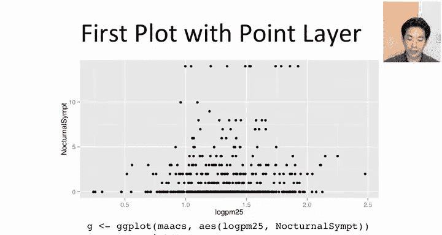

# 119：ggplot2 第3部分 📊


## 概述

在本节课中，我们将深入学习 `ggplot2` 包的核心概念与底层架构。我们将超越 `qplot` 函数，探索如何通过分层构建的方式，创建高度定制化的图形。本节课将使用一个关于儿童哮喘与环境因素的真实研究数据作为示例。

---

## 回顾：什么是 ggplot2？

上一节我们介绍了使用 `qplot` 函数快速创建基础图形。本节中，我们来看看 `ggplot2` 更底层的原理。

`ggplot2` 是 Leland Wilkinson 提出的“图形语法”在 R 语言中的实现。图形语法为图形提供了一种抽象的、系统化的描述方式，类似于语言的语法规则，定义了图形的基本构成元素及其组合方式。

一个 `ggplot2` 图形通常包含以下几个核心组件：

*   **数据**：这是绘图的基础，通常是一个包含所有待绘图变量的数据框。
*   **美学映射**：这定义了数据如何映射到图形的视觉属性上，例如将数据映射到点的**x轴位置**、**y轴位置**、**颜色**或**大小**。
*   **几何对象**：这是你在图上实际看到的元素，例如**点**、**线**、**条形**或**多边形**。
*   **分面**：用于创建条件绘图或多面板图形，例如根据第三个变量的不同水平分别展示图形。
*   **统计变换**：对数据进行统计处理后再绘图，例如**平滑**、**分箱**、**计算分位数**或**拟合回归线**。
*   **标度**：控制美学映射的具体表现方式，例如将“性别”这个分类变量映射为红色（男）和蓝色（女）。
*   **坐标系**：定义数据如何映射到图形的坐标平面上，例如笛卡尔坐标系或极坐标系。

---

## 分层构建：艺术家调色板模型

与 `lattice` 系统在一次函数调用中定义整个图形不同，`ggplot2` 采用“分层构建”或“艺术家调色板”模型。

你可以从最基础的元素开始，然后像画家在画布上添加图层一样，逐步添加几何对象、统计变换、标签等组件。这种模式提供了极大的灵活性。

以下是构建一个图形的典型分层步骤：

1.  首先，你告诉 `ggplot2` 要使用的**数据**和基本的**美学映射**。
2.  然后，你可以叠加一个**几何对象层**（例如散点）来展示数据。
3.  接着，你可能想叠加一个**统计摘要层**（例如一条平滑曲线或回归线）。
4.  最后，你可能会添加一些**注释或元数据**（例如标题、坐标轴标签）。

---

## 案例研究：哮喘与室内空气污染

我们将使用一个真实的研究案例来演示分层构建过程。这项研究调查了巴尔的摩地区5-17岁哮喘儿童的发病情况，特别关注室内空气污染物（如细颗粒物PM2.5）与身体质量指数对哮喘症状的交互影响。

我们的核心科学问题是：**BMI是否会改变PM2.5暴露与夜间哮喘症状之间的关系？**

以下是用 `qplot` 快速制作的探索性图形，它初步显示了这种关系可能因BMI状态（正常体重 vs. 超重/肥胖）而异。


现在，我们将使用底层的 `ggplot2` 语法重新构建这个图形。

---

## 第一步：初始化与数据映射

首先，我们需要准备数据并创建初始的 `ggplot` 对象。我们的数据框包含三个关键变量：`logpm25`（PM2.5的对数值）、`bmicat`（BMI类别）和 `NocturnalSym`（夜间症状天数）。

```r
# 创建初始的 ggplot 对象
# 参数 data 指定数据框，aes 定义美学映射（x轴和y轴变量）
g <- ggplot(data = maacs, aes(x = logpm25, y = NocturnalSym))
```

此时，对象 `g` 包含了数据和映射信息，但还没有指定如何绘制图形。调用 `summary(g)` 可以查看其内容，但直接打印 `g` 会报错，因为缺少“图层”。

---

## 第二步：添加几何对象层

一个图形必须至少包含一个几何对象层。我们使用 `+` 运算符来添加图层。

```r
# 在基础图形 g 上添加一个散点图层
p <- g + geom_point()
# 打印图形 p
print(p)
```

**关键点**：
*   `geom_point()` 函数在这里没有传递任何参数（如 `x`, `y`），因为它会自动从初始对象 `g` 中继承数据和美学映射。
*   你可以将添加图层后的结果保存为新对象（如 `p`），也可以直接运行 `g + geom_point()` 让图形自动打印到屏幕上。
*   默认情况下，`geom_point()` 会使用实心圆点。

添加了散点层后，我们得到了基本的散点图。



---

## 总结

本节课我们一起学习了 `ggplot2` 图形语法的核心组件和分层构建的思想。我们了解到，一个 `ggplot2` 图形始于数据和美学映射的定义，然后通过 `+` 运算符叠加不同的图层（如 `geom_point`）来逐步构建完整的可视化。


我们通过一个研究案例，实践了从初始化 `ggplot` 对象到添加第一个几何对象层的完整流程。在接下来的课程中，我们将在此基础上，学习如何添加更复杂的图层，如平滑曲线、分面以及如何自定义图形的外观。