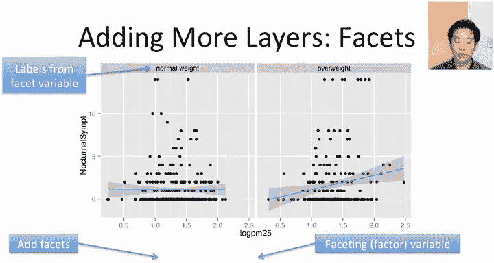
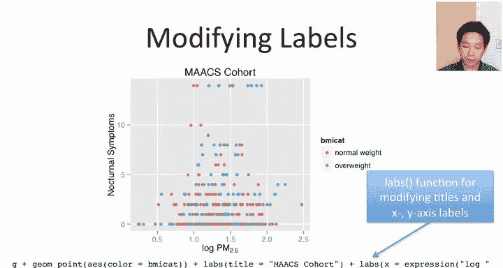
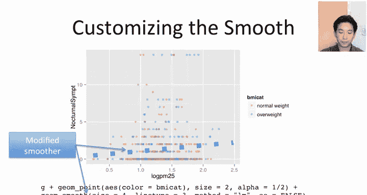
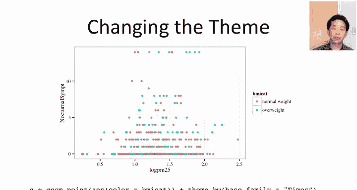
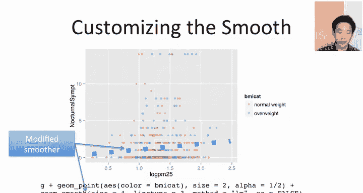
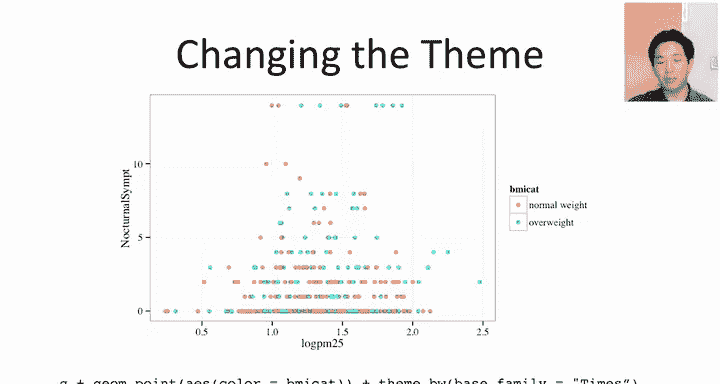

# 120：ggplot2 第四部分

在本节课中，我们将继续深入学习 `ggplot2` 包，重点介绍如何为图形添加平滑曲线、分面以及如何自定义图形的各种元素，如颜色、标签和主题。我们将通过具体的代码示例，帮助你理解如何构建和美化数据可视化图形。

---

## 添加平滑曲线

上一节我们介绍了如何创建散点图。本节中，我们来看看如何为散点图添加平滑曲线，以帮助我们观察数据的整体趋势。

你可以通过 `geom_smooth()` 函数为图形添加一条平滑曲线。默认情况下，该函数使用 LOESS 平滑方法，它会生成一条蓝色曲线和灰色的置信区间带。

以下是添加默认平滑曲线的代码：

```r
g + geom_point() + geom_smooth()
```

然而，LOESS 平滑在数据边界处可能因为数据稀疏而产生较大的置信区间，导致图形看起来“噪声”较多。如果你希望看到更简洁的趋势线，可以使用线性回归线代替。

你可以通过指定 `method = "lm"` 参数，将平滑方法改为线性回归：

```r
g + geom_point() + geom_smooth(method = "lm")
```

线性回归线不如 LOESS 平滑灵活，但它能更清晰地展示数据的总体趋势，并且在数据边界处的置信区间通常更窄。

---

## 使用分面

分面功能允许我们根据某个分类变量的不同水平，将数据绘制在多个独立的子图中进行比较。这有助于我们观察不同组别间的关系是否存在差异。

要添加分面，我们使用 `facet_grid()` 函数。其基本语法使用波浪号 `~` 来分隔变量，格式为 `facet_grid(行变量 ~ 列变量)`。



如果我们只想根据一个变量（例如 `bmi_cat`，包含“正常体重”和“超重”两个水平）进行分面，可以这样写：

```r
g + geom_point() + facet_grid(. ~ bmi_cat) + geom_smooth(method = "lm")
```

这段代码会生成一行两列的子图，每个子图对应一个 BMI 类别。`ggplot2` 会自动使用因子变量的水平作为每个子图的标题，因此确保你的数据标签清晰易懂非常重要。

图层（如 `geom_point`、`geom_smooth`、`facet_grid`）的添加顺序通常不影响最终图形的生成，你可以根据需要灵活安排。

---

## 自定义图形元素

创建基本图形后，我们经常需要修改坐标轴标签、标题、颜色等元素，以使图形更清晰、更专业。

以下是自定义图形的一些常用函数：

*   **修改标签和标题**：可以使用 `xlab()`、`ylab()` 和 `ggtitle()` 函数分别设置 X 轴标签、Y 轴标签和图形标题。更通用的方法是使用 `labs()` 函数，它可以一次性设置多个标签。
*   **修改几何对象属性**：每个 `geom_*` 函数（如 `geom_point`、`geom_smooth`）都有一系列参数可以修改其外观，例如线条粗细、颜色、透明度等。
*   **修改整体主题**：`theme()` 函数用于全局性地修改图形主题，例如背景色、图例位置、字体等。此外，还有一些内置的完整主题，如 `theme_gray()`（默认的灰色背景主题）和 `theme_bw()`（黑白背景主题），可以一键改变图形的整体风格。

---

### 修改点的美学属性

点的颜色、大小和透明度等属性可以通过 `geom_point()` 函数进行设置。这里有一个关键区别：是将属性设置为一个**固定常量**，还是将其**映射到数据中的某个变量**。

*   **设置为常量**：直接在 `geom_point()` 函数中指定参数值。例如，以下代码将所有点设置为钢蓝色、大小为 4、透明度为 0.5：
    ```r
    g + geom_point(color = "steelblue", size = 4, alpha = 0.5)
    ```
*   **映射到变量**：如果你想根据数据中某个分类变量（如 `bmi_cat`）来区分点的颜色，必须将映射关系包裹在 `aes()` 函数内。`aes` 代表“美学映射”。例如：
    ```r
    g + geom_point(aes(color = bmi_cat), size = 4, alpha = 0.5)
    ```
    这段代码会根据 `bmi_cat` 的不同水平为点分配不同颜色，并自动生成图例。而点的大小和透明度仍然是固定的常量。

---

### 使用 labs 函数修改标签

`labs()` 函数是设置图形标签的便捷工具。你可以用它来设置标题、X 轴和 Y 轴标签。

```r
g + geom_point(aes(color = bmi_cat)) +
    labs(title = "MAX Cohort",
         x = expression(log~PM[2.5]),
         y = "Nocturnal Symptoms")
```

在上面的代码中，我们使用了 `expression()` 函数和数学注释语法来生成带有下标（PM₂.₅）的 X 轴标签。

---

### 自定义平滑曲线

`geom_smooth()` 函数同样支持多种自定义选项。例如，你可以改变线条的粗细、线型，并选择是否显示置信区间。

```r
g + geom_point() + geom_smooth(method = "lm", size = 4, linetype = 3, se = FALSE)
```
*   `size = 4`：将回归线加粗。
*   `linetype = 3`：将线型改为虚线。
*   `se = FALSE`：不显示置信区间带。

---



### 更改整体主题

如果你不喜欢默认的灰色背景主题，可以轻松切换到其他内置主题。例如，使用黑白主题 `theme_bw()`：

```r
g + geom_point() + geom_smooth(method = "lm") + theme_bw(base_family = "Times")
```



此外，你还可以通过 `base_family` 等参数修改字体。上面的代码将图形主题改为黑白，并将字体设置为 Times New Roman（一种衬线字体）。

---

## 总结

本节课中我们一起学习了 `ggplot2` 的几个高级功能：
1.  使用 `geom_smooth()` 添加平滑曲线或回归线来揭示数据趋势。
2.  利用 `facet_grid()` 根据分类变量创建分面图，以便于组间比较。
3.  掌握了如何自定义图形，包括：
    *   使用 `labs()`、`xlab()`、`ylab()` 修改标签。
    *   在 `geom_*` 函数中设置常量或通过 `aes()` 映射变量来改变颜色、大小等美学属性。
    *   使用 `theme_bw()` 等函数更改图形的整体主题和外观。







通过组合这些图层和自定义选项，你可以创建出信息丰富且美观的专业级数据可视化图形。记住，在绘图前整理好数据并设置清晰的变量标签，往往能让后续的绘图代码更加简洁高效。