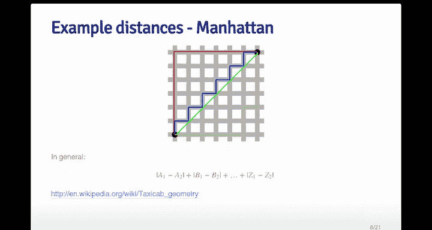

# 122：层次聚类（第 1 部分）🌳

在本节课中，我们将要学习层次聚类的基本概念。层次聚类是一种用于可视化高维或多维数据的常用技术。它的使用非常简单，其思想对大多数人来说相当直观，并且可以作为快速理解高维数据集中情况的有效方法。

## 概述

与大多数聚类技术（例如 K 均值）一样，定义层次聚类方法时需要解决一个基本问题：如何定义事物之间的“近”与“远”。因为从某种意义上说，所有聚类方法都试图告诉你，一个事物与另一个事物相比，哪个更近。例如，同一个簇中的元素彼此之间的距离，比它们与另一个簇中元素的距离更近。因此，我们必须定义“近”的含义、将事物分组在一起的含义，以及如何将事物分组。一旦我们有了距离概念和分组方法，我们还需要知道如何可视化处理过程和计算结果，以及如何解释分组的形成方式。

聚类分析是一项非常重要且应用广泛的技术。如果你在谷歌上搜索“聚类分析”，会得到数百万条结果。它在科学和其他应用的许多不同领域都是一种广泛应用的方法。因此，了解其中一些技术的工作原理是有益的。

## 层次聚类的基本思想

层次聚类，正如其名称所示，涉及将数据组织成一种层次结构。常用的方法是所谓的“凝聚式”方法。这是一种自底向上的方法：你从单个数据点开始，然后将它们逐步合并成簇，直到最终整个数据集成为一个大簇。

你可以想象有许多小颗粒漂浮在空中，你开始将它们分组为小球，然后这些小球被分组为更大的球，最终这些大球被合并成一个巨大的簇。这就是层次聚类的凝聚式方法，也是我们这里要讨论的内容。

基本思想是：首先找到数据中距离最近的两个点，然后将它们合并成一个“超级点”。这个合并后的点并不是数据中实际存在的点，但你可以将其视为一个新点。接着，你移除原始的两个数据点，并用这个合并点替代它们。然后，你不断重复这个过程：找到下一对最接近的事物，将它们合并在一起。一旦你将事物合并在一起，就会得到一棵小树，它可以展示合并的顺序以及哪些事物被合并了。

## 层次聚类的两个关键要素

这种方法需要两个重要的东西：一是距离度量，二是合并点的方法。

1.  **距离度量**：如何计算两点之间的距离？
2.  **合并方法**：一旦确定了两点最接近，如何将它们合并在一起？

层次聚类产生的一个优点是生成一棵树，有时称为**树状图**，它展示了事物是如何合并在一起的。

## 定义“距离”

在层次聚类方法中，可以说最重要的问题是定义“近”的含义。因为如果你的定义对你的问题没有意义，那么结果将是“垃圾进，垃圾出”。如果你的距离度量没有意义，那么你得到的结果也将相对无意义。

以下是几种常用的距离度量示例：

*   **欧几里得距离**：这是最熟悉的距离度量，即任意两点之间的直线距离。
*   **相关距离或相似性**：基于两点之间的相关性。
*   **曼哈顿距离**：我们稍后会解释其含义。

你必须为你的问题选择一个有意义的距离度量，这样才能产生有意义的结果。

### 欧几里得距离

这是一个简单的图示。以两个城市为例，比如巴尔的摩和华盛顿特区。如果你把它们放在地图上，可以想象每个城市的中心都有一个 X 和 Y 坐标。你想计算两个城市中心之间的距离，你可以在两个城市之间画一条直线对角线，然后以通常的方式计算距离。这个距离将是 X 坐标差和 Y 坐标差的函数。

要计算欧几里得距离，你取 X 坐标的差值，将其平方；取 Y 坐标的差值，将其平方；将两个平方相加，然后取平方根。这就是欧几里得距离的经典定义。

在现实生活中，这就像一只鸟从华盛顿特区飞到巴尔的摩，它会直接从一座城市飞到另一座城市，因为它可以在空中飞行，不受道路或山脉等障碍物的阻碍。这就是两座城市之间的直线距离。这个距离对你是否有意义，取决于你是否是一只鸟或其他东西。因此，你必须在问题的背景下思考这一点。

欧几里得距离很容易推广到更高维度。即使你有一百个维度，你通常也可以取每个维度的差值，平方，求和，然后取平方根。因此，它非常自然地扩展到非常高维的问题。

### 曼哈顿距离

曼哈顿距离得名于网格或城市街区网格上的点。想象你在纽约曼哈顿，想从一个点到达另一个点。你可以看这张图上的两个黑圈。如果你想从一个点到达另一个点，在城市街区中，你不能直接从一个点走到另一个点，因为中间会有建筑物，你必须沿着街道走。

在街道上，由于它们是网格状的，你只能向上、向下、向左或向右走。在这种情况下，图中的绿线将代表欧几里得距离，就像一只鸟想飞越一切到达两点之间。但作为一个在地面上行走的人，你必须走红线、蓝线或黄线，或介于其间的任何其他路径。关键在于，你必须沿着城市街区行走。因此，你在灰色街道（你可以将灰线想象成街道）上行走的距离就是曼哈顿距离。

它可以公式化地写为所有不同坐标的绝对值和。如果你有两个坐标，那么你将在 X 维度上行走的距离和在 Y 方向上行走的距离的绝对值相加。曼哈顿距离在某些情况下可能很有用，因为它可能在某些上下文中更准确地表示两点之间的距离，特别是在像曼哈顿这样的城市中，两点可能相距很远，即使它们在欧几里得距离意义上看起来相对接近。

## 总结

本节课中，我们一起学习了层次聚类的基本原理。我们了解到层次聚类是一种自底向上的凝聚式方法，通过不断合并最近的点来构建层次结构。实现层次聚类需要两个核心要素：**距离度量**（如欧几里得距离或曼哈顿距离）和**合并方法**。正确选择距离度量对于获得有意义的聚类结果至关重要。最后，层次聚类的结果通常以**树状图**的形式呈现，直观展示数据点的合并过程。在下一节中，我们将深入探讨具体的合并方法以及如何解读树状图。