# 123：层次聚类算法详解（第二部分）🔍

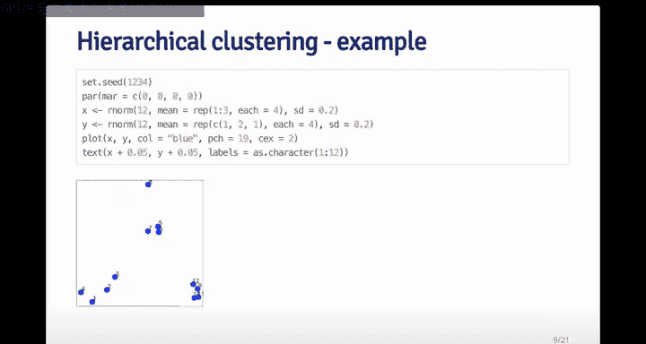

在本节课中，我们将通过一个简单的模拟数据集，详细演示层次聚类算法的工作流程。我们将从计算数据点之间的距离开始，逐步展示数据点如何被合并，最终形成树状图，并学习如何通过“切割”树状图来确定聚类的数量。

---

## 数据准备与可视化

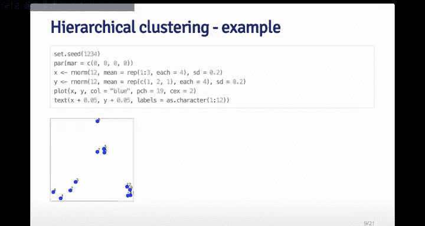

为了清晰地展示层次聚类的工作原理，这里模拟了一个非常简单的数据集。

首先，设置随机种子以确保数据可重现。运行以下代码可以生成并查看数据。

```r
set.seed(1234)
par(mar = c(0, 0, 0, 0))
x <- rnorm(12, mean = rep(1:3, each = 4), sd = 0.2)
y <- rnorm(12, mean = rep(c(1, 2, 1), each = 4), sd = 0.2)
plot(x, y, col = "blue", pch = 19, cex = 2)
text(x + 0.05, y + 0.05, labels = as.character(1:12))
```


图中总共绘制了12个点。从图中可以非常清晰地看到三个簇。使用`text`函数为每个点添加了标签，以便区分。

接下来，将运行层次聚类算法来观察这些点是如何被合并在一起的。

---

## 第一步：计算距离矩阵

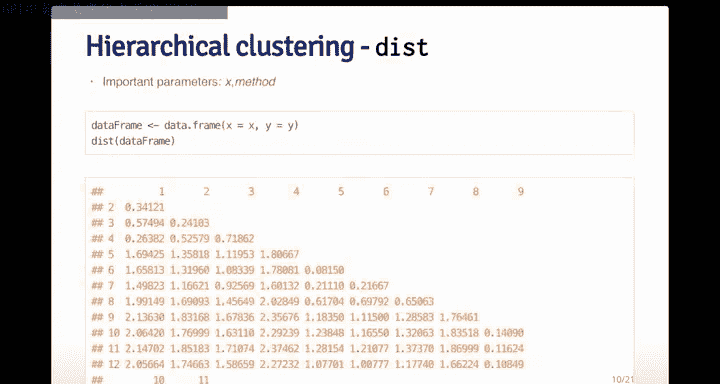

运行层次聚类算法的第一步是计算所有不同数据点之间的距离。需要计算所有点之间的两两距离，以便找出哪两个点距离最近。


在R语言中，最简便的方法是使用`dist`函数。该函数接收一个矩阵或数据框作为输入。本例中的数据框有两列：第一列是X坐标，第二列是Y坐标。

```r
dataFrame <- data.frame(x = x, y = y)
dist(dataFrame)
```

`dist`函数计算数据框中所有不同行之间的距离，并返回一个**距离矩阵**，其中包含了所有成对的距离值。

如果调用`dist`时不添加其他参数，它默认使用**欧几里得距离**度量，但也可以通过选项指定其他距离度量。


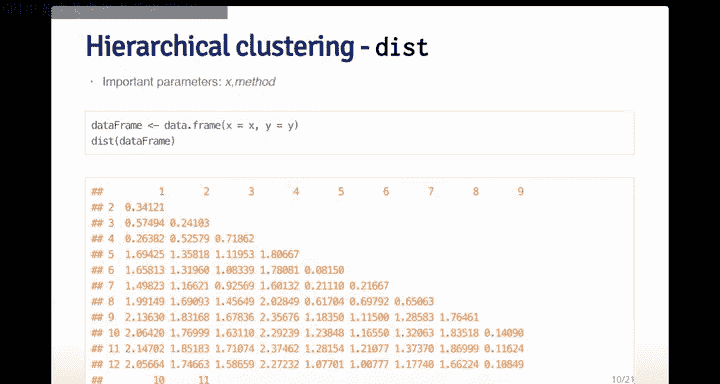

下方显示的是`dist`函数返回的距离矩阵的大部分内容。可以看到它是一个下三角矩阵，给出了所有成对距离。

例如，点1和点2之间的距离是0.34。当然，这里的实际距离数值本身没有特定意义，因为数据是模拟生成的。但可以看出，有些点之间的距离较远，有些则较近。

例如，点3和点1之间的距离是0.574，而点3和点2之间的距离是0.24。这表明点3离点2比离点1更近。可以像这样逐行查看各个点彼此之间的距离。

---

## 第二步：合并最近的点

层次聚类算法的核心思想是，从最初开始，将两个距离最近的点合并。

观察距离矩阵，最初距离最近的两个点是点5和点6。在图中，它们被标记为橙色。

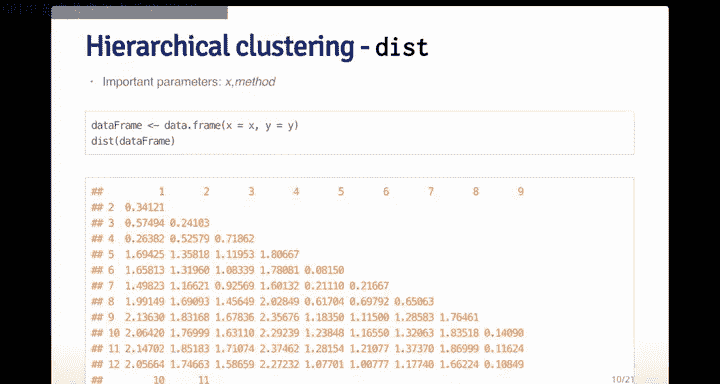


因为点5和点6距离最近，所以将它们归为一组，合并成一个单一的簇。

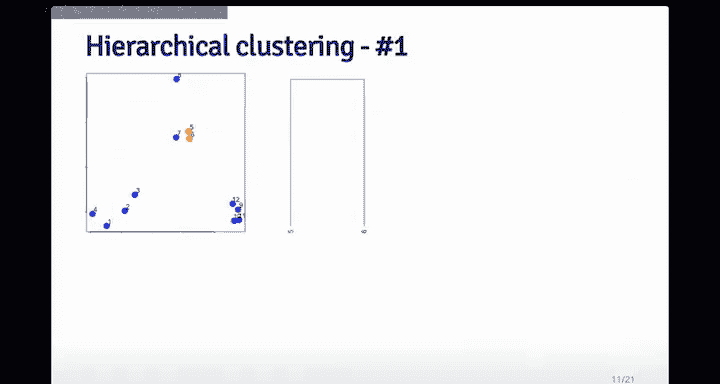
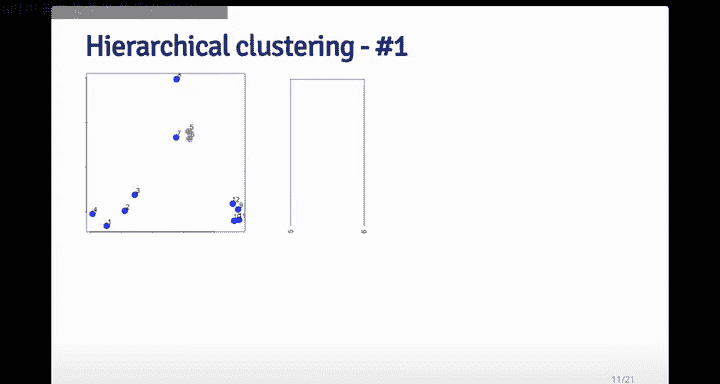


这个想法是创建一个单一的“超级点”。图中中间的加号（+）大致代表这个合并点集的新位置。

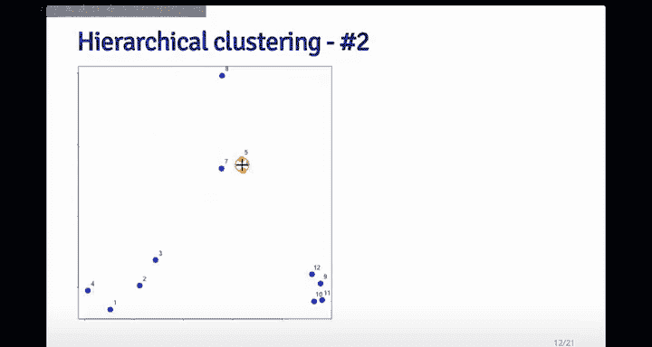


现在，点5和点6已经被合并为一个点。


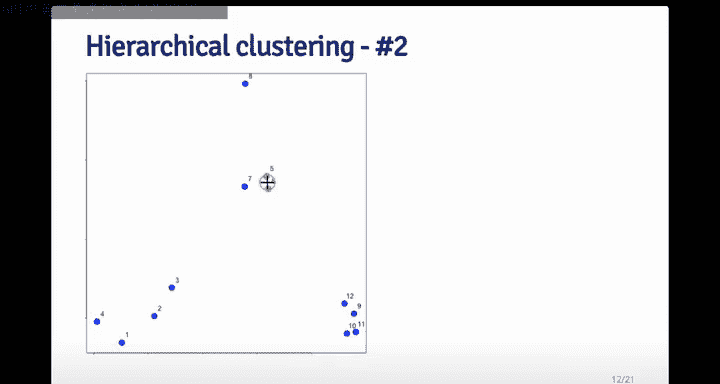

接下来，距离最近的两个点是右下角红色的点10和点11。将这两个点合并在一起，创建一个新的“超级点”，它将在这个算法中继续向上聚合。


可以继续按照这个流程进行。

---


## 第三步：生成树状图

最终，我们会得到一个小图，称为**树状图**。它展示了各个点是如何被聚类在一起的。

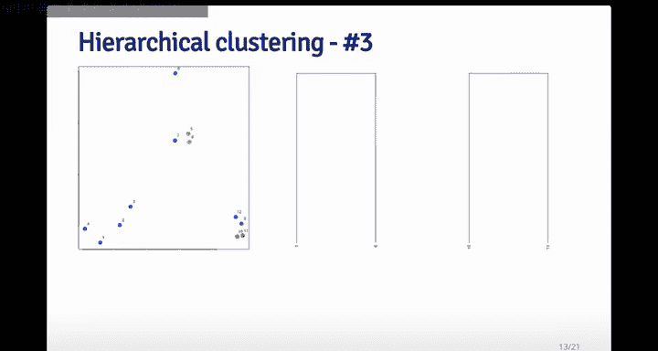


在树状图的最右侧，可以看到点5和点6被归为一组。

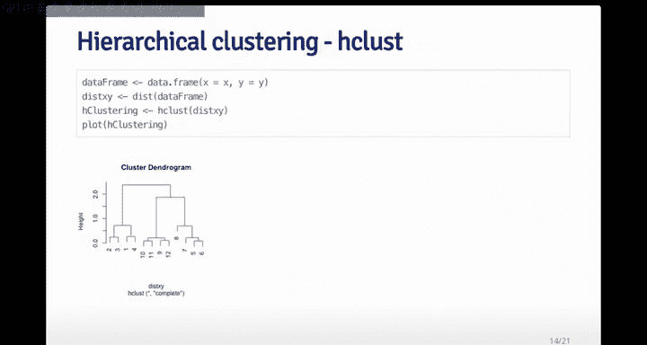

在中间部分，点10和点11被归为一组。


在树中位置越靠下的点，表示它们越早被聚类。而位置越靠上的点，则表示它们被聚类的时间越晚。

可以看到，点5和点6先被合并。然后它们与点7聚类。当点5、6、7全部合并成一个单一的超级点后，它们又与点8合并，依此类推。


---

## 第四步：切割树状图以确定簇数

由聚类算法生成的树状图本身并不直接告诉你存在多少个簇。你会注意到图上没有特定的标签标明是两个簇、三个簇还是其他数量。


因此，你必须在某个特定点“切割”这棵树，以确定有多少个簇。

例如，如果在Y轴上标记为2.0的高度处进行切割（即画一条水平线）。

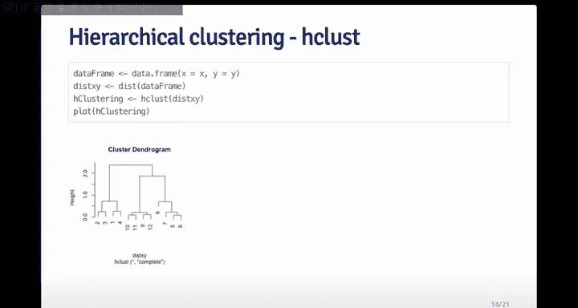


问题在于，这条水平线会与多少个分支相交？如果在2.0的高度画一条水平线，大致会与两个分支相交，这表明大致存在两个簇。

然而，如果在高度为1.0的地方画一条水平线。

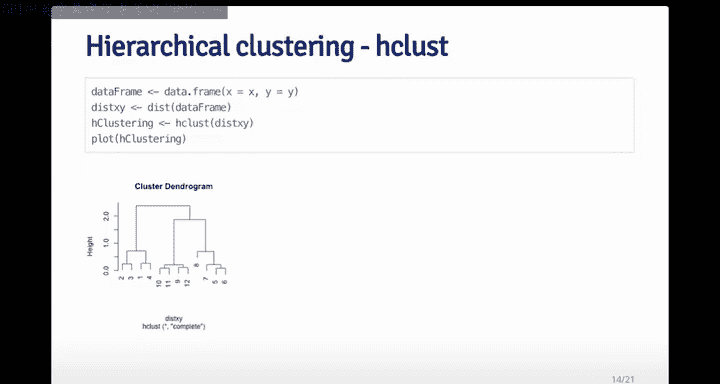


你会看到它与三个分支相交，这表明大致存在三个簇。

因此，根据你选择在何处画这条水平线（或切割这棵树），你将在聚类中得到或多或少的簇。

当然，在极端情况下，如果你在树的最底部切割，那么你将得到12个簇，等于数据点的数量。

所以，你需要在对你方便的位置切割这棵树。目前，我们并没有严格的规则来决定在哪里切割。但一旦完成切割，你就可以从层次聚类中获得簇的分配结果。

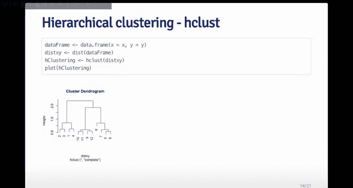

---

## 总结

本节课中，我们一起学习了层次聚类算法的完整步骤。

1.  **准备数据并计算距离矩阵**：使用`dist`函数计算所有数据点之间的成对距离。
2.  **迭代合并最近邻**：算法从距离最近的两个点开始，逐步将它们合并成“超级点”。
3.  **生成树状图**：树状图直观地展示了数据点被合并的先后顺序和层次关系。
4.  **切割树状图确定簇数**：通过在不同高度切割树状图，可以得到不同数量的聚类结果，这需要根据实际分析目标来决定。


层次聚类的优势在于它提供了完整的聚类层次结构，允许你在不同粒度上查看数据分组，而无需预先指定簇的数量。