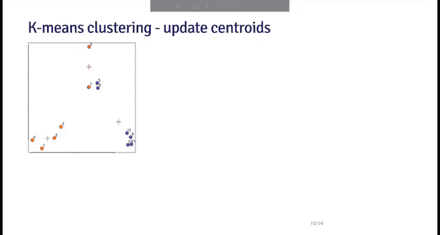

# 125：K均值聚类（第1部分） 🧮

在本节课中，我们将要学习K均值聚类的基本原理。这是一种用于将数据点分组到指定数量簇中的经典方法。我们将了解其工作原理、所需的关键概念，并通过一个简单示例来演示算法的迭代过程。

---

## 概述

K均值聚类是一种相对古老但至今仍非常有用的技术，主要用于总结高维数据，揭示数据中的模式，并识别哪些观测值彼此相似，哪些差异较大。本节将介绍K均值的工作原理及其应用价值。

## 核心概念：距离度量

在开始聚类之前，首先需要定义“相似”和“不同”的含义。这需要一个**距离度量**来量化两个事物之间的接近程度。距离的定义取决于具体情境，选择不当的度量标准可能导致无意义的结果。

以下是几种传统的距离度量：
*   **欧几里得距离**：两点之间的直线距离，公式为 `d = √((x₂ - x₁)² + (y₂ - y₁)²)`。
*   **相关性相似度**：衡量两个变量之间的相关程度，高度相关的点被视为相似。
*   **曼哈顿距离**：两点在标准坐标系上的绝对轴距总和。

你需要为你的问题选择一个有意义的距离或相似性度量。

## K均值算法原理

上一节我们介绍了距离的概念，本节中我们来看看K均值聚类的具体目标和方法。K均值聚类是一种将一组观测值划分到固定数量簇中的方法。

其核心思想是，你必须事先指定数据点可能被划分成的簇的数量 `K`。例如，如果你有100个观测值，你可能认为它们可以整齐地分为4个不同的组。每个组将有一个**质心**，类似于该组数据点的“重心”。

算法基本步骤如下：
1.  指定簇的数量 `K`。
2.  初始化 `K` 个质心的位置（例如随机选择）。
3.  将每个数据点分配给距离它最近的质心，形成初始簇。
4.  基于当前簇内所有点的位置，重新计算每个簇的质心。
5.  重复步骤3和4（重新分配点和更新质心），直到质心的位置不再发生显著变化，算法收敛。

K均值聚类算法最终会输出每个簇的最终质心位置，以及每个观测值被分配到的簇标签。

## 算法演示：一个简单例子

为了更直观地理解上述过程，我们通过一个在二维空间中生成的随机数据示例来逐步演示。该数据明显包含三个簇，每个簇有四个观测值。

以下是算法的迭代步骤：

首先，随机选择三个点作为初始质心（图中以“+”号表示）。

**第一步：分配点**
将每个数据点分配给距离它最近的质心。例如，顶部的点8被分配给左上角的红色质心；点1、2、3被分配给橙色质心；其余点被分配给紫色质心。这样就完成了点到三个簇的初始分组。

**第二步：重新计算质心**
根据当前每个簇内所有点的位置，重新计算质心。例如，取每个簇中所有点的坐标平均值作为新质心。可以看到，紫色和红色的“+”号移动到了各自簇的中间位置，橙色的“+”号也移动到了三个橙色点的中间。

**第三步：重新分配点**
基于新的质心位置，再次检查每个数据点离哪个质心最近，并重新分配。例如，点4原先属于红色簇，但现在离橙色质心更近，因此被重新分配到橙色簇；点7现在离红色质心更近，因此被分配到红色簇。

**第四步：再次更新质心**
根据新的分组，再次更新每个簇的质心位置。可以看到质心继续向各自簇的中心移动。

这两个过程——将点分配给最近的簇，以及根据当前分配更新簇的质心位置——不断重复，直到分配关系不再改变，此时聚类完成。

---

## 总结

本节课中我们一起学习了K均值聚类的基础知识。我们了解到，成功应用K均值需要三个关键要素：一个合适的**距离度量**、一个事先指定的**簇的数量K**，以及质心的**初始猜测**。算法通过交替执行“分配点”和“更新质心”两个步骤来迭代优化，最终将数据划分到不同的簇中，并输出每个簇的中心和每个点的归属。在下一部分，我们将探讨如何选择K值以及在实际数据中应用K均值时需要注意的问题。