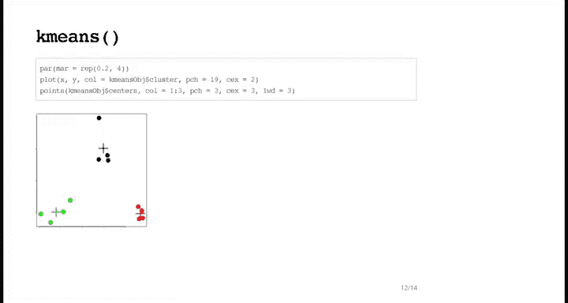
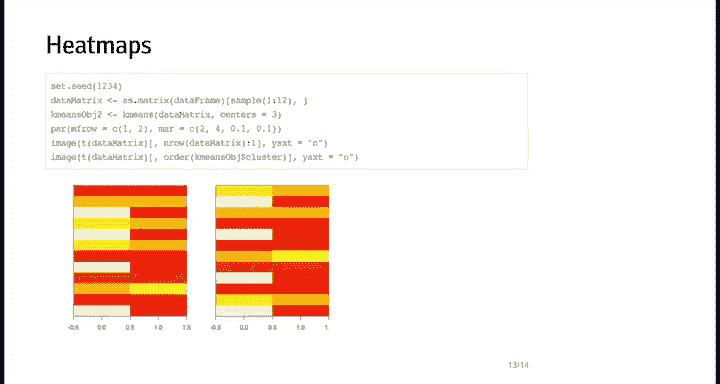
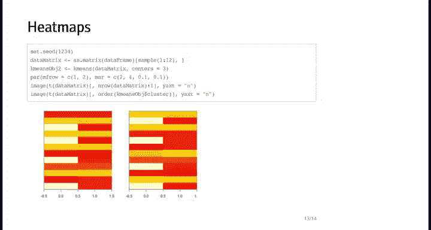
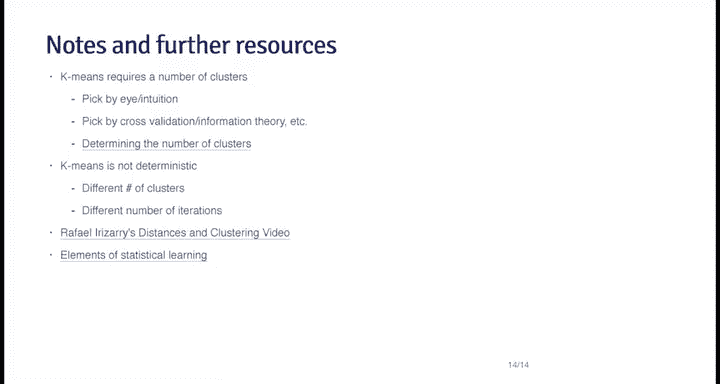

# 126：K均值聚类（第2部分）🎯

在本节课中，我们将学习如何在R语言中实现K均值聚类算法，并探索几种可视化聚类结果的方法。我们将重点介绍`kmeans()`函数的使用、结果解读以及通过散点图和热图来呈现聚类效果。

---

## 在R中实现K均值聚类

上一节我们介绍了K均值聚类的基本原理，本节中我们来看看如何在R语言中具体应用它。R语言内置的`kmeans()`函数是执行该算法的主要工具。

以下是一个使用二维数据框的简单演示：

```r
# 对数据框执行K均值聚类，指定3个中心点（质心）
kmeans_result <- kmeans(data_frame, centers = 3)
```

`kmeans()`函数返回一个包含多个元素的列表对象。其中最重要的元素之一是`cluster`。

```r
# 查看每个数据点被分配到的簇
kmeans_result$cluster
```

`cluster`元素是一个从1到K（本例中为3）的整数向量。它指明了传入数据框中每个数据点所属的簇。例如，输出可能显示前四个点在簇3，接下来四个在簇1，再接下来四个在簇2。

返回对象的另一个关键元素是`centers`。

```r
# 查看每个簇的质心坐标
kmeans_result$centers
```

`centers`元素告诉你每个质心在空间中的具体位置。

---



## 可视化聚类结果：散点图

了解算法结果后，我们可以将其可视化。一种直观的方法是使用散点图，并根据聚类结果对点进行着色。

以下是具体步骤：

首先，运行K均值算法获取聚类结果。然后，绘制原始数据点，并根据其所属簇号（`kmeans_result$cluster`）来指定颜色。最后，使用`points()`函数将计算出的质心位置添加到图中，通常用“+”符号标记。

```r
# 绘制数据点，按簇着色
plot(x, y, col = kmeans_result$cluster)
# 添加质心位置
points(kmeans_result$centers, pch = 3, cex = 2, lwd = 2)
```





通过这种可视化，你可以清晰地看到数据如何被分组，以及每个簇的中心所在。


---

## 可视化聚类结果：热图

除了散点图，另一种展示K均值等聚类算法结果的有效方式是使用热图。这对于观察高维数据或矩阵型数据中的模式特别有用。

以下是具体过程：

我们使用相同的数据集，但可能进行不同的随机抽样，并再次运行K均值算法，将结果存储在另一个对象中。

```r
kmeans_object_2 <- kmeans(new_sample_data, centers = 3)
```

接下来，我们可以为数据创建图像（热图）。左侧的热图可能展示原始数据的顺序，而右侧的热图则会根据聚类结果对数据行（有时是列）进行重新排序。


在右侧重新排序的热图中，属于同一簇的数据行被排列在一起。当你上下浏览这个矩阵时，可以看到聚类在一起的数据点彼此相邻。这种组织方式能帮助你更系统地观察矩阵数据，寻找其中的模式。我们将在讲解层次聚类时进一步探讨这一点，但热图这种可视化方式同样适用于K均值等其他聚类算法。

---

## K均值算法的要点与注意事项

最后，我们来总结一下K均值算法的特点和使用时需要注意的事项。

K均值是一个用于组织和寻找高维数据模式的便捷算法。但它有几个重要的前提和特点：

*   **需要预先指定簇数量（K值）**：你必须至少大致知道数据中可能存在的簇的数量。可以通过尝试不同的K值，观察哪种模式看起来最合理，但这并没有一个简单的固定规则。
*   **选择K值的方法**：除了目测，还有一些算法可以帮助确定最佳簇数，例如基于交叉验证、信息论或其他度量标准的方法。这里提供一个关于[确定K均值中簇数量的链接](https://en.wikipedia.org/wiki/Determining_the_number_of_clusters_in_a_data_set)供参考。
*   **算法的非确定性**：K均值算法不是完全确定性的。根据具体实现，初始质心通常是随机选择的。因此，多次运行算法以确保结果稳定是一个好习惯。例如，如果你运行三次得到三种完全不同的模式，可能意味着算法对数据的“看法”不稳定，或者该数据集本身不适合用K均值处理。
*   **数据集的适用性**：对于某些类型的数据集，K均值可能会出现问题。这里提供一些[视频和参考资料链接](https://scikit-learn.org/stable/auto_examples/cluster/plot_kmeans_assumptions.html)，它们提供了关于K均值算法局限性和注意事项的更多信息。




---

## 总结


本节课中，我们一起学习了在R语言中应用K均值聚类的完整流程。我们掌握了如何使用`kmeans()`函数进行聚类，如何从结果对象中提取簇分配和质心位置。我们还探讨了两种可视化方法：用散点图直观展示聚类与质心，以及用热图来观察高维数据中经聚类重排后的模式。最后，我们讨论了使用K均值时需要牢记的关键点，特别是关于预先指定K值、算法的非确定性以及对数据集的潜在假设。理解这些将帮助你在实际数据科学项目中更有效地应用K均值聚类。