# 128：降维第二部分 - 奇异值分解（SVD）深入解析 📊

在本节课中，我们将深入学习奇异值分解（SVD）的核心概念，包括其组成部分、如何解释结果，以及它与主成分分析（PCA）的关系。我们将通过具体的图像和数据示例，帮助你直观地理解SVD如何自动发现数据中的潜在模式。

---

## 概述

奇异值分解（SVD）是一种强大的矩阵分解技术，它能将原始数据矩阵分解为三个特定矩阵的乘积。本节课我们将拆解SVD的各个组成部分，理解左、右奇异向量如何揭示数据在行和列方向上的结构，并学习如何通过“方差解释”来衡量每个成分的重要性。我们还将探讨SVD与PCA的本质联系。

---

## SVD的组成部分与模式识别

上一节我们介绍了SVD的基本形式。本节中，我们来看看如何通过分解出的矩阵来理解数据的内在结构。

如果我们分解奇异值分解的组成部分，可以观察左奇异向量矩阵 **U** 和右奇异向量矩阵 **V**。

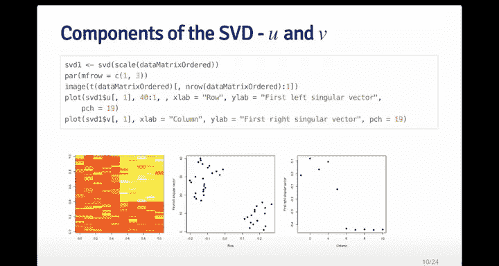

观察左侧的原始数据矩阵（即之前看到的图像图），以及中间的图，我绘制了第一个左奇异向量。它大致展示了整个数据集的均值模式。

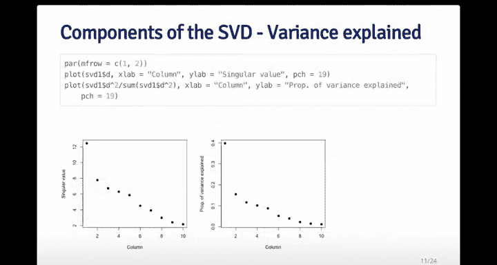

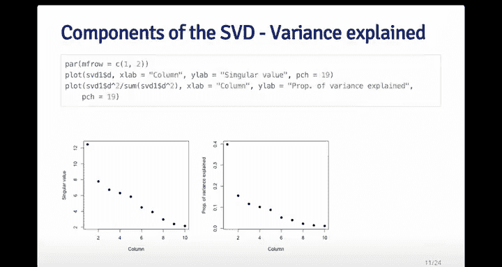

如果你按行绘制，可以看到第一个左奇异向量在大约第40行到第18行（或17行）左右为负值，而在其余行为正值。这清晰地显示了两组行在均值上的分离。

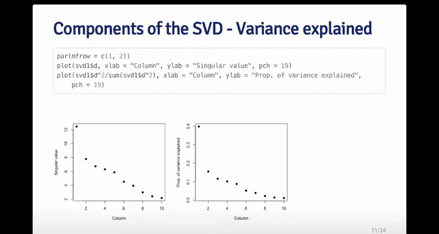

观察第一个右奇异向量，可以看到它也显示了前五列与后五列之间的均值变化。

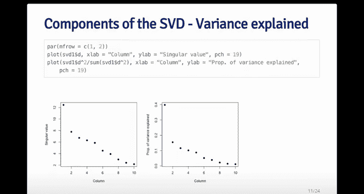

这里SVD的好处在于，它能立即捕捉到均值的偏移，无论是在行维度还是列维度上，无需任何先验信息。它是完全无监督的，可以自动识别出模式。记得我们之前绘制过非常类似的图，但那是在我们知道数据中存在这种模式的情况下。在这里，奇异值分解立即捕捉到了模式，并体现在第一个左奇异向量和右奇异向量中。

---

## 方差解释

奇异值分解的另一个组成部分被称为“方差解释”，这来源于 **D** 矩阵中的奇异值。

记住，**D** 矩阵本质上是一个对角矩阵，因此只有该矩阵对角线上的元素。

你可以将每个奇异值视为代表了数据集中由该特定成分解释的总变异的百分比。

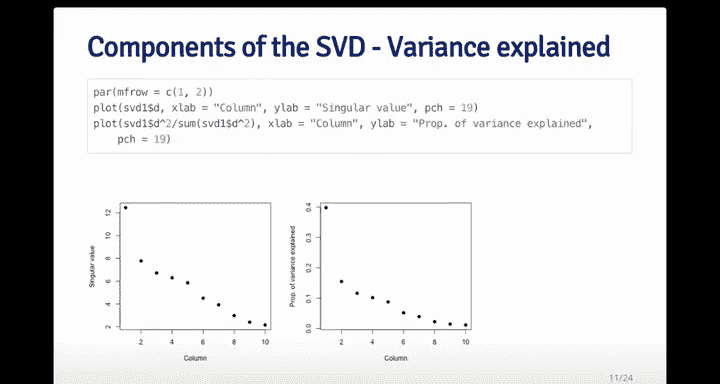

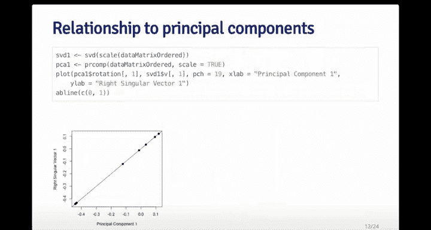

成分通常按顺序排列，第一个成分尽可能解释最多的变异，第二个解释第二多的变异，依此类推。因此，你可以绘制如下方所示的方差解释比例图。

在左侧，我绘制了原始的奇异值，可以看到它们随着列的增加而递减。当然，原始奇异值本身没有太多意义，因为它的尺度难以解释。

如果我将每个奇异值除以所有奇异值的总和，那么在右侧，我可以将其解释为方差解释的比例。可以看到这是完全相同的图，只是Y轴发生了变化。第一个奇异值（回想一下，它捕捉了行和列之间均值的偏移）解释了数据中约40%的变异。因此，几乎一半的数据变异可以由单个奇异值（或单个维度）解释。其余的数据变异则由其他成分解释。

---

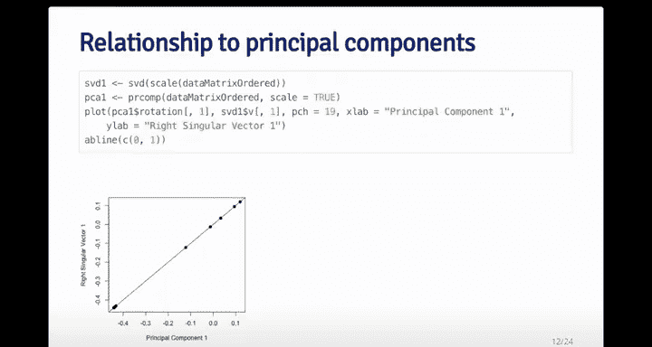

## SVD与PCA的关系

为了展示奇异值分解与主成分之间的密切关系，这里我计算了同一数据矩阵的SVD和PCA，并将第一主成分绘制在X轴上，将第一个右奇异向量绘制在Y轴上。可以看到它们完全落在同一条线上，本质上是相同的东西。

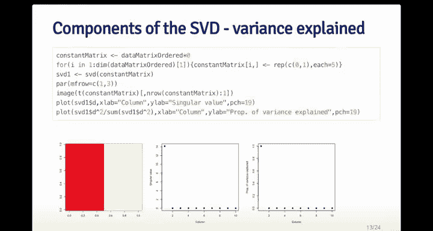

因此，SVD和主成分分析（PCA）本质上是相同的。如果你在社交场合听到有人谈论SVD和PCA，可以确信他们基本上在做同一件事。

---

## 深入理解方差解释：简单示例

让我们更仔细地看看方差解释。这里有一个非常简单的示例，基本上是一个只包含0或1的矩阵。

其核心思想是这个矩阵中基本上只有一个模式。前五列是0，后五列是1。仅此而已，没有什么特别的。

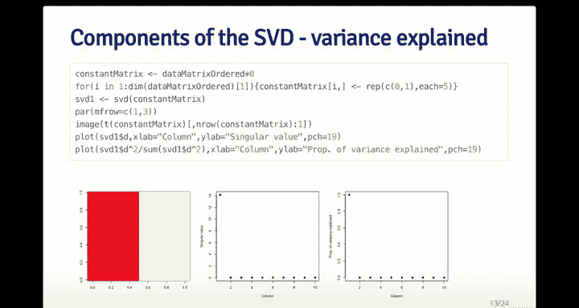

如果绘制数据，在左侧图中，可以看到前五列是红色，后五列是黄白色。

现在，如果我对这个相对简单的矩阵进行SVD，可以绘制奇异值图。你会看到一个奇异值非常高，其余的几乎都为零。你会发现第一个奇异值解释了数据中100%的变异。

这怎么可能？思考一下这个数据集，尽管它有大约40行和10列，但这个数据实际上只有一个维度：如果你在前五列，均值等于0；如果你在后五列，均值等于1。因此，尽管你有很多所谓的“观测值”，但这个矩阵中实际有用的信息只占很小一部分。SVD通过单个成分能解释100%的变异捕捉到了这一点。

---

## 添加第二个模式

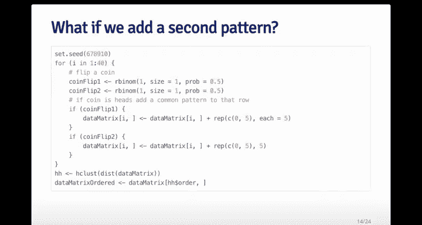

现在，让我们向数据集中添加第二个模式。我们可以添加一个跨越行和列的模式。

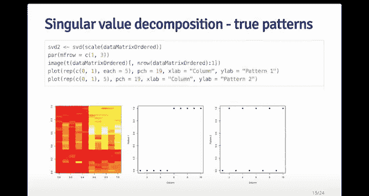

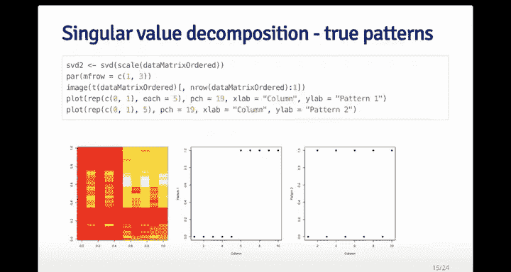

第一个模式基本上是我们之前解决的块状模式。因此，数据集的前一半将有一个均值，后一半将有另一个均值。

第二个模式基本上在列之间交替。你可以在这里看到它的样子。在左侧是数据，可以看到有一个模式，那是一种块状模式：左边五列较低，右边五列较高。然后，嵌套在其中的是一个每隔一列交替的模式，每隔一列的值更高。

如果我们绘制真实情况，可以在中间的图中看到，前五列的均值较低，后五列的均值较高，这是第一个模式。第二个模式显示第一列的均值约为0，第二列的均值约为1，第三列的均值约为0，第四列依此类推。因此，这里有两个模式：一个是这种偏移模式，另一个是这种交替模式。这就是真实情况。

当然，我们很少知道真实情况。我们需要从数据中学习真实情况。因此，问题是：当你面对左侧所示的数据时，能否提出一种算法来识别隐藏在数据中的两个独立模式？这正是SVD的用途。

---

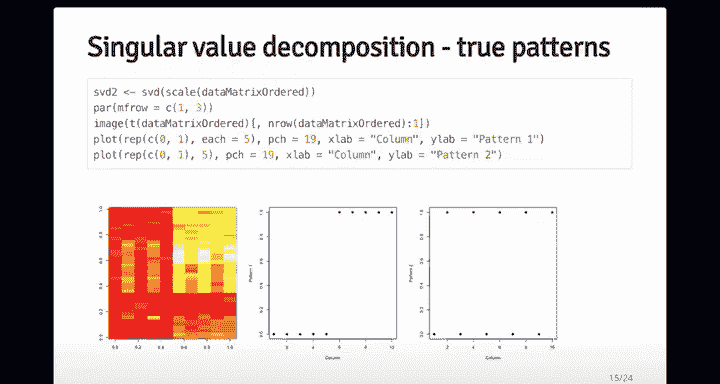

## 对包含两个模式的数据运行SVD

如果我们对这个包含两个模式的新矩阵运行SVD，左侧是数据，中间面板是第一个右奇异向量。可以看到它大致捕捉到了块状模式：前五列的值相对较低，后五列相对较高。虽然不如真实情况那么清晰，但可以大致分辨出这里有两种不同的均值。

第二个右奇异向量在右侧面板。虽然有点难以看清，但它确实试图捕捉交替的均值模式。当然，不如我们绘制真实情况时那么明显，但你可以看到每隔一个点要么较高，要么较低。

既然我们知道真实情况，讨论起来会容易一些。但总的来说，你可以看到这两个模式有些混杂在一起，因为很难将两个模式完全分开。因此，尽管我们知道真实情况是两个独立的模式，但第一个和第二个右奇异向量（也称为主成分）在某种程度上混合了这两个模式。它们各自都包含一些块状模式和交替模式。

就像大多数真实数据一样，如果你没有提前知道，真相会有点难以辨别。

---

## 两个模式数据的方差解释

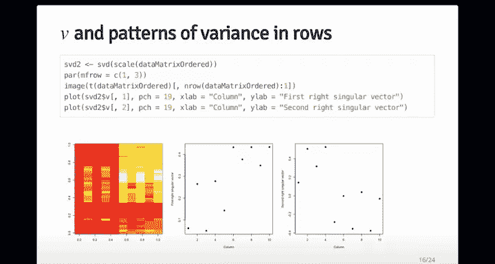

现在，如果你观察这个问题中的方差解释，可以在右侧面板（即方差解释百分比图）中看到，第一个成分解释了超过50%的数据总变异。这基本上是因为前五列和后五列之间的偏移模式非常强，代表了数据中的大量变异。因此，捕捉到这个偏移模式，就捕捉到了很多变异。

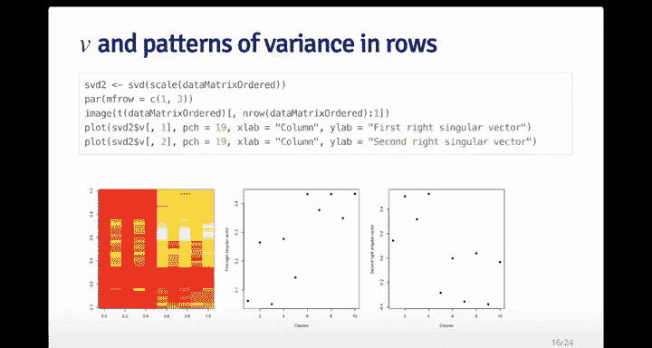

第二个成分只解释了大约18%的变异，之后的成分解释的变异更少。

这大致告诉了你这个数据集中有多少个成分。但正如你所见，那个每隔一列交替的模式（交替模式）更难被捕捉到。

---

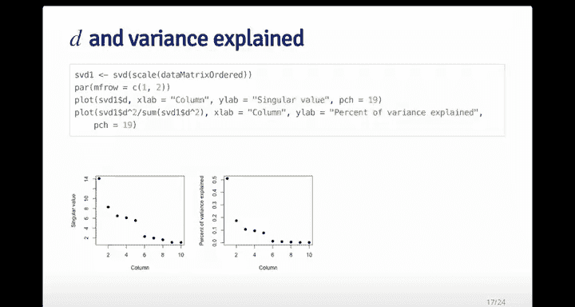

## 总结

本节课中，我们一起深入学习了奇异值分解（SVD）。我们拆解了SVD的 **U**、**V**、**D** 矩阵，理解了左、右奇异向量如何无监督地揭示数据在行和列方向上的结构（如均值偏移）。我们重点学习了“方差解释”的概念，它通过公式 **奇异值 / 奇异值总和** 来计算每个成分的重要性，并可通过绘图直观展示。通过简单和复杂的示例，我们看到了SVD如何识别数据中的单一主导模式或混合的多个模式。最后，我们明确了SVD与主成分分析（PCA）在数学上是等价的，它们都是强大的降维与模式发现工具。掌握SVD有助于你在面对高维数据时，有效地提取核心特征并理解其内在结构。