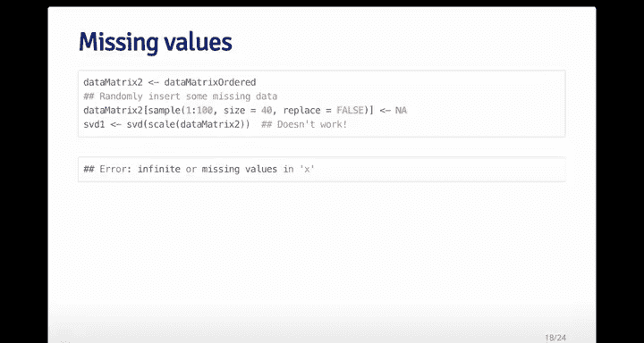
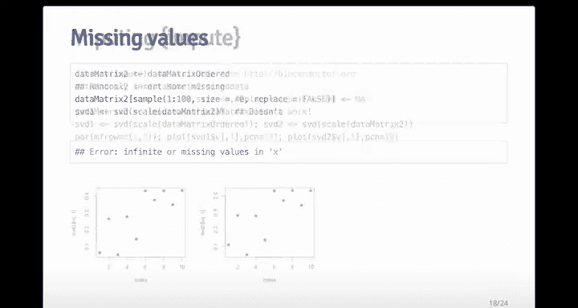
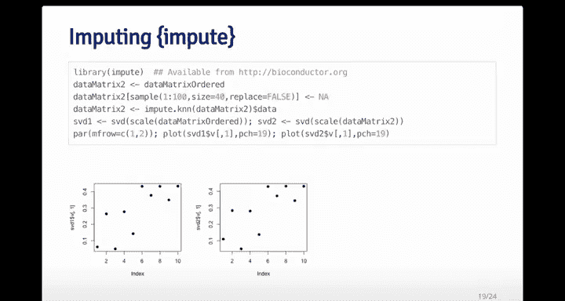
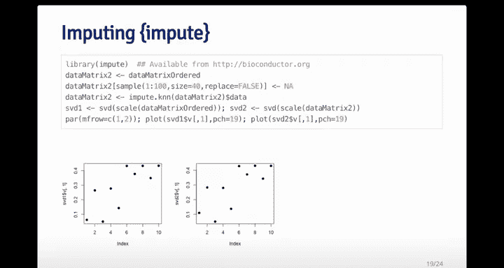
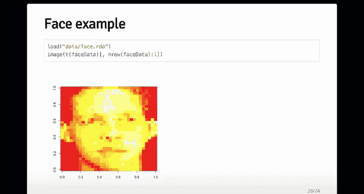
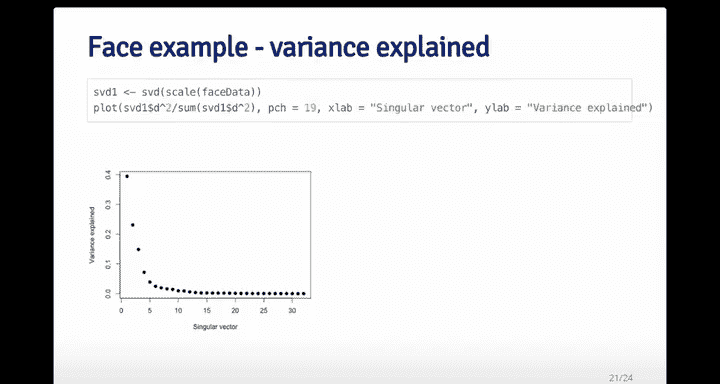
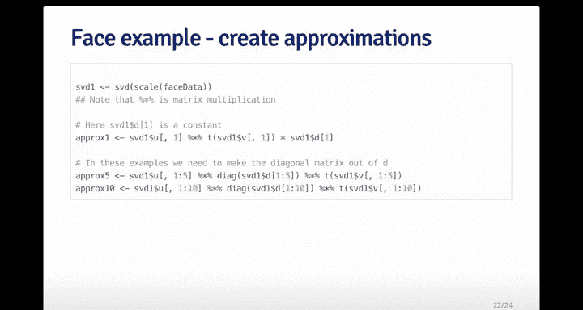
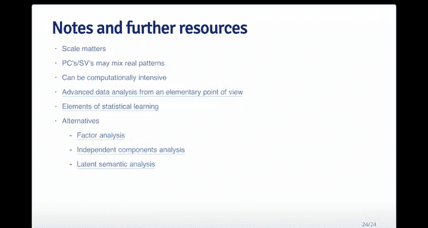
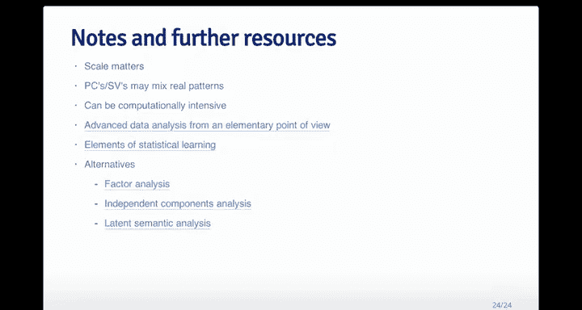
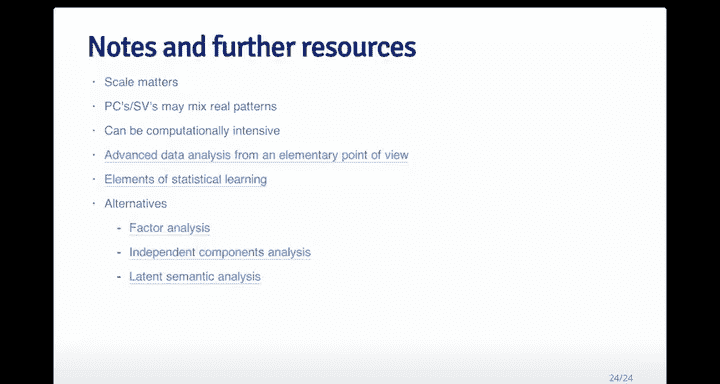

# 129：降维第3部分 - 处理缺失值与图像压缩 📊

在本节课中，我们将学习如何处理奇异值分解（SVD）和主成分分析（PCA）中的缺失值问题，并探索SVD在图像压缩和数据摘要方面的实际应用。

---

## 处理缺失值问题

上一节我们介绍了SVD和PCA的基本原理。本节中我们来看看一个实际应用中常见的问题：缺失值。

无论是SVD还是PCA，都存在一个共同问题，即无法直接处理缺失值。真实数据通常包含缺失值。如果你尝试在包含缺失值的数据上运行SVD，会直接报错，无法进行计算。因此，在运行SVD或PCA之前，必须对缺失值进行处理。

以下是处理缺失值的一种常用方法：

*   **使用`impute`包**：该包来自Bioconductor项目，可用于填补缺失的数据点。
*   **`impute.knn`函数**：此函数通过K近邻法填补缺失值。例如，若`k=5`，函数会找到与包含缺失值的行最接近的5行，然后用这5行数据的平均值来填补缺失值。

填补数据后，便可以顺利运行SVD。我们可以比较原始数据矩阵与填补后数据矩阵的第一奇异向量。虽然两者不完全相同，但大致相似，说明填补操作对SVD结果没有产生重大影响。

---

## SVD在图像压缩中的应用

接下来，我们通过一个有趣的例子，看看如何利用SVD对实际图像进行降维或低秩表示。

这里有一张人脸的相对低分辨率图片，可以清晰地看到鼻子、耳朵、眼睛和嘴巴。

我们对这张人脸数据运行SVD，并观察方差解释率。第一奇异向量解释了约40%的变异，第二奇异向量解释了约20%，第三奇异向量解释了约15%。前5到10个奇异向量几乎捕获了数据集中的所有变异。

因此，我们可以通过矩阵乘法，使用比原始数据集更少的成分来重建人脸的近似图像。例如，我们可以分别使用第1、前5和前10个奇异向量来重建图像。

以下是不同数量奇异向量重建图像的对比：

*   **仅使用第1奇异向量**：重建的图像非常模糊，几乎无法辨认出人脸。仅用一个向量来代表整张图像要求过高。
*   **使用前5个奇异向量**：图像的关键特征已基本呈现，可以清楚地看到双眼、鼻子、嘴巴和双耳。虽然与原始图像不完全相同，但已非常接近。
*   **使用前10个奇异向量**：图像具有更多细节，但与使用5个奇异向量重建的图像差异不大。
*   **原始数据集**：作为对比的原始图像。

这个例子展示了SVD在数据压缩方面的应用。仅使用少数几个（如5到10个）奇异向量，就能获得人脸的合理近似，而无需存储所有原始数据。数据压缩和统计摘要是同一枚硬币的两面，如果你想用更少的特征来总结数据集，奇异值分解同样非常有用。

---

## 注意事项与进一步资源

关于奇异值分解和主成分分析，有几点需要注意：

*   **数据尺度的影响**：数据的测量尺度很重要。如果不同变量具有完全不同的量纲和单位，数值较大的变量可能会主导PCA或SVD的结果，导致分析结果缺乏实际意义。因此，需要确保不同列或行的数据尺度大致可比。
*   **模式混合**：正如我们在双模式例子中看到的，主成分和奇异向量可能会混合真实的潜在模式。因此，你观察到的模式可能不代表可分离的独立模式，而是混合在一起的模式。
*   **计算强度**：对于非常大的矩阵，奇异值分解的计算量可能很大。不过，随着计算能力的提升以及高度优化的专用矩阵计算库的出现，在许多实际问题中应用SVD已无需过多提前规划。

以下是一些关于如何使用主成分分析和奇异值分解的进一步资源链接。此外，还有一些方法与此类似但在细节上有所不同，例如因子分析、独立成分分析和潜在语义分析。这些方法都值得探索，其核心思想与PCA和SVD一致：寻找能够解释数据中大部分变异的低维表示。

---

本节课中我们一起学习了如何处理SVD/PCA中的缺失值，并通过图像压缩的例子直观理解了SVD在数据降维与摘要中的强大应用。我们还讨论了应用时需注意的数据尺度、模式混合等关键点，为后续更深入的数据分析奠定了基础。