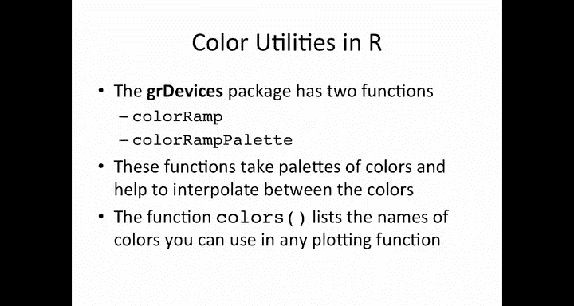
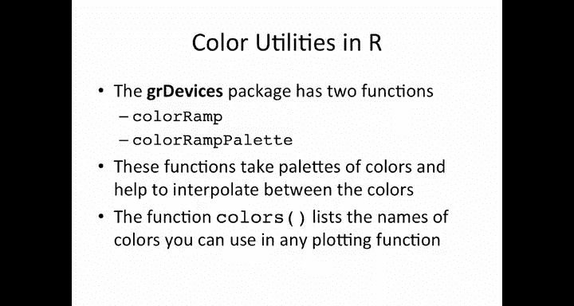
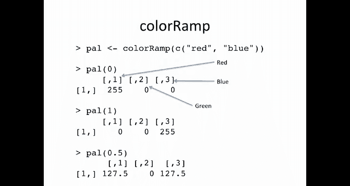
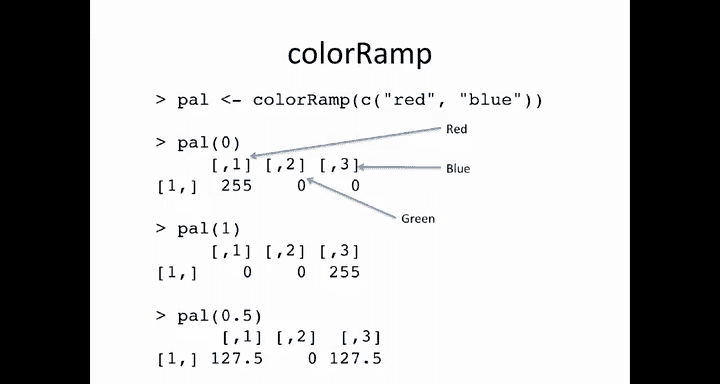
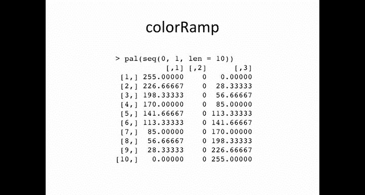
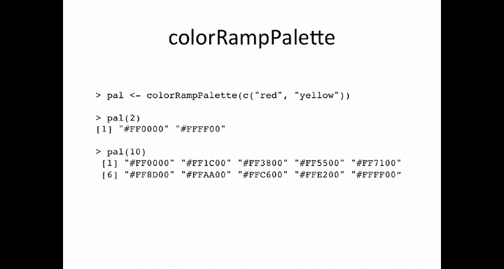

# 131：在R绘图中处理颜色（第二部分）🎨



在本节课中，我们将学习R语言中用于处理颜色的两个核心函数：`colorRamp` 和 `colorRampPalette`。这两个函数能够基于一组给定的基础颜色，通过数值插值生成一系列平滑过渡的新颜色，这对于创建自定义的连续型颜色标尺非常有用。

## 颜色插值的基本概念

上一节我们介绍了R中基本的颜色系统。本节中我们来看看如何通过混合基础颜色来创建新的颜色。

你可以想象一个画家在他的调色板上有几块特定的颜色。画家会用画笔混合这些颜色，从而创造出介于原始颜色之间的新色调。`colorRamp` 和 `colorRampPalette` 函数在R中实现了类似的功能：它们接收一组构成“调色板”的颜色，并通过数值计算在这些颜色之间进行插值，生成混合后的新颜色。

另一个可能有用的函数是 `colors()`。直接执行它（不带参数）会返回一个字符向量，其中包含了所有可以在绘图函数中通过名称引用的颜色。

## `colorRamp` 函数详解



`colorRamp` 函数接收一个颜色调色板，并返回另一个函数。这个返回的函数接收一个介于0和1之间的数值，该数值代表颜色在调色板两个极端之间的位置。

R中已有一个类似的函数 `gray()`，它在黑色和白色之间进行插值，生成各种灰度。`colorRamp` 是其通用化版本，它可以接收任意一组颜色作为调色板，并返回一个函数来在这些颜色的极端值之间进行插值。

以下是 `colorRamp` 函数的一个简单示例：

```r
# 创建一个由红色和蓝色组成的调色板
pal <- colorRamp(c("red", "blue"))
```

这里，`pal` 是一个函数。当我们调用 `pal(0)` 时，它返回调色板起始端（红色）的RGB值；调用 `pal(1)` 时，返回末端（蓝色）的RGB值。

```r
# 返回红色的RGB值矩阵
pal(0)
#      [,1] [,2] [,3]
# [1,]  255    0    0

# 返回蓝色的RGB值矩阵
pal(1)
#      [,1] [,2] [,3]
# [1,]    0    0  255
```

RGB值的范围是0到255。`pal(0.5)` 会返回红色和蓝色各占一半的混合色：

```r
pal(0.5)
#      [,1] [,2] [,3]
# [1,]  127.5    0  127.5
```

如果你传入一个0到1之间的数值序列，`pal` 会返回一系列在红色和蓝色之间平滑过渡的颜色。

## `colorRampPalette` 函数详解

`colorRampPalette` 函数与 `colorRamp` 非常相似，但它返回的函数略有不同。它也接收一个颜色调色板，但返回的函数接收一个整数参数 `n`，并生成一个包含 `n` 种颜色的向量，这些颜色在调色板指定的颜色之间均匀插值。





这与 `heat.colors()` 或 `topo.colors()` 等函数的行为类似。


以下是 `colorRampPalette` 的示例：

```r
# 创建一个由红色和黄色组成的调色板
pal2 <- colorRampPalette(c("red", "yellow"))
```

`pal2` 现在是一个函数。调用 `pal2(2)` 会返回调色板本身的两种颜色（红色和黄色），但以十六进制格式表示：



```r
pal2(2)
# [1] "#FF0000" "#FFFF00"
```

在十六进制颜色代码 `#RRGGBB` 中，前两位代表红色（R），中间两位代表绿色（G），后两位代表蓝色（B）。`#FF0000` 是纯红色（红色最大，绿色和蓝色为0），`#FFFF00` 是黄色（红色和绿色最大，蓝色为0）。

调用 `pal2(10)` 会生成10种颜色，在红色和黄色之间平滑过渡：

```r
pal2(10)
#  [1] "#FF0000" "#FF1C00" "#FF3800" "#FF5500" "#FF7100" "#FF8D00" "#FFAA00" "#FFC600" "#FFE200" "#FFFF00"
```

你可以看到，随着颜色从红色向黄色变化，红色分量（`FF`）始终保持最大，绿色分量从 `00` 逐渐增加到 `FF`，而蓝色分量始终为 `00`。

## 核心函数对比总结




以下是两个核心函数的对比：

*   **`colorRamp`**:
    *   **输入**：一个颜色向量（调色板）。
    *   **输出**：一个函数。
    *   **输出函数的输入**：介于0和1之间的数值。
    *   **输出函数的输出**：一个RGB值矩阵（每行代表一种颜色，三列分别对应R、G、B）。
    *   **用途**：根据连续变量（如比例）精确映射到某个颜色。

*   **`colorRampPalette`**:
    *   **输入**：一个颜色向量（调色板）。
    *   **输出**：一个函数。
    *   **输出函数的输入**：一个整数 `n`。
    *   **输出函数的输出**：一个长度为 `n` 的字符向量，包含十六进制颜色代码。
    *   **用途**：生成指定数量的、在调色板颜色之间均匀过渡的颜色序列，常用于为分类或离散数据上色。

## 课程总结


本节课中我们一起学习了R语言中两个强大的颜色处理工具：`colorRamp` 和 `colorRampPalette`。我们了解了它们如何通过接收一个基础颜色调色板，并利用数值插值来生成平滑过渡的颜色序列。`colorRamp` 适用于将连续数值映射到颜色，而 `colorRampPalette` 则擅长生成指定数量的离散颜色。掌握这两个函数，将极大地增强你在R中创建自定义、美观且信息丰富的图表的能力。