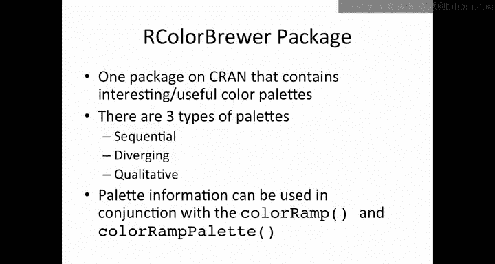
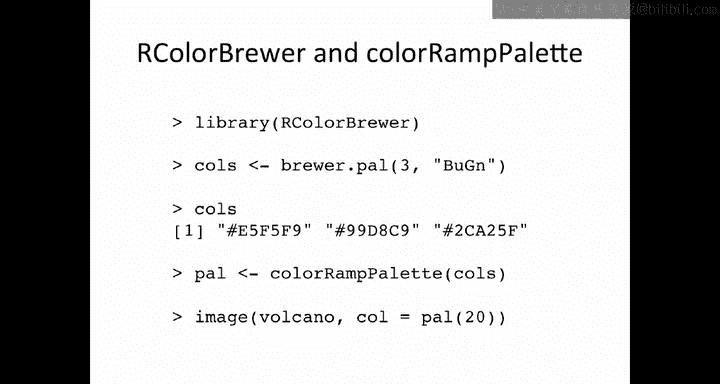
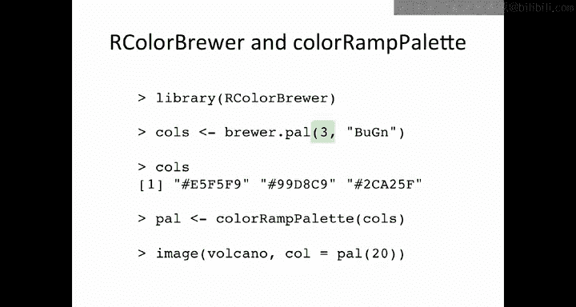
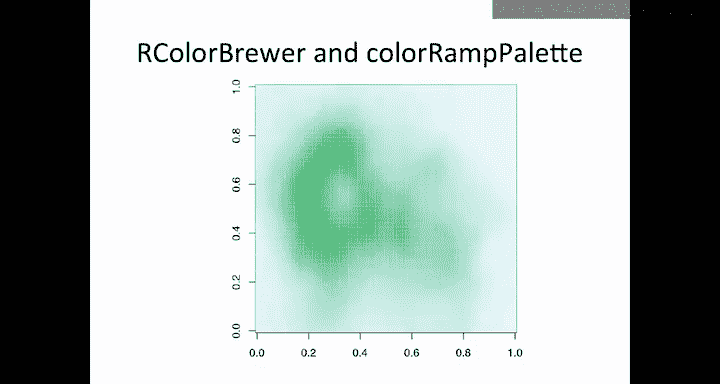
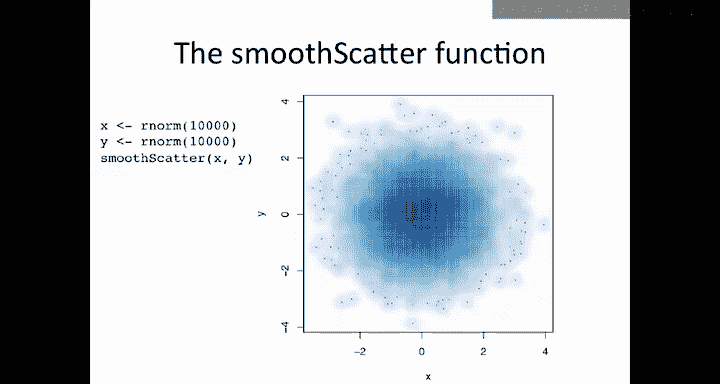

# 132：在R绘图中处理颜色（第三部分）🎨


在本节课中，我们将学习如何使用RColorBrewer包来获取和运用有趣且专业的调色板，以增强数据可视化的效果。

上一节我们介绍了如何手动创建颜色向量，本节中我们来看看如何利用现成的专业调色板。


## 认识RColorBrewer包

RColorBrewer包提供了多种精心设计的调色板，适用于不同类型的数据。这个包基于辛西娅·布鲁尔（Cynthia Brewer）在宾夕法尼亚州立大学的研究工作，她在地图制作和数据映射的颜色选择方面做了大量研究。这些调色板对于非地图数据也同样非常有用。

该包主要提供三种类型的调色板：
*   **顺序型调色板**：用于**有序数据**，例如从低到高的数值型或连续型数据。
*   **发散型调色板**：用于**偏离某个中心值的数据**，例如同时包含正值和负值，且数值大小表示偏离中心（如均值或零）的程度。
*   **定性型调色板**：用于**无序的分类数据或因子数据**，这些数据没有特定的顺序，只是代表不同的类别。

调色板信息可以通过`colorRamp`和`colorRampPalette`等函数传递给R的绘图函数。

## 调色板类型详解

以下是RColorBrewer包中提供的各类调色板示例。




*   **顺序型调色板**：位于顶部。可以看到它们基本上从左到右由浅色过渡到深色，但每种调色板会经过不同的颜色序列。例如，最上面的调色板从黄色、橙色过渡到红色，而最下面的“蓝调”调色板则从浅蓝过渡到深蓝。这些调色板用于具有低值和高值的数值型有序数据。
*   **定性型调色板**：位于中间。用于表示分类数据。可以看到调色板中的颜色没有特定的顺序，既不从浅到深，也没有其他特定排列。每种调色板都有一套相关联的颜色，并具有一个主题，有些调色板颜色更鲜明，有些则更柔和。
*   **发散型调色板**：位于底部。可以看到调色板中间的颜色较浅，从左到右，颜色在不同的色系范围内变深。可以将其理解为左侧代表负值，右侧代表正值，以此实现“发散”效果。同样，它们也经过不同的颜色序列，例如最上面的调色板从左边的红色一直过渡到右边的紫蓝色，而最下面的调色板则从左边的棕色过渡到右边的蓝绿色。你可以根据自己偏好的配色方案来选择调色板。

## 使用RColorBrewer包

安装RColorBrewer包后，可以加载它并使用其核心函数。

首先使用`install.packages`函数安装包，然后使用`library(RColorBrewer)`加载。包中最有用的函数是`brewer.pal`，它接受两个参数：
*   第一个参数是你希望调色板包含的**颜色数量**，这个数字通常较小，比如2、3或4，因为主色调不需要太多。
*   第二个参数是**调色板的名称**。调色板名称不容易记忆，需要查阅`brewer.pal`函数的帮助页面来获取所有可用的调色板名称列表。

以下是使用示例：
```r
brewer.pal(3, "BuGn")
```
这段代码请求一个蓝绿色类型的调色板，并需要3种不同的颜色。函数返回一个包含三个颜色的字符向量，每个颜色由红、绿、蓝混合值（十六进制代码）表示。即使不熟悉十六进制代码，也能在屏幕上看到这些颜色。

## 在绘图中应用调色板

接下来，我们将学习如何将调色板应用到实际的绘图中。

我们可以将这个从RColorBrewer获取的调色板传递给`colorRampPalette`函数。

```r
pal <- colorRampPalette(brewer.pal(3, "BuGn"))
```
这段代码会返回一个函数，我们将其命名为`pal`。现在，我们可以使用`image`函数来绘制火山数据图，但不再使用`heat.colors`或`topo.colors`调色板，而是使用从RColorBrewer包获得的这个调色板。

```r
image(volcano, col = pal(20))
```
这里指定希望在该图像中呈现20种不同的颜色。这20种颜色将从蓝绿调色板中通过插值生成。






生成的图像如上图所示。可以看到，随着海拔升高，颜色变得更深、更绿；而在海拔较低处，颜色更浅、更蓝。

## smoothScatter函数

另一个使用RColorBrewer调色板的函数是R自带的`smoothScatter`函数。


这个函数在需要绘制大量数据点的散点图时特别有用，可以避免点重叠造成的视觉混乱。例如，绘制10，000个点时，如果使用普通的`plot`函数，屏幕上会得到一堆相互重叠的点，很难看清细节。



`smoothScatter`函数的作用是创建图中点的二维直方图，并使用特定的颜色集来绘制这个直方图。它默认使用的颜色集是RColorBrewer包中的“蓝调”顺序型调色板。

```r
set.seed(1234)
x <- rnorm(10000)
y <- rnorm(10000)
smoothScatter(x, y)
```
随着密度增高，蓝色会变得更深。因此，图中深蓝色的区域是高密度区，即大多数点集中的地方；而图中浅蓝色的部分则是图的低密度区域。



## 总结


本节课中我们一起学习了如何利用RColorBrewer包来获取专业的顺序型、发散型和定性型调色板，并通过`colorRampPalette`函数和`smoothScatter`函数将这些调色板应用到R绘图中，从而创建出更美观、信息传达更有效的数据可视化图形。