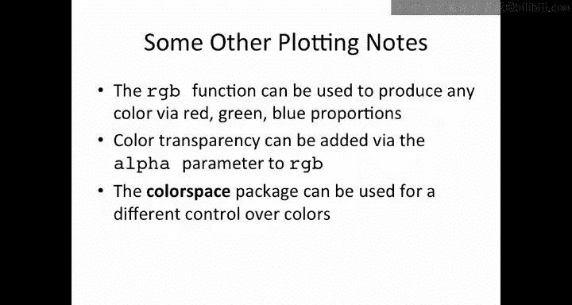
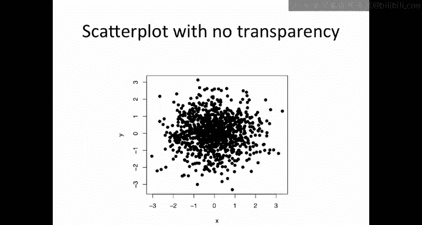
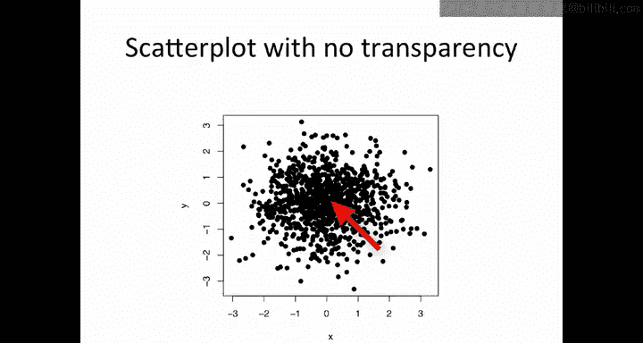
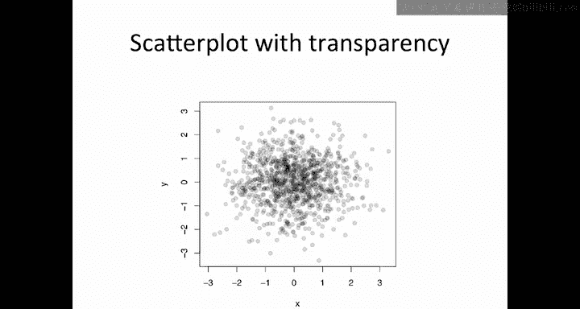

# 133：在R绘图中处理颜色（第四部分）🎨



在本节课中，我们将学习R语言中处理颜色的最后几个实用工具。我们将重点介绍`rgb()`函数，它允许我们通过红、绿、蓝三原色值来定义颜色，并可以添加透明度。此外，我们还将探讨如何利用透明度来增强高密度点图的视觉效果。

---

## 使用`rgb()`函数定义颜色

上一节我们介绍了预定义的颜色名称和调色板。本节中，我们来看看如何通过精确的数值来混合颜色。

`rgb()`函数接受红、绿、蓝三个参数，并返回一个十六进制的颜色字符串，该字符串可以传递给`image()`或`plot()`等绘图函数。


以下是该函数的基本用法：
```r
rgb(red, green, blue)
```
其中，`red`、`green`、`blue`是介于0到1之间的数字，分别代表红、绿、蓝的强度。

例如，要生成一个中等强度的灰色，可以使用：
```r
my_gray <- rgb(0.5, 0.5, 0.5)
```

---

## 为颜色添加透明度





`rgb()`函数还有一个非常有用的第四个参数——`alpha`。它用于控制颜色的透明度。

以下是带透明度参数的函数形式：
```r
rgb(red, green, blue, alpha)
```
其中，`alpha`参数同样是一个介于0到1之间的数字。**0代表完全透明**，**1代表完全不透明**。

通过调整`alpha`值，我们可以让颜色变得半透明，这在绘制重叠图形元素时特别有用。

---

## 透明度应用实例：高密度散点图

当散点图中包含大量数据点时，点与点之间会严重重叠，导致中心区域变成一片无法分辨的“黑块”，我们难以看清点的分布密度。

以下是解决此问题的一个简单示例。我们通过为点添加透明度，让重叠区域的颜色因叠加而变深，从而直观地展示出数据密度。



```r
# 生成示例数据
set.seed(123)
x <- rnorm(1000)
y <- rnorm(1000)

# 绘制带透明度的黑色散点图
plot(x, y, pch = 19, col = rgb(0, 0, 0, alpha = 0.2))
```
在这段代码中，`col = rgb(0, 0, 0, alpha = 0.2)` 定义了颜色为黑色，但透明度设置为0.2（即80%透明）。这样，点重叠越多的地方颜色就越深，形成了一种类似“廉价密度估计图”的效果，使我们能清晰地看到数据的高密度区和低密度区。

---

## 其他工具与总结

除了`rgb()`函数，还有一个名为`colorspace`的R包，它提供了另一种控制颜色的方式，允许你进行更专业的色彩空间操作。有兴趣的读者可以自行探索。

本节课中我们一起学习了：
1.  **`rgb()`函数**：用于通过红、绿、蓝数值精确创建颜色，其返回的十六进制字符串可直接用于绘图。
2.  **透明度（Alpha通道）**：通过`rgb()`函数的`alpha`参数为颜色添加透明度，**0为全透明**，**1为不透明**。这是澄清高密度点图、展示数据分布密度的强大工具。
3.  **实践应用**：在散点图中使用半透明颜色，可以让重叠点区域的颜色自然加深，从而直观地将数据密度可视化，这比一团模糊的黑点包含更多信息。

在绘图中审慎地使用颜色和透明度，无论是对于序列数据匹配渐变色，还是对于发散数据匹配对比色，都能让读者更容易理解你想表达的观点或进行的比较。`RColorBrewer`包及其相关的`colorRamp()`和`colorRampPalette()`函数，是处理这类任务的得力助手。