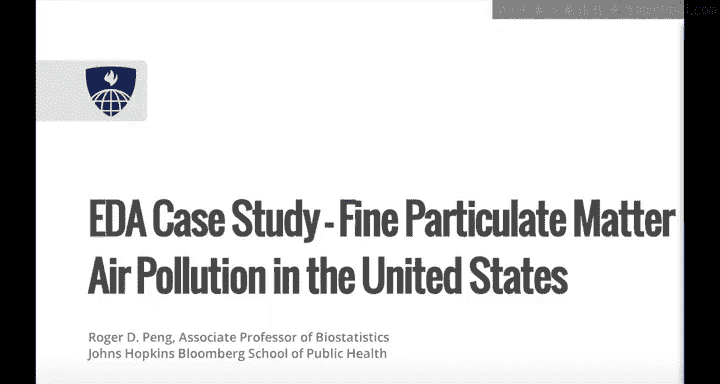
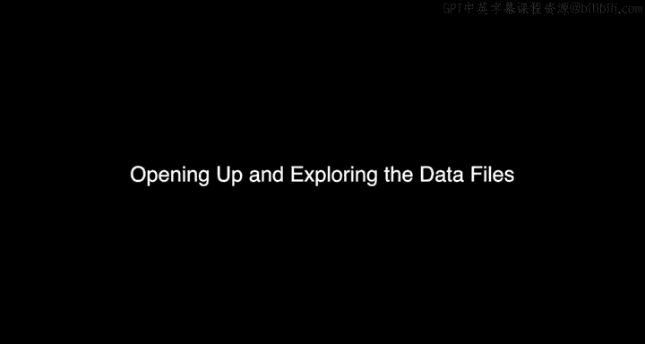
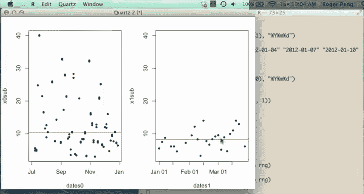
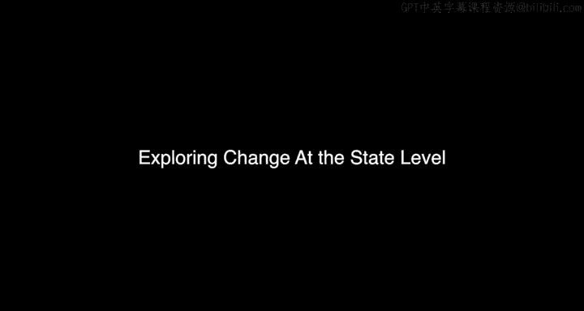
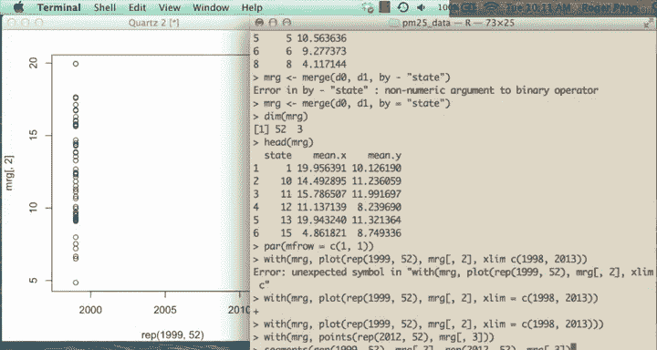

# 135：空气污染案例研究 📊



## 概述
在本节课中，我们将学习如何对一份真实的空气污染数据集进行探索性分析。我们将使用美国环境保护局（EPA）提供的细颗粒物（PM2.5）监测数据，来探究一个核心问题：**从1999年到2012年，美国的空气污染水平是否有所下降？** 我们将通过一系列基础的数据操作和可视化工具来逐步解答这个问题。

---

## 数据背景与问题定义
在开始分析任何数据之前，都需要明确我们想要回答的问题。这可以是一个具体的假设，也可以是一个宽泛的疑问。



我们使用的数据来自美国环境保护局，涉及全美范围内的空气污染监测。具体来说，我们关注的是空气中的细颗粒物（PM2.5）污染。颗粒物是空气中灰尘的统称，由于我们时刻都在呼吸，吸入这些颗粒物可能对公众健康产生影响。

过去几十年，美国的一项重要立法是《清洁空气法案》，其目的是降低美国的空气污染水平。因此，针对这类数据，一个基本的问题是：**现在的空气污染水平是否比过去更低？** 这是一个非常基础且宽泛的问题，我们可以从多种角度来审视它。在本案例中，我们将聚焦于PM2.5，这种污染物从1999年开始监测，一直持续至今。我们将比较1999年和2012年的数据，回答一个更具体的问题：**2012年的PM2.5平均水平是否低于1999年？**

美国环保局收集了所有相关数据并公开发布在其网站上，这为我们提供了便利。

---

## 数据获取与初步查看
首先，我们从EPA网站下载了1999年和2012年的PM2.5数据压缩包。原始文件包含一个`.txt`数据文件和一个`.pdf`说明文档。

让我们先查看一下1999年的原始数据文件。可以看到，文件中的每条记录占一行。第一行是表头，指明了各列的名称，各列之间用竖线 `|` 分隔。每条记录以“RD”开头，表示这是一种特定类型的记录。对我们最重要的列包括：州代码、县代码、站点ID、采样值（即PM2.5浓度，单位：微克/立方米）以及采集日期。

---

## 在R中读取数据
现在，我们启动R并开始读取数据。

首先读取1999年的数据。我们使用 `read.table` 函数，并指定分隔符为竖线 `|`，缺失值用空字符串表示。

```r
pm0 <- read.table("1999.txt", comment.char = "#", header = FALSE, sep = "|", na.strings = "")
```

检查数据维度，发现有约117,000行和28列。由于我们跳过了以 `#` 开头的表头行，所以目前列名是V1, V2等。我们需要从文件的第一行提取正确的列名。

```r
cnames <- readLines("1999.txt", 1)
cnames <- strsplit(cnames, "|", fixed = TRUE)[[1]]
names(pm0) <- make.names(cnames)
```

`make.names` 函数将列名中的空格等字符替换为点号，使其成为R数据框中有效的列名。

接下来，提取我们关心的PM2.5浓度数据，即 `Sample.Value` 列。

```r
x0 <- pm0$Sample.Value
summary(x0)
```

数据显示，中位数浓度为11.5微克/立方米，最大值达到157，并且存在约13,000个缺失值，约占11%。对于我们的宏观问题（全国平均水平是否下降），偶尔的缺失值可能影响不大，但这是分析中需要注意的一点。

现在，用同样的方法读取2012年的数据。

```r
pm1 <- read.table("2012.txt", comment.char = "#", header = FALSE, sep = "|", na.strings = "")
names(pm1) <- make.names(names(pm0)) # 使用相同的列名
x1 <- pm1$Sample.Value
```

2012年的数据量更大，约有130万条记录，但缺失值比例降至约5%。

---

## 全国水平的初步比较
让我们对两个年份的数据进行简单的数值比较。

```r
summary(x1)
summary(x0)
```

比较摘要统计量可以发现，2012年的PM2.5浓度中位数（约7.3）明显低于1999年的中位数（约11.5）。这初步表明全国平均水平有所下降。

为了更直观地比较，我们可以绘制箱线图。但由于数据存在严重的右偏（有很多高值），直接绘制效果不佳。

```r
boxplot(x0, x1)
```

我们发现2012年数据中存在一个异常高的值（909微克/立方米），这在美国非常罕见，可能是个错误或特殊事件。同时，箱线图因数据偏态而显得拥挤。我们可以通过对数变换来改善可视化效果。

```r
boxplot(log10(x0), log10(x1))
```

在对数尺度下，可以更清楚地看到2012年的数据中位数确实下降了，但数据的离散程度似乎有所增加。

此外，在2012年的数据摘要中，我们发现了负值。由于PM2.5是质量浓度，理论上不应为负。检查发现约有26,000个负值，约占2%。我们可以进一步探究这些负值是否与特定时间有关。

```r
negative <- x1 < 0
dates <- pm1$Date
dates <- as.Date(as.character(dates), "%Y%m%d")
hist(dates[negative], "month")
```

直方图显示，负值更多地出现在冬季月份（12月、1月、2月）。这可能是因为冬季污染水平较低，测量误差相对更明显。鉴于负值比例很小，我们暂时不深入处理。

---

## 深入分析：单个监测点的变化
全国水平的分析显示污染下降，但监测网络在十几年间发生了很大变化。为了更精确地比较，我们选择一个在1999年和2012年都存在的监测点，观察其浓度变化。

我们选择纽约州（州代码36）作为例子。首先，找出两个年份数据中都存在的监测点。

```r
site0 <- unique(subset(pm0, State.Code == 36, c(County.Code, Site.ID)))
site1 <- unique(subset(pm1, State.Code == 36, c(County.Code, Site.ID)))
site0$county.site <- paste(site0$County.Code, site0$Site.ID, sep = ".")
site1$county.site <- paste(site1$County.Code, site1$Site.ID, sep = ".")
both <- intersect(site0$county.site, site1$county.site)
```

共有10个监测点在两个年份都存在。我们选择其中一个观测次数较多的监测点（县代码63，站点ID 2008）进行深入分析。

```r
pm0_sub <- subset(pm0, State.Code==36 & County.Code==63 & Site.ID==2008)
pm1_sub <- subset(pm1, State.Code==36 & County.Code==63 & Site.ID==2008)
```

接下来，我们分别绘制这个监测点在1999年和2012年的PM2.5浓度随时间变化的散点图。为了公平比较，我们需要将两个图的y轴范围设置为一致。

```r
dates0 <- as.Date(as.character(pm0_sub$Date), "%Y%m%d")
x0_sub <- pm0_sub$Sample.Value
dates1 <- as.Date(as.character(pm1_sub$Date), "%Y%m%d")
x1_sub <- pm1_sub$Sample.Value

rng <- range(x0_sub, x1_sub, na.rm = TRUE)

par(mfrow = c(1, 2), mar = c(4, 4, 2, 1))
plot(dates0, x0_sub, pch = 20, ylim = rng, main = "1999")
abline(h = median(x0_sub, na.rm = TRUE))
plot(dates1, x1_sub, pch = 20, ylim = rng, main = "2012")
abline(h = median(x1_sub, na.rm = TRUE))
```

从图中可以清晰地看到两个现象：
1.  2012年的浓度中位数明显低于1999年。
2.  1999年的数据波动范围（特别是高值）远大于2012年。这意味着不仅平均水平下降了，极端的高污染事件也减少了。





---

## 州级水平的趋势分析
最后，我们不仅仅看全国或单个监测点，而是分析各个州的变化趋势。州一级是政策实施的关键单位，分析其趋势很有意义。

我们计算每个州在1999年和2012年的平均PM2.5浓度，然后将每个州的两个平均值用线段连接起来，形成“哑铃图”。

```r
mn0 <- with(pm0, tapply(Sample.Value, State.Code, mean, na.rm = TRUE))
mn1 <- with(pm1, tapply(Sample.Value, State.Code, mean, na.rm = TRUE))

d0 <- data.frame(state = names(mn0), mean = mn0)
d1 <- data.frame(state = names(mn1), mean = mn1)
mrg <- merge(d0, d1, by = "state")

par(mfrow = c(1,1))
with(mrg, plot(rep(1999, nrow(mrg)), mrg[, 2], xlim = c(1998, 2013), ylim = range(mrg[, 2:3])))
with(mrg, points(rep(2012, nrow(mrg)), mrg[, 3]))
segments(rep(1999, nrow(mrg)), mrg[, 2], rep(2012, nrow(mrg)), mrg[, 3])
```

从生成的图中可以看到，连接绝大多数州的线段都是向下倾斜的，表明大部分州的PM2.5平均水平在1999年至2012年间都有所下降。只有少数州的线段近乎水平或略有上升。这种可视化方法让我们能够一目了然地看到各州的改善情况。

---



## 总结
本节课中，我们一起完成了一个空气污染数据的探索性分析案例。我们试图回答的核心问题是：**美国的PM2.5水平在1999年至2012年间是否下降了？**

通过分析，我们得出了以下结论：
1.  **全国层面**：2012年的PM2.5浓度中位数明显低于1999年，表明整体水平下降。
2.  **单个监测点**：在纽约州一个长期存在的监测点，不仅平均水平下降，极端高值也显著减少。
3.  **州级层面**：通过“哑铃图”发现，美国绝大多数州的PM2.5平均水平在此期间都有所下降。

我们运用了数据读取、摘要统计、数据子集化、数据合并以及多种图形（箱线图、散点图、直方图、连接图）等基础工具，逐步深入地解答了问题。这个案例展示了探索性数据分析的基本流程：从提出一个简单问题开始，通过多角度、多层次的逐步探查，最终获得对数据的整体理解，并为后续更深入的分析指明方向。