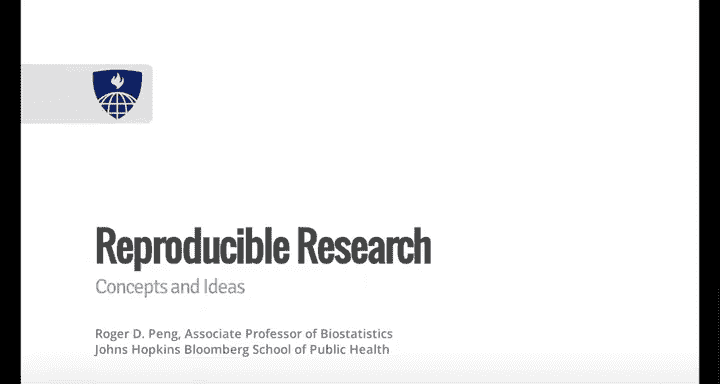
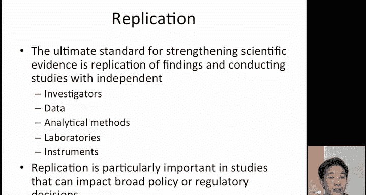
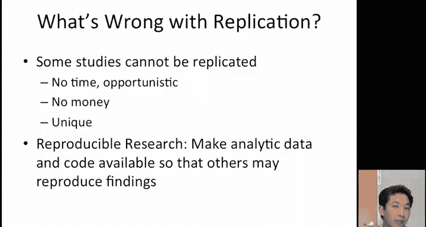
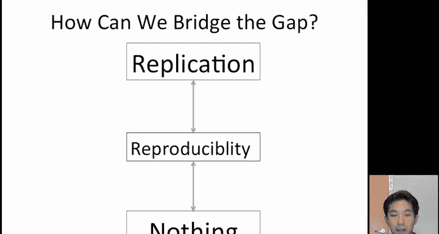
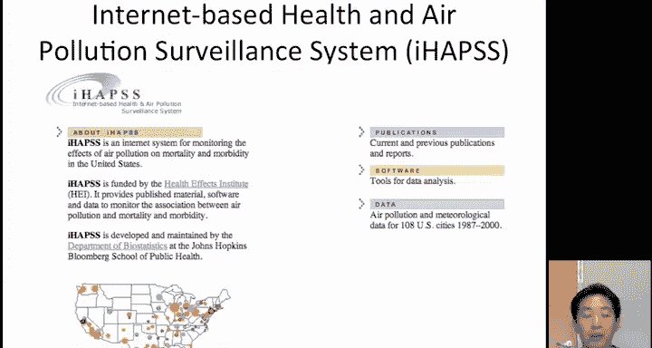

# 138：可重复研究的概念与思想（第一部分） 🧪

## 概述

在本节课中，我们将要学习**可重复研究**的基本概念和核心思想。我们将探讨为什么在科学研究中，验证和复制发现至关重要，以及当完全复制研究变得困难时，可重复性如何作为一种重要的中间标准。

## 科学证据的黄金标准：复制

上一节我们介绍了课程主题，本节中我们来看看科学验证的基石。

科学研究中，**复制**是验证和确认科学发现的最重要环节。其基本思想是：如果你声称X导致Y，或维生素C改善疾病，那么独立于原始研究人员的其他科学家会尝试调查相同的问题，看是否能得出相同的结果。如果许多不同的人都得出相同的结果并复制了原始发现，那么我们就有理由认为原始发现可能是真实的。

**公式**：`独立验证 → 相同结果 → 证据增强`

因此，加强科学证据的终极标准是复制。目标是让独立的人使用**不同的数据**、**不同的方法**和**在不同的实验室**进行独立研究，看是否能得到相同的结果。如果一个发现能经受住所有这些不同因素的考验，那么它就更可能是真实的，支持它的证据也就更强。

对于具有重大政策影响或影响监管决策的研究，复制尤为重要。

## 复制面临的挑战

既然复制如此重要，那它有什么问题吗？实际上，复制本身没有问题，这是科学数百年来一直在做的事情。但问题是，如今进行复制或复制其他研究正变得越来越具有挑战性。

以下是导致复制困难的一些原因：

*   **成本高昂**：研究规模越来越大，进行大规模研究需要大量资金。要做10个相同版本的研究，就需要10倍的资金，而资金并不总是那么充裕。
*   **时间漫长**：如果原始研究花了20年时间，那么再等20年进行复制就很困难。
*   **研究具有独特性**：有些研究针对的是特定时间、地点的独特情况或独特人群，无法轻易复制那种情境。

由于存在许多无法复制研究的合理原因，那么替代方案就是什么都不做，让那项研究独自成立吗？可重复研究背后的思想，就是在“完全复制”和“什么都不做”之间，建立一个最低标准或中间地带。

**公式**：`黄金标准（复制） <—— 中间地带（可重复性） ——> 最低标准（无验证）`

## 可重复性：连接复制与无验证的桥梁

上一节我们探讨了复制的困境，本节中我们来看看可重复性如何作为解决方案。

那么，为什么我们需要这个尚未明确定义的中间地带呢？基本思想是：你公开原始研究的数据和计算方法，以便其他人可以查看你的数据，运行你进行的分析，并得出与你相同的发现。

可重复研究在很大程度上是关于**数据分析的验证**。因为你没有使用独立的方法收集独立的数据，所以验证你所提出的问题本身会稍微困难一些。但是，如果你能获取某人的数据并重现他们的发现，那么你就在某种意义上验证了数据分析。

这涉及到拥有**数据**和**代码**。因为分析很可能是在计算机上使用某种编程语言（如R）完成的。如果你能使用他们的代码和数据，重现他们得出的发现，那么你至少可以确信分析是恰当进行的，并且使用了正确的方法。

## 推动可重复性需求的趋势

是什么在推动这种介于复制和无所作为之间的可重复性需求呢？在许多不同领域，包括生物学、化学、环境科学等，出现了大量新技术。

以下是驱动可重复性需求的几个关键趋势：

*   **数据生成技术**：这些技术使我们能够以更高的通量收集数据，从而几乎即时地获得非常复杂和高维的数据集，这与仅仅10年前相比是巨大的飞跃。
*   **计算能力**：计算能力使我们能够合并现有数据库，创建更大规模的新数据库，并执行更复杂的分析。我们拟合的模型和编写的算法比过去复杂得多。
*   **计算学科的兴起**：所有这些趋势的最终结果是，对于每个领域X，现在都有**计算X**，例如计算生物学、计算天文学等。

## 案例研究：空气污染与健康研究

为了具体说明，我们来看一个来自我研究领域的例子：空气污染与健康。这个领域汇集了使可重复性变得至关重要的几个特点：

1.  **信号微弱但影响重大**：我们估计的是非常微小但对公共卫生非常重要的效应，而这些效应存在于更强烈的信号背景中。
2.  **影响重大政策**：许多空气污染研究的结果为重大的政策决策提供信息，该领域的科学研究是制定法规的基础。这些法规可能影响众多利益相关者，并耗费数十亿美元来实施。
3.  **方法复杂**：我们使用许多复杂的统计方法进行研究，这些方法受到严格审查。

微弱的内在信号、巨大的影响和复杂的统计方法这三者的结合，几乎要求我们所做的研究必须是可重复的。

因此，我们在约翰霍普金斯大学创建了“基于互联网的健康与空气污染监测系统”。我们公开了大量数据，并以代码形式提供了许多统计方法，以便他人审查，并且我们产生的许多数据和结果可以被他人重现。

## 总结

本节课中我们一起学习了可重复研究的基本概念。我们了解到**复制**是科学验证的黄金标准，但由于成本、时间和研究独特性等原因，完全复制常常面临挑战。因此，**可重复性**作为一种重要的中间标准应运而生，它通过公开**数据**和**分析代码**，允许他人验证数据分析过程本身。现代数据技术的爆炸式增长和计算能力的提升，使得在各个领域推行可重复研究变得愈发重要，尤其是在像空气污染与健康这样涉及微弱信号、重大政策和复杂方法的领域。