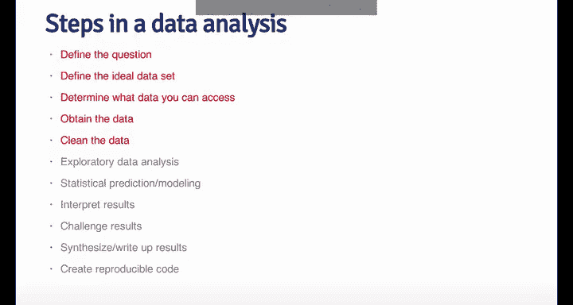
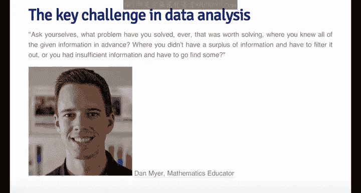
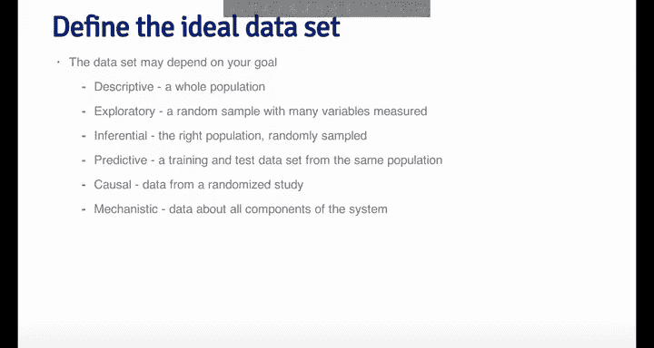
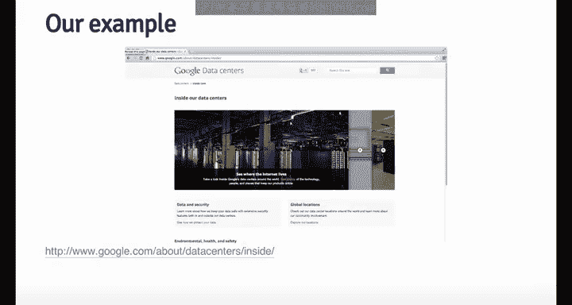
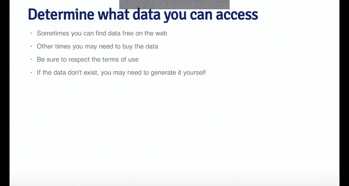
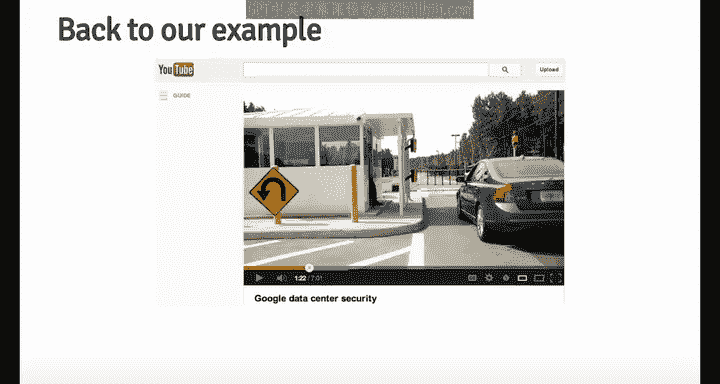
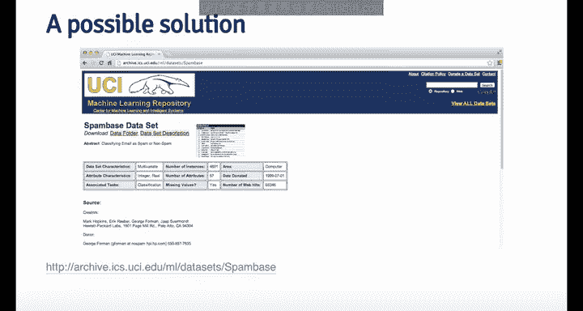
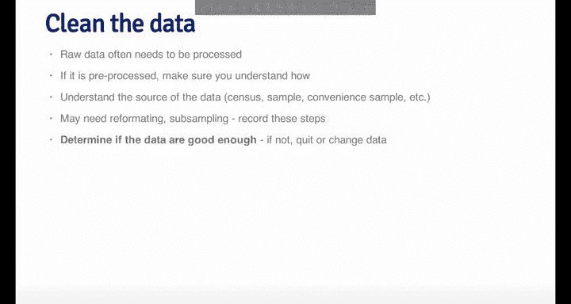
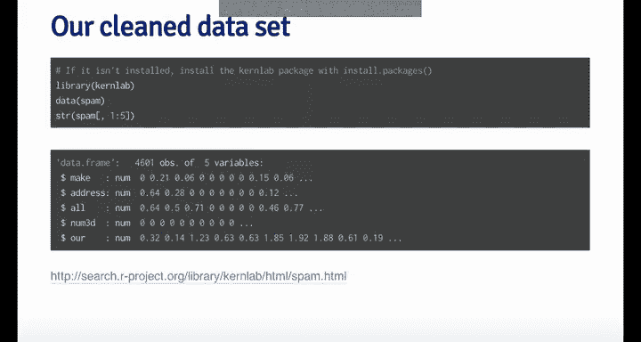

# 142：数据分析的结构（第 1 部分）📊

在本节课中，我们将学习数据分析的基本流程。虽然并非所有分析都完全相同，但了解其核心组成部分及其通常如何衔接，将为我们提供一个有用的模板。



## 概述

数据分析是一个结构化的过程。我们将分两部分来探讨其核心步骤。在第一部分中，我们将重点介绍如何定义问题、确定理想数据集、评估实际可获取的数据、获取数据以及清理数据。



## 定义问题 ❓

上一节我们介绍了数据分析的整体框架，本节中我们来看看第一步：定义问题。并非所有分析都始于一个非常具体或连贯的问题，但投入精力提出一个合理的问题，将能减少后续筛选信息的工作量。

定义问题是你能使用的最强大的降维工具。例如，如果你只关心身高或体重，就可以忽略许多与此无关的变量。因此，尽可能具体地界定问题，有助于减少处理大规模数据时的“噪音”。有时你可能只是想探索数据，但若能明确目标，将极大地简化问题。

科学背景通常决定了你想提出的问题类型，这进而引导你寻找数据、应用统计方法进行分析。如果目标远大，你甚至可能想发展一些理论统计方法来推广你的方法。不过，这部分（统计方法开发）通常只有少数人能完成。

需要警惕的是，如果脱离科学背景，仅仅为了寻找“有趣”的结果而随意对数据应用统计方法，这可能会得出不可复现或无意义的结论。一个恰当的数据分析应始于科学问题，并应用合适的统计方法。

让我们从一个基本问题开始：**“能否自动检测电子邮件是否为垃圾邮件？”** 这是一个重要问题。为了将其转化为数据分析问题，我们需要使其更具体。一个更具体的版本是：**“能否利用电子邮件本身的量化特征，将其分类为垃圾邮件（Spam）或正常邮件（Ham）？”** 这样，我们就可以开始寻找用于分类的量化特征了。

## 确定理想数据集 📁

一旦明确了问题，接下来就需要思考：解决这个问题，理想的数据集是什么样的？如果你拥有世界上所有的资源，你会去寻找什么？

根据问题的目标和类型，理想的数据集可能不同：
*   **描述性问题**：可能需要获取整个总体（Population），例如所有电子邮件。
*   **探索性问题**：可能只需要一个包含多个变量的随机样本。
*   **推断性问题**：必须仔细考虑抽样机制和总体定义，因为你要从样本推断总体。
*   **预测性问题**：需要来自目标总体的训练集和测试集，以构建模型或分类器。
*   **因果性问题**：需要实验数据，例如来自随机对照试验的数据。
*   **机制性问题**：需要关于系统中所有组成部分的数据。

对于我们的垃圾邮件分类问题，一个理想的数据集可能是：**获取谷歌数据中心所有的电子邮件**。这将是一个完整的总体，我们可以基于所有数据构建分类器，而无需担心抽样问题。

## 确定实际可获取的数据 🔍

当然，在现实世界中，我们必须考虑实际能获取哪些数据。也许谷歌内部人员可以访问所有Gmail邮件，但即便如此也可能很困难，更何况大多数人无法获取。

因此，有时你不得不退而求其次，选择非理想的数据。你可能需要在网上寻找免费数据，或从提供商处购买数据。在这些情况下，务必遵守数据的使用条款。如果所需数据根本不存在，你可能需要自己生成数据。

获取谷歌的所有数据很可能不现实。一个可行的替代方案来自**UCI机器学习库**中的垃圾邮件数据集。这个数据集由惠普的研究人员创建，包含数千条已分类的垃圾邮件和正常邮件，可用于探索我们的分类问题。



## 获取数据 📥

获取数据时，首要目标是尝试获取原始数据。例如，从UCI机器学习库获取。必须谨慎地注明数据来源，并记录其出处。



如果你需要从不熟悉的研究者那里获取数据，一封礼貌的电子邮件通常很有帮助。如果数据来自网络，至少应记录**URL（网址）**和**访问日期时间**，以便未来追溯。网站可能会关闭或变更，但你的记录提供了获取时的快照。

在本例中，由于无法访问谷歌数据中心，我们将使用R语言`kernlab`包中自带的垃圾邮件数据集。安装该包后，即可直接加载数据。





## 清理数据 🧹



获取数据后，通常需要先进行清理。原始数据往往需要经过处理，才能用于建模或分析。

如果数据已经过预处理，了解其预处理方式和步骤至关重要。你需要知道数据的来源（例如，来自调查、观察性研究还是实验），以及抽样方式。有时，你可能需要重新格式化数据以适应特定的分析工具。对于极大的数据集，可能需要进行子抽样以使其更易于管理。

**记录所有数据清理步骤至关重要**。你应该将这些步骤写在脚本或文档中，以便你或他人未来能够复现你的分析结果。如果缺乏记录，将无人能够复现你的发现。

清理数据并初步查看后，需要判断数据是否足以解决你的问题。有时数据可能不够好：样本量不足、变量不够、抽样方式不适用于你的问题等。如果确定数据不足以支撑你的问题，那么应该停止、重试、更换数据或调整问题。不要仅仅因为手头只有这些数据就强行推进，这可能导致不恰当的推断或结论。

以下是我们将在本例中使用的已清理数据集（来自`kernlab`包），这里展示了前五个变量：

```r
library(kernlab)
data(spam)
head(spam, n=5)
```

该数据集包含4601条观测和多个变量（此处仅显示前5个）。你可以通过R中的`?spam`命令查看数据集的帮助页面，了解其来源和处理方式。

## 总结



在本节课的第一部分，我们一起学习了数据分析流程的前半部分。我们从**定义具体、可操作的问题**开始，这是降维和聚焦的关键。接着，我们探讨了针对不同类型问题所需的**理想数据集**，并认识到现实约束下往往需要寻找**实际可获取的数据**替代方案。然后，我们介绍了**获取数据**时的注意事项，如记录来源。最后，我们强调了**清理数据**的重要性，包括处理原始数据、理解预处理步骤、记录所有操作，并评估数据是否足以回答初始问题。



这些步骤为进行严谨、可复现的数据分析奠定了坚实的基础。在下一部分，我们将继续探讨后续的分析步骤。