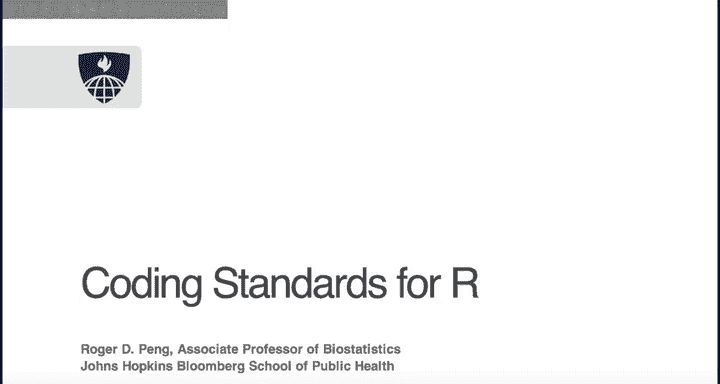
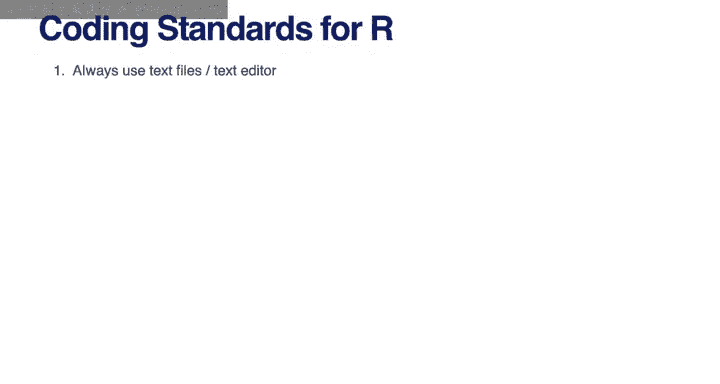
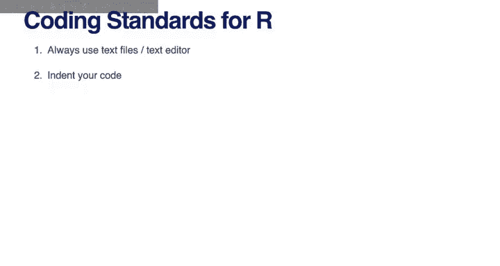
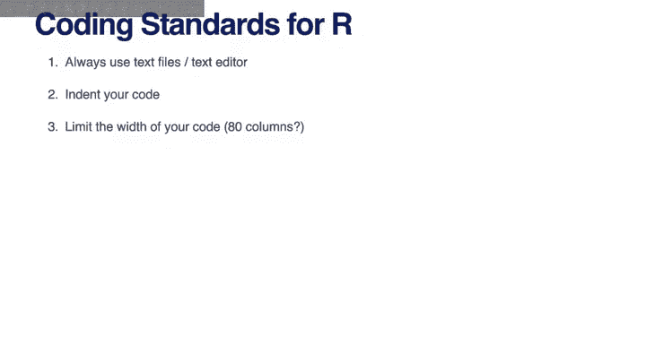
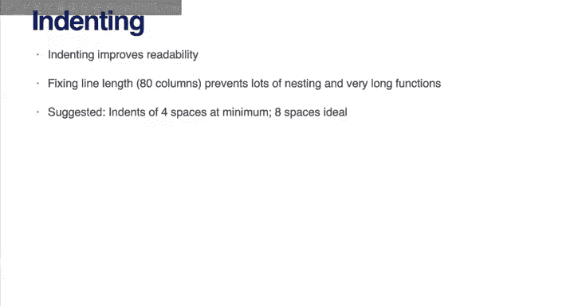
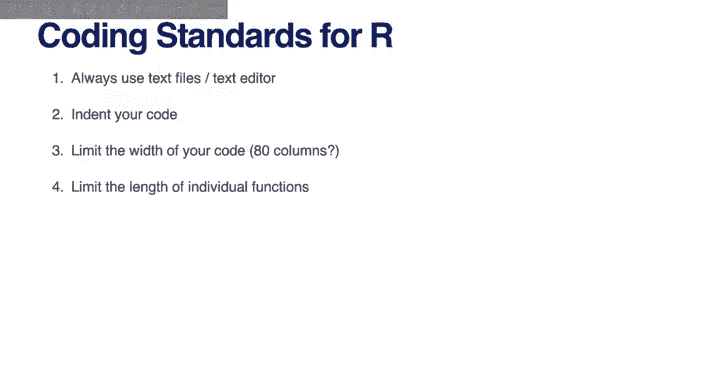

# 145：R语言编码标准 📝



在本节课中，我们将学习R语言编程中的编码标准。编码标准对于编写清晰、可读且易于维护的代码至关重要。我们将探讨几个核心原则，帮助你养成良好的编程习惯，使你的代码不仅自己能看懂，也能方便他人阅读和使用。

---

## 1. 使用文本编辑器 📄

在任何编程语言中，包括R语言，首要原则是**始终使用文本编辑器编写代码，并将其保存为文本文件**。

文本文件是一种基本标准格式，通常不包含任何特殊格式或样式，只是纯文本。它通常采用ASCII编码，但在非英语地区也可能使用其他标准文本格式。关键在于，文本格式可以被现今几乎所有基本的编辑程序读取。

当你编写书籍或网页等内容时，可以使用多种不同的工具。然而，编写代码时，应尽量使用文本编辑器。这是最通用的工具，能确保所有人都能访问你的代码，并在此基础上进行改进。



---

## 2. 缩进你的代码 ↔️

上一节我们介绍了代码的存储格式，本节中我们来看看如何提升代码的可读性。第二个对可读性至关重要的原则是**缩进你的代码**。

缩进是指在代码块右侧增加空格，使其比周围的代码更靠右。通过缩进，你可以仅凭视觉就能理解程序的控制流和结构。关于缩进多少合适，在各类讨论中常有激烈争论。虽然我也有一些建议，但最重要的是理解缩进为何重要。





以下是缩进的基本原则：
*   缩进使代码块的层级关系一目了然。
*   它有助于区分函数、循环和条件语句的开始与结束。

---

## 3. 限制代码宽度 📏

与缩进紧密相关的是第三个原则：**限制代码的宽度**。

如果你不断缩进，代码可能会无限地向右侧延伸。因此，你需要限制代码在右侧的宽度。这通常通过限制文本列数来实现。一种常见的做法是将文本限制在大约80列，确保代码宽度不会超过这个限制。

让我们来看一个快速示例。

---

## 4. 示例：调整缩进与宽度

以下是在RStudio中调整缩进和查看边距的示例。

```r
# 初始代码：缩进为1个空格，难以阅读
my_function <- function(x) {
if (x > 0) {
print("Positive")
} else {
print("Non-positive")
}
}



# 在RStudio中，通过“Preferences” -> “Code Editing”可以调整：
# 1. 将“Tab width”设置为4或8（推荐至少4个空格）。
# 2. 确保“Show margin”已勾选，并设置为80字符。
# 3. 使用快捷键（如Cmd+A全选，然后Cmd+I自动缩进）重新格式化代码。

# 调整后（例如使用8空格缩进）的代码结构更清晰：
my_function <- function(x) {
        if (x > 0) {
                print("Positive")
        } else {
                print("Non-positive")
        }
}
```

将缩进设置为至少4个空格（我个人偏好8个空格），并配合80字符的右侧边距，有两大好处：
1.  **提升可读性**：代码结构变得非常明显，间距清晰。
2.  **引导更好的设计**：例如，使用8空格缩进时，嵌套的循环或条件语句会迅速接近80字符的边界。这迫使你思考是否嵌套过深，从而鼓励你将复杂逻辑拆分成独立的函数，这本身就是一种良好的编程实践。

---

## 5. 限制函数长度 ⚙️

最后，我们来讨论如何组织代码逻辑。第四个原则是**限制函数的长度**。

R语言中的函数理论上可以写得很长。但合理的做法是，**让一个函数只完成一项基本的、逻辑独立的活动**。



例如，如果你的函数名为 `read_data`，那么它就应该只负责读取数据，而不应该同时处理数据、拟合模型和打印输出。这类逻辑上独立的步骤应该被拆分成多个函数。

将代码拆分成逻辑独立的函数有几个优点：
*   **一目了然**：单个函数能在一屏内显示，便于整体理解其功能。
*   **利于调试**：当你使用 `traceback`、性能分析器或调试器时，它们会指出问题发生在函数调用栈的哪个位置。如果函数逻辑清晰且分离，你就能快速定位到出问题的具体函数。如果一个函数冗长无比，调试器只能告诉你这个函数有问题，却难以精确定位。

当然，也要避免过度拆分，比如创建十个只有三行的函数。目标是让函数的分离符合逻辑，并且每个函数专注于完成一件特定的事情。

---

## 总结 🎯

本节课中我们一起学习了R语言编码的四个核心标准：

1.  **使用文本编辑器**：确保代码的通用性和可访问性。
2.  **进行代码缩进**：使用至少4个空格（推荐8个）来明确代码结构。
3.  **限制代码宽度**：建议不超过80字符，提升可读性并引导更好的代码设计。
4.  **限制函数长度**：让每个函数专注于单一逻辑任务，提升可读性和可调试性。

遵循这些基本原则，你的代码将变得更加清晰、易读，无论是对于你自己还是其他协作者，都将大大提高R语言编程的效率和实用性。