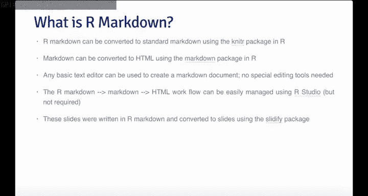

# 147：R Markdown 简介 🧑‍💻


在本节课中，我们将要学习 **R Markdown** 的基本概念。这是一种将 R 代码与文档撰写相结合的工具，能够帮助我们创建包含动态代码和结果的报告。

## 概述

R Markdown 的核心思想是将 **R 语言** 与 **Markdown 轻量级标记语言** 结合起来。它允许我们在编写文档时，直接嵌入可执行的 R 代码块。当文档被编译时，这些代码会自动运行，并将结果（如表格、图表）插入到最终生成的报告中。这确保了文档中的代码示例和结果是准确且可复现的。

## 什么是 Markdown？

上一节我们介绍了 R Markdown 的核心理念，本节中我们来看看它的基础之一：Markdown。

Markdown 是一种非常简单的标记语言。它的设计哲学是让作者能够专注于写作内容本身，而不是复杂的格式排版。与 HTML、LaTeX 或 XML 等语言相比，Markdown 的语法极其简洁直观。

以下是 Markdown 的一些基本格式化元素：
*   **粗体文本**：用 `**文本**` 表示。
*   **章节标题**：用 `#` 的数量表示层级，例如 `# 一级标题`。
*   **列表**：用 `-` 或 `*` 创建无序列表。

Markdown 的一个优点是它可以轻松转换为 HTML 等多种格式。如果需要更复杂的格式，你甚至可以直接在 Markdown 文档中插入 HTML 代码。

## 什么是 R Markdown？

了解了基础的 Markdown 后，本节我们来看看 R Markdown 如何将代码与文档融合。

R Markdown 本质上是在 Markdown 文档中嵌入了 R 代码。它的文件通常使用 `.Rmd` 作为扩展名。文档看起来像标准的 Markdown，但其中会包含被称为 **代码块** 的特殊部分。

代码块由特定的格式标签标识，例如：
```r
# 这是一个 R 代码块
x <- 1:10
mean(x)
```
当处理 R Markdown 文档以生成最终报告（如 HTML）时，这些代码块会被执行，运行结果（如计算结果、生成的图表）会直接插入到输出文档中。这样做的一个主要好处是，你能确保文档中展示的代码是有效的，因为如果代码无法运行，文档就无法成功生成。

## 工作流程与工具

现在我们已经知道 R Markdown 是什么，本节中我们来了解一下如何使用它。

处理 R Markdown 文档的核心工具是 R 中的 **knitr** 包。基本工作流程分为三步：
1.  编写核心的 `.Rmd` 源文件，其中包含 Markdown 文本和 R 代码块。
2.  使用 **knitr** 包处理 `.Rmd` 文件。它会执行其中的 R 代码，并将结果与文本合并，生成一个纯 `.md` 格式的 Markdown 文件。
3.  使用 **markdown** 包（或类似工具）将上一步生成的 `.md` 文件转换为最终的 `.html` 网页文件。

在整个流程中，你只需要编辑最初的 `.Rmd` 源文件，而无需修改中间生成的 `.md` 文件或最终的 `.html` 文件。

如果你使用 RStudio 集成开发环境，这个过程会更加简便。RStudio 内置了对 knitr 和 markdown 的支持，甚至包含一个网页浏览器来预览最终生成的 HTML 报告，从而将整个工作流无缝地管理起来。

## 总结



本节课中我们一起学习了 R Markdown 的基础知识。我们了解到 R Markdown 是 **R 代码** 与 **Markdown 标记语言** 的结合，用于创建动态、可复现的报告。我们介绍了其简洁的语法、核心的工作流程，以及如何使用 **knitr** 等工具来编译文档。通过 R Markdown，你可以确保文档中的代码示例始终有效，并轻松生成格式优美的最终报告。