# 148：R Markdown 演示 🧑‍💻

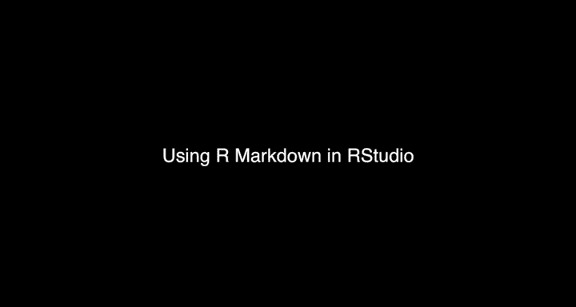

在本课程中，我们将学习如何创建和编辑一个 R Markdown 文档。R Markdown 是一种将 R 代码、分析结果和文本叙述结合在一起的强大工具，可以生成格式优美的报告。

## 概述

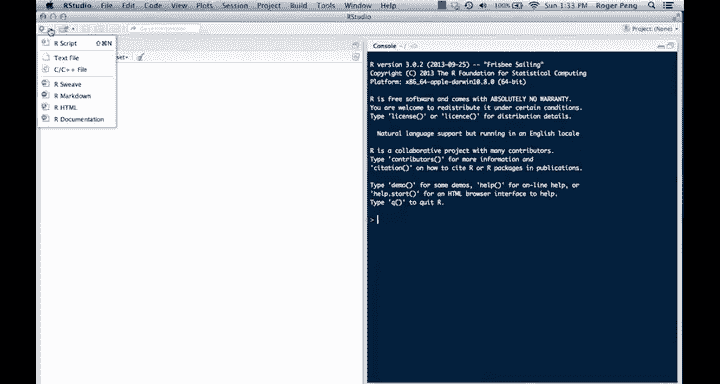

我们将从零开始，演示在 RStudio 中创建 R Markdown 文件、编写内容、嵌入 R 代码块，并最终将其“编织”成 HTML 格式报告的全过程。

---

## 创建新文档

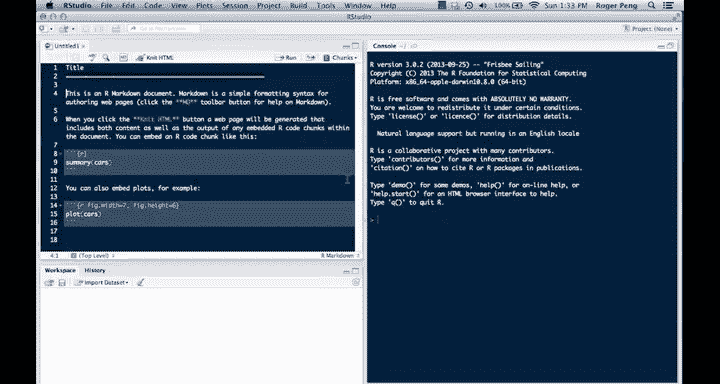

首先，我们需要在 RStudio 中创建一个新的 R Markdown 文档。

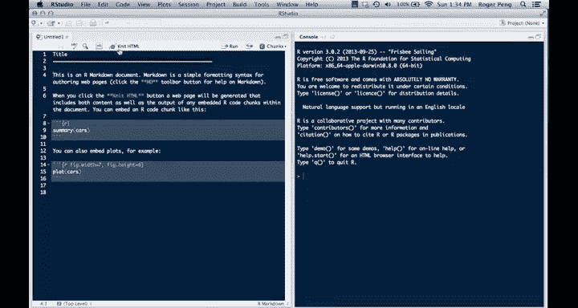

以下是具体步骤：
1.  在 RStudio 菜单栏中，点击 **File**。
2.  选择 **New File**。
3.  从下拉菜单中选择 **R Markdown...**。

此时，RStudio 会自动在新文档中填充一些示例内容，帮助你快速入门。

---

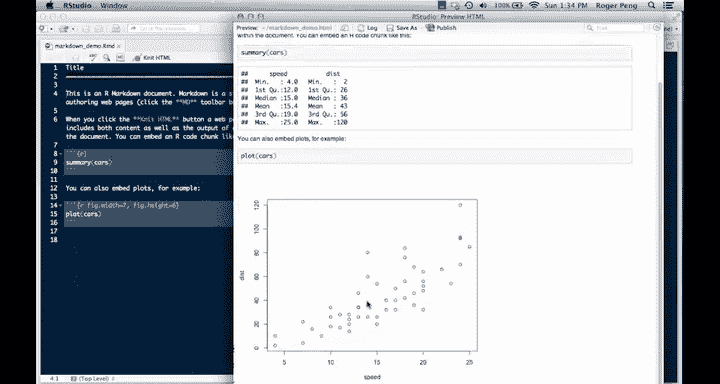

## 编织文档


上一节我们创建了文档，本节中我们来看看如何生成最终的报告。

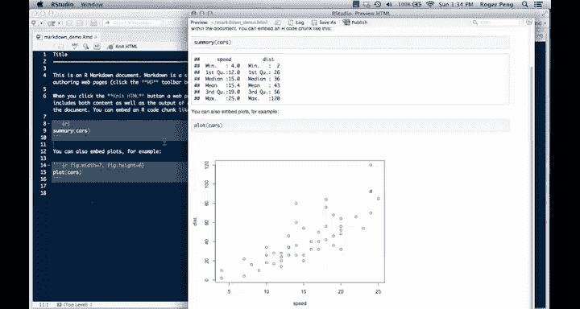

“编织”是将 R Markdown 文档转换为最终输出格式（如 HTML、PDF）的过程。它会执行文档中的所有 R 代码，并将结果嵌入到生成的文档中。

点击编辑器上方的 **Knit** 按钮（通常显示为“Knit to HTML”）。首次编织时，系统会提示你保存文件。将文件命名为 `Markdown_demo.Rmd` 并保存。

编织过程完成后，RStudio 会打开一个预览窗口，显示生成的 HTML 报告。你可以看到，标题、文本、R 代码及其输出（包括图表）都被整合到了一个整洁的文档中。

---

## 编辑文档内容

生成的示例文档并非我们所需，因此需要对其进行编辑。我们将学习如何编写自己的标题、文本和 R 代码块。

首先，删除文档中的示例内容。然后，我们可以开始构建自己的报告。

### 添加标题和文本

在文档顶部，输入你的标题，例如：
```
My First R Markdown File
========================
```
在标题下方输入普通文本，例如：
```
This is my first R Markdown file. Here we are going to load some data.
```

### 插入 R 代码块

R 代码需要被包裹在特定的代码块中。以下是插入代码块的方法：
1.  使用三个反引号 ``` 开始一个代码块。
2.  在花括号 `{}` 内指定语言为 `r`，即 `{r}`。
3.  在代码块内编写你的 R 代码。
4.  使用三个反引号 ``` 结束代码块。

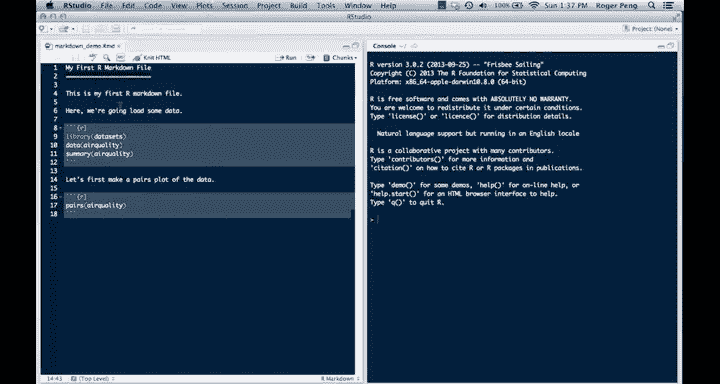

例如，以下代码块加载 `airquality` 数据集并生成摘要：
```{r}
library(datasets)
data(airquality)
summary(airquality)
```

在代码块之后，可以添加描述性文本，例如：“接下来，我们将绘制数据的散点图矩阵。”

---

## 添加更多分析与输出

现在，让我们为报告添加更多分析内容，例如绘制图表和拟合回归模型。

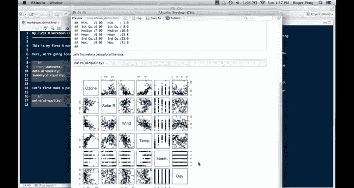

### 绘制散点图矩阵

我们可以在一个新的 R 代码块中创建可视化图表。

以下是具体代码：
```{r}
pairs(airquality)
```
这段代码将对 `airquality` 数据框中的所有变量生成两两关系的散点图矩阵。

### 拟合回归模型

最后，我们可以添加一个回归模型来分析变量之间的关系。

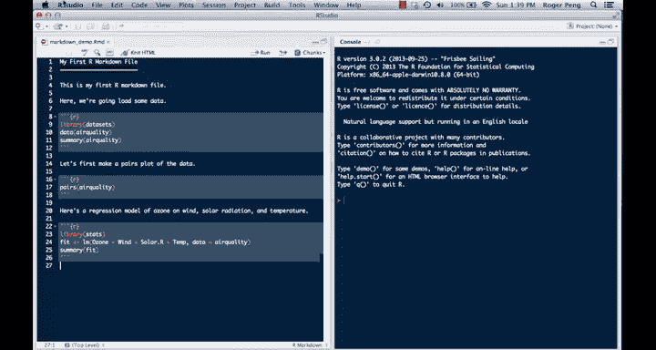

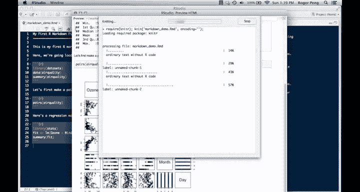

以下是拟合模型的代码：
```{r}
library(stats)
fit <- lm(Ozone ~ Wind + Solar.R + Temp, data = airquality)
summary(fit)
```
这段代码拟合了一个以臭氧浓度为因变量，以风速、太阳辐射和温度为自变量的线性回归模型，并输出了模型摘要。

保存文件并再次点击 **Knit** 按钮。在生成的 HTML 报告中，你将依次看到数据摘要、散点图矩阵和回归分析结果。

---

## 其他格式元素

除了上述基础元素，R Markdown 还支持列表等格式，以增强报告的可读性。

例如，要创建一个无序列表，只需在每行前加上 `-` 或 `*` 号：
```
- 第一项
- 第二项
- 第三项
```
编织后，这些行将显示为带项目符号的列表。

你还可以在文档中嵌入原始 HTML 或 LaTeX 代码，用于添加更复杂的格式或数学公式。

---

## 总结

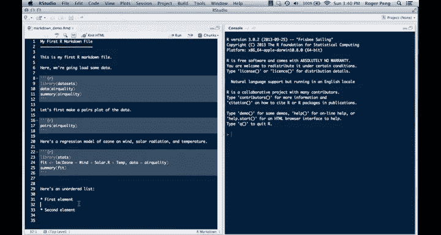

本节课中我们一起学习了 R Markdown 的基本工作流程。我们掌握了如何创建新文档、编写文本和 R 代码块、通过“编织”生成最终报告，以及添加列表等基本格式。R Markdown 的核心在于将分析代码、结果和文字叙述无缝整合，实现可重复的研究报告。请尝试在 RStudio 编辑器中创建你的第一个 R Markdown 文件，并探索其各种功能。