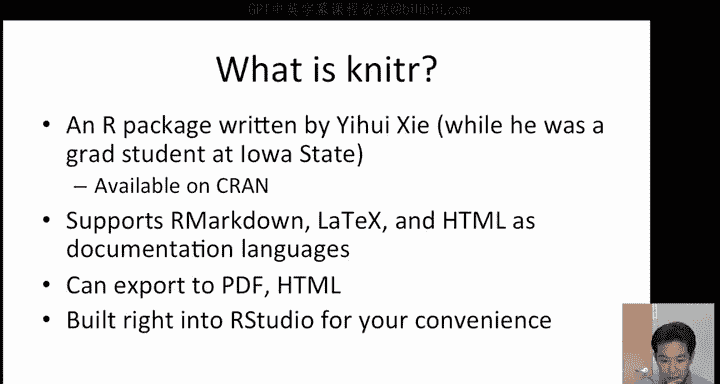
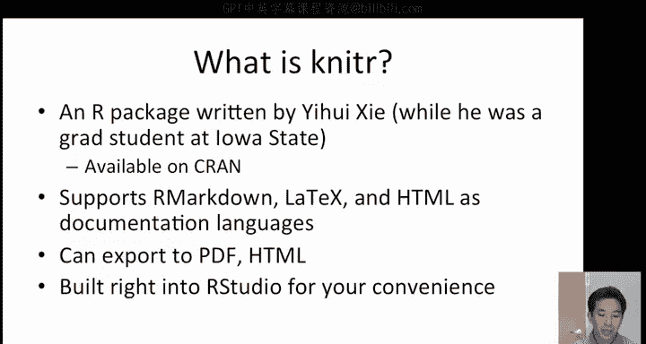
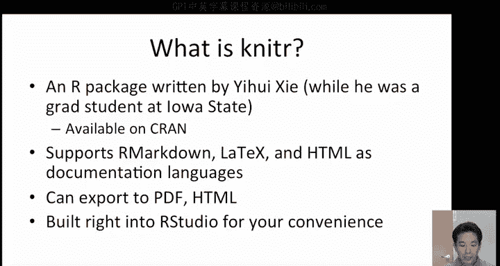
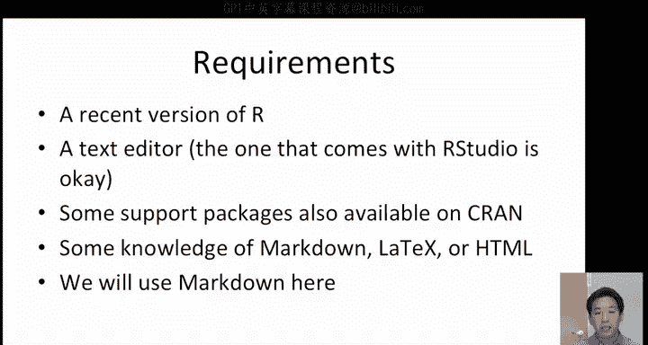
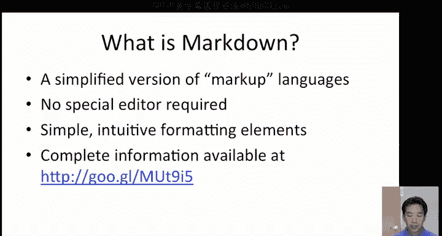
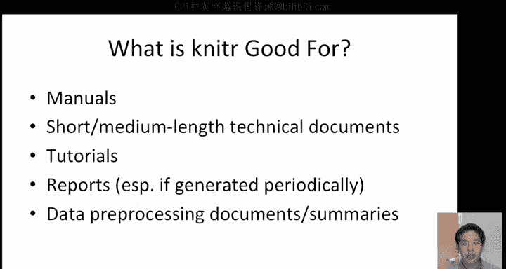
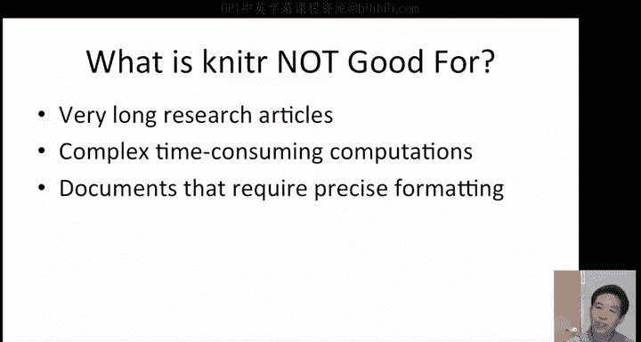
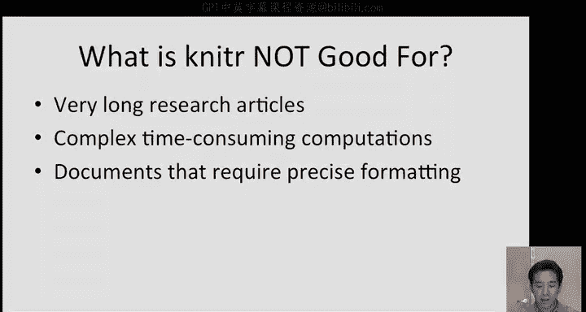

# 150：knitr 工具详解（第二部分）🔧

在本节课中，我们将深入探讨 `knitr` 工具，了解它是什么、如何工作以及它的适用场景。我们将学习如何使用 `knitr` 创建可重复性文档，并理解其核心概念。

---

## 什么是 knitr？🤔

`knitr` 是一个可以帮助你创建可重复性文档的工具。它是一个由爱荷华州立大学研究生谢益辉编写的 R 语言包。你可以在 CRAN 上找到它。如果你使用 RStudio，`knitr` 实际上已经内置在 RStudio 中，并集成到图形用户界面里。因此，如果你使用 RStudio，你无需单独安装它。

`knitr` 支持多种文档语言，包括 **R Markdown**、LaTeX 和 HTML。这三种是常用的文档语言。它可以将文档导出为 PDF 和 HTML 格式，你还可以使用 Pandoc 等外部工具将其导出为其他格式。正如刚才提到的，为了方便用户，`knitr` 已直接集成到 RStudio 中。

---

## 使用 knitr 需要什么？📋

要使用 `knitr`，你需要满足以下条件：

1.  **一个较新版本的 R**：确保你的 R 版本足够新。
2.  **一个文本编辑器**：你可以使用 R 自带的编辑器，或者任何你习惯的文本编辑器。
3.  **一些支持包**：这些包可以从 CRAN 获取。如果你使用 `install.packages()` 函数，它们会自动下载。
4.  **掌握一种文档语言的知识**：你需要了解 R Markdown、LaTeX 或 HTML 中的至少一种。本教程将重点介绍 Markdown，因为它是一种相对简单易懂的语言。

---

## 什么是 Markdown？📝

Markdown 是常见标记语言的简化版本。LaTeX 和 HTML 可以被视为标记语言，你在普通文本中添加标签和其他类型的注释，以指示你希望对文本进行的操作。标记语言的一个问题是，它们可能因为包含大量标签而难以阅读，这些标签有时会掩盖实际文本内容。

Markdown 的目的就是简化这一切，使文本本身易于阅读，同时只需在文档中输入少量格式化元素。它不需要特殊的编辑器，只需一个标准的文本编辑器即可。它具有简单直观的格式化元素。你可以在这个网站上找到所有相关文档。

---

## knitr 擅长做什么？✨

在创建可重复性文档方面，我个人认为 `knitr` 非常适用于以下场景：

*   **手册**：如果你想指导某人如何使用某个软件。
*   **短篇或中篇技术文档**：用于解释某些技术概念。
*   **教程**：这类似于手册，但可能更深入，是关于某个主题的教程。
*   **报告**：报告尤其有用。例如，如果你需要每周基于某个数据库或数据集生成报告，或者你在进行一项研究，不断有受试者加入，你可能需要每周生成一份包含研究摘要统计数据的报告。这类“活”文档非常有用，因为你可以随着文档的生成重新计算所有摘要统计数据，无需手动操作后再单独插入报告中。
*   **数据预处理**：通常，在预处理数据以创建干净数据集时，创建一个 `knitr` 类型的文档会很有帮助。在这个文档中，你可以记录对数据集进行的所有清理操作，例如移除异常值、填充缺失数据、转换变量等。所有这些都可以在这种 `knitr` 风格的文档中记录下来，你可以在其中同时说明你做了什么，并在代码中实际执行这些操作。

---

## knitr 不擅长做什么？🚫

在我看来，`knitr` 不太适合以下情况：

*   **非常长的研究文章**：如果你正在撰写一篇非常复杂、涉及大量分析的文章，因为所有内容都存储在一个文档中，当代码和文本都很多时，编辑这个文档可能会变得有些混乱。
*   **计算非常复杂或耗时**：如果你的计算非常耗时，`knitr` 通常不是一个好的选择，因为每次你想查看文档时都必须重新编译它，这会使整个过程变慢。
*   **需要非常精确格式化的文档**：如果你的文档需要特殊的布局，比如图片必须放在这里，文本必须放在那里等，`knitr` 也不是一个非常理想的工具，因为它的格式化往往非常临时性。

---

## 总结 📚

本节课我们一起学习了 `knitr` 工具。我们了解到 `knitr` 是一个用于创建可重复性文档的 R 包，它支持 R Markdown、LaTeX 和 HTML 等语言，并能方便地集成在 RStudio 中使用。我们明确了使用 `knitr` 所需的环境和知识，并介绍了其底层常用的 Markdown 语言。最后，我们探讨了 `knitr` 最适合的应用场景（如报告、教程、数据预处理）以及其不太适用的领域（如超长文章、复杂计算、精密排版）。理解这些将帮助你更有效地利用 `knitr` 来提升数据分析工作的可重复性和效率。